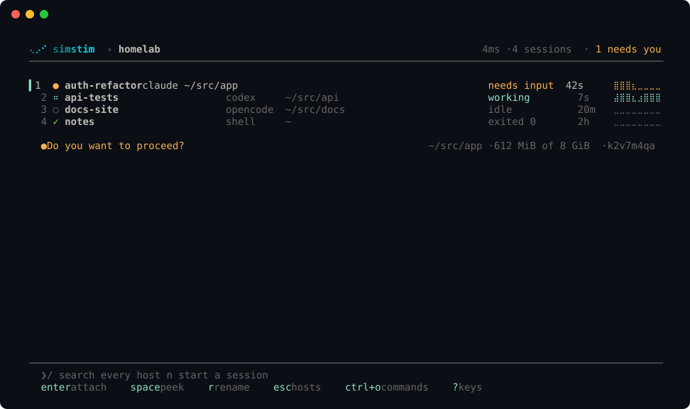
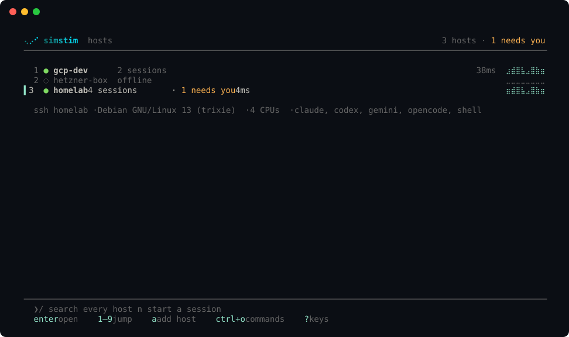
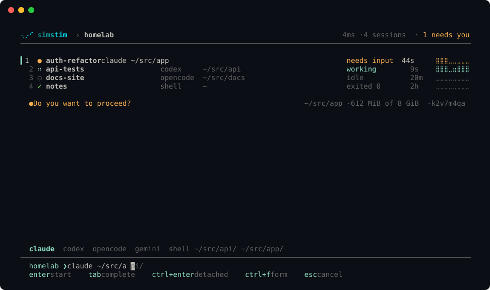
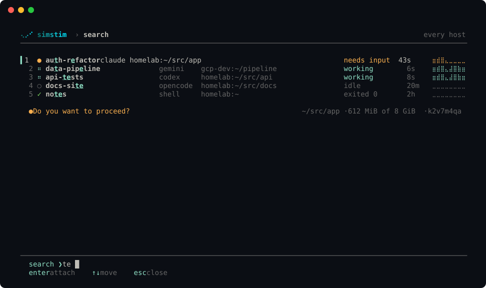
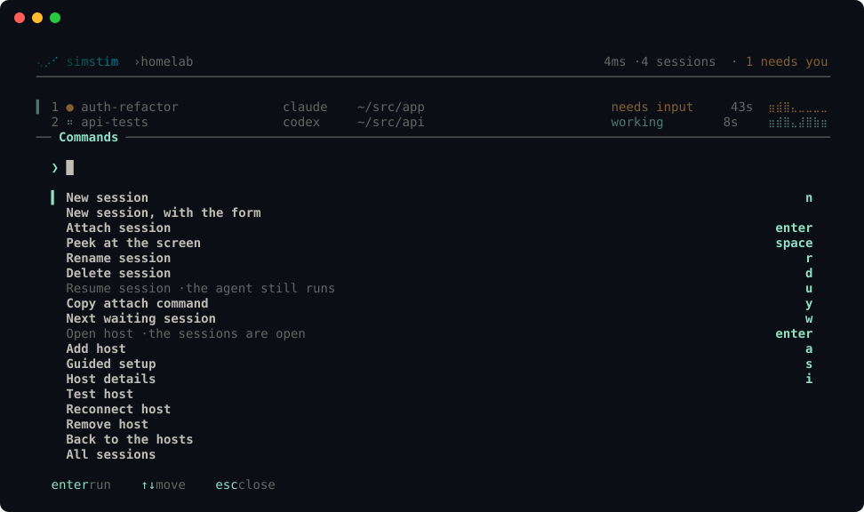
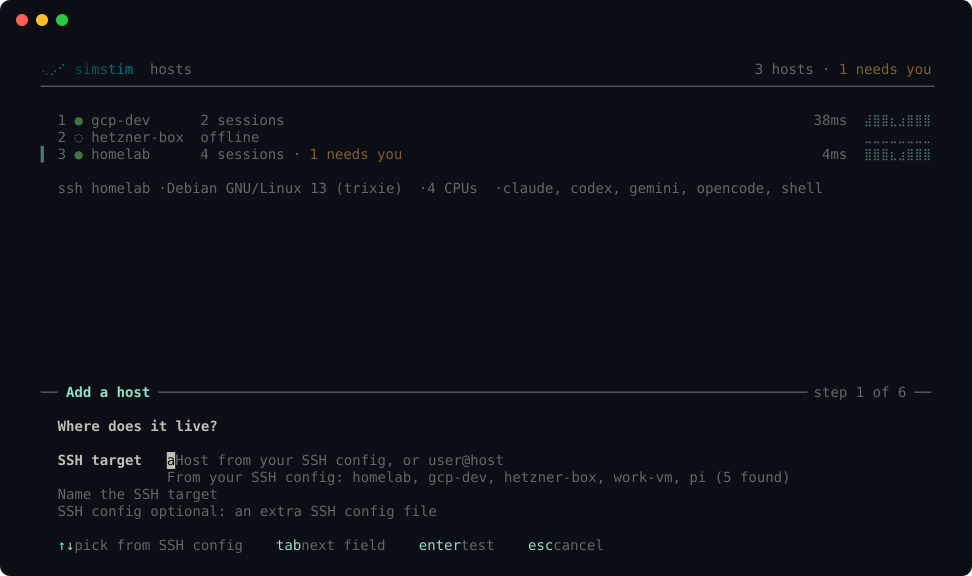

# simstim

**Your coding agents, on any host, as if they ran on your laptop.**

simstim runs Claude Code, Codex, opencode, Antigravity CLI or any other terminal program in a session on a host you own: a VPS, a cloud VM or a homelab machine. Close the laptop, change networks, switch devices: the session keeps running. Come back, and you flip straight back in. Your terminal draws the agent's real screen, byte for byte, so keys, colours, scrollback, clipboard and notifications work as they do locally.


**Docs:** [simstim.astrel.sh](https://simstim.astrel.sh)

[](https://scorecard.dev/viewer/?uri=github.com/iamlakshya/simstim)

> **Status:** early. The latest release, 0.1.1, came out on 17 October 2026. Every feature passes 116 end-to-end checks on a Linux test host, and sessions have survived real reboots there. Before 1.0, a minor version may still break the CLI or the config ([versions](docs/contributing/releasing.md#versioning)).

## Why

- **Any agent.** Agents are rows in a table, not code paths.
- **Any host you can reach with `ssh`.** simstim uses your own OpenSSH and your `~/.ssh/config`, so ProxyJump, Tailscale, GCP IAP and AWS SSM all work. Nothing new listens on the host, and there is no relay or cloud account.
- **The real thing, byte for byte.** No re-rendering and no multiplexer in the way. The kitty keyboard protocol, truecolour, OSC 8 links, OSC 52 clipboard and desktop notifications pass straight through. Native scrollback and search keep working.
- **Survives sleep.** The client reconnects by itself, and replays exactly the output you missed.
- **Paste screenshots.** Ctrl+V with an image on your laptop's clipboard uploads it and pastes the remote path into the agent. Dropped files work the same way.
- **Knows what each agent is doing.** Sessions show working, needs input, idle or exited, from the agents' own hooks and screen rules kept as data. You get a desktop notification when another session needs you.
- **A worktree per task.** `new --worktree` gives a session its own git branch and folder, and delete keeps it if it has work.
- **Comes back after a reboot.** A boot-time unit restarts each agent with its own resume command.

## How it works

```text
 laptop                                   host
 ┌──────────────────────┐  your ssh   ┌───────────────────────────────────────────┐
 │ simstim (client)     │ ──────────▶ │ simstim-host bridge                       │
 │  screens, attach,    │             │  ├─ holder ── PTY ── claude   (8 MiB ring) │
 │  reconnect, paste    │             │  ├─ holder ── PTY ── codex                 │
 └──────────────────────┘             │  └─ systemd user service per session      │
                                      └───────────────────────────────────────────┘
```

Read [the architecture](docs/explanation/architecture.md) for the details.

## Agents

Any program that runs in a terminal runs in a session, unmodified: you log in through the agent's own flow, inside the session. Some agents get more:

| Support | Agents | What it means |
| --- | --- | --- |
| First-class | Claude Code, Codex | Tested end to end on every release. Status comes from the agent's own hooks, sessions resume after a host reboot, and `agents install` sets them up. |
| Supported | opencode, Antigravity CLI, a shell | In the agent table and tested when the test host has them. Status comes from screen rules. |
| Best effort | Gemini CLI, Amp, Cursor CLI, Aider, Goose | In the agent table; contributors keep them working. |

The table lives in `internal/agents`; adding an agent is one row.

## Build from source

You need Go 1.26 and [just](https://github.com/casey/just). [Zig 0.16](https://ziglang.org/download/) is optional: it builds the shadow terminal that redraws a session's screen for a new client (without it, new clients get the raw history).

```sh
just build        # builds the host helpers, then the client, into ./bin
./bin/simstim --help
```

## Quick start

```sh
simstim setup                                    # guided: a host, its agents and their logins, step by step
simstim host add my-vps                          # or by hand: a Host from ~/.ssh/config: checks it, installs the helper
simstim                                          # the launcher: Enter on a host, then Enter on a session; n to start one
simstim new my-vps --agent claude --dir ~/src/app --worktree
simstim attach my-vps/app                        # attach from a script or a terminal keybinding
```

While attached, the agent owns your terminal. **Ctrl+\\** detaches (press it twice to send it to the agent). **Ctrl+V** with an image on the clipboard pastes it into the agent.

| Command | Does |
| --- | --- |
| `setup` | The guided setup: where agents run (your SSH config, Lima, Docker, E2B, or a server you rent, step by step), the host, a checklist of agents to install, and their logins |
| `host add/ls/rm/test/doctor/restore` | Manage hosts; `restore` starts again sessions a reboot stopped |
| `host create lima/docker/e2b`, `host destroy` | Make a host in one step (a local Lima VM, a test container, an E2B sandbox), and delete it ([how to](docs/how-to/create-a-host.md)) |
| `host start/stop/status/idle` | Start or stop a created host, or a cloud VM through your provider script ([examples](examples/providers)); set its idle stop |
| `new <host> [--agent a] [--dir d] [--worktree] [--detach] [-- cmd…]` | Start a session |
| `ls [--json]`, `attach`, `send`, `rename`, `kill` | Work with sessions |
| `ports`, `forward` | See and forward the ports a session listens on |
| `flip` | Quick switcher: every host's sessions, then attach |
| `doctor keys`, `doctor terminal` | Show what your terminal sends for each key, and what it supports |
| `config keymap` | Show the launcher's keys; rebind them under `[keymap]` in `config.toml` |
| `demo [--empty]` | Try the launcher with sample hosts and sessions; nothing connects anywhere |

## Screens

The launcher does one thing: it starts or joins a session in a few keys, then gets out of the way. It is one list in one column. Enter goes forward, Esc goes back, a number opens a row, `/` searches every host, and `n` starts a session from one line. It opens where you left off and draws at once, so `simstim` then Enter takes you back into your last session. The look is its own: a cyan accent, a live trace of each session's output, and sheets that rise from the bottom, with smooth motion in your terminal's own colours ([UX](docs/contributing/ux-spec.md)). `simstim demo` opens these screens with sample data.

**Sessions.** Each session's state, agent, folder and a trace of its recent output. The line under the list says what the selected one is doing now, what it is waiting for, or why its agent ended.



**Hosts.** Each host with its state, its sessions, how many need you, and the trace of all its output.



**Quick start.** `n`, then one line: `claude ~/src/app auth`. Tab completes the agent and the folder from the host; `ctrl+f` opens the full form.



**Search every host.** `/` finds a session on any host by name, agent, folder or host.



**Commands.** `ctrl+o` lists every action in plain words, with its key.



**Attached.** The agent owns every row and column of your terminal. There is no frame or status bar. `ctrl+\` brings the launcher back.


**Add a host.** The wizard offers the hosts in your `~/.ssh/config`, tests the connection, and installs the helper with your consent.



The images use a dark Ghostty theme and show still frames. In your terminal, the screens use your own colours, and they move. `just screenshots` makes the images again from the demo.

## Docs

Start with [getting started](docs/tutorials/getting-started.md): five minutes from install to an agent on your host. Then:

- [How-to guides](docs/how-to/README.md): add a host, worktrees, ports, image paste, restore after a reboot, keys, troubleshooting.
- [Reference](docs/reference/_index.md): every command and flag, the configuration, the keys and the agent table, generated from the code.
- [Explanation](docs/explanation/design.md): why it exists, [how it works](docs/explanation/architecture.md), [the fidelity contract](docs/explanation/fidelity.md) and [the security model](docs/explanation/security.md).
- [Roadmap](docs/roadmap.md): what comes next, scored by demand, impact and effort.
- [Contributing](docs/contributing/README.md), [decisions](docs/contributing/decisions/README.md) and [research](docs/research/README.md).

## Contributing

Read [CONTRIBUTING.md](CONTRIBUTING.md). Contributions are under the Apache-2.0 licence. Report security issues privately, as [SECURITY.md](SECURITY.md) describes.

## Licence

[Apache-2.0](LICENSE).

The name is a working name, from William Gibson's *Neuromancer*. It may change, so the code keeps it in one place ([docs/contributing/renaming.md](docs/contributing/renaming.md)).
