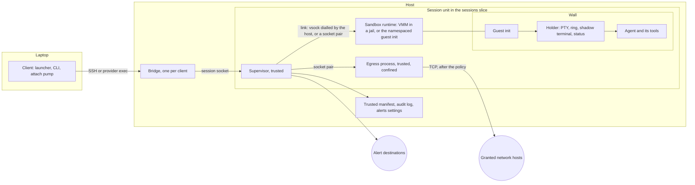

# Isolated sessions: spec

**Status:** proposed, 10 November 2026. **Decision:** [0029](decisions/0029-a-sandbox-per-session.md). **Plan:** [isolation-plan.md](isolation-plan.md). **Research:** [isolation](../research/isolation.md). **Issue:** [#100](https://github.com/iamlakshya/simstim/issues/100). **Roadmap:** O2, which widens X6 ([#13](https://github.com/iamlakshya/simstim/issues/13)).

This spec says what to build so that each session runs in its own sandbox. [The plan](isolation-plan.md) says in what order. Another coding agent will build it one pull request at a time, under [AGENTS.md](../../AGENTS.md) and [CONTRIBUTING.md](../../CONTRIBUTING.md). Task IDs such as P1.4 and H7 name tasks in the plan, which gives their order.

**How the design was chosen.** A Monte Carlo tree search looked at five decisions in order. They are the wall (L1), where the trusted parts run (L2), the lifecycle (L3), the doors (L4), and the supply chain and autonomy (L5). Five researchers expanded each node, and two judges scored each option for security, fit, convenience, scale and effort. The value was (0.35 security + 0.15 fit + 0.20 convenience + 0.15 scale + 0.15 effort) / 10, over 7 iterations. The best path is:

| Layer | Choice | Own value | Best below |
| --- | --- | --- | --- |
| L1 Wall | Wall drivers with levels and a floor pinned for each host | 0.575 | 0.687 |
| L2 Control | The holder inside the wall, a thin trusted supervisor outside | 0.678 | 0.687 |
| L3 Lifecycle | Cold boot from a verified image, state on disk only | 0.645 | 0.687 |
| L4 Doors | A wall without a network card, an egress process on the trusted side, sentinel secrets | 0.687 | 0.687 |
| L5 Supply chain | The laptop holds the digests: a signed, reproducible boot chain | 0.675 | 0.675 |

The path reaches L5, but the chosen L5 option secures only the project's own artefacts. It does nothing against a poisoned package or an injected prompt inside a session. So this spec completes L5 with grafts from the other L5 options, which the judges and the red team support. The grafts are package manager hardening and a registry gate, a review gate on `pull`, sentinel tripwires, and a guard on the model API. Each graft says where it came from.

[The research note](../research/isolation.md) gives the method, the full tree, the red team, the fact check and a check of the choice under six weight sets. Below L2, the choices hold under all six. At L2, the holder outside with a guest agent comes within 0.01 of the chosen option, and wins when convenience weighs more. The design keeps the holder inside, so that no memory-unsafe parser of hostile bytes runs on the trusted side. Section 14 comes from a second search of 4 iterations. Its best path is SSH add, then client placement with host admission, then tiers as a grant ceiling (0.732). That path holds under every weight set.

Every fact that no primary source confirms is marked UNVERIFIED. Where the fact check corrected a claim, this spec uses the correction.

**The second pass.** On 10 November 2026 the owner asked for more control: one config for all sessions that a narrower place can override, one-off exceptions, no forced strict defaults, a shell beside the agent, and research on automatic classifiers, so that many sessions can run at once. The owner also asked for a command line that is easy to guess. This pass adds the layers, profiles and locks of section 8, the unknown action and the classifier of 7.2 and 7.8, SSH keys (7.9), and shells in a sandbox (6.11). Every command now follows [0033](decisions/0033-one-command-grammar.md). [The research](../research/isolation.md#policy-for-parallel-work) and [the CLI study](../research/cli-dx.md) give the evidence.

**Words.** `<name>` is `brand.Name`, today `simstim`. Code never spells the product name outside `internal/brand` ([0007](decisions/0007-name-in-one-place.md)). Commands in this spec are written as users type them, `simstim …`. Section 14 writes paths and names with today's name, such as `~/.config/simstim/tiers.toml`. Code builds each of them from `brand`.

## 1. Goal, scope and non-goals

### 1.1 Goal

Each session runs in its own sandbox. A wall separates the sandbox from the host and from every other session. Nothing crosses the wall unless the user grants it: no file of the host, no network host, no secret value, no port and no device. The wall is on by default, at the strongest level that the host can run. The design must stay convenient enough that users keep it on.

The product reference is a sandbox service on hosts that the user owns: one command makes a sandbox, attaches to it, stops it, wakes it and forks it. Docker Sandboxes ([architecture](https://docs.docker.com/ai/sandboxes/architecture/)) and a hosted VM service show what users expect. This design differs in three ways. It runs on the user's own hosts, it keeps the agent's terminal bytes exact, and it is open source.

### 1.2 In scope

- A wall for each session, at one of four levels: none, process, gvisor and microvm (section 2).
- A floor for each host, pinned on the laptop, and recorded downgrades.
- A trusted supervisor for each session, outside the wall, and the holder inside it.
- Doors that are closed by default: files, network, secrets, ports, devices, paste and terminal output (section 7).
- Policy in layers: built-in, all sessions, a host, a repository, a profile and a session, with locks, one-off rules that end by themselves, and changes that reach running sandboxes (section 8).
- An unknown action for sites that no rule covers, and a classifier that decides them for work with nobody at the terminal (7.2, 7.8).
- Shells and commands in the same sandbox as the agent (6.11).
- SSH keys that a sandbox can use but not read (7.9).
- Secrets that the sandbox can use but not read (sentinels).
- Stop, wake on attach, restore after a reboot, fork and destroy.
- A verified boot chain for the microvm wall, and checks of the project's own artefacts.
- Fixes for holes that exist today, whatever wall a session has (phase 0).
- Hosts that the user adds: the sandbox probe, the root step, runtime delivery, tiers and the grant gate, placement, health, drain and purge (section 14).

### 1.3 Non-goals

- **No cloud service.** No account, relay or telemetry. Hosts stay the user's own.
- **No change to the agent's bytes.** The design observes risky terminal output and warns. It never filters it. An opt-in filter is an open question ([question 26](#15-open-questions)), not part of this plan.
- **No memory snapshots.** Every start is a cold boot. A stop loses the processes and the screen. The agent comes back with its resume command, as restore does today. This keeps secrets out of files and avoids clone-uniqueness bugs.
- **No native macOS host.** On a Mac, sessions run in a Lima VM, as today ([question 37](#15-open-questions)).
- **No Windows hosts.**
- **No defence against a compromised laptop,** or a compromised login account on a host. The design limits what each can reach, and says where it stops (3.4).
- **No judgement of code.** The review summary on `pull` flags risky files. It cannot find a backdoor in ordinary code.
- **No GPU or other device passthrough** in this plan.
- **The tool still never changes an agent's own permissions** ([design](../explanation/design.md#non-goals)). Policy acts at the doors, outside the agent.
- **No judgement of commands.** The classifier judges only what crosses a door. Whatever runs inside the sandbox stays inside it (7.8).

## 2. Terms

One name for each thing. Other documents and the code use these names and no others.

| Term | Meaning | In code |
| --- | --- | --- |
| host | A machine that runs the host helper and sessions, as today. | `client.Host` |
| laptop | The machine that runs the client, as today. | |
| session | One unit of work in the list: a name, an agent, a folder and a state, as today. `new` starts one. A walled session runs in one sandbox. | `host.Manifest` |
| agent | The AI coding CLI, or any program, that a session runs. Never the helper. | `agents.Agent` |
| sandbox | The isolated place where one or more sessions run, with all their processes. `new` makes a sandbox for its session. `shell` and `new --in` add sessions to a sandbox that exists. The sessions in a sandbox share its files, its policy and its secrets. | `wall.Sandbox` |
| shell session | A session that runs a login shell in the sandbox of another session, for commands that the user types (6.11). | `api.SessionInfo.SandboxOf` |
| wall | What separates a sandbox from the host and from other sandboxes. Never the name of a kind of sandbox. | `internal/wall` |
| level | How strong a wall is: `none` (W0), `process` (W1), `gvisor` (W2) or `microvm` (W3). `vz` is a later level for Mac hosts ([question 37](#15-open-questions)), and it ranks with `microvm`. | `wall.Level` |
| floor | Only this: the weakest level that a host may give a new session. The client pins it in `hosts.toml`. A host's tier sets the lowest floor allowed (14.8.2). | `client.Host.WallFloor` |
| downgrade | A session that runs below its host's floor because the user asked for that level by name. | `api.WallInfo.DowngradedFrom` |
| driver | The code that builds walls of one level, such as `process` or `chv` (Cloud Hypervisor). | `wall.Driver` |
| driver's probe | What a driver finds out about a host: whether it can run, and why not. | `wall.Probe` |
| sandbox probe | The read-only bridge request `sandbox.probe`. It runs each driver's probe and reports the host's features (14.3). | `api.CapProbe` |
| tier | How far the user trusts a host: `own`, `throwaway` or `shared`. The host never learns it (14.8). | `client.Tier` |
| trusted side | Everything outside the wall on the host: the bridge, the supervisor and the egress process. | |
| guest | Everything inside the wall. The guest is untrusted, the holder included. | |
| supervisor | The trusted process of one walled session. It is the main process of the session's systemd unit. | `internal/supervisor` |
| guest init | The host helper as the first process inside the wall. It sets the sandbox up, starts the holder and serves the link. | `internal/guest` |
| holder | As today: the PTY, the 8 MiB ring, the shadow terminal and the status engine. In a walled session it runs inside the wall. | `host.Holder` |
| link | The one byte stream between a supervisor and its guest init. It carries many streams. | `internal/link` |
| stream | One two-way byte stream inside a link. Each has a kind: `ctl`, `holder`, `egress`, `dns`, `port`, `put`, `bundle`, `exec` or `agent`. | `link.Stream` |
| door | One typed way across the wall: files, network, secrets, ports, devices, paste or terminal output. | `api.Door` |
| rule | One allow or one deny for one door and one target, in one layer, with a source and an optional end time. | `api.Rule` |
| grant | A rule that allows. A host's tier caps the grants that its sandboxes may get. | `api.Rule` |
| layer | One place that rules and settings come from: built-in, all sessions, a host, a repository, a profile or a session (8.2). | `api.Layer` |
| profile | A named set of settings and rules for a kind of work, such as `unattended`. A session uses at most one (8.3). | `config.Profile` |
| lock | A value or a deny that no narrower layer may change. Only the user's own layers can lock (8.2). | `api.Lock` |
| grant gate | The client's check that a host's tier allows each thing that leaves the laptop for it: a secret, the SSH agent, an alert token, a repository, a place in the auto pool (14.8). | `client.Allow` |
| grant ledger | The laptop's record of which grants each host got: names, never values. | `grants.json` |
| policy | The merged layers of one sandbox: its rules, locks, preset, unknown action and level. The supervisor keeps it. | `api.Policy` |
| preset | A named starting point for the network door: `locked`, `balanced` or `open`. Any layer may pick it. | `api.Preset` |
| unknown action | What the egress process does with a flow that no rule covers: `ask`, `deny`, `allow` or `classify` (7.2). | `api.Unknown` |
| classifier | The trusted code that decides a flow that no rule covers, when the unknown action is `classify`. It runs fixed checks first, then the judge (7.8). | `internal/egress/classify` |
| judge | The optional last step of the classifier: a model or a program that the user configures. It answers allow, deny or unsure. | `classify.Judge` |
| egress process | The trusted, confined process of one session that makes every network connection for it. | `internal/egress` |
| bound secret | A secret whose value stays in the egress process. The proxy puts it into requests to its bound hosts. | `api.SecretBound` |
| exposed secret | A secret whose value enters the guest's environment, as all secrets do today. | `api.SecretExposed` |
| sentinel | The random stand-in that the guest sees in place of a bound secret. Each start makes new ones. | `egress.Sentinel` |
| armed | A session whose egress process holds the values of its bound secrets. | `api.SessionInfo.Armed` |
| jail | The confinement of a trusted-side process that handles untrusted input: the VMM, the image converter, host-side git. A jail is not a wall. | `internal/jail` |
| image | A read-only root file system with a dm-verity tree, made from an OCI image and named by its digest. | `internal/image` |
| template | A user's own image, built on the laptop and named by its digest. It reaches a host only from the laptop (14.9.5). | `templates.json` |
| boot pair | The guest kernel and the tools image that the project builds and signs. | `guest/` |
| tools image | A read-only image with the guest helper and the shadow terminal. | `tools.erofs` |
| agents disk | A read-only image of the agents that the host has installed, for microvm sandboxes. | `agents.img` |
| session disk | The one writable disk of a microvm sandbox. | `disk.img` |
| trusted manifest | The session's `manifest.json`. Only the trusted side writes it. | `host.Manifest` |
| claim | A fact that the guest reports, such as the agent's state. It is kept apart from trusted facts and shown as claimed. | `host.Manifest.Guest` |
| audit log | `audit.jsonl` in the session folder: what the trusted side did and decided. It never holds a secret value. | `internal/supervisor/audit.go` |
| release manifest | The one list of digests of every trusted artefact of a release: the helper, the shadow terminal, the guest kernel, the tools image, the VMM and `runsc`. The client embeds it. | `internal/supply` |
| runtime | The artefacts that a host needs for walls: the VMM, `runsc` and the boot pair. The release manifest names each by digest. | |
| prepare | The sandbox probe, runtime delivery, the root step and a test boot, in that order (14.2.1). | `host prepare`, `sandbox.prepare` |
| root step | The one optional script that needs root on a host. The client builds it, and the user runs it through sudo or gives it to the machine's owner (14.4). | `client.RootScript` |
| namespace launcher | A root-owned copy of a small program that an `AppArmor` profile lets make user namespaces, for process walls on Ubuntu 23.10 or later ([question 4](#15-open-questions)). | `/usr/local/libexec/<name>/` |
| slot launcher | A root-owned program that starts each VMM as a slot account, through one sudo line (14.4.6, [question 27](#15-open-questions)). | `cmd/launch` |
| facts | A host's live numbers for placement. | `host.facts`, `api.HostFacts` |
| admission | The host's own check, under a lock, that a sandbox fits. | `admit.go` |
| pool | The hosts that `new auto` may contact. | `[host.place] pool` |
| footprint ledger | The host's record of each change that the helper made outside its own folders. | `footprint.json` |
| drain | A mark on a host that makes it refuse new sandboxes. | `drain.json` |
| purge | `host rm --purge`: remove everything that the tool put on a host. | `host.purge` |

The guest init is never called an agent, because "agent" means the AI CLI.

## 3. Threat model and security properties

### 3.1 Threats

| ID | Threat |
| --- | --- |
| T1 | A malicious dependency or tool runs code inside a session. |
| T2 | Prompt injection makes the agent exfiltrate code or secrets. |
| T3 | An autonomous agent does destructive things: `rm -rf`, a force-push, deleting cloud resources. |
| T4 | A compromised session attacks other sessions, the host or the laptop, including through terminal escape sequences. |
| T5 | Credentials are stolen, as against credentials misused while the session runs. |

The 2025 npm attacks show T1, T2 and T5 together. The Nx payload ran installed agent CLIs with flags that turn their approvals off, to list secret files, and pushed the results to public repositories in the victim's own GitHub account ([Snyk](https://snyk.io/blog/weaponizing-ai-coding-agents-for-malware-in-the-nx-malicious-package/)). The Shai-Hulud worm compromised more than 500 packages and spread by publishing with stolen tokens ([CISA](https://www.cisa.gov/news-events/alerts/2025/09/23/widespread-supply-chain-compromise-impacting-npm-ecosystem)). Anthropic reports that an injected attacker key uploaded files through an allowed model API ([Anthropic](https://www.anthropic.com/research/how-we-contain-claude)).

### 3.2 Trust boundaries

- **Trusted:** the client on the laptop, the bridge, the supervisor, the egress process and the host helper's binaries. The egress process is trusted but confined, because it parses hostile traffic.
- **Untrusted:** everything in the wall (the guest init, the holder, the shadow terminal, the agent and its tools), everything that a session wrote (its clone, its disk, its bundles, its claims), a repository's own files until the user trusts them, and a host's answers about itself. A compromised host can lie in its sandbox probe and its facts. The floor guards against mistakes, not against a hostile host.
- **Today's holes,** fixed in phase 0 whatever the wall:
  - Any process of the host user can attach to any holder socket and type into any session. `Holder.serve` in `internal/host/holder_conn.go` checks no peer and no role, and the agent's hook uses the full socket.
  - The shadow terminal parses hostile bytes in an unconfined child of the holder (`internal/host/vt_child.go`). Its Ghostty pin, `ad97d331`, comes before the fix `e257bb45` of [GHSA-w9q4-5jvv-mcv4](https://github.com/ghostty-org/ghostty/security/advisories/GHSA-w9q4-5jvv-mcv4). GitHub rates that advisory Moderate, and it may not be reachable with the 10,000-line scrollback that `vt/src/main.zig` sets (UNVERIFIED either way).
  - `applyHook` stores any `session_id` that a hook sends (`internal/host/hooks.go`), and `resumeArgv` puts it into the resume command (`internal/host/restore.go`).
  - The launcher draws a session's reason without cleaning it (`internal/tui/detail.go`), and `oscSafe` removes only C0 and DEL (`internal/client/attach_notify.go`).
  - A paste whose words are all local files uploads them (`internal/client/attach_paste.go`). A session can put a path on the laptop's clipboard with OSC 52 first.
  - Setup trust is a yes or no for each repository, not tied to the script's content (`internal/client/trust.go`).
  - `copyWorktreeInclude` follows symlinks (`internal/host/worktree.go`).
  - The generated SSH wrapper includes the user's `~/.ssh/config` first, so a `ForwardAgent yes` there reaches every host (`writeWrapper` in `internal/client/ssh.go`). Task H2 fixes it (14.8.5).

### 3.3 What the design guarantees

Each guarantee names the levels and the phase from which it holds.

| ID | Guarantee | Levels | From |
| --- | --- | --- | --- |
| G1 | Without a grant, no process in a sandbox can read or change a file outside it: the host user's home, SSH keys, agent logins, cloud credentials, other sessions' folders, the helper's files. | process, gvisor, microvm | P1 |
| G2 | Without a grant, a sandbox has no network. It has no network card and an empty network namespace. Every connection goes through the egress process. The egress process refuses loopback, private, link-local, shared (`100.64/10`) and unique local ranges, cloud metadata addresses and the host's own addresses unless a grant names them. No UDP, ICMP or raw packet leaves. | process, gvisor, microvm | P1 |
| G3 | DNS answers only granted names. A refused name is never sent upstream. | process, gvisor, microvm | P2 |
| G4 | A bound secret's value never enters the sandbox. The egress process puts it into one named header, only on its bound hosts, and only while the session is armed. On a bound host, a request with any other credential is refused. A sentinel seen anywhere else is refused and raises an alert. | process, gvisor, microvm | P2 |
| G5 | A sandbox reaches no other session's socket, process, file or network, and not the host's systemd user bus, SSH agent or the holder sockets of unwalled sessions. | process, gvisor, microvm | P1 |
| G6 | The guest cannot change its own limits, level, policy, trusted manifest, audit log, alert destinations or alert settings. It can lie only in its claims about its own session. | process, gvisor, microvm | P1 |
| G7 | Nothing new listens on a host network port. No trusted-side process listens where a guest can connect: the supervisor dials into a microvm, and gives a process or gvisor sandbox one end of a socket pair. | all | P1 |
| G8 | The agent's bytes reach the user's terminal unchanged. The supervisor passes output frames on and never reads their payload. | all | P1 |
| G9 | A new session never starts below its host's pinned floor unless the user names the downgrade. The trusted manifest records it, the session's row shows it, and a `wall_downgraded` alert reports it. A repository's file, an agent's data or a host's answer may raise a level, never lower it. | all | P1 |
| G10 | A paste never uploads a laptop file whose path a session wrote to the clipboard, nor a file under a sensitive path. A notice names each file that is uploaded. | all | P0 |
| G11 | Each trusted artefact that a host runs or boots for a session (the helper, the VMM, the guest kernel, the tools image, the user's image) matches a digest that the client holds. | microvm (all for the helper) | P4 |

### 3.4 What the design does not guarantee

| ID | Not guaranteed | Why, and what helps |
| --- | --- | --- |
| N1 | Safety from terminal escape sequences | Byte-exact is a project rule. Escape sequences reach the laptop's terminal. The client observes and warns (P7), and the docs say which terminal settings to change. |
| N2 | Safety from misuse of what is granted | A sentinel can be used on its bound hosts while the session runs. Path and method rules, live revoke and the audit log limit this. |
| N3 | No exfiltration through granted hosts | Spliced flows to a granted host can carry data. Interception, upload budgets and the model API guard narrow this. |
| N4 | Safety from kernel, KVM or VMM bugs | A process wall shares the host kernel. A microvm wall depends on KVM and the VMM. Jails, pins and `pins-watch` shorten the exposure. |
| N5 | Safety when the host's login account is compromised | Code that runs as the login user can drive every session on that host and read the egress processes' memory if it can trace them. Jails make sure that a VMM escape does not land as that user where a subuid is available. Slot accounts go further (14.4.6). |
| N6 | Safety when the laptop is compromised | The laptop holds every secret command and SSH key, as today. |
| N7 | A clean history | A backdoor in a reviewed commit passes every wall by design. The review summary flags risky files only. |
| N8 | True claims | The guest can lie about its own state, ports and alerts. The launcher shows claims as claimed. Trusted facts (end, out-of-memory kills, level, policy) come only from the trusted side. |
| N9 | The same strength on every host | A host without KVM runs process or gvisor walls. The floor and the row show which. |
| N10 | Safety from root on a host | Root sees the memory and disk of every sandbox there, and every secret sent. Tiers limit what goes there (14.8). Nothing hides what does. |

### 3.5 Coverage of each threat

| Threat | What stops it | What still passes | Phases |
| --- | --- | --- | --- |
| T1 | G1, G2, G5: the code meets an empty home, no host logins, no network. Root and home reset at each start, so a dropper in `~/.bashrc` does not persist. Package manager settings in the guest. Registry gates in the egress process. | The code runs inside with every open door. It persists in `/work` and in the agent's state folders. A backdoor commit can reach the laptop through `pull`. | P1, P2, P7 |
| T2 | G2, G3. The identity pin stops an attacker's key on an allowed model API. The model API guard refuses server-side fetch tools. Push rules refuse new repositories and gists. Upload budgets. Audit lines. | Data inside allowed spliced flows, pushes to granted session branches, and the model vendor itself. | P1, P2 |
| T3 | Damage stays in the sandbox. The host's repository is never touched: the session works on its own clone. Path rules refuse ref deletes, repository creation, workflow writes and runner registration. Cloud APIs are closed unless granted. | Destructive calls through a granted secret within the rules. Loss of the session's own uncommitted work (checkpoints in P5). | P1, P2, P5 |
| T4 | G1, G5, G6, G7. The parser of hostile bytes runs inside the wall. Jails for the VMM, the converter and host-side git. Phase 0 fixes: the hook socket, the peer check, cleaned text, the paste guard. | Terminal escape sequences (N1). Kernel and VMM bugs (N4). The laptop's git still parses a hostile pack on `pull`, with fsck on and no checkout. | P0, P1, P3 |
| T5 | G4 for bound secrets. G1 for the host's agent logins. The tool never copies login files into a sandbox. The grant gate keeps secrets off hosts of a lower tier (14.8). | Exposed secrets and logins made inside a sandbox can be stolen. The row shows a badge, and an alert reports each exposed secret. Misuse while armed (N2). | P1, P2 |

## 4. Design overview

A walled session has two halves. The trusted half runs in the session's systemd user unit, outside the wall: the supervisor and the egress process. The untrusted half runs inside the wall: the guest init, the holder with its ring and shadow terminal, and the agent. One link joins them. The client and the bridge do not change their path: the bridge still dials the session's socket, `paths.Socket(id)`. The supervisor serves that socket now, and passes each connection on to the holder inside the wall.

A sandbox may hold more than one session: a shell session beside the agent, or a second agent (6.11). Its sessions share one supervisor, one egress process and one link. Each session has its own holder inside the wall and its own session socket outside.



### 4.1 What runs where

| Part | process wall (W1) | microvm wall (W3) |
| --- | --- | --- |
| Supervisor, egress process | The session's unit, as the login user | The same |
| What makes the wall | The guest init, started in new user, mount, PID, network, IPC, UTS and cgroup namespaces, with Landlock and seccomp | Cloud Hypervisor in a jail, on `/dev/kvm` |
| Link | One end of a socket pair that the guest init inherits | vsock: the supervisor connects to the VMM's Unix socket and sends `CONNECT <port>` |
| Holder, ring, shadow terminal, agent | Inside, on the host kernel | Inside, on the guest kernel |
| Root file system | The host's `/usr`, `/bin`, `/lib` and a filtered `/etc`, read-only | A verified image with an overlay that resets at each start |
| `/work/<repo>` | A folder in the session folder, bound into the sandbox | On the session disk |
| Network | An empty namespace. An explicit proxy on the guest's loopback. | No network card. A transparent redirect and an explicit proxy in the guest. |
| gvisor wall (W2, P6) | As the process wall, with gVisor's sentry between the guest and the host kernel | |

### 4.2 A session from start to end

1. `simstim new devbox --agent claude --dir ~/src/app` picks the level: the host's floor unless the user asks for more, or names a downgrade.
2. The host makes a git bundle of the repository on the trusted side, writes the trusted manifest, and starts the session's unit with `<helper> supervise <id>`.
3. The supervisor starts the egress process, hands it the policy and the values of bound secrets, and gets their sentinels back.
4. The supervisor builds the sandbox with its driver and gets the link.
5. Over the `ctl` stream it sends `start`: the command, an environment made from a fixed base (never the host's login environment), the sentinels, the proxy settings and the terminal size. The guest init clones the bundle into `/work/<repo>`, starts the holder, and the holder starts the agent.
6. The client attaches. The supervisor passes frames to the holder and back. It checks frame types and sizes, and never reads the output's payload.
7. Every network flow from the agent becomes an `egress` stream. The egress process decides, makes the connection, swaps sentinels for values on bound hosts, and writes one audit line.
8. `pull` brings the work out as a git bundle into quarantine refs on the laptop. `stop` shuts the sandbox down and keeps `/work` and the agent's state folders. `rm` destroys it.

## 5. Components

| Component | Job | Runs | Trust | Code |
| --- | --- | --- | --- | --- |
| Client | Picks the host and the level, checks the floor and the tier, fetches secrets, shows badges, grants and reviews | Laptop | Trusted | `internal/client`, `internal/cli`, `internal/tui` |
| Bridge | Serves one client, as today. Forwards new requests to the supervisor. | Host, outside units | Trusted | `internal/host/bridge*.go` |
| Supervisor | Owns the sandbox, the unit's limits, the trusted manifest, the audit log, alerts, the policy and the link. Serves the session socket and passes its frames to the holder. | Host, the session's unit | Trusted | `internal/supervisor` (new) |
| Egress process | Makes every network connection: policy, DNS, splice or intercept, sentinels, audit lines | Host, the session's unit | Trusted, confined | `internal/egress` (new) |
| Jail | Confines trusted-side processes that touch untrusted input | Host | Trusted code, confined process | `internal/jail` (new) |
| Wall drivers | Probe, prepare, start, stop and destroy sandboxes | Host, in the supervisor | Trusted | `internal/wall`, `internal/wall/process`, `internal/wall/chv`, later `internal/wall/gvisor`, `internal/wall/firecracker` |
| Link | Many streams over one byte stream, with flow control | Both sides | Parses hostile frames on the trusted side | `internal/link` (new) |
| Guest init | PID 1 in the sandbox: mounts, the network shim, the DNS stub, the holder's start, clean shutdown | Inside the wall | Untrusted | `internal/guest` (new) |
| Holder | As today, in a guest mode that listens on guest paths | Inside the wall | Untrusted | `internal/host/holder*.go` |
| Shadow terminal | As today. It now parses hostile bytes inside the wall. | Inside the wall | Untrusted | `vt/` |
| Image builder | Pulls OCI images, flattens them, writes ext4 with a verity tree | Host, in a jail | Trusted code, confined process | `internal/image` (new, P3) |
| Supply checks | The release manifest, digest checks, exec from a hashed descriptor, verity tables | Laptop and host | Trusted | `internal/supply` (new, P4) |
| Policy layers | The merge of layers, host pattern checks, locks | Laptop and host | Trusted | `internal/grant` (new), types in `internal/api` |
| Classifier | The steps of 7.8, and the judge's client | Host, in the egress process | Trusted | `internal/egress/classify` (new) |
| Grant gate | Checks each thing that leaves the laptop against the host's tier, and records it in the grant ledger | Laptop | Trusted | `internal/client/tier.go`, `grants.go` (new, 14.8) |
| Placement | Picks a host for `new`, from saved defaults or live facts | Laptop | Trusted | `internal/client/place.go`, `facts.go` (new, 14.10) |
| Sandbox probe, admission, purge | Report a host's features and facts, admit a sandbox under a lock, remove what the tool put on a host | Host | Trusted. The client treats their answers as claims. | `internal/host/capprobe*.go`, `facts.go`, `admit.go`, `purge.go` (new, 14) |

### 5.1 `internal/wall`

```go
// Package wall builds the wall around one session's sandbox.
package wall

// Level is how strong a wall is. A higher level is stronger.
type Level int

const (
    None    Level = 0 // W0: no wall, as before this change
    Process Level = 1 // W1: namespaces, Landlock and seccomp on the host kernel
    GVisor  Level = 2 // W2: gVisor's user-space kernel in front of the host kernel
    MicroVM Level = 3 // W3: a guest kernel on KVM
    // vz, a later level for Mac hosts (question 37), ranks with MicroVM.
)

// ParseLevel reads "none", "process", "gvisor" or "microvm".
func ParseLevel(s string) (Level, error)

// String returns the level's name, as users type it.
func (l Level) String() string

// Driver builds walls of one level on this host.
type Driver interface {
    Name() string // "process", "chv", later "gvisor" and "firecracker"
    Level() Level
    // Probe says whether this host can run the driver, and why not.
    Probe(ctx context.Context) Probe
    // Prepare makes the sandbox's files from spec. It starts nothing.
    Prepare(ctx context.Context, spec Spec) (Sandbox, error)
    // Open returns a prepared sandbox again, for a supervisor that
    // starts after a reboot.
    Open(ctx context.Context, sessionDir string) (Sandbox, error)
}

// Sandbox is one session's sandbox.
type Sandbox interface {
    // Start boots the sandbox and returns the link to its guest init.
    Start(ctx context.Context) (net.Conn, error)
    // Stop asks the guest init to stop the agent and shut down, and waits
    // up to grace. The session's files and disk stay.
    Stop(ctx context.Context, grace time.Duration) error
    // Kill ends the sandbox at once.
    Kill() error
    // Wait returns when the sandbox has ended, and how.
    Wait() Exit
    // Destroy removes the sandbox's files. The sandbox must have ended.
    Destroy() error
    // Abilities lists what this sandbox can do beyond these methods.
    Abilities() Abilities
}

// Abilities are optional abilities of a sandbox.
type Abilities struct {
    Freeze bool // a consistent copy of /work for fork (P5)
    Reflink bool // copies that share blocks
}

// Spec describes the sandbox to prepare.
type Spec struct {
    ID         string
    SessionDir string
    Image      *ImageRef // microvm and gvisor. nil for process.
    Mounts     []Mount   // the files door
    StateDirs  []string  // the agent's folders that stay across starts
    MemoryMax  int64     // the unit's cap, decision 0024
    CPUs       int
    DiskMax    int64     // the session disk's cap, microvm
    Root       RootMode  // Reset (the default) or Keep
    Helper     string    // the helper version folder that the guest runs
}

// Mount is one granted folder.
type Mount struct {
    Host  string // opened by the supervisor with os.Root, never followed
    Guest string
    Write bool
}

// Probe is what a driver found on this host.
type Probe struct {
    Driver  string            `json:"driver"`
    Level   Level             `json:"level"`
    OK      bool              `json:"ok"`
    Reason  string            `json:"reason,omitempty"` // why not, in plain words
    Fix     string            `json:"fix,omitempty"`    // a command for the Try: hint
    Version string            `json:"version,omitempty"`
    Facts   map[string]string `json:"facts,omitempty"` // kernel, landlock_abi, kvm, apparmor_userns
}

// Best is the strongest level whose driver probed OK.
func Best(probes []Probe) Level

// Drivers lists the drivers built into this helper, strongest first.
func Drivers() []Driver
```

Each driver's probe runs inside the sandbox probe (`sandbox.probe`, 14.3): at `host add`, `host prepare`, `host show` and `host doctor`. Its result is cached for each boot in `StateDir()/walls.json`, keyed by `BootID()`.

| Driver | Probe checks |
| --- | --- |
| `process` | Linux 5.13 or later. An unprivileged user namespace starts (a fork that calls `unshare(CLONE_NEWUSER)`). `kernel.apparmor_restrict_unprivileged_userns` is 0, or the namespace launcher and its profile from the root step exist (14.4.2). The Landlock ABI from `landlock_create_ruleset(NULL, 0, LANDLOCK_CREATE_RULESET_VERSION)` is 1 or more. seccomp filters load. |
| `chv` | `/dev/kvm` opens read and write, and `KVM_GET_API_VERSION` answers 12. The host kernel is 6.8 or later ([Cloud Hypervisor README](https://github.com/cloud-hypervisor/cloud-hypervisor/blob/main/README.md)). The pinned `cloud-hypervisor` binary is in the artefact store with its digest. The user is in the group that owns `/dev/kvm`, or has an ACL entry on it (14.4.2). `systemd-detect-virt` is recorded as a fact. |
| `gvisor` (P6) | Linux 5.6 or later. The pinned `runsc` is present. A smoke run of `runsc` in the OCI user-namespace mode succeeds. |
| `firecracker` (P6) | `/dev/kvm` as above, and a host kernel of 5.10, 6.1 or 6.18, the ones that Firecracker tests ([kernel policy](https://github.com/firecracker-microvm/firecracker/blob/main/docs/kernel-policy.md)). |

### 5.2 `internal/link`

```go
// Package link carries many streams over one byte stream, between a
// supervisor and its guest init. Frames are proto frames of the types
// TStreamOpen, TStreamData, TStreamClose and TStreamWindow.
package link

// Kind is what a stream carries.
type Kind string

const (
    KindCtl    Kind = "ctl"    // one per link: start, stop, status, alerts
    KindHolder Kind = "holder" // one connection to the holder's socket
    KindEgress Kind = "egress" // one network flow out of the guest
    KindDNS    Kind = "dns"    // one DNS query out of the guest
    KindPort   Kind = "port"   // one forwarded connection into the guest
    KindPut    Kind = "put"    // one pasted file into the guest
    KindBundle Kind = "bundle" // a git bundle in (seed) or out (pull)
)

// Side is the end of a link.
type Side int

const (
    Supervisor Side = iota
    Guest
)

// Opener says which side may open each kind. The other side refuses a
// stream of another kind, or one from the wrong side, and counts it.
var Opener = map[Kind]Side{
    KindCtl: Supervisor, KindHolder: Supervisor, KindPort: Supervisor,
    KindPut: Supervisor, KindBundle: Supervisor,
    KindEgress: Guest, KindDNS: Guest,
}

// Options bound a link.
type Options struct {
    Window     uint32 // credit for each stream, 256 KiB by default
    MaxStreams int    // open streams at once, 1024 by default
    MaxHeader  int    // the JSON header of an open, 4 KiB by default
}

// Session is one end of a link.
type Session struct{ /* … */ }

// New starts a link over conn.
func New(conn net.Conn, side Side, opt Options) *Session

// Open opens a stream of kind k with a JSON header.
func (s *Session) Open(ctx context.Context, k Kind, header any) (*Stream, error)

// Accept waits for a stream that the other side opened.
func (s *Session) Accept(ctx context.Context) (*Stream, error)

// Close ends every stream and the link.
func (s *Session) Close() error

// Stream is one stream. It is a net.Conn, and CloseWrite half-closes it.
type Stream struct{ /* … */ }

func (st *Stream) Kind() Kind
func (st *Stream) Header(v any) error // decodes the open's header
func (st *Stream) CloseWrite() error
```

Each stream has its own credit window, so a large download on an `egress` stream never holds back `holder` output. The writer of the link sends the frames of streams in turn, and `holder` and `ctl` streams go first when several wait.

### 5.3 `internal/supervisor`

```go
// Package supervisor is the trusted side of one walled session.
package supervisor

// Run supervises session id: it starts the egress process and the
// sandbox, serves the session's socket, and returns when the sandbox
// has ended and the session is stopped, ended or killed.
func Run(id string) error

// Supervisor holds one session's trusted state.
type Supervisor struct {
    id     string
    m      *host.Manifest // the trusted manifest, saved by save()
    sb     wall.Sandbox
    link   *link.Session
    egress *egressProc    // the child process, and its link
    policy *api.Policy
    audit  *auditLog
    alerts *alerts.Dispatcher
    mem    memWatch       // moved from holder_mem.go for walled sessions
    claims claims         // the guest's last reports, size-capped
}
```

The supervisor never runs, renders or interpolates guest data. It parses only link frames and the JSON of `ctl` events, each capped at 64 KiB. Every string that it keeps from a claim goes through `api.CleanText` first.

### 5.4 `internal/egress`

```go
// Package egress makes every network connection for one walled session.
package egress

// Run is the egress process of session id. It reads its policy, its CA
// key and the values of bound secrets from fd 3, a socket pair to the
// supervisor. After start it opens no file.
func Run(id string) error

// Request is one flow or one HTTP request to decide on.
type Request struct {
    Host   string // from CONNECT, the SNI, or the synthetic address
    Port   int
    Method string // intercepted flows only
    Path   string // intercepted flows only, without the query
    Header http.Header
}

// Decision says what to do with a request.
type Decision struct {
    Action Action // Allow, Deny or Hold
    Mode   Mode   // Splice or Intercept
    Rule   string // the grant ID or the preset rule that decided
    Why    string // in plain words, for the audit line and the 403 body
}

// Decide applies the policy. A deny always wins over an allow.
func (p *Policy) Decide(r Request) Decision
```

### 5.5 Grants: `internal/api` and `internal/grant`

```go
// In internal/api, which has no dependencies.

// Door is one typed way across the wall.
type Door string

const (
    DoorNet    Door = "net"    // a host and port
    DoorPush   Door = "push"   // git pushes to one repository's session branches
    DoorMount  Door = "mount"  // a host folder
    DoorSecret Door = "secret" // a secret, bound or exposed
    DoorPort   Door = "port"   // a port forwarded to the laptop
    DoorPaste  Door = "paste"  // file types for drops and pastes
    DoorSSHKey Door = "ssh-key" // a key that the sandbox's own SSH agent holds (7.9)
    DoorDevice Door = "device" // reserved, no grant is possible in this plan
)

// LayerKind is where a rule or a setting comes from, broadest first (8.2).
type LayerKind string

const (
    LayerBuiltin LayerKind = "builtin" // the preset lists, the agent table, the refused ranges
    LayerAll     LayerKind = "all"     // the top level of config.toml
    LayerHost    LayerKind = "host"    // the host's entry in hosts.toml
    LayerRepo    LayerKind = "repo"    // the laptop's section, then the repository's own file
    LayerProfile LayerKind = "profile" // [profiles.<name>]
    LayerSession LayerKind = "session" // flags, --set, and rules made --in the session
)

// Unknown is what the egress process does with a flow that no rule covers.
type Unknown string

const (
    UnknownAsk      Unknown = "ask"
    UnknownDeny     Unknown = "deny"
    UnknownAllow    Unknown = "allow"
    UnknownClassify Unknown = "classify"
)

// Rule allows or denies one door for one target. A rule that allows is a grant.
type Rule struct {
    ID      string    `json:"id"`              // "g" and 6 base32 characters
    Allow   bool      `json:"allow"`
    Door    Door      `json:"door"`
    Target  string    `json:"target"`          // "api.stripe.com:443", "~/data", "3000"
    Mode    string    `json:"mode,omitempty"`  // "ro" or "rw", "read" or "write", "bound" or "exposed"
    Layer   LayerKind `json:"layer"`
    Name    string    `json:"name,omitempty"`  // the profile's name, the repository's remote or the host's name
    Source  string    `json:"source"`          // "preset", "agent", "user", "repo-file", "live", "classifier"
    Once    bool      `json:"once,omitempty"`  // ends after one flow
    Expires time.Time `json:"expires,omitzero"`
}

// Lock is a value or a deny that no narrower layer may change.
type Lock struct {
    Key   string `json:"key"`             // "network.deny", "network.unknown", "sandbox.wall"
    Value string `json:"value"`           // for a deny, the target
    From  string `json:"from"`            // "config.toml" or the host's name
}

// Policy is one sandbox's merged policy.
type Policy struct {
    Level   string  `json:"level"`
    Preset  Preset  `json:"preset"`
    Unknown Unknown `json:"unknown"`
    Profile string  `json:"profile,omitempty"`
    Rules   []Rule  `json:"rules"`
    Locks   []Lock  `json:"locks,omitempty"`
    Hash    string  `json:"hash"`  // of the layers, to find a sandbox whose files changed (8.8)
}

// CleanText removes C0 and C1 controls, DEL, bidirectional controls,
// zero-width characters and Unicode tag characters from s, and cuts it
// to max runes. Every string that a host or a guest sends goes through it
// before it is drawn or stored.
func CleanText(s string, max int) string
```

```go
// Package grant merges the layers of a sandbox's policy and checks targets.
package grant

// Layer is one layer of section 8.2. Every layer has the same shape.
type Layer struct {
    Kind     api.LayerKind
    Name     string            // the profile, the repository's remote or the host
    Rules    []api.Rule
    Values   map[string]string // "sandbox.preset": "locked", "network.unknown": "deny"
    Lists    map[string][]string // "sandbox.secrets", with "!NAME" to drop an inherited item
    Locks    []api.Lock        // only from the layers for all sessions and for a host
    Untrusted bool             // the repository's own file: it may only narrow
}

// Merge applies the precedence of section 8.2: locks first, then the
// narrowest layer that sets a value or has a matching rule.
func Merge(floor string, layers []Layer) (api.Policy, error)

// Decide finds the rule that decides one target, and its layer. It
// returns nil when no rule matches, and the caller takes the unknown action.
func Decide(p api.Policy, door api.Door, target string) *api.Rule

// CheckHost refuses a network target that is an IP literal in a refused
// range, a wildcard that spans a public suffix or a private suffix of the
// Public Suffix List, or an internationalised name that the user did not
// type in its Unicode form.
func CheckHost(target string, typed bool) error
```

`CheckHost` uses `golang.org/x/net/publicsuffix` (BSD-3-Clause).

### 5.6 `internal/jail`

```go
// Package jail confines a trusted-side process that handles untrusted
// input: the VMM, the image converter, host-side git.
package jail

// Spec says how to confine one command.
type Spec struct {
    Argv    []string
    Env     []string
    Subuid  bool       // run as a subuid when /etc/subuid gives a range and newuidmap exists
    Net     NetMode    // NetNone: an empty network namespace. NetHost: the host's.
    Binds   []Bind     // the only paths in the new mount namespace
    Rules   []PathRule // Landlock rules, at the best ABI the kernel has
    Seccomp Profile    // "vmm", "converter", "git", "egress"
    Files   []*os.File // inherited from fd 3
}

// Command returns a command that starts argv inside the jail. Every jail
// also sets no_new_privs and PR_SET_DUMPABLE to 0, and drops all
// capabilities before it runs argv.
func Command(ctx context.Context, s Spec) (*exec.Cmd, error)
```

Libraries: `github.com/landlock-lsm/go-landlock` (MIT) and `github.com/elastic/go-seccomp-bpf` (Apache-2.0), with attribution in `NOTICE`. A jail never shows `$XDG_RUNTIME_DIR` (the systemd user bus, other sessions' sockets, the SSH agent), `/dev/vhost-*` or the user's home.

## 6. Flows

Every flow below is for a walled session. A session at level `none` keeps today's flows, with the phase 0 fixes, until task P6.3 moves it onto the same path.

### 6.1 Create

1. **Level.** The client picks the host first (14.10.1). It then picks the level in this order: `--wall`, the repository's section in `config.toml`, `[sandbox] wall`, then the host's floor. `auto` means the floor. A level below the floor stops here with the error `wall_floor` (9.3), unless the command has `--downgrade` or the launcher's downgrade sheet got the typed level name.
2. **Secrets.** The grant gate checks each secret against the host's tier (14.8.5). The client then fetches the values of the session's secrets, as today ([secrets](../how-to/secrets.md)). For each secret it also sends the mode: bound when the user's config or the agent table names its hosts (P2), exposed when the user passed `--expose NAME`. Before P2 every secret is exposed.
3. **Policy layers.** The client sends `new` with `NewArgs.Wall`, `NewArgs.Downgrade` and `NewArgs.Layers`: the layers of 8.2 that the laptop holds. These are all sessions, the host, the repository's section, the profile and the session's flags, with the locks. The host adds the built-in layer: the preset lists and the agent's needs.
4. **Repository file.** If the folder is in a git repository with `.<name>/sandbox.toml`, the host reads it from the host's working tree, the trusted source, before any sandbox exists. Its denies, a stronger level and a tighter preset apply at once. Its proposed grants come back as a question (`CodeGrantQuestion`) with the file's SHA-256, unless the client's answers for that hash came with the request.
5. **Seed.** The host runs `git bundle create <SessionDir>/seed.bundle <branch>` in the source repository, in a `git` jail with `-c core.fsmonitor=false -c core.hooksPath=/dev/null`. The bundle holds the branch that the folder has checked out (or `--base`), with its history. Untracked files, stashes, other branches and `.git/config` never enter. A folder outside git gives an empty workspace, `/work/scratch`, and the row says "scratch". `--mount` brings such a folder in when the user wants it.
6. **Manifest and unit.** When the request carries `NewArgs.Need`, admission runs first (14.10.3), and the trusted manifest is its reservation. The host writes the trusted manifest with `Wall`, `Policy` and the names and modes of the secrets, never their values. It starts the unit:

   ```text
   systemd-run --user --quiet --collect --unit=<prefix><id>.service --slice=<name>.slice \
     -p KillMode=mixed -p TimeoutStopSec=30 -p OOMPolicy=continue -p TasksMax=4096 \
     -p MemoryMax=<cap> -p MemorySwapMax=0 \
     <helper> supervise <id>
   ```

   Then it hands the secrets' values to the supervisor over the session's socket, as `deliverSecrets` does for a holder today.
7. **Egress.** The supervisor starts `<helper> egress <id>` in an `egress` jail, with a socket pair on fd 3. It sends the policy and the bound values, and gets one sentinel for each bound secret.
8. **Sandbox.** The supervisor calls `Prepare` and `Start` on the driver, and gets the link. It opens the `ctl` stream and sends `seed` with a `bundle` stream. The guest init runs `git clone` from the bundle into `/work/<repo>`, as the agent's user, and checks out `<name>/<id>/<slug>`.
9. **Start.** The supervisor sends `start`. The guest init writes the holder's guest manifest under `/run/<name>/`, starts the holder, and the holder starts the agent, as `Holder.start` does today.
10. **Answer.** The supervisor records the run in the trusted manifest, writes the audit line `start` with the level and the policy's grant IDs, and the host answers `new` with the session's row. The client attaches.

### 6.2 Start on demand

A `stopped` session wakes on attach, as a stopped host does ([0013](decisions/0013-host-providers.md)).

1. Enter in the launcher, `attach` or `resume` on a stopped session sends `resume` with fresh secret values. The launcher fetches only the secrets that the host's `secrets` list names, as `u` does today.
2. The host runs `startAgain` for the session: the same unit name, a new supervisor, a cold start of the sandbox, and the agent's resume command from `resumeArgv`.
3. The agent finds its conversation in its state folder, which stayed on disk. The screen starts empty.
4. The client attaches. The launcher shows "Waking auth-fix on devbox…" while it waits.

### 6.3 Attach

1. The client sends `attach` to the bridge, which dials `paths.Socket(id)` as today.
2. The supervisor answers the hello with role `supervisor` and the features of section 10.5. For each connection it opens a `holder` stream. The guest init connects that stream to `/run/<name>/holder.sock`.
3. The supervisor passes frames both ways. To the guest it passes `THello`, `TPing`, `TAttach`, `TInput`, `TResize`, `TDetach`, `TTrace` and the `TRequest` ops of 10.4. To the bridge it passes `THello`, `TError`, `TPong`, `TResponse`, `TAttached`, `TOutput`, `TSnapshot`, `TEnded` and `TEvent`. Any other type closes the connection. It never reads an output payload.
4. When the session is not armed (6.8) and the client has the values, the client sends `arm` before `attach`.

### 6.4 Add and remove a rule

1. `simstim policy allow api.stripe.com --in devbox/auth-fix` runs `grant.CheckHost` on the laptop. A `push` rule also asks the forge, with the real token on the laptop, whether the repository is public, and refuses a public one unless the user passed `--public`.
2. For the session layer, the client sends the bridge op `policy.add`. The bridge passes it to the supervisor, which checks the target again and records the rule in the session layer of the trusted manifest.
3. The supervisor merges the layers again (8.2), sends the new policy to the egress process, and writes the audit line `rule`.
4. Doors that change while the session runs: `net`, `push` and `port`. Doors that change at the next start: `mount`, `secret`, `ssh-key` and `paste`. For those, the answer says "applies at the next start".
5. For a wider layer (`--profile`, `--repo`, `--host` or `--all`), the client writes the rule to that layer's file. It then sends the new layer with `policy.replace` to every running sandbox that the layer reaches (8.8).
6. `simstim policy rm g7k2m4q --in devbox/auth-fix` removes the rule. The egress process closes every open flow that the rule allowed, and the supervisor writes the audit line `rule_rm`. A removed port rule stops listening at once.
7. A rule with `--once` ends after one flow. A rule with `--for` ends at its time. The supervisor removes it then, and writes the audit line `rule_end`.
8. Approving a held flow (7.2) adds a rule with the scope that the user picked (9.4) and the source `live`. A judge's allow adds a rule with the source `classifier` and the scope `once` or `session` (7.8).

### 6.5 Fork (P5)

1. `simstim fork devbox/auth-fix --count 3` asks the source's supervisor to freeze `/work`. On a microvm the guest runs `FIFREEZE` on the session disk's file system. On a process wall the guest init stops the agent's process group with `SIGSTOP`.
2. The supervisor copies the session folder for each child, with a reflink where the file system has one, or a sparse copy. Then it thaws the source.
3. Each child gets a new ID, a trusted manifest with `ForkOf`, the parent's grants, new sentinels and a new CA. It cold-starts with the agent's `Fork` command from the agent table, such as `claude --resume {agent_session_id} --fork-session`. An agent without one starts with its continue command.
4. Each child's row shows "forked from auth-fix".

### 6.6 Stop and resume

1. `simstim stop devbox/auth-fix` sends the session op `stop`. The supervisor sends `stop {grace: 10s}` on the `ctl` stream. Every session of the sandbox stops with it.
2. The guest holder sends `SIGTERM` to the agent's process group and waits. The guest init syncs, unmounts the session disk and calls `reboot(2)`. A microvm's VMM then exits. A process wall's guest init exits.
3. After the grace, the supervisor kills the sandbox. It sets the state `stopped`, tells the egress process to drop its values, and exits. The unit ends.
4. `/work/<repo>` and the agent's state folders stay. Everything else in the home, `/tmp` and the root's overlay goes.
5. Resume is 6.2.

### 6.7 Destroy

1. `simstim rm devbox/auth-fix` stops the sandbox as in 6.6, with a 5 s grace. When the session is the first of its sandbox and others run there, `rm` lists them and asks first.
2. The supervisor compares the guest's last `refs` claim with the commits that the client has pulled (`Manifest.Pulled`). When commits are not pulled, `rm` refuses: "auth-fix has 3 commits that you have not pulled." Try: `simstim pull devbox/auth-fix`, or `simstim rm devbox/auth-fix --force`. The launcher's delete sheet says the same in its red rule. The host never runs git on the session's files to find out.
3. The driver's `Destroy` removes the session folder: the clone or the session disk, the state folders, the audit log and the logs. `os.RemoveAll` follows no symlink.

### 6.8 Restore after a host reboot

1. The restore unit runs `<helper> restore` at boot, as today.
2. A walled session whose last claimed state was `working` starts again, at most 2 at a time, in the order of their last activity. Every other walled session becomes `stopped`, and wakes when a client attaches.
3. A session that starts again is not armed: its egress process has no values, because nothing on the host keeps them. Its row shows "secrets not armed". A request to a bound host gets `401` with the body "<name>: secrets not armed after a host restart. Try: simstim attach <host>/<session>".
4. The next attach sends `arm` with fresh values. This replaces today's "started without its secrets".

### 6.9 Upgrade

1. The client and the helper still upgrade apart. A supervisor runs from the helper version that started it. `prune` already keeps a version that a running process uses.
2. The guest helper always matches its supervisor. A process wall binds the supervisor's own version folder into the sandbox. A microvm boots the tools image of the supervisor's version.
3. The link's hello carries the version. A supervisor refuses a guest init of another version, with the error "the sandbox runs helper 0.4.0, and its supervisor 0.5.0. Try: simstim stop <s>, then resume it".
4. A running session keeps its version until its next start. The session socket's protocol only grows: new ops wait for a feature flag.
5. Runtime files upgrade as section 14.11.2 says. A running sandbox keeps its runtime until its next start.

### 6.10 Pull

1. `simstim pull devbox/auth-fix` sends the bridge op `pull.begin`. The supervisor opens a `bundle` stream. The guest runs `git bundle create - <branch> --not <base>` for its branches under `refs/heads/<name>/<id>/`, and streams it.
2. The supervisor caps the bundle at `[sandbox] pull_max` (512 MiB by default) and passes it in 1 MiB chunks through `pull.read`, as `debug.read` does.
3. The client writes the bundle to a temporary file, runs `git bundle verify`, then fetches it with `-c transfer.fsckObjects=true -c fetch.fsckObjects=true -c core.hooksPath=/dev/null` into `refs/<name>/sessions/<host>/<id>/*`. It never checks out.
4. The client reads the diff from the base in the user's own repository and prints the review summary (7.1). When nothing is flagged, or with `--yes`, it moves the branch `--into` (the session's branch name by default), as `pull` does today.
5. The client sends `pulled` with the commits it fetched, and the supervisor records them in `Manifest.Pulled`.
6. This path works over every transport, so `pull` now works on hosts made by `host create docker` and `e2b` too.

### 6.11 Shells and commands in a sandbox (P1.13)

Daily work needs a terminal beside the agent, in the same files: to run the tests, start a dev server or read the work. A shell on the host would need the host to run code in a folder that the sandbox can write, which the host never does (7.1). So the shell runs inside the sandbox.

1. `simstim shell devbox/auth-fix` asks the supervisor of auth-fix for a new session in its sandbox. The supervisor sends `spawn` on the `ctl` stream, with the session's new ID, the command, the agent's base environment (the proxy, CA and sentinel variables), `cwd` `/work/<repo>` and the terminal size. The command is the image's login shell, or `[sandbox] shell` from any layer.
2. The guest init starts a second holder, with its own socket `/run/<name>/holder-<id>.sock`. The supervisor serves the session socket `paths.Socket(<id>)` for it. The bridge, attach, replay by offset and alerts then work as for any session.
3. The new session's trusted manifest has `SandboxOf` set to the first session's ID. Its name is `<name>-sh`, then `<name>-sh2` and so on, unless `--name` gives one. `shell` attaches to the newest shell session of the sandbox when one runs, and starts one when none does. `--new` always starts one.
4. `simstim new devbox --in auth-fix --agent codex` starts a second agent in the same sandbox, in the same way.
5. `simstim exec devbox/auth-fix -- npm test` runs one command without a terminal. The supervisor sends `exec`. The guest init runs the command as the agent's user in `/work/<repo>`, streams its output on a new `exec` stream, and returns its exit code. `exec` exits with that code. `--timeout` limits it, 10 minutes by default.

The rules:

- **One policy for each sandbox.** The sessions of a sandbox share its files, its network policy, its sentinels and its exposed secrets. A process in one session can reach the processes of another session in the same sandbox, so the sandbox is the unit of policy, not the terminal. A rule given `--in` a shell session applies to the whole sandbox, and the answer says so. For a wider door for a short time, use `--for 10m`.
- **The same user.** A shell runs as the user `agent`, uid 1000, never as root. On a microvm with `--docker`, it is in the `docker` group, as the agent is.
- **Lifecycle.** The sandbox runs while any of its sessions runs. When the last one ends, the sandbox stops as in 6.6, and keeps `/work`. `stop` on any of its sessions stops the sandbox and all its sessions, and the answer lists them. `rm` on a shell session ends only that session. `rm` on the first session destroys the sandbox, after it lists the other sessions and asks.
- **Rows.** The launcher draws the sessions of one sandbox together: the first at the top, the others indented under it. `ls --json` adds `sandbox_of`.
- **History.** The home resets at each start (7.1), so a shell's history goes with it. `[sandbox] keep = [".bash_history"]` in any layer keeps named files of the home across starts, as `StateDirs` does for agents. `keep` refuses files that a shell runs at start, such as `.bashrc`, `.profile`, `.bash_profile`, `.zshrc` and `.zprofile`, because a dropper would hide there.
- **Unwalled sessions.** A session at the level `none` has no sandbox. `shell` on it opens a shell session on the host in the same folder, as `new <host> --dir <folder>` does today.

## 7. The doors

Each door is closed by the built-in layer. A rule in any layer opens it (8.2), and every decision goes into the audit log. The word in the second column names the door in `policy` commands, in config files and in the audit log.

| Door | Word | Closed by the built-in layer means | Opened by | Changes while running | Phase |
| --- | --- | --- | --- | --- | --- |
| Files | `mount` | Only the session's own clone, a private home and read-only system files | `mounts` in any layer, `--mount`, `policy allow mount` | No, next start | P1 |
| Network | `net` | No route out but the egress process, and that refuses all but the preset | `allow` in any layer, `--allow`, `policy allow`, the unknown action (7.2) | Yes | P1, P2 |
| Pushes | `push` | No push from the sandbox | `push` in any layer, `policy allow push` | Yes | P2 |
| Secrets | `secret` | No secret value in the guest | `secrets` in any layer, `--secret` (bound from P2), `--expose` | No, next start | P1, P2 |
| SSH keys | `ssh-key` | No SSH agent in the guest | `ssh_keys` in any layer, `policy allow ssh-key` (7.9) | No, next start | P2 |
| Ports | `port` | Nothing from the sandbox reaches the laptop | `forward`, `policy allow port` | Yes | P1 |
| Devices | `device` | No device beyond the basics | `--docker` on a microvm (P3). Nothing else in this plan. | No | P3 |
| Paste | `paste` | Images and PDF files only, no sensitive path | `paste = "any"` in any layer | No | P0, P1 |
| Terminal output | none | Bytes pass unchanged. Risky sequences are counted. | Nothing | Not a door that closes | P7 |

### 7.1 Files

**Default.** The sandbox sees:

- `/work/<repo>`: its own clone, from the seed bundle (6.1). It is writable, and it stays across stops.
- The home of the user `agent`: a fresh home at each start (tmpfs on a process wall, the overlay on a microvm). Only the agent's `StateDirs` stay, from the session folder or disk: `~/.claude/projects` for Claude Code, `~/.codex/sessions` for Codex. These hold what a resume needs and nothing that runs code, so a dropper in `~/.bashrc` or a hook in `~/.claude/settings.json` goes at the next start.
- `/tmp` and `/var/tmp`: fresh at each start.
- System files, read-only. On a process wall: the host's `/usr`, `/bin`, `/sbin`, `/lib`, `/lib64` and `/etc`, with these files replaced: `/etc/passwd` and `/etc/group` (the user `agent`, uid 1000), `/etc/resolv.conf` (`nameserver 127.0.0.53`) and `/etc/hosts`. On a microvm: the image, with an overlay that resets at each start unless `[sandbox] system = "keep"`.
- The agent's install folders, read-only: on a process wall, each folder in the agent's `InstallDirs` and the folder of its resolved binary, at their host paths. On a microvm, the agents disk at `/opt/agents`.
- `/opt/<name>/bin`: the helper and the shadow terminal of the supervisor's version, read-only.
- `/run/<name>/`: the holder's socket, the hook socket, the paste folder and, from P2, the CA files.
- `/dev`: `null`, `zero`, `full`, `random`, `urandom`, `tty`, a new `devpts` and `/dev/shm`. No `/dev/kvm`, `/dev/vhost-*`, `/dev/fuse` or `/dev/net/tun`.

The sandbox never sees the host user's home, `$XDG_RUNTIME_DIR` (the systemd user bus, the SSH agent, other sessions' sockets), `/root`, `/var/run/docker.sock`, `/run/user` or other sessions' folders.

**Grants.** `--mount <host-path>[:<guest-path>][:ro|:rw]`, read-only by default, at `/mnt/<base name>` unless a guest path is given. On a process wall it is a bind mount. The supervisor opens the path with `os.Root` and refuses one that leaves its root by a symlink. A writable mount is direct: the guest can plant `.git/hooks`, `.envrc` or editor tasks there. So the row shows "direct folder", and the supervisor binds `.git/hooks` and `.git/config` read-only on top when the folder is a repository. On a microvm, mounts are not possible in P3, because Cloud Hypervisor needs `virtiofsd` for folder sharing. `--mount` there fails with the hint to use `pull`, or `cp` from P5.

**`.worktreeinclude`.** A walled session copies none of the listed files. The laptop's `[repos."<remote>"] include = [".env"]` or `--include .env` copies them into the clone at seed time, through `os.Root`, and records each as an exposure in the audit log.

**Out.** Work leaves by `pull` (6.10), and from P5 by `cp`. The review summary flags these changes, from the data file `internal/client/review/flags.toml`:

| Flag | Paths or content |
| --- | --- |
| git | `.githooks/`, `.husky/`, `.gitmodules` (a value with a CR is refused, CVE-2025-48384), `.gitattributes` filters |
| CI | `.github/workflows/**`, `.gitlab-ci.yml`, `.circleci/**`, `azure-pipelines.yml`, `Jenkinsfile` |
| build and install | changes to `scripts` in `package.json`, `binding.gyp`, `Makefile`, `setup.py`, `build.rs`, `pyproject.toml` build settings |
| agent project files | each agent's `ProjectFiles`: `.claude/**`, `CLAUDE.md`, `.mcp.json`, `AGENTS.md`, `.codex/**` |
| editor and shell | `.vscode/tasks.json`, `.vscode/settings.json`, `.idea/**`, `.envrc` |
| registry config | `.npmrc`, `.yarnrc.yml`, `pip.conf`, `.cargo/config.toml` |
| this tool | `.<name>/**` |
| hidden text | bidirectional controls, zero-width and tag characters in added lines |
| secrets | an added line that holds the value of one of the session's secrets, or a sentinel, as fetched on the laptop |

**The host never runs git, and never follows a symlink, in a folder that a sandbox can write.** It only removes such folders.

### 7.2 Network

**Path of a flow.** No wall has a network card or a veth.

- **Process and gvisor walls:** the network namespace has only `lo`. The guest init serves an explicit proxy on `127.0.0.1:3128` and `[::1]:3128`, for `CONNECT` and absolute-form HTTP. The agent's environment gets `HTTPS_PROXY`, `HTTP_PROXY`, `ALL_PROXY` and their lower-case forms, `NO_PROXY=localhost,127.0.0.1,::1`, and the agent's own `ProxyEnv` from the agent table. A tool that ignores them fails closed.
- **Microvm wall:** the guest init also makes a `dummy0` interface with the default route, and a guest nftables rule that redirects all TCP to a transparent shim on `127.0.0.1:3129`. The shim reads the original address with `SO_ORIGINAL_DST`, and the DNS stub maps it back to the name (synthetic mode, below). UDP and ICMP have no path.
- Each flow becomes one `egress` stream, with the header `{"via":"explicit|transparent","host":"api.anthropic.com","port":443}`. The supervisor passes the stream to the egress process. The guest never gives an IP address that the egress process trusts: the egress process resolves the name itself.

**DNS (P2).** `/etc/resolv.conf` points to a stub on `127.0.0.53:53` in the guest. Each query becomes a `dns` stream with the raw DNS message. The egress process answers with `golang.org/x/net/dns/dnsmessage`:

- A granted name gets its real addresses (process and gvisor walls) or a synthetic address from `198.18.0.0/15`, unique for the session (microvm).
- Any other name gets `NXDOMAIN`, and is never sent upstream. This stops DNS tunnelling.
- `HTTPS` and `SVCB` queries get an empty answer, so clients do not learn ECH keys.

Before P2 there is no stub, and lookups in the guest fail. Tools that use the proxy still work.

**Decisions.** For each flow the egress process:

1. Checks the locks. Then it finds the narrowest layer with a rule that matches the host and port (8.2). In that layer a deny wins over an allow. With no match, it takes the unknown action below.
2. Resolves the name and refuses every address in `internal/egress/rules/ranges.toml`: `0.0.0.0/8`, the private ranges of RFC 1918 (`10/8`, `172.16/12`, `192.168/16`), the shared address space (`100.64/10`), `127.0.0.0/8`, `169.254.0.0/16`, `192.0.0.0/24`, `198.18.0.0/15`, `224.0.0.0/4`, `240.0.0.0/4`, `::/128`, `::1/128`, `fc00::/7`, `fe80::/10`, `ff00::/8`, `fd00:ec2::254`, IPv4 inside `64:ff9b::/96` when the inner address is refused, and the host's own addresses, read at start. A grant that names such an address by number opens it. Short forms such as `10/8` stand for the full ranges.
3. On port 443, reads the ClientHello, checks that the SNI equals the host, and refuses one that carries the `encrypted_client_hello` extension.
4. Splices, or, when a rule needs it, intercepts (P2).
5. Writes one audit line.

**Interception (P2).** Three things make a host intercepted: a bound secret on it, a method or path rule, or a class rule (registries, object stores, model APIs). Every other allowed host is spliced after the SNI check.

- The egress process makes an ECDSA P-256 CA at each start, and keeps its key in memory only ([0032](decisions/0032-secret-values-in-memory-only.md)). It makes one leaf for each intercepted host and caches it for the session.
- The guest init writes the CA's certificate to `/run/<name>/ca.pem`, and a bundle of the image's system CAs plus that certificate to `/run/<name>/ca-bundle.pem`. The agent's environment gets `SSL_CERT_FILE` and `REQUESTS_CA_BUNDLE` (the bundle), `NODE_EXTRA_CA_CERTS` (the CA alone), `GIT_SSL_CAINFO` (the bundle), and the agent's own `CAEnv`, such as `CODEX_CA_CERTIFICATE` for Codex ([Codex PR 14178](https://github.com/openai/codex/pull/14178)). Claude Code reads `NODE_EXTRA_CA_CERTS` ([network config](https://code.claude.com/docs/en/network-config)).
- Upstream, the egress process makes its own TLS connection with the system roots, read at start, and full checks. It never weakens upstream TLS.
- It parses each request into a canonical form and matches rules on that form. It forwards the canonical form, never the raw bytes. It refuses duplicate `Host` headers, both `Content-Length` and `Transfer-Encoding`, an absolute-form target that differs from the SNI, and a query longer than 8 KiB. It uses one `http.Transport` for each session process. It pins the Go toolchain at or above the fixes for CVE-2026-56866 ([NVD](https://nvd.nist.gov/vuln/detail/CVE-2026-56866)) and CVE-2026-39825 (UNVERIFIED: no primary source was found for the second).
- HTTP/1.1, HTTP/2, server-sent events and WebSocket upgrades pass through `httputil.ReverseProxy`.
- A host whose client pins its certificate or needs mTLS goes in the splice-only list, `internal/egress/rules/splice.toml`. It gets no secret.

**Presets.** The lists are data in `internal/egress/rules/presets.toml`, each entry with a source link.

| Preset | Allows | Meant for |
| --- | --- | --- |
| `locked` | The agent's `Egress` hosts (its model API and its login hosts) and nothing else | Untrusted repositories and research |
| `balanced` (the built-in default) | `locked`, plus package registries (GET and HEAD only from P2), plus code hosts for reading, plus pushes to granted repositories | Daily work |
| `open` | Every public host, still never the refused ranges or a locked deny, with secrets still bound and every flow logged | Exploration. The row shows "net: open". |

**Rules for services (P2).** Data in `internal/egress/rules/*.toml`:

| Service | Refused unless a grant names it |
| --- | --- |
| GitHub (`api.github.com`, `github.com`) | `POST /user/repos`, `POST /orgs/*/repos`, `PATCH /repos/*/*` that changes visibility, `POST /gists`, `PUT /repos/*/*/contents/.github/**`, `POST /repos/*/*/actions/runners/registration-token`, collaborator changes, and every git push but those of the `push` door |
| Git over HTTPS (`*/git-receive-pack`) | The proxy reads the pkt-line commands before the pack. It allows only refs under `refs/heads/<name>/<id>/`, and refuses deletes (a zero new ID), tags and every other ref. |
| npm (`registry.npmjs.org`) | Every method but GET and HEAD: no publish, unpublish, dist-tag or `/-/npm/v1/tokens` |
| PyPI, crates.io, Go proxy | Every method but GET and HEAD: no upload, publish or yank |
| Object stores (`*.s3.amazonaws.com`, `storage.googleapis.com`, `*.blob.core.windows.net`) | Every method but GET and HEAD, when a grant allows the host at all |
| Any bound host | Endpoints that mint or rotate tokens, listed for each service |

**Model APIs (P2, a graft from "Agent rows as policy" and the red team).** Model hosts are always intercepted. For each agent, `ModelGuard` in the agent table names the wire format and the allowed paths. The egress process parses the JSON body of each model request and refuses:

- tools that make the provider fetch a URL that the caller chose: Anthropic's web fetch tool and `mcp_servers`, and OpenAI's `mcp` tool with a `server_url` ([OpenAI](https://developers.openai.com/api/docs/guides/tools-connectors-mcp)),
- file uploads to the provider's file API,
- endpoints that are not in the agent's list, so that a new server-side feature fails closed.

Each refusal returns the API's own error shape with a `Try:` line in the message, and raises `egress_blocked`. A grant `net <host> --tools web_fetch` opens a refused tool for one session. The lists come from recorded traffic of each first-class agent (task P2.4).

**Unknown sites (P2).** A flow that no rule covers gets the unknown action of the narrowest layer that sets one (8.2). Before P2, every unknown flow is refused.

| Action | What happens | Meant for |
| --- | --- | --- |
| `ask` | The flow waits up to `[network] hold` (20 s by default). The session's state becomes `needs_input` with the source `network` and the reason "wants api.example.com:443", and an `egress_blocked` alert goes out. An answer within the hold opens the flow, at the scope that the user picks (9.4). No answer refuses it. | Work with a person at the terminal |
| `deny` | The flow is refused at once. | Unattended work with a known list |
| `allow` | The flow goes through. Its audit line has `"decision":"allow-unknown"`, and the first flow to each new host raises `egress_unknown` once. | Learning what a project needs, before `policy learn` (8.8) |
| `classify` | The classifier decides (7.8). | Unattended and parallel work |

The built-in layer sets `ask`. The guided setup asks once which action the user wants for all sessions, and writes the answer to `config.toml` ([question 43](#15-open-questions)).

A refused flow gets a 403 whose body is one line, the same each time: `simstim: api.example.com is not allowed in devbox/auth-fix. Try: simstim policy allow api.example.com --in devbox/auth-fix`. After 5 refusals in 10 minutes, `ask` and `classify` stop: new unknown hosts are refused at once, and the row says so. A `policy` command on the session resets the count.

**Budgets (P2).** For each host that is not a model API and not a granted push remote, a session may upload `[network] upload_budget` (16 MiB by default) in each hour. After that, flows to the host wait as above, with an alert.

**Private addresses.** A `net` grant to a private range or to the host's LAN goes only to sandboxes on an `own` host (14.8.2).

**Audit line.** One JSON line for each flow, or for each request on an intercepted host:

```json
{"v":1,"t":"2026-11-09T10:12:03Z","kind":"net","host":"registry.npmjs.org","port":443,"mode":"intercept","method":"GET","path":"/left-pad","status":200,"up":512,"down":2048,"rule":"preset:balanced","secret":"","decision":"allow"}
```

It never holds a query string, a header value or a body.

### 7.3 Secrets

**Today.** A secret is a value that a command fetches on the laptop at the start, and that goes only into the agent's environment ([secrets](../how-to/secrets.md)). Naming a secret with `--secret` or the host's `secrets` list is the grant. The grant gate also checks it against the host's tier (14.8.2).

**Bound secrets (P2).** A secret is bound when its hosts are known: from `[secrets.NAME] hosts` in `config.toml`, or from the agent table's `Secrets` rows. Its value goes to the egress process only, and lives only in its memory ([0032](decisions/0032-secret-values-in-memory-only.md)). The guest sees a sentinel: the value's known prefix (such as `sk-ant-api03-`) and random characters of the same length and alphabet, new at each start, so format checks in the agent pass.

- **Swap.** On a bound host, the egress process puts the value into the named header only: `x-api-key`, `Authorization: Bearer`, or the password of `Authorization: Basic` for git over HTTPS. Never into a body or a URL.
- **Identity pin.** On a bound host, a request that carries any other credential in a credential header is refused, and raises `secret_misuse`. This stops an attacker's own key on an allowed model API.
- **Tripwire.** A sentinel in a request to any other host, in a URL, a header or a DNS name, is refused, and raises `secret_misuse`.
- **Echoes.** A response from a bound host that holds the value gets the sentinel in its place.
- **Minted credentials.** In responses from bound hosts, strings that look like credentials (rules from gitleaks, MIT, with attribution in `NOTICE`) are replaced by new sentinels that the egress process registers for the same host. This raises `secret_minted`. The new values stay in memory and go at the stop.
- **Arming.** A start after a host restart has sentinels but no values (6.8).

**Exposed secrets.** `--expose NAME` puts the value in the guest's environment, as today. Use it only for a tool that cannot use a sentinel. The row shows "exposed: NAME", the audit log records it, and the alert `secret_exposed` goes out once. In a walled session, a secret without known hosts is refused unless it is exposed by name (error `secret_unbound`).

**Agent logins.** A walled session never sees the host's login files (`LoginFiles` in the agent table), and the tool never copies them in. The supported paths:

| Agent | Path |
| --- | --- |
| Claude Code | An API key as `ANTHROPIC_API_KEY`, or a long-lived token from `claude setup-token` as `CLAUDE_CODE_OAUTH_TOKEN` ([authentication](https://code.claude.com/docs/en/authentication)), each a bound secret for `api.anthropic.com`. Which header carries the OAuth token is UNVERIFIED (likely `Authorization: Bearer`). Task P2.3 checks it against recorded traffic. |
| Codex | An API key as `OPENAI_API_KEY`, bound to `api.openai.com`. A ChatGPT login needs token refresh, which a header swap cannot do. It is not supported in a walled session, except as an exposed login made inside the sandbox, which the row shows. |
| Others | An API key bound to the agent's model host, from the agent table. |

**SSH keys** have a door of their own (7.9). **Not supported in this plan:** forwarding the laptop's own SSH agent into a sandbox, AWS SigV4 keys, GCP service-account keys, mTLS client keys and signing keys. They need a re-signing door, which is an open question ([question 15](#15-open-questions)).

### 7.4 Ports

- **Default:** nothing from a sandbox reaches the laptop or the host.
- **Opened by:** `simstim forward devbox/auth-fix 3000`, which adds a `port` rule in the session layer, and the row shows it. `simstim policy allow port 3000 --in devbox/auth-fix` adds one without forwarding.
- **Path:** while the grant holds, the supervisor listens on the Unix socket `paths.PortSocket(id, port)`, `$XDG_RUNTIME_DIR/<name>/p/<id>/<port>.sock` (0600, in a 0700 folder). `forward` runs `ssh -N -L 127.0.0.1:<port>:<socket>`. Each connection becomes a `port` stream, and the guest init connects it to `127.0.0.1:<port>` inside the sandbox. No TCP port opens on the host.
- **List:** `ports` shows the guest's claim of its listening ports, marked as claimed, and the granted ones.
- **Browser:** pages from a session run in the laptop's browser at a localhost origin, which shares cookies with other local apps by port ([RFC 6265, 8.5](https://datatracker.ietf.org/doc/html/rfc6265#section-8.5)). The first forward of a walled session shows a notice that says so, and suggests `http://<id>.localhost:<port>`, which browsers send to the loopback address.
- **Transports:** `forward` stays SSH-only, as [0013](decisions/0013-host-providers.md) says.

### 7.5 Devices

No device crosses the wall in this plan. The guest gets no `/dev/kvm`, so no sandbox runs a nested VM.

- **Docker inside (P3):** `--docker` on a microvm starts `dockerd` in the guest on first use and puts the agent's user in the `docker` group, which is root in the guest. The row shows "docker". A process wall cannot run Docker: the seccomp filter refuses nested user namespaces and mounts.
- **The agents' own sandboxes:** Claude Code's sandbox uses bubblewrap ([sandboxing](https://code.claude.com/docs/en/sandboxing)). It fails inside a process wall, because nested user namespaces are refused. It works inside a microvm. The docs say so. The tool does not turn it off, because the tool never changes an agent's permissions.

### 7.6 Paste: the clipboard and image paste

- **Default (P1):** the image key and dropped files upload images (PNG, JPEG, GIF, WebP) and PDF files. Other types need `[sandbox] paste = "any"`.
- **Always refused (P0, for every session):**
  - a drop whose text equals a recent OSC 52 clipboard write from the session that is attached. The client keeps the payloads of the last 16 OSC 52 writes for 10 minutes, and only reads them.
  - files under `~/.ssh`, `~/.aws`, `~/.config`, `~/.gnupg`, `~/.kube`, `~/.docker`, `~/Library/Keychains`, and files named `.env`, `*.pem`, `*.key`, `id_*`, `credentials*`.
- **Notice:** each upload raises an OSC 777 notice that names the file and its size, and the bridge writes an audit line for walled sessions.
- **Path:** for a walled session the bridge sends the upload frames to the supervisor, which writes the file into the guest through a `put` stream, at `/run/<name>/paste/<name>`. The client pastes that guest path.

### 7.7 Terminal output

The bytes stay exact (G8). From P7, the client observes, reads only, and never changes a byte:

- It counts OSC 52 writes, notifications whose title copies the client's own `<name> · <host>` title, title and DECRQSS reports, OSC 1337 `File` and kitty file transfers. At detach, a notice sums them: "auth-fix wrote to your clipboard 3 times."
- At attach it reads the terminal's XTVERSION answer, from the queries that `simstim doctor terminal` sends, and warns when the version is in a known-bad range from the release manifest.
- The docs list the terminal settings that limit what remote output can do, such as Ghostty's `clipboard-write = ask`.

An opt-in guarded attach, which would drop some sequences, is not in this plan ([question 26](#15-open-questions)).

### 7.8 The classifier (P2.11, P2.12)

The classifier decides a flow that no rule covers, when the unknown action is `classify`. Many sessions can then run with nobody at their terminals. It judges only what crosses a door: a network destination and, from P2, a push target. It never judges a command inside the sandbox, because the wall holds whatever runs there.

The classifier makes fewer questions. It is not a wall. Every model judge that researchers tested with adaptive attacks could be fooled ([research](../research/isolation.md#policy-for-parallel-work)). The guarantees stay in the fixed parts: no network card, DNS only through the egress process, sentinels in place of secrets, the identity pin, the service rules, the upload budget and the review on `pull`.

The steps run in this order. Each step decides, or passes the flow on.

1. **Normalise.** Lower case, IDNA A-labels and no trailing dot. A name with a null byte or an empty label, or one longer than 253 bytes, is refused. An empty allow list never means "allow all". Both mistakes let flows past another sandbox's allowlist in 2025 ([write-up](https://oddguan.com/blog/second-time-same-sandbox-anthropic-claude-code-network-allowlist-bypass-data-exfiltration/)).
2. **Fixed denies.** The list is data in `internal/egress/rules/classify.toml`, each entry with a source link. A fixed deny is final, and no judge sees the flow.
   - An IP address that no rule names, as in a February 2026 npm campaign ([Socket](https://socket.dev/blog/stegabin-26-malicious-npm-packages-use-pastebin-steganography)).
   - Services that real attacks used to carry data out or to tunnel: `webhook.site` ([Wiz](https://www.wiz.io/blog/shai-hulud-npm-supply-chain-attack)), `*.requestcatcher.com` and `*.lhr.life` ([Panther](https://panther.com/blog/frankly-malicious-inside-a-38-package-npm-supply-chain-campaign-targeting-tech-giants)), `*.trycloudflare.com` ([Unit 42](https://unit42.paloaltonetworks.com/teampcp-supply-chain-attacks/)), `oast.fun` ([advisory](https://github.com/advisories/GHSA-j8vq-ph59-27pv)), and the other out-of-band test hosts that the Panther rules list. Some only by path: `discord.com/api/webhooks/*` and `api.telegram.org/bot*` ([Datadog](https://securitylabs.datadoghq.com/articles/mut-8964-an-npm-and-pypi-malicious-campaign-targeting-windows-users/)), and writes to `pastebin.com`.
   - A lookalike: a name whose confusable skeleton ([UTS #39](https://www.unicode.org/reports/tr39/)) equals that of an allowed host but whose name differs, as in the March 2026 TeamPCP domains ([Unit 42](https://unit42.paloaltonetworks.com/teampcp-supply-chain-attacks/)).
   - A name with a label of 40 characters or more that looks random, as DNS tunnels use ([Unit 42](https://unit42.paloaltonetworks.com/detecting-dns-tunneling-campaigns/)). The length and the randomness test are starting values that P2.12 measures.
3. **Facts.** These are tags for the judge, never decisions on their own.
   - The registrable domain, from the [Public Suffix List](https://publicsuffix.org/), and whether the session already reaches it.
   - The domain's age, from RDAP ([RFC 9083](https://www.rfc-editor.org/rfc/rfc9083)), only with `[classifier] rdap = true`, because a lookup tells the registry which names the session asks for. A domain 32 days old or less is tagged new, after Unit 42's definition ([Unit 42](https://unit42.paloaltonetworks.com/newly-registered-domains-malicious-abuse-by-bad-actors/)). Answers are cached for a day. A timeout is "unknown", never "old".
   - A rank from a popularity list, only when the user points `[classifier] popularity` at a file. The tool ships no list, because the licence of the combined Tranco list is not stated ([Tranco](https://tranco-list.eu/)). A popular host is not a safe host: Discord, GitHub and Pastebin are all popular.
4. **The judge.** `[classifier] judge` picks it:
   - `none`, the built-in value: no judge. A flow that reaches this step is unsure.
   - `model`: a model API that the user names, such as Anthropic's or OpenAI's, or a local server that speaks the OpenAI chat format, such as Ollama on the host. Its key is a secret from `[secrets]`, bound to the endpoint's host, and the egress process holds it as it holds any bound secret.
   - `command`: a program on the host. It reads one JSON request on stdin and writes one JSON answer on stdout. Any other result is unsure.

   The judge gets structured fields only: the host, the port, the registrable domain, the facts, the method and the path when the egress process intercepts the host (never the query or the body), the repository's remote and its ecosystems as the trusted side read them at seed time, the agent's name, the profile's name, and the task line that the user gave with `new --task`. The host name is the one field that the guest chose, so the request quotes it as data. The judge never gets a response body, the agent's text, a file's contents, or the agent's reasons.

   The judge answers `allow`, `deny` or `unsure`, with a reason of 200 characters at most and a scope. The scope is never wider than `[classifier] max_scope`: `once` or `session`, and `session` by default. A judge never writes a rule in a wider layer. The flow waits at most `[classifier] timeout` (5 s by default), and no answer is unsure. A session gets at most `[classifier] rate` judge calls a minute (20 by default). Above that, flows are unsure.
5. **Unsure.** `[classifier] unsure` decides: `ask`, the built-in value, or `deny`, for unattended work.

Each step writes the flow's audit line with `"rule":"classify:<step>"` and the reason. The launcher shows, for each session, how many flows the classifier allowed. `policy log --by classifier` lists them, and `policy learn` turns them into rules that a person approves (8.8).

The judge's own requests leave from the trusted side, never from the guest. They are not telemetry: the user turns the judge on, names its endpoint, and sees each call in the audit log ([0031](decisions/0031-the-egress-process-is-not-a-relay.md)). A local model keeps every name on the host.

A judge that sees only destinations cannot see data inside a path, a query or a body sent to an allowed host. It cannot see a write to another account on an allowed host either. The service rules, the identity pin, the upload budget and the push door cover those.

### 7.9 SSH keys (P2.13)

- **Closed:** no sandbox gets an SSH agent unless a layer names a key.
- **Opened by:** `ssh_keys = ["DEPLOY_KEY"]` in any layer, or `policy allow ssh-key DEPLOY_KEY --in <host>/<session>`. Each name is a secret in `[secrets]` with `kind = "ssh-key"`, whose command prints a private key. The client fetches it at the start, as it fetches any secret, and the grant gate checks its tier (14.8.2).
- **How:** the supervisor keeps the key in memory only ([0032](decisions/0032-secret-values-in-memory-only.md)) and serves an SSH agent that holds only the named keys, over an `agent` stream. The guest init offers it at `/run/<name>/ssh-agent.sock` and sets `SSH_AUTH_SOCK`. The agent answers requests to list keys and to sign. It refuses requests to add, remove or lock keys, and every extension. Each signature writes an audit line with the key's fingerprint, and the server's host key when the client binds the agent connection to its session with the `session-bind@openssh.com` extension ([PROTOCOL.agent](https://github.com/openssh/openssh-portable/blob/master/PROTOCOL.agent)). Which OpenSSH release first sends it is UNVERIFIED.
- **Network:** git over SSH still needs a `net` rule for the server and port 22. The egress process cannot read an SSH stream, so the push door's limits on refs do not apply there. Use a deploy key that can write to one repository only. The row shows "ssh-key: DEPLOY_KEY".
- **The laptop's own agent** never enters a sandbox. `new --ssh-agent` stays for one unwalled session on an `own` host (14.8.2).

## 8. Policy and config

### 8.1 Where policy lives

| File | Side | Written by | Holds |
| --- | --- | --- | --- |
| `~/.config/<name>/config.toml` | Laptop | The user, `policy edit`, and `policy allow` or `deny` with `--all`, `--repo` or `--profile` | The layer for all sessions (`[sandbox]`, `[network]`, `[classifier]`), `[lock]`, `[profiles.<name>]`, `[repos."<remote>"]`, `[secrets]`, `[secret_tiers]`, `[placement]`, `[images]` |
| `~/.config/<name>/hosts.toml` | Laptop | `host add`, `host create`, `host prepare`, `host set`, `host default`, and `policy allow` or `deny` with `--host` | `default`, and for each host: `wall_floor`, `repos`, its layer (`[host.sandbox]`, `[host.network]`, `[host.classifier]`), `[host.lock]`, the prepare cache (`[host.prepared]`) and `[host.place]` |
| `~/.config/<name>/tiers.toml` | Laptop | `host add`, `host create`, `host set … tier=`, `host rekey` | Each host's tier, host ID and pinned key fingerprint (14.6) |
| `~/.local/state/<name>/grants.json` | Laptop | The client | The grant ledger: names, never values (14.8.6) |
| `~/.local/state/<name>/grant-trust.json` | Laptop | The client | The user's answers to a repository file's proposals, by host, repository and the file's SHA-256 |
| `~/.local/state/<name>/setup-trust.json` | Laptop | The client | Setup trust, now by the script's SHA-256 (P0.6) |
| `~/.config/<name>/images.lock` | Laptop | The client (P3) | Image references and their digests and verity root hashes |
| `.<name>/sandbox.toml` | Repository | The repository's authors | Narrowing rules and proposals. Untrusted. |
| `<SessionDir>/manifest.json` | Host | The supervisor | The sandbox's layers, its merged policy, its level, and its secret names and modes |

Policy never comes from the session's own files. The host reads a repository file from the trusted source at the start (6.1), never from the sandbox's clone or disk.

### 8.2 Layers and precedence

Every setting and every rule comes from a layer. The layers, broadest first:

| # | Layer | Where it lives | Written by |
| --- | --- | --- | --- |
| 1 | Built-in | The preset lists, the agent table and the refused ranges | The project |
| 2 | All sessions | The top level of `config.toml` | The user, or `policy … --all` |
| 3 | Host | The host's entry in `hosts.toml` | The user, or `policy … --host` |
| 4 | Repository | `[repos."<remote>"]` in `config.toml`, then the repository's own file (8.5) | The user, or `policy … --repo`. The repository's authors, untrusted. |
| 5 | Profile | `[profiles.<name>]` in `config.toml`, picked by `--profile` or by a `profile` key in a broader layer | The user, or `policy … --profile` |
| 6 | Session | The flags of `new`, `--set`, and rules made `--in` the session | The user, the launcher, and the classifier at session scope only |

Every layer has the same shape: the tables `sandbox`, `network` and `classifier`. A key means the same thing in every layer, and `config check` refuses a key that a layer may not hold. `new --set network.unknown=deny` sets any key for one session. clig.dev puts flags above project files and project files above user files, and these layers follow that order ([clig.dev](https://clig.dev/#configuration)).

1. **A narrower layer overrides a broader one.** For a value, such as `preset` or `network.unknown`, the narrowest layer that sets it wins.
2. **For a destination, the narrowest layer with a matching rule decides.** In that layer, a deny wins over an allow. A session can allow a host that all sessions deny, and a profile can deny a host that a repository allows.
3. **Lists add up.** `mounts`, `secrets`, `ssh_keys`, `include` and `keep` gather from every layer. A narrower layer drops an inherited item with a leading `!`, as in `secrets = ["!GITHUB_TOKEN"]`.
4. **Locks win over every layer.** A `[lock]` table at the top level of `config.toml`, or in a host's entry, holds values and denies that no narrower layer may change. A flag or a rule that tries fails with `policy_locked`, and names the lock. kubectl also stops when a flag conflicts with a file, instead of choosing one in silence ([kubectl conventions](https://github.com/kubernetes/community/blob/master/contributors/devel/sig-cli/kubectl-conventions.md)). The repository's own file cannot lock.
5. **The level** is the highest of the host's floor and the levels that the layers ask for. Only `--wall <level> --downgrade`, or the launcher's typed confirmation, goes below the floor. Then the level is exactly the one named, and the downgrade is recorded.
6. **The repository's own file only narrows.** Its denies, a stronger level, a tighter preset and a stricter unknown action apply at once. Its allows are proposals. They apply only after the user's answer for that file's hash.
7. **The tier caps every layer.** No layer gives a host what its tier refuses (14.8.2). The caps are settings too, in `tiers.toml`.
8. **A profile comes after the repository,** because the user picks it for this run.

`policy ls` prints every rule and value with the layer that it comes from, as `git config --show-origin` does. `policy check <target> --in <host>/<session>` prints the one rule that decides, its layer, and the unknown action when no rule matches. Both work before a session exists: `--repo`, `--profile` and `--host` name the layers to merge.

### 8.3 `config.toml`

The comments on the fields in `internal/client/config.go` are the config reference, and `just docs` writes `docs/reference/config.md` from them. This is the only place that specifies these keys.

```toml
# The top level is the layer for all sessions. Narrower layers override it (8.2).

[sandbox]
wall = "auto"          # auto = the host's floor | none | process | gvisor | microvm
preset = "balanced"    # locked | balanced | open
profile = ""           # a profile that every session uses unless a narrower layer names another
system = "reset"       # reset | keep: whether system changes stay across starts (microvm)
image = "default"      # an OCI reference, pinned in images.lock (microvm)
disk_max = "20G"       # the session disk's cap (microvm)
idle_stop = "never"    # stop a walled session after this long with no client and no work
paste = "media"        # media (images and PDF files) | any
pull_max = "512M"      # the largest bundle that pull brings back
docker = false         # a Docker engine inside microvm sandboxes
decoys = true          # decoy credential files whose values are tripwires (P7.2)
shell = ""             # the shell that `shell` starts. Empty: the image's login shell.
keep = []              # files of the home to keep across starts, such as ".bash_history"
mounts = []            # host folders, such as "~/data:/mnt/data:ro"
secrets = []           # names from [secrets] that every session gets
ssh_keys = []          # names from [secrets] with kind = "ssh-key" (7.9)
push = false           # push to this session's branches on the origin

[sandbox.image_policy]   # leave it out to trust each image's first digest (P4.5)
identity = ""            # the cosign certificate identity that must sign images
issuer = ""              # the OIDC issuer of that identity

[network]
allow = []             # hosts that sessions may reach
deny = []              # hosts that sessions may not reach
unknown = "ask"        # ask | deny | allow | classify: a flow that no rule covers (7.2)
hold = "20s"           # how long a flow waits for an answer under ask
upload_budget = "16M"  # for each host and hour, except model APIs and push remotes
min_release_age = "7d" # registry gates refuse package versions younger than this (P7.1)

[classifier]           # used when unknown = "classify" (7.8)
judge = "none"         # none | model | command
endpoint = ""          # model: such as "https://api.anthropic.com", or "http://127.0.0.1:11434/v1" for a local server
model = ""             # model: the model's name at that endpoint
key = ""               # model: a name in [secrets], bound to the endpoint's host
command = ""           # command: a program on the host
unsure = "ask"         # ask | deny
max_scope = "session"  # once | session: the widest scope that a judge's answer gets
timeout = "5s"         # how long a flow waits for the judge
rate = 20              # judge calls for each session and minute
rdap = false           # look up a domain's age
popularity = ""        # a file of ranked domains on the host

[lock]                 # values and denies that no narrower layer may change
network.deny = ["pastebin.com"]

[profiles.unattended]  # a profile has the same tables as the top level
network.unknown = "classify"
classifier.unsure = "deny"

[profiles.untrusted]
sandbox.preset = "locked"
sandbox.wall = "microvm"
network.unknown = "deny"

[secrets]
GITHUB_TOKEN = "gh auth token"   # the plain form: a command, as today

[secrets.ANTHROPIC_API_KEY]
run = "security find-generic-password -s anthropic-api-key -w"
hosts = ["api.anthropic.com"]    # bound: the value stays in the egress process
# header = "x-api-key"           # when the agent table gives none
# format = "{value}"             # "Bearer {value}", or "basic:x-access-token:{value}"

[secrets.DEPLOY_KEY]
run = "op read op://dev/api-deploy-key/private-key"
kind = "ssh-key"                 # served by the sandbox's own SSH agent (7.9)

[secret_tiers]
CLAUDE_LAB = "shared"            # the lowest tier that may get this secret. Unlisted secrets: own.

[repos."github.com/acme/api"]    # the repository's origin, without the scheme and .git
sandbox.profile = "web"
sandbox.push = true
sandbox.secrets = ["STRIPE_TEST_KEY"]
sandbox.include = [".env.test"]  # files to copy into the clone at seed time
sandbox.wall = "microvm"
network.allow = ["api.stripe.com"]

[placement]                      # for new auto (14.10.5)
strategy = "spread"              # spread or pack
prefer = ["box", "nuc"]          # earlier names win a tie
wake = "ask"                     # ask, always or never: a wake that costs money

[images]
fetch = "auto"                   # auto, host or laptop: how runtime files and images reach a host (14.9.3)
```

`--images` on `host add` and `host prepare` overrides `[images] fetch` for one command.

### 8.4 `hosts.toml`

This is the only place that specifies these keys. Each new field of `client.Host` has a doc comment, so `just docs` writes it into the configuration reference. `default` is a field of `hostsFile`, not of `Host`.

```toml
# The host that `new` uses when you name none. `simstim host default box` sets it.
default = "box"

[[host]]
name = "box"
ssh = "me@box"
wall_floor = "microvm"           # the floor: pinned by host add, host create and host prepare, changed by host set
# Repositories that may be sent to this host in clone mode. Only shared hosts use it.
repos = ["github.com/example/*"]

[host.network]                   # this host's layer has the same tables as the top level of config.toml
allow = ["pypi.internal.example:443"]
deny = []

[host.lock]                      # values and denies that no narrower layer may change on this host
network.unknown = "deny"

# Written by host add and host prepare. A cache: the client probes again when it is missing.
[host.prepared]
level = "gvisor"                 # the level at the last prepare
level_after_root = "microvm"
runtime = "2026.11.0"
arch = "amd64"
mem_total = 67430096896          # bytes, checked against later facts
prepared_at = 2026-11-09T10:00:00Z

# For `new auto`. Leave it out to take the defaults.
[host.place]
pool = false                     # in the auto pool: true by default for own hosts, false otherwise
mandatory = ["gpu"]              # a request must name all of these to use this host
cost = "free"                    # free or paid: what a wake of this host costs
max_sandboxes = 0                # 0: no limit but memory
```

A host saved before this change has no `wall_floor`. Until the user runs `host set <host> floor=<level>`, `host prepare` or `host add` again, `--wall auto` uses the strongest level from the host's sandbox probe at that start, and pins nothing. The launcher says so once for each such host: "box has no wall floor yet. Try: simstim host prepare box".

An older client that saves `hosts.toml` drops the keys above, because `SaveHosts` writes the file from its own struct. The floor then behaves as for a host saved before this change, and the prepare cache is probed again. Tiers live in `tiers.toml` for this reason (14.6).

The environment variable `SIMSTIM_DEFAULT_HOST` (`brand.Env("DEFAULT_HOST")`) overrides `default`. It cannot be `SIMSTIM_HOST`, because provider scripts already get that name (`internal/client/provider.go`).

### 8.5 A repository's own file

```toml
# .simstim/sandbox.toml, committed in the repository. Untrusted.
[sandbox]
wall = "microvm"      # may raise the level, never lower it
preset = "locked"     # may tighten the preset, never loosen it

[network]
allow = ["api.stripe.com"]  # proposals: the client asks once for each version of this file
deny = ["*.example.net"]    # applied at once
unknown = "deny"            # may make the unknown action stricter: allow, classify, ask, deny
```

The file has no `[classifier]` table and no `[lock]`, and it cannot name a profile, a mount, a secret or an SSH key. A repository's own settings must never choose who judges its traffic. Claude Code also never reads its classifier's rules from a repository's settings, so that a repository cannot add its own allow rules ([auto mode config](https://code.claude.com/docs/en/auto-mode-config)).

The client shows the proposals once, with the file's short hash, and keeps the answer in `grant-trust.json`. A change to the file asks again.

### 8.6 Agent and service data

New fields in `internal/agents.Agent`. All are data, and no code branches on an agent's name.

```go
// Egress lists the hosts the agent needs: its model API and its login.
// The locked preset allows these and nothing else.
Egress []string `json:"egress,omitempty"`
// Secrets binds the agent's credential variables to hosts and headers.
Secrets []SecretBinding `json:"secrets,omitempty"`
// CAEnv names variables that point the agent at a CA file.
CAEnv []string `json:"ca_env,omitempty"`
// ProxyEnv are extra variables that make the agent use HTTPS_PROXY.
ProxyEnv map[string]string `json:"proxy_env,omitempty"`
// IDPattern is a regular expression for the agent's own session ID. An ID
// that a hook reports enters a resume command only when it matches.
IDPattern string `json:"id_pattern,omitempty"`
// DangerFlags are arguments that turn the agent's own approvals off. The
// host refuses a command with one unless the user typed the command.
DangerFlags []string `json:"danger_flags,omitempty"`
// StateDirs are folders under the home that a resume needs. A sandbox
// keeps them across starts, and nothing else in the home.
StateDirs []string `json:"state_dirs,omitempty"`
// InstallDirs are folders under the home that hold the agent's files.
// A process wall binds them read-only. The agents disk copies them.
InstallDirs []string `json:"install_dirs,omitempty"`
// ProjectFiles are paths in a repository that the agent reads as its own
// settings. pull flags changes to them.
ProjectFiles []string `json:"project_files,omitempty"`
// Fork starts a copy of the agent's conversation under a new ID.
// {agent_session_id} is replaced.
Fork []string `json:"fork,omitempty"`
// ModelGuard is the wire format and the allowed paths and tools of the
// agent's model API.
ModelGuard *ModelGuard `json:"model_guard,omitempty"`

// SecretBinding says how one variable is used.
type SecretBinding struct {
    Env    string   `json:"env"`    // "ANTHROPIC_API_KEY"
    Hosts  []string `json:"hosts"`  // "api.anthropic.com"
    Header string   `json:"header"` // "x-api-key"
    Format string   `json:"format"` // "{value}"
    Prefix string   `json:"prefix,omitempty"` // kept in the sentinel, "sk-ant-api03-"
    Source string   `json:"source"` // a link to the agent's docs
}
```

Values for the first-class agents:

| Field | Claude Code | Codex |
| --- | --- | --- |
| `Egress` | `api.anthropic.com`, `claude.ai`, `platform.claude.com` ([network config](https://code.claude.com/docs/en/network-config)) | `api.openai.com`, `auth.openai.com` (UNVERIFIED: recorded traffic in P2.4 confirms) |
| `Secrets` | `ANTHROPIC_API_KEY` in `x-api-key`. `CLAUDE_CODE_OAUTH_TOKEN` in `Authorization: Bearer` (UNVERIFIED). | `OPENAI_API_KEY` in `Authorization: Bearer` |
| `CAEnv` | `NODE_EXTRA_CA_CERTS` | `CODEX_CA_CERTIFICATE`, `SSL_CERT_FILE` |
| `IDPattern` | a UUID: `^[0-9a-f]{8}-[0-9a-f]{4}-[0-9a-f]{4}-[0-9a-f]{4}-[0-9a-f]{12}$` | a UUID, as above (UNVERIFIED) |
| `DangerFlags` | `--dangerously-skip-permissions`, `--permission-mode=bypassPermissions` | `--dangerously-bypass-approvals-and-sandbox`, `--yolo` (the alias is UNVERIFIED) |
| `StateDirs` | `.claude/projects` | `.codex/sessions` |
| `InstallDirs` | `.local/share/claude` | none: the binary's folder is enough |
| `ProjectFiles` | `.claude/`, `CLAUDE.md`, `.mcp.json` | `AGENTS.md`, `.codex/` |
| `Fork` | `claude --resume {agent_session_id} --fork-session` ([CLI reference](https://code.claude.com/docs/en/cli-reference)) | `codex --no-daemon fork {agent_session_id}` (the `fork` command is in Codex's docs, the flag order is UNVERIFIED) |

The agent table also gets a hint for each agent about a low-value token that a `shared` host may get, such as a token from `claude setup-token` (14.2.3). The size of a sandbox for each agent is data there too ([question 14](#15-open-questions)).

Service rules are data in `internal/egress/rules/`: `presets.toml`, `ranges.toml`, `splice.toml`, `github.toml`, `npm.toml`, `pypi.toml`, `crates.toml`, `goproxy.toml`, `objectstores.toml` and `secrets-patterns.toml`. Each entry has a source link.

### 8.7 Examples

**An open-source repository that you do not know.** The profile `untrusted` of 8.3 gives a locked microvm that refuses every unknown site:

```sh
simstim new devbox --agent claude --dir ~/src/unknown-lib --profile untrusted
```

The agent reaches its model API and nothing else. `npm install` fails, and the agent sees a 403 that names `simstim policy allow registry.npmjs.org --in devbox/<s>`.

**Your own work repository.** The section `[repos."github.com/acme/api"]` of 8.3 gives the profile `web`, Stripe's API with a sentinel, and pushes to `refs/heads/simstim/<id>/*` on the origin:

```sh
simstim new devbox --agent claude --dir ~/src/api
```

**One exception for one session.** It ends by itself after an hour:

```sh
simstim policy allow api.example.com --in devbox/auth-fix --for 1h
```

`--once` allows one connection only. Without `--for` or `--once`, the rule lasts as long as the session.

**A rule for every session.** It reaches every running sandbox at once (8.8):

```sh
simstim policy deny paste.example.net --all
```

**Parallel work with nobody watching.** A judge on a local model, then four sessions with the profile `unattended` of 8.3:

```toml
[classifier]
judge = "model"
endpoint = "http://127.0.0.1:11434/v1"
model = "my-local-model"
```

```sh
for n in 1 2 3 4; do
  simstim new devbox --agent claude --dir ~/src/api --profile unattended \
    --name "issue-$n" --task "Fix issue $n" --detach --json
done
```

Each session runs without stopping for a question. A site that the rules do not cover goes to the judge, and a site that the judge is unsure about is refused. `policy log --by classifier` lists what the judge allowed, and `policy learn` turns it into rules for the next run.

**A shell beside the agent.** It shares the agent's files and policy (6.11):

```sh
simstim shell devbox/auth-fix
```

**A quick look with the old behaviour.** On a host whose floor is `process`:

```sh
simstim new devbox --wall none --downgrade -- htop
```

The row shows `!` and "none, below the floor process", and a `wall_downgraded` alert goes out.

### 8.8 Changing policy while sessions run (P2.14)

1. **A command changes running sandboxes.** `policy allow`, `deny` and `rm` write the rule to its layer's file. The client then sends the new layer to every running sandbox that the layer reaches, on every host that it can reach. Network and push rules change at once. Mounts, secrets, SSH keys and paste apply at the next start, and the answer says so.
2. **A hand edit waits for a start, or for `policy apply`.** `policy apply` shows the change for each sandbox and asks, then sends it. `--dry-run` only shows it, as Terraform's plan does ([Terraform](https://developer.hashicorp.com/terraform/cli/commands/plan)). Each sandbox records a hash of its layers. `ls` marks a session whose layers differ from the laptop's files with `~`, and `show` names the layer that changed.
3. **A host that the client cannot reach** gets the change at its next contact. The answer lists those hosts.
4. **Lockdown.** `policy lockdown [--host <h>]` adds a lock layer to every running sandbox that it reaches: `unknown = "deny"`, the preset `locked`, and every session rule paused. It is the step to take when something looks wrong. `policy lockdown --off` lifts it, after the user types the word `lockdown`, or passes `--confirm=lockdown`.
5. **Learn.** `policy learn <host>/<session> [--repo <r> | --profile <p> | --all]` reads the session's audit log. It proposes one rule for each host that the unknown action `allow` let through, that the judge allowed, or that a person allowed at a hold, with the count of flows. The user picks rules from a list, and the client writes them to the layer. `--dry-run` prints them. Harden-Runner builds its baseline from past runs in the same way, and offers a policy from it ([baseline](https://docs.stepsecurity.io/github-actions/harden-runner/baseline)).
6. **Edit.** `policy edit [--repo <r> | --profile <p> | --host <h> | --all]` opens the file at that layer's table in `$EDITOR`. It then runs `config check`, and `policy apply --dry-run`.

## 9. The CLI and the launcher

Every command follows [0033](decisions/0033-one-command-grammar.md): session verbs at the top level, a noun and a verb for everything else, and every rule of every door under `policy`. Session commands take `<host>/<session>`, and the host may be left out when the name is unique. The shared parts come from [the CLI plan](cli-plan.md): errors with a "Try:" line, exit codes, prompts only at a terminal, `--no-input`, `--json` and pickers. Run `just docs` after each change to a command, a flag, a config key or a key.

### 9.1 Commands

`<layer>` below is one of `--in <host>/<session>`, `--profile <p>`, `--repo <r>`, `--host <h>` or `--all`. `--repo .` means the origin of the current folder's repository. A `policy` command that changes a rule needs a layer. Without one it asks at a terminal, and fails elsewhere with `layer_missing`.

| Command | Does | Phase or task |
| --- | --- | --- |
| `simstim new [<host>\|auto] … [--wall auto\|none\|process\|gvisor\|microvm] [--downgrade] [--profile <p>] [--set <key>=<value>]… [--preset locked\|balanced\|open] [--allow <host>]… [--deny <host>]… [--mount <path>[:<guest>][:ro\|:rw]]… [--expose <NAME>]… [--include <path>]… [--task <text>]` | Starts a session in a new sandbox. The host comes from section 14.10.1. The other flags stay as today. `--task` is one line about the work, which the launcher shows and the judge reads (7.8). | P1, P1.12, P2, H12 |
| `simstim new [<host>] --in <session> …` | Starts another agent in that session's sandbox (6.11) | P1.13 |
| `simstim new [<host>\|auto] … [--untrusted] [--ssh-agent]` | `--untrusted` sets the request tier (14.8.4). `--ssh-agent` forwards the laptop's SSH agent to one unwalled session on an `own` host (14.8.2). | H5 |
| `simstim new auto … [--need arch=…,<feature>,<label>=<value>] [--dry-run] [--allow-wake]` | Places the session on a host from live facts, and explains the choice (14.10.5) | H13 |
| `simstim new <host> … [--image <ref>] [--keep-system] [--docker]` | Microvm options | P3 |
| `simstim shell <host>/<session> [--new] [--name <n>]` | Opens a shell session in that session's sandbox, or attaches to its newest one (6.11) | P1.13 |
| `simstim exec <host>/<session> [--timeout <time>] -- <command…>` | Runs one command in the sandbox, prints its output, and exits with its code (6.11) | P1.13 |
| `simstim policy allow [<door>] <target> <layer> [--once \| --for <time>] [--public] [--tools <name>,…] [--idn] [--dry-run]` | Adds an allow rule. `<door>` is a word from section 7, and `net` when left out. Prints the rule's ID and when it applies. | P1, P1.12, P2 |
| `simstim policy deny [<door>] <target> <layer> [--dry-run]` | Adds a deny rule | P1.12 |
| `simstim policy rm <id or target> <layer>` | Removes a rule. Open flows that it allowed close. | P1, P1.12 |
| `simstim policy ls [<layer>] [--json]` | Lists the merged policy: the level, the preset, the unknown action, the locks, held requests, and every rule with its layer and end time | P1, P1.12 |
| `simstim policy check <target> [<layer>]` | Prints the rule that decides a target and its layer, or the unknown action when no rule matches | P1.12 |
| `simstim policy log [<layer>] [--door <word>] [--by classifier] [--since 1h] [--follow] [--json]` | Shows the door decisions from the audit log, as `sbx policy log` does | P1 |
| `simstim policy edit [<layer>]`, `policy apply [--dry-run]`, `policy learn <host>/<session> [<layer>] [--dry-run]`, `policy lockdown [--host <h>] [--off]` | Edits, applies, learns and locks down (8.8) | P2.14 |
| `simstim stop <host>/<session>` | Shuts the sandbox down, and keeps `/work` and the agents' state. It stops every session in the sandbox. | P1 |
| `simstim attach [<host>/<session>]` | As today. It also wakes a stopped sandbox, and offers to restart an ended agent. | P1 |
| `simstim resume <host>/<session>` | As today, and it also wakes a stopped sandbox | P1 |
| `simstim rm <host>/<session> [--force] [-y]` | Ends the session. On the first session of a sandbox, it destroys the sandbox. It refuses while commits are not pulled, unless `--force`. | P1 |
| `simstim show <host>/<session> [--json]` | Everything about one session: its level, its layers, its unknown action, its rules and its counts | P1.8 |
| `simstim pull <host>/<session> [--into <b>] [--force] [--allow-flagged]` | For a walled session: a bundle into quarantine refs, the review summary, then the branch. `--allow-flagged` moves the branch even when the review flags files. | P1 |
| `simstim forward <host>/<session> [port…]` | As today. For a walled session it also adds a `port` rule. | P1 |
| `simstim ls [<host>] [--json]` | Text shows each session's level, and indents the sessions of one sandbox. JSON adds `wall`, `armed`, `exposed`, `claimed`, `sandbox_of`, `layers_hash`, `placed_by` and `place_reason`. | P1, P1.13, H13 |
| `simstim host show <host> [--json]` | Each driver's probe, the level now and after the root step, the floor, the tier, the room, the health, and the names of what was sent to the host (14.8.6) | P1, H5 |
| `simstim host set <host> <key>=<value>…` | Changes named host settings: `floor`, `tier`, `drain` (a reason, or `off`), `idle`. A floor below the tier's lowest floor is refused (14.8.2). Lowering a tier asks first. | P1, H4, H14 |
| `simstim host add <name> <target> [--tier own\|throwaway\|shared] [--host-key SHA256:…] [--root-step run\|print\|skip] [--images auto\|host\|laptop] [--no-sandbox] [--yes]` | As today, and it pins the host key, asks the tier and prepares the host (14.2.1). With `--yes`, `--tier` is needed. `--no-sandbox` keeps today's flow. | H3, H4, H10 |
| `simstim host prepare <host> [--root-step run\|print\|skip] [--images auto\|host\|laptop] [--delegate-io]` | The sandbox probe, runtime delivery, the root step and a test boot | H7, H9, H10 |
| `simstim host upgrade <host>` | Updates the helper and the runtime | H9 |
| `simstim host rekey <host>` | Replaces the pinned host key after the user types the host's name (14.7.1) | H3 |
| `simstim host default [<host>\|auto] [--clear]` | Prints, sets or clears the default host (14.10.1) | H12 |
| `simstim host rm <host> [--purge] [--destroy] [--force] [--root-step run\|print\|skip] [--confirm <name>]` | Forgets the host, then asks about each further part. `--purge` removes everything that the tool put on the host (14.12). `--purge` and `--destroy` need the typed name, or `--confirm`. | H15 |
| `simstim host doctor <host> [--fix] [--json]` | As today, with a "Sandboxes" block, health items and the route | H6, H14, H16 |
| `simstim image ls [<host>]`, `image pull <ref> <host>`, `image rm <digest> <host>` | Lists, prepares and removes images on a host | P3 |
| `simstim image save <host>/<session> <ref>` | Saves the root's changes as an image, after a review (microvm) | P5 |
| `simstim fork <host>/<session> [--name <n>] [--count <n>] [--detach]` | Copies a stopped or frozen sandbox into new sessions | P5 |
| `simstim cp <host>/<session>:<path> <local>` and `cp <local> <host>/<session>:<path>` | Copies files out of or into a sandbox, with a size cap | P5 |

### 9.2 What users of other tools will find

| Docker Sandboxes (`sbx`) | A hosted VM service | This design |
| --- | --- | --- |
| `sbx run` | `new` | `simstim new` |
| `sbx exec -it <name> bash` | `ssh` | `simstim shell` |
| `sbx exec` | `exec` | `simstim exec` |
| `sbx policy allow network <host>` | firewall rules inside the VM | `simstim policy allow <host> --in <s>`, or `--all` for every session |
| `sbx policy log` | | `simstim policy log` |
| `sbx policy check network` | | `simstim policy check` |
| `sbx secret set` | environment secrets | `[secrets.NAME]` with `hosts` |
| `sbx stop`, `sbx rm` | `stop`, `delete` | `simstim stop`, `simstim rm` |
| | `resume` | `simstim attach`, or `resume` |
| | `fork` | `simstim fork` (P5) |
| `sbx cp` | `scp` | `simstim cp` (P5) |
| Templates | Environments | Profiles, images and `image save` (P3, P5) |

### 9.3 Errors

Each error has a message and a `Try:` line ([style](style.md)). The host sends a `proto.Error` with `Code`, and the client prints it. Section 14.14 lists the errors of hosts you add.

| Code | Message | Try |
| --- | --- | --- |
| `wall_floor` | devbox runs sessions at microvm or stronger, and process is weaker. | `simstim new devbox --wall process --downgrade` (records a downgrade), or `simstim host set devbox floor=process` |
| `wall_unavailable` | The microvm wall needs /dev/kvm, and devbox has none. | `simstim host show devbox` (shows what this host can run) |
| `wall_setup` | devbox needs a one-time root step before it can run process walls: Ubuntu limits user namespaces. | `simstim host prepare devbox` (runs or prints the root step) |
| `wall_helper_old` | The helper on devbox is too old for walls. | `simstim host upgrade devbox` |
| `policy_locked` | A lock in config.toml denies api.stripe.com, so no layer can allow it. | `simstim policy edit --all`, and remove it from `[lock] network.deny` |
| `layer_missing` | Say where the rule goes: a session, a profile, a repository, a host or all sessions. | `simstim policy allow api.example.com --in devbox/auth-fix` |
| `grant_wildcard` | `*.vercel.app` covers sites of many owners. | Grant the one host you need, such as `myapp.vercel.app` |
| `grant_idn` | `gіthub.com` holds characters that are not Latin. Its ASCII form is `xn--gthub-…`. | Type the name as you mean it, with `--idn` |
| `grant_public` | acme/site is a public repository, so each push publishes. | `simstim policy allow push github.com/acme/site --in <s> --public` |
| `secret_unbound` | GITHUB_TOKEN has no hosts, so it would enter the sandbox as a plain value. | Add `hosts = ["api.github.com", "github.com"]` to `[secrets.GITHUB_TOKEN]`, or pass `--expose GITHUB_TOKEN` |
| `sandbox_stopped` | auth-fix on devbox is stopped. | `simstim attach devbox/auth-fix` (wakes it) |
| `sandbox_busy` | auth-fix on devbox is starting or stopping. | Wait a moment, then try again |
| `unpulled` | auth-fix has 3 commits that you have not pulled. | `simstim pull devbox/auth-fix`, or `simstim rm devbox/auth-fix --force` |
| `pull_flagged` | The work changes files that run code on your laptop or in CI: `.github/workflows/ci.yml`, `.claude/settings.json`. | Review them with `git diff <base> refs/simstim/sessions/devbox/<id>/…`, then `simstim pull devbox/auth-fix --allow-flagged` |
| `mount_microvm` | microvm sandboxes cannot share a folder in this version. | `simstim pull`, or `simstim cp` |
| `digest_mismatch` | The VMM on devbox does not match the digest in this client. | `simstim host upgrade devbox` (installs the files again) |
| `judge_unavailable` | The judge at 127.0.0.1:11434 did not answer, so unknown sites are unsure. | Start the model server, or set `classifier.judge = "none"` |
| `ssh_key_kind` | DEPLOY_KEY is not an SSH key. | Add `kind = "ssh-key"` to `[secrets.DEPLOY_KEY]` in config.toml |
| `keep_refused` | `.bashrc` runs at every start, so `keep` cannot hold it. | Keep `.bash_history`, and put start-up commands in the image |

In the guest, a refused flow gets a 403 whose body is one line: `simstim: api.example.com is not allowed in devbox/auth-fix. Try: simstim policy allow api.example.com --in devbox/auth-fix`.

### 9.4 The launcher

- **Session rows** get a one-cell mark between the state glyph and the name: `▣` microvm, `▤` gvisor, `□` process, a space for none. A downgraded session shows a yellow `!` in its place. The golden tests in `internal/tui/testdata` change with it.
- **The line under the list** adds the level: `~/src/app · microvm · 6.1 of 8 GiB · s4`. A downgrade reads "! none, below the floor process" in yellow. Exposed secrets read "exposed: GITHUB_TOKEN" in yellow. A session that is not armed reads "secrets not armed: attach to arm them". A claimed state is followed by a faint "(claimed)" when the row has room. The unknown action shows when it is not `ask`, with the classifier's count: "net: classify, 3 allowed". A session whose layers differ from the laptop's files shows "policy changed: apply" in faint text.
- **Sessions of one sandbox** sit together. The first is at the top, and the others are indented under it with their own state glyphs (6.11).
- **A held flow:** the session needs input, and the line reads "● wants api.example.com:443   p policy".
- **Host rows** add the floor, the room and health, as section 14.2.6 draws them. The tier shows only when it is not `own`.
- **The policy sheet** opens with `p` on a session. Its rule says the level, the preset, the unknown action and the profile. Held requests come first, in yellow, with the registrable domain in bold and the ASCII form of an internationalised name. Then the rules by door, each with its layer, faint. Keys: `o` allow once, `enter` allow for this session, `r` allow for this repository, `f` allow for the session's profile, `x` refuse, `del` remove the selected rule, `esc` close. The sheet never offers "all sessions": that needs `policy allow --all`, typed. After 5 refusals in 10 minutes, it stops asking and says so.
- **A shell:** `t` on a session opens a shell session in its sandbox, or attaches to the newest one (6.11).
- **The new-session form** gets a `Wall` row: `auto (microvm)  process  none…`. Picking a level below the floor opens the downgrade sheet: a red rule, "Run below the floor of devbox?", the list of what the session loses, and a field where the user types the level's name. It also gets a `Host` row (14.2.6).
- **The add-host sheet** gains the steps Tier, Sandboxes and Root step (14.2.6).
- **The delete sheet** for a walled session says what goes: the sandbox, its clone or disk, its state and its audit log, and the count of commits not pulled.
- **Waking:** Enter on a stopped session shows "Waking auth-fix on devbox…", then attaches.
- **Notices:** "Stopped auth-fix on devbox. Its work stays." "Granted api.stripe.com to auth-fix for this session." "Revoked api.stripe.com from auth-fix."
- **The palette** adds "Policy", "Policy log", "Open a shell", "Stop session", "Lock down every sandbox" and, from P5, "Fork session". Stop and lockdown have no default key, as the debug commands have none.
- **Attached:** nothing changes. The session owns every row and column. Placement, prepare and the root step print before an attach, never during it.

| Key | Where | Action |
| --- | --- | --- |
| `p` | Sessions | Open the policy sheet |
| `t` | Sessions | Open a shell in the session's sandbox |
| `o` | Policy sheet | Allow the held request once |
| `enter` | Policy sheet | Allow it for this session |
| `r` | Policy sheet | Allow it for this repository |
| `f` | Policy sheet | Allow it for the session's profile |
| `x` | Policy sheet | Refuse it |
| `del` | Policy sheet | Remove the selected rule |

## 10. Protocol changes

Frame types and fields are append-only ([architecture, 4](../explanation/architecture.md#4-protocol)). The protocol's major version stays `1`. A peer ignores a type it does not know, and a new feature waits for its flag in the hello. This section lists every change to the protocol. A row may point to the subsection of section 14 that specifies it.

### 10.1 New frame types

These four travel only on a link, never between the client and the bridge. Their payloads are binary.

| Type | Code | Payload |
| --- | --- | --- |
| `TStreamOpen` | `0x50` | u32 stream ID (little-endian), then the JSON header: `{"kind":"egress", …}` |
| `TStreamData` | `0x51` | u32 stream ID, then the bytes |
| `TStreamClose` | `0x52` | u32 stream ID, then u8: 0 both ways, 1 the sender's writes only, 2 refused |
| `TStreamWindow` | `0x53` | u32 stream ID, then u32 bytes of new credit |

The supervisor gives odd stream IDs and the guest gives even ones, so both can open at once. A link starts with `THello` both ways: role `supervisor` or `guest`, and the helper's version. The supervisor refuses a guest of another version (6.9).

### 10.2 Stream headers

| Kind | Opened by | Header | Then |
| --- | --- | --- | --- |
| `ctl` | supervisor | `{}` | proto frames: `TRequest` and `TResponse` from the supervisor, `TEvent` from the guest |
| `holder` | supervisor | `{}` | the holder's protocol, unchanged |
| `egress` | guest | `{"via":"explicit\|transparent","host":"…","port":443}` | raw bytes of the flow |
| `dns` | guest | `{}` | one DNS message each way |
| `port` | supervisor | `{"port":3000}` | raw bytes |
| `put` | supervisor | `{"name":"shot.png","size":123456,"sha256":"…"}` | the file's bytes. The guest answers with the path. |
| `bundle` | supervisor | `{"dir":"in","repo":"app"}` or `{"dir":"out","base":"<sha>"}` | a git bundle |
| `exec` | supervisor | `{"id":"<exec id>"}` | the command's stdout and stderr, framed, then its exit code (6.11) |
| `agent` | guest | `{}` | the SSH agent protocol, for the keys of 7.9 |

### 10.3 `ctl` operations

From the supervisor to the guest init, as `TRequest`:

| Op | Arguments | Answer |
| --- | --- | --- |
| `seed` | `{"repo":"app","branch":"main","into":"<name>/<id>/<slug>","bundle_stream":7}` | `{"head":"<sha>"}` |
| `start` | `{"argv":[…],"env":[…],"cwd":"/work/app","cols":120,"rows":40,"hooks":[…],"ca_pem":"…","proxy":"http://127.0.0.1:3128","dns":"real\|synthetic","state_dirs":[…],"package_managers":true}` | `{"agent_pid":12}` |
| `stop` | `{"grace_ms":10000}` | `{}`, then the guest shuts down |
| `freeze`, `thaw` | `{}` | `{}` (P5) |
| `refs` | `{}` | `{"refs":[{"name":"refs/heads/…","sha":"…"}]}` |
| `spawn` | `{"session":"<id>","argv":[…],"env":[…],"cwd":"/work/app","cols":120,"rows":40}` | `{"pid":31}`. The guest init starts another holder in the same sandbox (6.11). |
| `exec` | `{"id":"<exec id>","argv":[…],"cwd":"/work/app","timeout_ms":600000}` | `{}`, then the output on an `exec` stream |

From the guest to the supervisor, as `TEvent`, each capped at 64 KiB and at 20 a second. The supervisor cleans every string with `api.CleanText` and keeps them as claims:

| Event | Fields |
| --- | --- |
| `status` | `state` (one of the session states), `source` (64 characters at most, `^[a-z0-9:._-]+$`), `reason` (200 runes), `full_screen` |
| `alert` | `kind` (`needs_input`, `turn_done` or `memory`), `detail` (500 runes) |
| `agent_id` | `id`, checked against the agent's `IDPattern` before it is kept |
| `ports` | a list of up to 64 ports |
| `refs` | as the `refs` answer, after each commit that a hook reports |
| `ended` | `exit_code`, `signal` |
| `mem` | `current`, `max`, `events` of the guest's cgroup (microvm) |
| `heartbeat` | every 5 s. After 15 s of silence the supervisor raises `link_silent`. |

### 10.4 The session socket

The supervisor serves `paths.Socket(id)` with the holder's protocol. It answers some ops itself, passes some to the guest holder, and refuses the rest.

| Op | Handled by | Notes |
| --- | --- | --- |
| `info` | supervisor | From the trusted manifest, with claims marked |
| `rename`, `kill` | supervisor | |
| `peek`, `send` | passed to the guest holder | |
| `ports` | both | The claim, and the granted ports |
| `debug.*` | both | The supervisor's own files, and the guest's through the `ctl` stream |
| `secrets` | supervisor | Only before the sandbox starts, as today |
| `policy.ls`, `policy.add`, `policy.rm`, `policy.check` | supervisor | New |
| `policy.replace` | supervisor | New: the new layers for every layer but the session's (8.8) |
| `policy.log` | supervisor | New: `{"since":"…","door":"net","by":"classifier","max":500}` |
| `spawn`, `exec` | supervisor | New: a session or a command in the same sandbox (6.11) |
| `stop` | supervisor | New |
| `arm` | supervisor | New: `{"env":{"NAME":"value"}}`, values for bound secrets |
| `pull.begin`, `pull.read`, `pulled` | supervisor | New |
| `hook` | refused | Hooks reach the guest holder's hook socket only |

`TUploadBegin`, `TUploadChunk` and `TUploadEnd` are now accepted on the session socket too, for walled sessions (feature `put`).

The holder of an unwalled session (P0.2) checks the peer of each connection. It reads `SO_PEERCRED`, then `/proc/<pid>/cgroup`. A peer inside any session's unit gets only `hello` and `ping`, and the error `forbidden` for anything else. Hooks use the new hook socket, `paths.HookSocket(id)`, which accepts only the role `hook` and the op `hook`.

### 10.5 Bridge ops, features and hello

New bridge ops. The bridge serves the ops of section 14 in a new `internal/host/bridge_sandbox.go`, as `handleMore` does in `bridge_ops.go`.

| Op | Feature | What it does | Specified in |
| --- | --- | --- | --- |
| `sandbox.probe` | `sandbox` | The sandbox probe. Read-only. It answers `api.CapProbe`, which holds each driver's probe as `[]api.WallProbe`. | 14.3, 14.15 |
| `sandbox.prepare` | `sandbox` | A test boot of a sandbox, after runtime delivery and the root step | 14.2.1 |
| `runtime.status` | `sandbox` | The runtime files that the host holds, and the bytes so far of a download | 14.9.3 |
| `runtime.fetch` | `sandbox` | The host downloads the files that the client names by digest | 14.9.3 |
| `runtime.install` | `sandbox` | The host checks files that the laptop copied, and moves them into the store | 14.9.3 |
| `host.facts` | `facts` | The host's facts and health items | 14.10.2, 14.11.1 |
| `host.drain` | `drain` | Sets or clears the drain mark | 14.11.3 |
| `host.purge` | `purge` | Removes what the helper put on the host, and reports it | 14.12 |
| `policy.ls`, `policy.add`, `policy.rm`, `policy.check`, `policy.replace`, `policy.log`, `spawn`, `exec`, `stop`, `arm`, `pull.begin`, `pull.read`, `pulled` | `policy`, `spawn`, `stop`, `arm`, `pull.bundle` | The bridge passes these to the session's supervisor | 6, 10.4 |

The helper never runs sudo, so no bridge op runs a root step. The client builds the root step and runs it through `ssh -t … sudo` (14.4).

New features in the bridge's hello: `wall`, `policy`, `spawn`, `stop`, `arm`, `pull.bundle`, `put`, `sandbox`, `facts`, `drain` and `purge`. Later: `classify` (P2), `ssh-key` (P2), `images` (P3), `fork` and `cp` (P5). `spawn` covers `shell` and `exec`. `wall` means that the helper can start walled sessions. `sandbox` means that it serves the sandbox probe and the runtime ops. A client that needs a feature the helper lacks says `wall_helper_old` with its hint, or the error "too old for sandboxes" of section 14.14.

New fields in the hello and in requests:

- `proto.Hello` gains a field `HostID`, with the JSON name `host_id` (14.7.2).
- `api.NewArgs` gains `Need *Need`, `PlacedBy string` and `PlaceReason string` (14.10, 14.15), beside the fields of 10.6.
- New error codes: `no_room`, `draining`, `level_below`, `runtime_missing`, `unsaved` and `busy` (14.15).

### 10.6 Types in `internal/api`

```go
// NewArgs, new fields.
Wall      string  `json:"wall,omitempty"`      // "auto", or a level
Downgrade bool    `json:"downgrade,omitempty"` // the user named a level below the floor
Floor     string  `json:"floor,omitempty"`     // the floor that the client pinned
Layers    []Layer `json:"layers,omitempty"`    // the layers of 8.2 that the laptop holds, with their locks
Profile   string  `json:"profile,omitempty"`   // the profile's name, for the row
Task      string  `json:"task,omitempty"`      // new --task: one line about the work, for the row and the judge
In        string  `json:"in,omitempty"`        // new --in: the session whose sandbox this session joins (6.11)
SecretModes map[string]string `json:"secret_modes,omitempty"` // NAME: "bound" or "exposed"
GrantAnswers map[string]bool  `json:"grant_answers,omitempty"` // proposal: yes or no, for the file's hash
Mounts    []string `json:"mounts,omitempty"`   // "path[:guest][:ro|:rw]"
Include   []string `json:"include,omitempty"`
Need        *Need  `json:"need,omitempty"`         // what the sandbox asks of the host (14.15)
PlacedBy    string `json:"placed_by,omitempty"`    // "auto", or "" for a named host
PlaceReason string `json:"place_reason,omitempty"` // the line that won, such as "awake, image cached, most room"

// WallProbe is one driver's probe, as the client sees it.
type WallProbe struct {
    Driver  string            `json:"driver"`
    Level   string            `json:"level"`
    OK      bool              `json:"ok"`
    Reason  string            `json:"reason,omitempty"`
    Fix     string            `json:"fix,omitempty"`
    Version string            `json:"version,omitempty"`
    Facts   map[string]string `json:"facts,omitempty"`
}

// WallInfo is a session's wall, in its row.
type WallInfo struct {
    Level          string `json:"level"`
    Driver         string `json:"driver"`
    Version        string `json:"version,omitempty"`
    Floor          string `json:"floor,omitempty"`
    DowngradedFrom string `json:"downgraded_from,omitempty"`
    Preset         string `json:"preset,omitempty"`
}

// SessionInfo, new fields.
Wall     *WallInfo `json:"wall,omitempty"`
Armed    bool      `json:"armed,omitempty"`
Exposed  []string  `json:"exposed,omitempty"`  // names of exposed secrets
Claimed  bool      `json:"claimed,omitempty"`  // the state comes from the guest
Held     []string  `json:"held,omitempty"`     // "api.example.com:443", flows that wait
SandboxOf string   `json:"sandbox_of,omitempty"` // the first session of this session's sandbox (6.11)
Unknown  string    `json:"unknown,omitempty"`  // the unknown action, when it is not ask
Classified int     `json:"classified,omitempty"` // flows that the classifier allowed
LayersHash string  `json:"layers_hash,omitempty"` // compared with the laptop's files (8.8)
Stopped  bool      `json:"stopped,omitempty"`  // state "stopped"
Outdated bool      `json:"outdated,omitempty"` // its runtime is older than the client's (14.11.2)

// HostInfo, new field.
Walls []WallProbe `json:"walls,omitempty"`

// A new state.
const StateStopped = "stopped"
```

`api.CapProbe`, `api.Need`, `api.Health`, `api.HostFacts` and the error codes of section 14 are in 14.15.

### 10.7 The trusted manifest

New fields in `host.Manifest`. Each name joins the `known` list in `Manifest.UnmarshalJSON`.

```go
Wall        *WallRecord       `json:"wall,omitempty"`         // level, driver, version, floor, downgraded_from, reason, at
Policy      *api.Policy       `json:"policy,omitempty"`
SecretModes map[string]string `json:"secret_modes,omitempty"` // names and modes, never values
Armed       bool              `json:"armed,omitempty"`
Guest       *GuestClaims      `json:"guest,omitempty"`        // the last status, ports and refs claims
Pulled      []string          `json:"pulled,omitempty"`       // commits that the client fetched
Image       *ImageRecord      `json:"image,omitempty"`        // ref, digest, root hash (P3)
Disk        *DiskRecord       `json:"disk,omitempty"`         // path, cap (P3)
ForkOf      string            `json:"fork_of,omitempty"`      // (P5)
Limits      *Limits           `json:"limits,omitempty"`       // declared: the memory that admission reserved (14.10.3)
PlacedBy    string            `json:"placed_by,omitempty"`    // "auto", or "" (14.10.5)
PlaceReason string            `json:"place_reason,omitempty"`
Runtime     string            `json:"runtime,omitempty"`      // the runtime label the sandbox started with (14.9.1)
```

New paths in `internal/paths`: `HookSocket(id)`, `AuditLog(id)`, `SupervisorLog(id)`, `WorkDir(id)`, `SessionStateDir(id)`, `SessionDisk(id)`, `VsockSocket(id)`, `VMMSocket(id)`, `PortSocket(id, port)`, `ArtefactsDir()`, `ImagesDir()` and `WallProbes()`. Section 14 adds the files of 14.5 under `StateDir()`: `host-id`, `place.lock`, `drain.json`, `footprint.json` and `sandboxes-started`.

### 10.8 Alerts

New event kinds in `internal/alerts`, added to `Kinds` and to `DefaultEvents`:

| Event | When |
| --- | --- |
| `wall_downgraded` | A session starts below its host's floor, or with the `open` preset |
| `egress_blocked` | A flow waits for an answer, or the model API guard refuses a request. At most one a minute for each session. |
| `secret_misuse` | A sentinel goes to the wrong place, or another credential goes to a bound host |
| `secret_minted` | A bound host answers with a new credential |
| `secret_exposed` | A session starts with an exposed secret |
| `link_silent` | The guest init has not sent a heartbeat for 15 s |

`secret_misuse` and `link_silent` skip the once-a-minute rule, as a session's end does ([0026](decisions/0026-end-and-memory-alerts.md)). For a walled session, the `DETAIL` variable of a command destination holds text that the guest wrote. A new variable, `<NAME>_DETAIL_FROM=guest`, says so, and the docs say never to put `DETAIL` into code.

## 11. Platform matrix and fallbacks

"Without root" is what the host gives before the root step of section 14.4. "After the root step" is what it gives after.

| Platform | Strongest level | Floor that `host prepare` pins | Notes | Fallback |
| --- | --- | --- | --- | --- |
| Linux with KVM, host kernel 6.8 or later (Ubuntu 24.04, Debian 13), `/dev/kvm` open to the user (mode 0666, as upstream systemd sets it, or the user already in `kvm`) | microvm (Cloud Hypervisor) | microvm | No root step needed for the level | process |
| Linux with KVM, `/dev/kvm` 0660 `root:kvm` and the user not in `kvm` (Debian's default) | without root: process (gvisor from P6). After the root step: microvm | the probe's best at that time | The root step's `kvm-acl` opens `/dev/kvm` at once, and `kvm-group` keeps it after a reboot (14.4.2). That Ubuntu also sets 0660 is UNVERIFIED. | process |
| Linux with KVM, kernel 5.10, 6.1 or 6.18 below 6.8 (Debian 12) | process until P6.2, then microvm (Firecracker) | process | Cloud Hypervisor needs 6.8 or later. Firecracker tests 5.10, 6.1 and 6.18 only ([kernel policy](https://github.com/firecracker-microvm/firecracker/blob/main/docs/kernel-policy.md)). | process |
| Linux without KVM: Hetzner Cloud ([FAQ](https://docs.hetzner.com/cloud/servers/faq/)), most VPS, EC2 Graviton, GCE Arm, E2 and AMD types other than N4D, Azure Arm sizes | process, gvisor from P6 | process | No nested virtualisation. No root step can give these hosts microvm. | Move the host to a type with it |
| Cloud VM with nested virtualisation: EC2 M7i, C7i, R7i, M8i, C8i, R8i, X8i, I7i and variants, all Intel ([AWS](https://docs.aws.amazon.com/AWSEC2/latest/UserGuide/amazon-ec2-nested-virtualization.html)). GCE Intel types except E2 and memory-optimised, and AMD N4D ([GCE](https://docs.cloud.google.com/compute/docs/instances/nested-virtualization/overview)). Azure x86 sizes such as Dsv6. | microvm | microvm | Slower: Google warns of 10 % or more for CPU-bound work. P3.8 measures it. | process |
| Ubuntu 23.10 or later, any of the above | as above | as above | Unprivileged user namespaces need an `AppArmor` profile ([Ubuntu](https://ubuntu.com/blog/ubuntu-23-10-restricted-unprivileged-user-namespaces)). The root step's `userns-apparmor` installs it for the namespace launcher (14.4.2). Without it, process walls are refused. | microvm, which needs no user namespace for the guest |
| A host where the user has no sudo | as the rows above say for "without root" | the probe's best | The machine's owner runs the printed root step (14.2.2). | |
| Mac, Apple M3 or later, macOS 15 or later | microvm, inside a Lima VM | microvm | `host create lima` sets `nestedVirtualization: true`, which Lima supports with `vmType: vz` on M3 or later and macOS 15 or later ([Lima template](https://raw.githubusercontent.com/lima-vm/lima/master/templates/default.yaml)). | process |
| Mac, Apple M1 or M2 | process, inside a Lima VM | process | No nested virtualisation. gvisor from P6. | none |
| Mac, Apple silicon, as a host itself | none: no native helper in this plan | | `vz` is a later level for such hosts. It needs a darwin helper, launchd and an entitled binary ([question 37](#15-open-questions)). | A Lima VM, as above |
| Any Mac host while the laptop sleeps | | | A local Lima VM stops with the laptop. Sessions that must outlive the lid belong on a remote host. | |
| Host made by `host create docker` | none | none | Docker's default seccomp profile refuses `unshare`, and there is no `/dev/kvm` ([Docker](https://docs.docker.com/engine/security/seccomp/)). Tier `own`. | Use `--wall none --downgrade`, or another host |
| Host made by `host create e2b` | process (UNVERIFIED: nothing has tested namespaces inside an E2B guest yet) | the probe's answer | Each E2B sandbox is a Firecracker microVM. Pause keeps memory, with any exposed secret, at E2B. Tier `shared` ([question 32](#15-open-questions)). | none, with a downgrade |
| Host made by `host create lima` | as for the Mac above, or the Linux host's KVM | | `host create lima` also sets `networkOpts.hostLoopback: false`, so the guest cannot reach the laptop's loopback services. The default is true since Lima 2.3. (P0.8) Tier `own`. | |
| Windows host | none | | No helper | |
| Windows laptop | as the host allows | | The client runs. Paste paths and notices behave as today. | |

The full microvm wall needs Linux on amd64 or arm64, systemd with cgroup v2, and a kernel that the chosen VMM supports.

**Ideas left out on purpose.** libkrun is not a driver on Linux. Its own security model says that the VMM serves devices with its own permissions, and its TSI networking uses the VMM's host network ([security model](https://github.com/libkrun/libkrun/blob/main/docs/security-model.md)). Kata Containers is not a driver either: it adds a root containerd, shim and `virtiofsd`.

## 12. Performance targets, and how to measure them

The figures from upstream are for small configurations. Firecracker reaches the guest's init in 125 ms or less, and its VMM uses 5 MiB or less, with 1 vCPU, 128 MiB, a minimal kernel and the serial console off ([specification](https://github.com/firecracker-microvm/firecracker/blob/main/SPECIFICATION.md)). A session's guest with 1 to 2 GiB and a fuller kernel starts slower. No official start figure for Cloud Hypervisor was found. So each target below is a target to measure, on the 4 GB test host and on one KVM host with 8 GB or more.

| What | Target | How to measure |
| --- | --- | --- |
| Key to PTY, added by the supervisor and the link | p50 0.3 ms or less, p99 2 ms or less | The debug trace (`--debug=attach`) gives the bridge's read and the holder's write of each key. Compare a `none` and a `process` session on the same host, 1,000 keys each, with `scripts/bench.sh`. |
| Output through the supervisor | 100 MiB/s or more on one core | A Go benchmark in `internal/link` and `internal/supervisor` that passes 1 GiB through a socket pair, beside `internal/client/attach_bench_test.go` |
| Start to the agent's first output, process wall | 700 ms or less above a `none` session, at p50 | `scripts/time-to-agent.sh` with `--wall process`, 20 runs |
| Start to the holder's answer, microvm, image cached | 1.5 s or less on bare-metal KVM, 4 s or less nested, at p50 | `time-to-agent.sh` with `--wall microvm`. The supervisor's log has a time for each step: VMM up, kernel, guest init, holder. |
| Wake on attach | The start above, plus 0.5 s or less | `time-to-agent.sh --stop-first` |
| Stop | 5 s or less at p95 | The supervisor's log, from `stop` to the unit's end |
| Memory for each idle walled session, above a `none` session | process: 40 MiB or less. microvm: 160 MiB or less above the agent's own use. | `memory.current` of the unit with the agent idle for 60 s, read by `ls --json` |
| Density on the 4 GB test host (2.9 GiB for sessions) | 3 idle Claude Code sessions at process, 2 at microvm with 1 GiB guests | An end-to-end script that starts sessions until the next one fails, and records each unit's memory |
| A spliced flow's set-up, without DNS | 3 ms or less added, at p50 | A Go benchmark with a local TLS server, direct against through the egress process |
| An intercepted request, leaf certificate cached | 10 ms or less added, at p50 | The same benchmark |
| Spliced throughput | 200 MiB/s or more | The same benchmark |
| The digest check before the bridge (P4) | 25 ms or less at p50 | `time-to-agent.sh`, the dial step |
| A first image conversion, 1 GiB image | 90 s or less (an estimate to check) | `simstim image pull <ref> devbox` with `time` |
| A flow that the classifier's fixed steps decide | 1 ms or less added, at p50 | A Go benchmark in `internal/egress/classify` |
| A judge's answer | 5 s at most, by the timeout. The p50 is to measure, for a local model and for an API. | The times in the audit lines over P2.12's test set |
| A rule for all sessions, to every running sandbox | 2 s or less for 10 sandboxes on 3 reachable hosts | An end-to-end script that times `policy deny --all` until each egress process refuses the host |
| `shell` to a prompt, sandbox running | 300 ms or less above a plain `attach`, at p50 | `scripts/time-to-agent.sh --shell`, 20 runs |

A target that a measurement misses opens an issue before the phase ends. It does not block the phase unless it is the key-to-PTY target, which guards the project's first principle.

## 13. The project rules this design bends

Each line that says "bent" needs the owner's yes, and each rule change needs its own decision record ([governance](../../GOVERNANCE.md)).

| Rule | Bent? | How the design keeps the rest |
| --- | --- | --- |
| The agent's bytes reach the terminal unchanged | No | The supervisor passes output frames on without reading them. The client only observes. Placement, prepare and the root step print before an attach, never during it. An opt-in filter would bend this rule ([question 26](#15-open-questions)). |
| Nothing new listens on a host | No, under [0030](decisions/0030-local-sockets-do-not-listen.md) | No new TCP or UDP port, loopback included. The supervisor serves the session's existing Unix socket path. Forwarded ports are Unix sockets, as SSH reaches them. Cloud Hypervisor's API socket is a Unix socket for the supervisor only (0600, 0700 folder). No trusted process listens where a guest can connect: the supervisor dials into a microvm, and the other walls get one end of a socket pair. Inside the guest, the proxy listens on the guest's own loopback. Decision 0030 records that a Unix socket in a folder that only the user can reach, and a VM socket that only one sandbox's VMM can reach, are not listening on a host ([question 23](#15-open-questions)). |
| No relay | No, under [0031](decisions/0031-the-egress-process-is-not-a-relay.md) | The egress process runs on the user's own host, for one session, under the user's grants. Decision 0031 records that it is not a relay ([question 24](#15-open-questions)). The laptop copies its own files to its own hosts, and no bytes go from one host to another. Jump hosts, tunnels and overlays are the user's own set-up, on machines that the user owns (14.13). The tool runs no tunnel. |
| No telemetry | No | A judge's requests go only to an endpoint that the user names, and the audit log records each one ([0031](decisions/0031-the-egress-process-is-not-a-relay.md)). Image pulls and artefact downloads are fetches that the user starts. A host may download the runtime from the release ([question 39](#15-open-questions)): that is new outbound traffic, but it reports nothing. The malware feed of P7 comes with releases or by a sync the user starts. |
| The tool stores no secrets | No, under [0032](decisions/0032-secret-values-in-memory-only.md) | No value is ever written. But the egress process holds the values of bound secrets, and the session's TLS key, in memory for the whole session, where today the holder drops values as soon as the agent starts. Decision 0032 records this ([question 25](#15-open-questions)). The laptop arms them again after a host reboot. No memory snapshot is ever made. The docs and `security.md` must say this plainly. A login that a user makes inside a sandbox is written by the agent, on the session's disk, and the row shows it. `tiers.toml` and the grant ledger hold names, times and host IDs, never values. |
| Principle 7: small and boring, one binary on each side | **Bent** | Hosts that run microvm walls also hold a VMM, a guest kernel, a tools image, an agents disk and images (later `runsc`). The client stays one binary and embeds only digests. The guest helper is the same binary as the host helper. |
| Setup needs no root, except `sudo -n poweroff` for idle stop | **Bent** | The root step of `host prepare` (14.4) may run root steps once: the kvm ACL and group, linger, the namespace launcher's `AppArmor` profile, `kernel.io_uring_disabled=2`, a list of blocked vsock modules, and subuid ranges. The client builds the script and shows every line first. It runs the script through sudo in the user's terminal only after a yes, and never at attach. The helper never runs sudo ([question 29](#15-open-questions)). |
| A new trust decision: the trusted side decrypts session TLS | **New** | Interception is only for bound hosts, model APIs, registries and object stores. The CA's key lives in one process's memory for one session. Upstream TLS stays strict. It needs its own decision record and every maintainer's yes before P2.2 ([question 16](#15-open-questions)). |
| The tool never changes an agent's permissions | No | Policy acts at the doors. The model API guard refuses some server-side tools at the proxy, as a network rule refuses a host. The package manager settings that the guest init writes change tools, not the agent. The agent's own sandbox is not turned off. |
| `internal/host/fix.go`: "Nothing here uses sudo" | No | The helper never runs sudo. The client runs `ssh -t … sudo`, and the user types the password into sudo (14.4.1). |
| The user's SSH settings win | Changed for saved hosts | The host key pin and the forwarding options go on the `ssh` command line, where they win over the user's config (14.7.1, 14.8.5). Record 3 of section 14.17 states this. |
| Agents are data | No | Low-value token hints and each agent's sandbox size go in `internal/agents` (8.6). The classifier's fixed lists are data in `internal/egress/rules/classify.toml`. |
| Decision 0002, one holder for each session | No, but extended | Still one holder, now in the wall, plus a supervisor, an egress process and, for a microvm, a VMM, in the same unit |
| Decision 0024, the memory cap | Extended | A microvm's guest memory is the session's cap minus 160 MiB for the VMM, the supervisor and the egress process. The balloon device returns freed pages. Admission refuses a sandbox that does not fit, where 0024 lowers a request to the limit (14.10.3). Record 5 of section 14.17 amends 0024. |
| Decision 0013 and the design's non-goal "no promise that a process survives a host reboot" | Extended | A stopped session keeps its files, not its processes. An idle stop, when the user turns it on, stops processes too. Principle 2 holds while a session runs. `host create e2b` gives the tier `shared` ([question 32](#15-open-questions)), in record 2 of section 14.17. |
| Clean-room | No | The design follows public docs. It copies no code, prompts or assets from Docker Sandboxes, a hosted VM service, Nomad (BUSL-1.1) or any closed tool. |
| Licences | No, but read the detail | Cloud Hypervisor is Apache-2.0 and BSD-3-Clause, both together ([CONTRIBUTING](https://github.com/cloud-hypervisor/cloud-hypervisor/blob/main/CONTRIBUTING.md)): the BSD notice ships. The guest kernel is GPL-2.0: it ships as a separate file with its source and config in each release, never linked. `go-landlock` (MIT), `go-seccomp-bpf` (Apache-2.0), `go-containerregistry` (Apache-2.0), `x/net` (BSD-3-Clause), `sigstore-go` (Apache-2.0) and `hiddeco/sshsig` (Apache-2.0, [sshsig](https://github.com/hiddeco/sshsig)) are compatible. `hcsshim`'s licence is MIT by its repository (UNVERIFIED in this research: P3.2 checks it). gitleaks rules (MIT) get attribution in `NOTICE`. |

## 14. Hosts you add

This section specifies how a user adds machines of their own as sandbox hosts, and how `new` opens a sandbox on one of them. It covers the three layers of [Your own hosts](../research/isolation.md#your-own-hosts): attach, placement and fleet. Sections 1 to 13 specify the sandbox itself: the VMM, the guest, the egress process, the grants inside a sandbox, and how a session starts in a sandbox. This section names each point where the two meet.

Task IDs H1 to H18 name pull requests in [the plan](isolation-plan.md). They are not the layers of the search.

### 14.1 Scope

Section 2 defines the words of this section.

**In the first version:**

- Linux hosts that `host add` reaches over SSH, and hosts that `host create` makes.
- The sandbox probe, the root step, runtime delivery and a test boot.
- Host identity: a pinned host key and a host ID.
- Tiers, and one grant gate on the laptop.
- Named placement, then `new auto`.
- Health, runtime upgrades and drain.
- Leave and wipe.
- Docs for hosts behind NAT.

**Later, each behind an open question (section 15):** separate accounts for sandboxes (the slot launcher and slot accounts), Mac hosts, layered templates, image patches, warm pools, team hosts and timed loans.

**Not planned:** live moves between hosts, a tunnel that the tool runs, and copies from one host to another.

### 14.2 From a bare machine to an open sandbox

These screens show a release with every driver. Before phase 6 there is no `gvisor` level, and a host that shows `gvisor` here gives `process` instead.

#### 14.2.1 A desktop where the user has sudo

The machine runs Debian 13 with KVM. The user's account on it is `me`, and `ssh me@box` already works with a key.

```text
$ simstim host add box me@box
Connecting to box (me@box)…
  ✓ connected in 1.9s: linux/amd64
  ✓ host key SHA256:3f9a…c1 pinned, from your known_hosts

Who else has root on box?
  1  Only me                  own
  2  Someone else             shared
  3  A machine for one task   throwaway
Tier (1, 2 or 3): 1

simstim needs a small helper on the host to keep sessions alive.
    What   simstim-host 0.6.0-1a2b3c4d, 9.3 MB, SHA-256 checked
    Where  ~/.local/share/simstim/bin/0.6.0-1a2b3c4d/
    Also   turn on linger, install this terminal's terminfo
  Nothing listens on the network. To remove it later, run `simstim host rm box --purge`.

Install it? [y/N] y
  ✓ installed simstim-host 0.6.0-1a2b3c4d
  ✓ linger: turned on
  ✓ restore unit: installed
  ✓ terminfo xterm-ghostty: installed
  ✓ Debian 13, 16 CPUs, 62.8 GiB, 57.3 GiB of it for sessions

Sandboxes on box
  ✓ kernel 6.12, systemd 257, cgroup v2 with cpu, memory and pids
  ✓ /dev/kvm present, Intel VT-x
  ✕ /dev/kvm not open to me (crw-rw---- root kvm)
  ✓ Landlock ABI 6, seccomp, user namespaces
  ✓ 210 GiB free in ~/.local/share/simstim, xfs with reflink
  ✓ box can reach the release
  Level now: gvisor. After one root step: microvm.

Prepare box for sandboxes?
    What   runtime 2026.11.0: cloud-hypervisor 54.0 (7.4 MB), guest kernel 6.18 (11 MB),
           and the image agent-base@1a2b3c4d (1.0 GB)
    Where  ~/.local/share/simstim/artefacts/ and images/
    How    box downloads them from the release, and checks each SHA-256 against this client
Prepare it? [Y/n] y
  ✓ cloud-hypervisor 54.0     7.4 MB   sha256 ok
  ✓ guest kernel 6.18        11.0 MB   sha256 ok
  ✓ agent-base@1a2b3c4d       1.0 GB   sha256 ok   9.8s

One step needs root on box. It does only this:
  1 kvm-acl    setfacl -m u:me:rw /dev/kvm
               Why: open /dev/kvm now, without a restart of your sessions.
               Undo: setfacl -x u:me /dev/kvm
  2 kvm-group  usermod -aG kvm me
               Why: keep access to /dev/kvm after a reboot.
               Undo: gpasswd -d me kvm
  The script is 1.4 KB, SHA-256 9c1e…44. It adds no daemon, package, port or setuid program.
  It leaves an undo script in /var/lib/simstim/root-steps/me/undo.sh.
Run it now with sudo on box? You type your password into sudo, not into simstim. [y/N/p=print] y
[sudo] password for me:
  ✓ 1/2 kvm-acl
  ✓ 2/2 kvm-group
  ✓ microvm walls ready: a test sandbox booted in 0.9s and was deleted

box is ready: own, floor microvm, room for 14 sandboxes of 4 GiB.
Start one with `simstim new box --agent claude`.

$ simstim new box --agent claude --dir ~/src/app
Starting on box: microvm, 4 GiB, 2 CPUs, agent-base@1a2b3c4d
```

The agent's own screen then fills the terminal, byte for byte. Every line above prints before the attach, never during it.

#### 14.2.2 A machine where the user has no sudo

```text
Sandboxes on lab
  ✓ kernel 6.8, systemd 255, cgroup v2 with cpu, memory and pids
  ✓ /dev/kvm present, AMD-V
  ✕ /dev/kvm not open to me (crw-rw---- root kvm)
  ✕ user namespaces are restricted (kernel.apparmor_restrict_unprivileged_userns = 1)
  ✕ no sudo for me
  Level now: none. After one root step: microvm.

The root step needs the machine's owner. It is in ./simstim-root-lab.sh (SHA-256 51a0…9e).
  Ask them to run: sudo sh simstim-root-lab.sh
  Then run: simstim host prepare lab
```

The host is saved with the level `none`, because a process wall needs a user namespace (5.1). Once walls are the default, `new lab` needs `--wall none --downgrade` there until the owner runs the script ([question 6](#15-open-questions)). The script also holds the `userns-apparmor` step, so that process walls work there too.

#### 14.2.3 A teammate's machine

The user picks tier 2 at the question. The client then prints:

```text
lab is shared. Its floor is gvisor or stronger, never process.
It never gets your SSH agent or alert tokens. It gets a secret only when
[secret_tiers] in config.toml marks it shared. It is not in the auto pool.

Repositories that may be sent to lab (patterns, empty for none): github.com/example/*
```

The root step defaults to print, for the machine's owner. Later:

```text
$ simstim new lab --agent claude --secret ANTHROPIC_API_KEY
lab is a shared host, so it does not get ANTHROPIC_API_KEY.
Try: make a low-limit token for lab (claude setup-token), save it as CLAUDE_LAB under [secrets], and add CLAUDE_LAB = "shared" under [secret_tiers].
```

#### 14.2.4 A cloud VM with no KVM

```text
Sandboxes on vps
  ✓ kernel 6.12, systemd 257, cgroup v2 with cpu, memory and pids
  ✕ no /dev/kvm: this VM has no nested virtualisation
  ✓ user namespaces allowed
  Level: gvisor. No root step can give vps the microvm level.
```

#### 14.2.5 Several hosts and `new auto`

This is the second step of placement (task H13).

```text
$ simstim new auto --agent claude --dry-run
Placing a sandbox: 4 GiB, 2 CPUs, microvm, agent-base@1a2b3c4d
  host   verdict  why                                   room    image    rtt   level
  box    chosen   awake, image cached, most room        41 GiB  cached   2ms   microvm
  nuc    fits     awake, image missing (1.0 GB)          9 GiB  missing  4ms   microvm
  cloud  fits     stopped, paid wake                     -      cached   -     microvm
  lab    skipped  shared: not in the auto pool           -      -        -     gvisor
  mini   skipped  asleep, and it has no wake             -      -        -     -
Nothing was started.
```

#### 14.2.6 Launcher screens

**Hosts.** The row adds the floor and the room. The tier shows only when it is not `own`.

```text
  ⢄⡠⠊ simstim  hosts                                     4 hosts · 1 needs you
  ────────────────────────────────────────────────────────────────────────────

  ▍ 1 ● box     3 sessions · 1 needs you     microvm   41 GiB free    2ms  ⣀⣀⣀⣀⣀⣀⣀⣼
    2 ● nuc     1 session                    microvm    9 GiB free    4ms  ⣀⣀⣀⣀⣀⣀⣀⣀
    3 ● lab     shared                       gvisor     6 GiB free   38ms  ⣀⣀⣀⣀⣀⣀⣀⣀
    4 ◌ cloud   stopped                                                    ⣀⣀⣀⣀⣀⣀⣀⣀

    ssh me@box · own · key pinned · Debian 13 · 16 CPUs · runtime 2026.11.0
```

- The floor is faint. It is yellow when it is `process`, or when a `level-drift` health item holds (14.11.1).
- `draining` replaces the summary, in yellow, while a host drains.
- A host with a `blocks_new` health item shows `✕` as its state, with the item's text under the list.
- In a narrow terminal, the room goes first, then the floor.
- Facts from a `shared` host show "reported by lab" in the details line.

**Add a host.** The sheet of [the UX spec, 2.10](ux-spec.md#210-add-a-host) gains three steps. The new order: Where, Test, **Tier**, Install the helper, **Sandboxes**, **Root step**, Ready, Agents, Install then log in, Done.

```text
  ── Add a host ──────────────────────────────────────────────── step 3 of 10 ──

    Who else has root on box?

    ▍ 1 Only me                  own: gets your secrets when you ask
      2 Someone else             shared: no secret unless you mark it
      3 A machine for one task   throwaway: short-lived secrets only

    ↑↓ pick   enter next   esc back
```

```text
  ── Root step on box ─────────────────────────────────────────── step 6 of 10 ──

    One step needs root on box. It does only this:

      1 kvm-acl     setfacl -m u:me:rw /dev/kvm
                    open /dev/kvm now · undo: setfacl -x u:me /dev/kvm
      2 kvm-group   usermod -aG kvm me
                    keep access after a reboot · undo: gpasswd -d me kvm

    SHA-256 9c1e…44. You type your password into sudo, not into simstim.

    enter run with sudo   p print for the owner   s skip
```

Enter hands the terminal to `ssh -t … sudo` with Bubble Tea's `ExecProcess`, as an editor would run, and takes it back when sudo ends.

**New session.** The dialog gains a host row. With a default host or `auto`, `n` opens it with no host selected, instead of the toast "Choose a host, then press n."

```text
  ── New session ───────────────────────────────────────────────────────────

    Host     ‹ auto ›  box: 41 GiB free, image cached, 2ms
    Agent    claude
    Folder   ~/src/app
    Name     app

    tab next   ←→ host   enter start   esc cancel
```

### 14.3 The sandbox probe

**When it runs:** in `host add` after the doctor line, in `host prepare`, in `host show`, in `host doctor` (a "Sandboxes" block), and again after the root step.

**What it is:** the bridge request `sandbox.probe`, behind the feature `sandbox`. Its argument is `{"release_url": "<url>"}`, or `{}` when images come from the laptop. It changes nothing on the host. The reflink test makes two files in `artefacts/incoming/` and deletes them at once. It runs each driver's probe of section 5.1, and returns them in `walls`.

| Fact | How the helper reads it | Field |
| --- | --- | --- |
| System | `runtime.GOOS`, `runtime.GOARCH`, `uname -r`, `/etc/os-release` | `os`, `arch`, `kernel`, `distro` |
| User | `user.Current()` | `user`, `uid` |
| systemd | First line of `systemctl --version`. `SystemdUser()`, `lingerOn()` | `systemd`, `user_manager`, `linger` |
| cgroups | `/sys/fs/cgroup/cgroup.controllers` exists. The user manager's `cgroup.controllers`, from `userManagerCgroup()` | `cgroup_v2`, `delegated` |
| `/dev/kvm` | `os.Stat`: mode, owner and group | `kvm.present`, `kvm.mode`, `kvm.group` |
| `/dev/kvm` works | `open(O_RDWR\|O_CLOEXEC)`, then `ioctl(KVM_GET_API_VERSION)` returns 12 | `kvm.usable` |
| ACL | The `system.posix_acl_access` xattr, parsed for an entry with the user's uid | `kvm.acl_user` |
| `kvm` group | `user.Current().GroupIds()`, and `os.Getgroups()` for the process now | `kvm.in_group`, `kvm.in_group_now` |
| CPU | `vmx` or `svm` in `/proc/cpuinfo` flags (amd64) | `cpu_virt` |
| Inside a VM | `systemd-detect-virt`, when present | `virt` |
| Nitro | `/dev/nitro_enclaves` exists | `nitro` |
| Landlock | `landlock_create_ruleset(NULL, 0, LANDLOCK_CREATE_RULESET_VERSION)` | `landlock_abi` |
| seccomp | A `Seccomp:` line in `/proc/self/status` | `seccomp` |
| User namespaces | `/proc/sys/user/max_user_namespaces` > 0, and `kernel.unprivileged_userns_clone` = 1 and `kernel.apparmor_restrict_unprivileged_userns` = 0 where they exist | `userns`, `apparmor_userns` |
| `io_uring` | `/proc/sys/kernel/io_uring_disabled` | `io_uring_disabled` |
| vsock modules | The block list of the `vsock-modules` step exists | `vsock_blocked` |
| Subordinate IDs | A range for the user in `/etc/subuid` and `/etc/subgid`, and `newuidmap` on `PATH` | `subuid` |
| Tools | `exec.LookPath("setfacl")` | `has_setfacl` |
| sudo | `/usr/bin/sudo` exists. `sudo -n true` exits 0, with a 3 s timeout | `sudo`, `sudo_passwordless` |
| Disk | `paths.DataDir()`: `diskFree`, `statfs` type, a `FICLONE` test | `disk_free`, `disk_fs`, `reflink` |
| Memory | `MemTotal()`, `DefaultMemoryMax()` | `mem_total`, `mem_for_sessions` |
| Root steps done | `/var/lib/simstim/root-steps/<user>/applied.json`, read only when root owns it and nobody else may write it | `root_steps` |
| Runtimes | Each `artefacts/runtime/*.json` | `runtimes` |
| Release | An HTTPS `HEAD` of `release_url`, with a 3 s timeout, only when the argument has one | `release_reachable` |
| History | The count in `sandboxes-started` | `started` |
| Drivers | Each driver's probe (5.1) | `walls` |

**The levels.** `api.LevelsFor(probe, runtime)` returns the level now and the level after the root step. It takes the strongest driver whose probe passed. Its default:

| Level now | When |
| --- | --- |
| `microvm` | `kvm.usable`, and the runtime has a VMM for this kernel and architecture |
| `gvisor` | Not `microvm`, `userns`, and the runtime has `runsc` (P6) |
| `process` | Neither, with `userns`, `landlock_abi` 1 or more and `seccomp` |
| `none` | Not even that. Sandboxes are off on this host. |

The level after the root step is `microvm` when `kvm.present`. Otherwise it is `process` when only `apparmor_userns` stops the `process` driver, and the level now in every other case.

**The root needs.** The client, not the helper, turns the probe into root steps:

- `kvm-acl`: `kvm.present`, not `kvm.usable`, and `has_setfacl`.
- `kvm-group`: `kvm.present`, not `kvm.in_group`, and `kvm.group` is `kvm`.
- `linger`: `linger` is off.
- `delegate-io`: only with `host prepare --delegate-io`, when `io` is not in `delegated`.
- `subuid`: `subuid` is false.
- `userns-apparmor`: `apparmor_userns` restricts user namespaces ([question 4](#15-open-questions)).
- `io-uring-off`: `io_uring_disabled` is below 2.
- `vsock-modules`: `vsock_blocked` is false, and the level after the root step is `microvm`.

`host doctor <name> --json` gains a `sandbox` object with the whole probe.

### 14.4 Privileges: the root step

#### 14.4.1 Rules

- The helper never runs sudo. The client starts sudo, in a terminal that the user sees, and the user types the password into sudo. The comment in `internal/host/fix.go`, "Nothing here uses sudo", stays true.
- Every step is optional. A host without the root step keeps a weaker level, and the client names it.
- The root step never adds a daemon, a package, a listening port or a setuid program.
- Three steps change the machine for every user: `userns-apparmor`, `io-uring-off` and `vsock-modules`. The client marks them "machine-wide" before it runs them. Every other step changes only the login user's own access.
- The second phase (14.4.6) adds a sudoers line, only after the owner's yes.

#### 14.4.2 The steps

| ID | Line | Why | Undo |
| --- | --- | --- | --- |
| `kvm-acl` | `setfacl -m u:<user>:rw /dev/kvm` | Open `/dev/kvm` now. A group change would need a restart of the user manager, which stops every session. | `setfacl -x u:<user> /dev/kvm` |
| `kvm-group` | `usermod -aG kvm <user>` | Keep access after a reboot, when the ACL is gone. | `gpasswd -d <user> kvm` |
| `linger` | `loginctl enable-linger <user>` | Sessions survive logout. Offered only when `Setup`'s own `sudo -n` failed. | `loginctl disable-linger <user>` |
| `delegate-io` | Write `/etc/systemd/system/user@<uid>.service.d/50-simstim-delegate.conf` with `Delegate=cpu cpuset io memory pids`, then `systemctl daemon-reload` | Cap each sandbox's disk I/O. It takes effect when the user manager next starts. | Remove the file, then `systemctl daemon-reload` |
| `subuid` | `usermod --add-subuids <range> --add-subgids <range> <user>`, for 65,536 IDs that the client computes from the uid alone | Let jails run the VMM, the image converter and host-side git as a subuid (5.6) | `usermod --del-subuids <range> --del-subgids <range> <user>` |
| `userns-apparmor` | Copy the namespace launcher to `/usr/local/libexec/simstim/` (root, 0755), and load an `AppArmor` profile that lets only that path make user namespaces | Process walls on Ubuntu 23.10 or later ([question 4](#15-open-questions)). Machine-wide, but it opens user namespaces for that one program only. | Unload the profile, then remove it and the launcher |
| `io-uring-off` | Write `kernel.io_uring_disabled = 2` to `/etc/sysctl.d/50-simstim.conf`, then load that file with `sysctl` | Close `io_uring` to every process on the machine, as the seccomp profile already does inside a process wall (section 16). Machine-wide. | Remove the file, then set the value that the step recorded before |
| `vsock-modules` | Write `/etc/modprobe.d/50-simstim-vsock.conf`, which blocks `vsock_loopback`, `vmw_vsock_virtio_transport` and `vhost_vsock` | No sandbox needs these modules, so blocking them removes kernel code from reach. Machine-wide. | Remove the file |

Without `setfacl`, the step is `kvm-group` only, and the client says: "Access starts after the next reboot of box."

#### 14.4.3 How the client builds the script

`client.BuildRootScript` writes the script and its undo script from Go templates. It refuses:

- A user name that does not match `^[a-z_][a-z0-9_-]{0,31}$`, or that is `root`.
- A uid that is not a whole number above 0.
- Any step ID that is not in 14.4.2.

The probe chooses steps through booleans only. No string from the host enters the script except the checked user name and uid. The script never uses `$USER`, because sudo sets it to the target user. For the user `me` and the steps `kvm-acl` and `kvm-group`, the script is:

```sh
set -eu
umask 022
d='/var/lib/simstim/root-steps/me'
install -d -m 0755 /var/lib/simstim /var/lib/simstim/root-steps "$d"
echo '1/2 kvm-acl'
setfacl -m 'u:me:rw' /dev/kvm
echo '2/2 kvm-group'
usermod -aG kvm 'me'
cat > "$d/undo.sh" <<'UNDO'
#!/bin/sh
# Undoes the root step that simstim showed on 2026-11-09. Run it as root.
gpasswd -d 'me' kvm
setfacl -x 'u:me' /dev/kvm
rm -rf '/var/lib/simstim/root-steps/me'
rmdir /var/lib/simstim/root-steps /var/lib/simstim 2>/dev/null
exit 0
UNDO
chmod 0700 "$d/undo.sh"
printf '{"user":"me","steps":["kvm-acl","kvm-group"],"at":"2026-11-09T10:00:00Z"}\n' > "$d/applied.json"
chmod 0644 "$d/applied.json"
echo __ROOT_STEP_DONE__
```

The undo script lists the steps in reverse order. A later root step on the same host merges its undo lines into the same `undo.sh`, newest first.

#### 14.4.4 How it runs

The user picks one of three modes. `--root-step run|print|skip` on `host add`, `host prepare` and `host rm --purge` picks it without a question.

- **run:** the client runs `ssh -t -F <wrapper> <pin options> -- <target> /usr/bin/sudo /bin/sh -c '<script>'` through `SSH.RunRoot`. It quotes the script with single quotes, and writes `'\''` for each single quote in it. It prints the SHA-256 of the exact text before it sends it. It checks for `__ROOT_STEP_DONE__`, then probes again. The probe, not the exit code, says whether the step worked.
- **print:** the client writes `./simstim-root-<host>.sh` (0600) and prints its SHA-256 and the line `sudo sh simstim-root-<host>.sh`. The machine's owner runs it from a root console. `host prepare` then probes again.
- **skip:** nothing. The host keeps the level it has now.

The default mode:

| Tier | Default |
| --- | --- |
| `own`, `throwaway` | `run` when this laptop has started no sandbox on this host ID and the probe reports `started` = 0. `print` after that, because a compromised account could capture the password. |
| `shared` | `print`. `--root-step run` works only after the user types the host's name. |

With `--yes`, the mode is `print` unless `--root-step` says otherwise. `--root-step run --yes` works only when the probe says `sudo_passwordless`.

#### 14.4.5 Records

- **On the host:** `/var/lib/simstim/root-steps/<user>/applied.json` (root, 0644) and `undo.sh` (root, 0700). The machine's owner can undo the step without the client: `sudo sh /var/lib/simstim/root-steps/<user>/undo.sh`.
- **On the laptop:** `~/.local/state/simstim/hosts/<name>/root-steps.json` holds the steps, the script's SHA-256, the mode, the time and the host ID. This is the record that `host rm --purge` trusts.

#### 14.4.6 Second phase: separate accounts

This phase starts only after [question 27](#15-open-questions). It closes the main gap of the first phase: a VMM escape lands in the login user's account.

- The root step adds the slot launcher, a static, signed program at `/usr/local/libexec/simstim/launch` (root, 0755).
- It adds one sudoers line, `/etc/sudoers.d/simstim-<user>`: `<user> ALL=(root) NOPASSWD: /usr/local/libexec/simstim/launch ""`. The `""` allows no arguments. The slot launcher reads a JSON request on stdin.
- It adds 16 system accounts, `simstim-s00` to `simstim-s15`, with no home and no login shell.
- It moves the runtime store to `/var/lib/simstim/store/` (root, read-only), with each sandbox's disk in `/var/lib/simstim/vms/<id>/` (the slot account, 0700).
- For each start, the slot launcher checks the request and each digest against the store. It then takes a free slot under a lock, makes the sandbox's folder, and starts the VMM in a jail as the slot account. It never passes a string from the request to the jail unchecked.
- The egress process stays in the login user's unit, so an escaped VMM cannot read its memory.
- The slot launcher accepts a new version of itself only when the release key of decision [0017](decisions/0017-release-signatures.md) signed it, and it is newer. It checks that signature in Go (14.9.2). Upgrades then need no password.
- The level label becomes `microvm (own account)`.

### 14.5 Files and paths

**On the host:**

| Path | Contents | Owner |
| --- | --- | --- |
| `~/.local/share/simstim/artefacts/sha256/<hex>` | Runtime files by digest, 0444 (`paths.ArtefactsDir()`, P4.2) | The login user |
| `~/.local/share/simstim/artefacts/runtime/<runtime>.json` | The release manifest's runtime entries that a client sent, by runtime label | The login user |
| `~/.local/share/simstim/artefacts/incoming/` | Partial downloads and copies, 0700 | The login user |
| `~/.local/share/simstim/images/` | Images by digest, with their verity trees (`paths.ImagesDir()`, P3.2) | The login user |
| The session folder | A sandbox's session disk and sockets (10.7) | The login user |
| `~/.local/state/simstim/sandboxes-started` | The count of sandboxes started | The login user |
| `~/.local/state/simstim/host-id` | The host ID, 0600 | The login user |
| `~/.local/state/simstim/place.lock` | The admission lock | The login user |
| `~/.local/state/simstim/drain.json` | The drain mark | The login user |
| `~/.local/state/simstim/footprint.json` | Each change outside the helper's own folders | The login user |
| `/var/lib/simstim/root-steps/<user>/` | `applied.json` and `undo.sh` | root |

**On the laptop:**

| Path | Contents |
| --- | --- |
| `~/.config/simstim/hosts.toml` | New keys: section 8.4 |
| `~/.config/simstim/tiers.toml` | Each host's tier, host ID and pinned key fingerprint (0600) |
| `~/.config/simstim/ssh/known_hosts-<name>` | The pinned host key (0600) |
| `~/.cache/simstim/runtime/sha256/<hex>` | Runtime files that the laptop fetched, to copy to a host |
| `~/.cache/simstim/facts.json` | The last facts of each host |
| `~/.cache/simstim/placements.json` | This laptop's auto placements of the last 10 minutes |
| `~/.local/state/simstim/grants.json` | The grant ledger: names, never values (0600) |
| `~/.local/state/simstim/templates.json` | The digest of each template that the laptop built |
| `~/.local/state/simstim/hosts/<name>/` | `root-steps.json`, `baseline.json`, `sandboxes.json` |
| `./simstim-root-<host>.sh` | A printed root script (0600) |

### 14.6 Configuration

Section 8.4 specifies the keys that this section adds to `hosts.toml`: `default`, `repos`, the prepare cache in `[host.sandbox]`, and `[host.place]`. Section 8.3 specifies its keys in `config.toml`: `[placement]`, `[images]` and `[secret_tiers]`. Tiers live in a file of their own.

#### 14.6.1 `tiers.toml`

```toml
# Tiers of simstim hosts. Edit with `simstim host set <host> tier=<tier>`.
migrated = 2026-11-09T10:00:00Z

[[host]]
name = "box"
tier = "own"
host_id = "6f1d0c9e7a2b4c3d8e9f0a1b2c3d4e5f"
key = "SHA256:3f9a…c1"
set_at = 2026-11-09T10:00:00Z
```

An older client's `SaveHosts` writes `hosts.toml` from its own struct, so it drops keys that it does not know. So tiers live in `tiers.toml`, which older clients never write.

- **Migration.** When `tiers.toml` does not exist, the first client that reads it writes every host in `hosts.toml` as `own`, and sets `migrated`. Today's hosts keep today's behaviour.
- **After the migration,** a host in `hosts.toml` with no entry, for example one that an older client added, has no tier. It counts as `shared`. In a terminal, the client asks the tier question at its next use.

### 14.7 Host identity

#### 14.7.1 The pinned host key

This applies to hosts reached over SSH, Lima hosts included. Docker and E2B hosts have no host key.

At `host add`, `client.PinHostKey`:

1. Runs `ssh -G -F <wrapper> <target>` to read `hostname`, `port`, `hostkeyalias` and `userknownhostsfile`.
2. Looks up the host's keys in the user's own known hosts files with `golang.org/x/crypto/ssh/knownhosts`, which also matches hashed entries. It copies each match into `~/.config/simstim/ssh/known_hosts-<name>`, with the host field set to `simstim-<name>`.
3. When there is no match:
   - With `--host-key SHA256:…`, it connects once with `StrictHostKeyChecking=accept-new` into a temporary file, compares the fingerprint, and keeps it or fails.
   - In a terminal, it connects once with `StrictHostKeyChecking=ask`, so `ssh` shows the fingerprint and asks.
   - With `--yes`, it accepts the key on first use, and prints: "host key SHA256:3f9a…c1 pinned on first use. Check it on the machine: ssh-keygen -lf /etc/ssh/ssh_host_ed25519_key.pub".
4. Stores the fingerprint in `tiers.toml`.

From then on, `SSH.baseArgs` adds these options on the command line, where they win over every config file:

```text
-o HostKeyAlias=simstim-<name>
-o UserKnownHostsFile=<config>/ssh/known_hosts-<name>
-o StrictHostKeyChecking=yes
-o UpdateHostKeys=no
```

- The pin covers the destination only. Jump hosts follow the user's own config, because options on the command line do not reach the nested `ssh` of a ProxyJump. A jump host cannot read or change the session, because the session to the destination is end-to-end SSH with a pinned key.
- A changed key makes `ssh` exit with 255 and "REMOTE HOST IDENTIFICATION HAS CHANGED". `sshError` turns that into the error in section 14.14.
- `simstim host rekey <name>` shows the old and the new fingerprint, asks the user to type the host's name, replaces the pin, and sets the tier to `shared`.
- `ForgetHost` also removes `known_hosts-<name>`.

#### 14.7.2 The host ID

- On its first run, the helper writes 16 random bytes, in hex, to `~/.local/state/simstim/host-id` (0600).
- The bridge's hello carries it: `proto.Hello` gains a field `HostID`, with the JSON name `host_id` (10.5).
- The client stores it in `tiers.toml` the first time. When a later hello carries a different ID, the client prints the warning in section 14.14, sets the tier to `shared`, and marks the host in the launcher.
- The host ID is a hint, not proof. A copied home folder, or a compromised account, can return the same ID.

### 14.8 Tiers and grants

#### 14.8.1 The scale

`shared` < `throwaway` < `own`.

| Tier | Means |
| --- | --- |
| `own` | Only the user has root on the machine. |
| `throwaway` | The user's own machine, made for one task, that may be lost. It gets only short-lived secrets. |
| `shared` | Someone else has root: a teammate's or a company's machine, or a hosted service. |

The host never learns its tier. The client enforces every rule in this section, and only the client.

#### 14.8.2 What each tier may get

| Grant | `own` | `throwaway` | `shared` |
| --- | --- | --- | --- |
| A secret from `[secrets]` | Yes | Only when `[secret_tiers]` marks it `throwaway` or `shared` | Only when `[secret_tiers]` marks it `shared`, and in a terminal after "Send CLAUDE_LAB to lab? Its owner can read it. [y/N]" |
| The laptop's SSH agent, for one session at level `none` with `new --ssh-agent`. No sandbox ever gets it (7.9). | Yes | No | No |
| An SSH key for a sandbox's own agent (7.9) | Yes | Only when `[secret_tiers]` marks it `throwaway` or `shared` | Only when `[secret_tiers]` marks it `shared`, after a question |
| An alert token (`host alerts set --token-cmd`, or a webhook URL with a credential) | Yes | No | No |
| A repository in clone mode | Any | Any | Only those that match `repos` |
| Port forward, image paste | Yes | Yes, with a notice about localhost cookies | Yes, with the notice |
| A place in the auto pool | Yes, unless `pool = false` | Only for `new auto --untrusted`, or when the request names `throwaway` | Only when the request names `shared`, or `pool = true` is set by hand |
| The default host | Yes | Yes | No |
| The root step in `run` mode | Default at first add | Default at first add | Only after typing the host's name |
| Silent runtime upgrades | Yes | Yes | No: the client asks |
| A `net` grant to a private range or the LAN (7.2) | Yes | No | No |
| The lowest floor allowed | `process`, with a notice | `process`, with a notice | `gvisor` |
| A user template | Yes | Yes | Only one named with `--template` on that start |

`--ssh-agent` and `net` grants to private ranges are doors of section 7. This section only gates them. `host set … floor=` refuses a floor below the tier's lowest floor. Lowering a host's tier raises its floor to that tier's lowest floor when the floor is below it ([question 5](#15-open-questions)).

#### 14.8.3 The tier at each way in

| Way in | Tier |
| --- | --- |
| `host add` or `setup --host` in a terminal | The question in 14.2.1. It has no default answer. |
| `host add --yes` without `--tier` | `shared`, with the line "Tier: shared. Pass --tier own if only you have root on box." |
| `host create lima`, `host create docker` | `own` |
| `host create e2b` | `shared` ([question 32](#15-open-questions)) |
| `host add --provider-script` | The question, or `shared` with `--yes` |
| A host that existed before the migration | `own` |
| A host with no entry after the migration | `shared` until the user answers |

`simstim host show <name>` prints the tier. `simstim host set <name> tier=own|throwaway|shared` sets it.

- **Lowering** works at once. The client lists the sessions that hold grants the new tier refuses. It says that a value already sent cannot be taken back.
- **Raising** needs a connection that passes the pinned key, and the user must type the host's name.

#### 14.8.4 Request tier

`new --untrusted` sets the session's ceiling to `min(host tier, throwaway)`. Its grants follow the `throwaway` column on any host. With `auto`, it prefers `throwaway` hosts.

#### 14.8.5 Where the client checks

All checks call `client.Allow`, which returns a `*client.UserError` with a hint.

1. `newCmd` (`internal/cli/session.go`), before `FetchSecrets`, so a refused secret never asks for a password.
2. `Conn.NewSession` (`internal/client/ops.go`), next to `RequireSecrets`, as a second check of `NewArgs.Secrets`.
3. `Conn.Resume` and `ResumeSecrets` (`internal/client/resume.go`).
4. The launcher's new-session form (`internal/tui/actions.go`): it hides secrets above the tier. Its backend's secret fetch checks again.
5. `alertsSetCmd` (`internal/cli/alerts.go`).
6. `forwardCmd` (`internal/cli/forward.go`): the notice below `own`.
7. `client.Filter`, for `new auto`.
8. Prepare: the root step's default mode, and silent upgrades.

`SSH.baseArgs` also turns off forwarding for every host, whatever its tier:

```text
-o ForwardAgent=no -o ForwardX11=no -o PermitLocalCommand=no
```

`SSH.Command` and `SSH.Start` add `-o ClearAllForwardings=yes` for the bridge and for `Run`. `SSH.Forward` keeps its own `-L` options and does not add it. This fix ships first, on its own, as task H2 ([question 40](#15-open-questions)).

#### 14.8.6 The grant ledger

`~/.local/state/simstim/grants.json` records, for each grant: the host's name and ID, the kind, the name, the first and last time, and a count. It never holds a value.

```text
$ simstim host show lab
…
Sent to lab (shared, host ID 6f1d…4e5f)
  secret     CLAUDE_LAB              sent 3 times, last 9 Nov 14:02
  ssh agent  never
  ssh keys   never
  repos      github.com/example/web
  pastes     2 images
```

`host rm`, `host rm --destroy` and `host rm --purge` end with the rotate list:

```text
Rotate these secrets, which lab got: CLAUDE_LAB.
```

### 14.9 Images and templates

#### 14.9.1 The release manifest

Each client release embeds one release manifest (section 5, `internal/supply`, task P4.1). It lists every trusted artefact of the release by digest. This section names the format of its entries:

```json
{
  "release": "0.6.0",
  "runtime": "2026.11.0",
  "items": [
    {"kind": "helper", "name": "simstim-host", "arch": "amd64", "sha256": "…"},
    {"kind": "vt", "name": "simstim-vt", "arch": "amd64", "sha256": "…"},
    {"kind": "vmm", "name": "cloud-hypervisor", "version": "54.0", "arch": "amd64",
     "sha256": "…", "size": 7365360, "url": "https://github.com/…/releases/download/v0.6.0/…",
     "licence": "Apache-2.0 AND BSD-3-Clause", "eol": "2027-01-06", "host_kernel": ">=6.8"},
    {"kind": "kernel", "name": "guest", "version": "6.18", "arch": "amd64", "sha256": "…",
     "size": 11534336, "url": "…", "licence": "GPL-2.0-only", "source_url": "…"},
    {"kind": "tools", "name": "tools", "arch": "amd64", "sha256": "…", "root_hash": "…",
     "salt": "…", "url": "…"}
  ],
  "advisories": [
    {"id": "GHSA-…", "kind": "vmm", "name": "cloud-hypervisor", "before": "53.1", "severity": "high"}
  ]
}
```

- `runtime` is a label that changes when any runtime item changes. Hosts and the launcher show it, and the host's cache keeps the files of the two newest labels (14.9.4).
- The release manifest has no key, minimum version or expiry of its own. The client embeds it, and the release that carries the client is signed as decision [0017](decisions/0017-release-signatures.md) says. Each start names its runtime files by the client's digests, so a host cannot roll back to an older runtime ([question 30](#15-open-questions)).
- Every `url` points at the project's own release, never at a third party. Each GPL item has a `source_url`.
- `advisories` is the known-bad list of task P4.6. The client refuses a microvm start on a host whose VMM is in it.
- Images are not in the release manifest. `images.lock` on the laptop pins each image by digest and verity root hash (8.1). The default image, `agent-base` in these examples, is pinned the same way.

#### 14.9.2 Checks

Before the helper installs a file or starts a sandbox, it checks each file's size before it reads it, and its SHA-256 after. It checks them against the digests that the client sends from its release manifest and `images.lock`. The supervisor checks them again before it runs or boots a file (P4.2). The client checks the helper itself before each connection (P4.1).

One check cannot use the client's digests: the slot launcher's own updates (14.4.6), because it runs as root and cannot trust the login user. It checks a signature by the release key of decision [0017](decisions/0017-release-signatures.md) instead. That check runs in Go, with `github.com/hiddeco/sshsig` (Apache-2.0). Nothing calls `ssh-keygen` for it, so the client's OpenSSH minimum version stays 8.0 ([question 38](#15-open-questions)).

#### 14.9.3 Delivery

`[images] fetch` in `config.toml`, or `--images` on `host add` and `host prepare`, picks the way ([question 39](#15-open-questions)):

| Mode | How |
| --- | --- |
| `host` | The request `runtime.fetch` gives the helper the missing items from the client's release manifest: each one's URL, size and SHA-256. The helper downloads each item from its `url` over HTTPS into `incoming/<hex>.part`, stops at the item's size, checks the SHA-256, and moves it to `artefacts/sha256/<hex>`. |
| `laptop` | The client downloads each item into `~/.cache/simstim/runtime/sha256/`, checks it, and copies it to the host over the transport, as `upload` in `internal/client/bootstrap.go` does: `cat > "$HOME/.local/share/simstim/artefacts/incoming/<hex>.part"`. Then `runtime.install` makes the helper check it and move it into place. |
| `auto` | `host` when the sandbox probe says `release_reachable`, otherwise `laptop`. When a host download fails, it falls back to `laptop` once, and says so. |

- Progress shows one line for each file, with its size, its time and `sha256 ok`. In `host` mode the client asks `runtime.status` once a second for the bytes so far.
- Images never install in the background. VMMs and kernels may (14.11.2).
- No host ever gets a file from another host, or a key to another host ([question 35](#15-open-questions)).

#### 14.9.4 The cache on a host

The helper keeps a file when:

- One of the two newest runtime labels names it.
- A session's manifest names it, for a session that is not deleted.
- Or it arrived in the last hour.

`simstim-host prune` removes the rest. `host doctor --fix` offers the same as the fix `old-runtime`.

#### 14.9.5 User templates

A template is a user's own image (section 2). User templates come after this plan ([the plan](isolation-plan.md)), and these rules bind that later work. Their delivery follows these rules:

1. A user template is built on the laptop. The client records its digest in `~/.local/state/simstim/templates.json` when it builds it.
2. It reaches a host only from the laptop, through the `laptop` path above, with the hash checked again on the host.
3. The client never builds a template on a host, never copies one from a host, and never accepts a digest that a host reports for a template or a runtime file.
4. A `shared` host gets a user template only when the user names it with `--template` on that start.

Two other kinds of image follow their own rules:

- **Registry images.** The laptop pins each OCI image that the user names to its manifest digest. The host's image builder pulls by that digest, so the registry's bytes are checked, and converts the image in a jail (P3.2). The trusted manifest records the converted image's root hash.
- **Saved images.** An image that `save` makes (P5.5) stays on the host that made it. Only sessions on that host can use it, and the launcher marks it "made on <host>". To use it on another host, build a template on the laptop.

#### 14.9.6 An image missing at `new`

On an `own` or `throwaway` host, in a terminal, `new` asks: "box lacks agent-base@1a2b3c4d (1.0 GB). Get it now? [Y/n]". Without a terminal, it fails with the error in section 14.14. On a `shared` host it always asks.

### 14.10 Placement

#### 14.10.1 Which host `new` uses

The grammar is `new [<host> | auto | -] [flags] [-- command…]`. Only one word before `--` can name a host. A command always goes after `--`.

`client.ResolveHost` picks the host in this order:

1. A host named on the command line.
2. `-`: the host of the last session that the launcher attached to (`tui.LastSession`).
3. `auto`: section 14.10.5 (task H13).
4. No host: `SIMSTIM_DEFAULT_HOST`, then `default` in `hosts.toml`, then the only saved host that is not `shared`.
5. Otherwise, the error in section 14.14, which lists the hosts with room.

- `auto` and any name that starts with `-` cannot name a host. `ValidHostName` refuses them.
- `simstim host default <name>` sets the default. `host default` prints it. `host default --clear` removes it. `host default auto` makes `auto` the default, after task H13.
- A `shared` host cannot be the default.

#### 14.10.2 Facts

The bridge request `host.facts`, behind the feature `facts`, returns `api.HostFacts`: about 1 KB of JSON from about six small files.

| Field | From |
| --- | --- |
| `host_id`, `boot_id`, `at` | `host-id`, `BootID()`, the host's clock |
| `os`, `arch`, `level`, `runtime` | The last sandbox probe, the installed runtimes |
| `mem_total`, `mem_for_sessions` | `MemTotal()`, `DefaultMemoryMax()` |
| `mem_reserved`, `room` | Section 14.10.3 |
| `mem_available` | `meminfoBytes("MemAvailable:")` |
| `pressure_mem`, `pressure_cpu` | `some avg10` in `/proc/pressure/memory` and `/proc/pressure/cpu`. `load1` from `/proc/loadavg` when PSI is missing |
| `disk_free`, `reflink` | `diskFree(paths.DataDir())`, the last probe |
| `sandboxes`, `images` | The session manifests, `artefacts/sha256/` and `images/` |
| `on_battery` | `/sys/class/power_supply/*/online` |
| `drain` | `drain.json` |
| `health` | Section 14.11.1 |

- The launcher asks each online host for facts every 10 s, on its own connection. This is a new request, because `onLatencyTick` does no I/O today. Facts never hold up a drawing ([0011](decisions/0011-instant-launcher.md)).
- The client keeps the last facts of each host in `~/.cache/simstim/facts.json`, by host name and host ID. The CLI uses entries younger than 30 s.

#### 14.10.3 Admission on the host

A start that carries `NewArgs.Need` goes through admission in `host.New`, before section 6.1 starts the sandbox:

1. Take `place.lock` with `flock(LOCK_EX)`, as `lockSession` does. Wait at most 5 s, then refuse with the code `busy`.
2. Refuse with `draining` when `drain.json` exists.
3. Refuse with `runtime_missing` when a file that `Need.Runtime` names by digest is not in the store. The client then installs it (14.11.2).
4. Refuse with `level_below` when the host's level now is weaker than `Need.MinLevel`.
5. Work out what is reserved. A session counts when its manifest has the current `boot_id`, and its holder is alive or its state is `starting` and less than 2 minutes old. Add its `limits.declared` when it has a sandbox, or its `memory.current` when it has none.
6. `room` is `DefaultMemoryMax()` less what is reserved. Refuse with `no_room` when `Need.Memory` plus the VMM overhead is more than `room`. The error's `Data` holds fresh facts.
7. Write the manifest with `limits.declared`, state `starting`, `placed_by` and `place_reason`. The manifest is the reservation.
8. Release the lock. Then start the sandbox.

A sandbox that does not fit is refused, not made smaller. This differs from [0024](decisions/0024-memory-cap.md), which lowers a session's request to the limit. Sessions without a sandbox keep 0024's rule. Admission counts declared memory, with no overcommit ([question 13](#15-open-questions)).

#### 14.10.4 Named placement

`new box` checks the fit through admission. On `no_room`, the hint names the hosts whose cached facts show room, best first.

#### 14.10.5 `new auto`

`client.Place` does these steps:

1. **Need.** Memory and CPUs come from the sandbox's size: `--memory-max`, `sessions.memory_max` or the template ([question 14](#15-open-questions)). `--need arch=arm64,gpu,label=value` adds the architecture, features and labels. `MinLevel` is `microvm`, or the level that `--wall` or the config names. `gvisor` is the weakest level that `auto` takes, and `process` is never allowed for `auto` ([question 5](#15-open-questions)). A request that names an `own`-tier secret needs an `own` host.
2. **Candidates.** The hosts in the pool, by section 14.8.2 and `[host.place]`, whose `mandatory` features the request names. Hosts outside the pool are never contacted.
3. **Facts.** Cached facts younger than 30 s. For the rest, all at once, `Dial` with `WithoutWake` and a deadline of 2.5 s for the whole fan-out. A host that misses it is "away". A stopped machine host is classed by its lifecycle's `Status`, without a dial.
4. **Filter.** A host is rejected, with a reason, when:
   - It is away and has no wake.
   - It drains, or has a `blocks_new` health item.
   - Its architecture, level, labels or tier do not match.
   - Its room, less this laptop's in-flight placements of the last 60 s, is less than the need.
   - Its free disk is less than the missing image plus the sandbox's disk.
   - Its facts disagree with `[host.sandbox]`: `mem_total` differs by more than 1 %, `arch` differs, or `level` is stronger than at prepare time.
5. **Rank.** A fixed order, not a weighted sum, so one line explains each choice:
   1. Awake, then a free wake (Lima, Docker, a script with `cost = "free"`), then a paid wake (E2B, a script with `cost = "paid"`).
   2. The order in `[placement] prefer`.
   3. The image cached.
   4. Near: a round trip of 10 ms or less.
   5. One band lower when memory pressure is 10 % or more, CPU pressure is 50 % or more, or the host is on battery.
   6. One band lower when the host took more than half of this laptop's last 4 or more auto placements in 10 minutes, and another host passes the filter.
   7. `spread`: the most room. `pack`: the least room that fits.
   8. The fewest sandboxes.
   9. The host's name.
6. **Wake.** Only when no awake host passes. A free wake runs with a progress line. A paid wake asks "No awake host can take it. Wake cloud (e2b, billed while it runs)? [y/N]", unless `--allow-wake` is given or `wake = "always"`. With `wake = "never"`, it fails.
7. **Admit.** Send `new` to the first host. On `no_room`, update its facts from the error and try the next host, at most 3 hosts in all.
8. **Record.** Add the placement to `placements.json`. The manifest's `placed_by` is `auto`, and `place_reason` is the winning line, for example "awake, image cached, most room". `ls --json` shows both.

`--dry-run` prints the table of 14.2.5 and starts nothing.

### 14.11 Health, upgrades and drain

#### 14.11.1 Health

The helper adds health items to each facts reply. The client adds the three that need its own records. Each item has an ID, a severity (`ok`, `warn` or `blocks_new`), a text and a hint.

| ID | When | Severity |
| --- | --- | --- |
| `level-drift` | The level now is weaker than the level at prepare. The client compares them. | `blocks_new` for the stronger level |
| `runtime-missing` | The host lacks a runtime file that the client's release manifest names. The client compares them. | `blocks_new` for the microvm level |
| `runtime-eol` | The VMM is past its `eol` | `warn` |
| `advisory` | A running sandbox uses a VMM or kernel that an advisory names | `warn` |
| `reboot` | `/var/run/reboot-required` exists | `warn` |
| `disk-low` | Free disk under 10 %, or under twice the largest image | `warn`. Under one image: `blocks_new` |
| `memory-pressure` | `some avg10` memory pressure of 10 % or more | `warn` |
| `vm-crashed` | A VMM ended with an error in the last 24 hours | `warn` |
| `drain` | `drain.json` exists | `blocks_new` |
| `linger` | Linger is off | `warn` |
| `clock` | The host's clock differs from the laptop's by more than 5 minutes. The client compares them. | `warn` |

Health shows in the launcher's host row and details, in `host ls`, and in `host doctor`. Health is self-reported. It catches drift and accidents, not an attacker.

#### 14.11.2 Upgrades

- **The helper:** as today. `Dial` installs a missing version, and old holders keep theirs.
- **VMMs and kernels:** `new`, `host prepare`, and the launcher after it connects compare the host's `runtime.status` with the client's release manifest. On an `own` or `throwaway` host, the client installs the missing small files at once, with one progress line. On a `shared` host, it asks first.
- **Images:** never in the background (14.9.6).
- **Running sandboxes** keep their runtime. Their manifest records the runtime label. `ls` and the launcher mark a session `outdated` when its runtime is older than the client's, and `exposed` when an advisory names it. The hint says to end the session when it is idle and start a new one.
- **Rollback:** each start names its runtime files in `Need.Runtime`, by the digests of the client's release manifest. A host cannot start an older runtime for that client, because the client never names one. Two laptops on different client versions may start different runtimes on one host. The known-bad list in each release manifest refuses a runtime with a known advisory (P4.6).

#### 14.11.3 Drain

- `simstim host set <name> drain=<reason>` writes `drain.json` on the host, through the request `host.drain` (feature `drain`).
- While the mark is there, admission refuses new sandboxes with `draining`. Running sandboxes keep running. `new auto` skips the host.
- `simstim host set <name> drain=off` removes the mark.
- The docs give the order for a host restart: drain, wait or stop sessions, restart, undrain. Restore at boot ([architecture, 3.9](../explanation/architecture.md#39-host-reboot-and-respawn)) brings eligible sessions back.

### 14.12 Leave and wipe

`simstim host rm <name>` keeps today's behaviour: it forgets the host, and prints the rotate list.

`simstim host rm <name> --purge [--force] [--root-step run|print|skip]` removes everything that the tool put on the host:

1. **Ask.** "Remove everything simstim put on box? This stops 3 sessions. [y/N]". It refuses while a session works, unless `--force`, as `host rm --destroy` does.
2. **Purge on the host.** The request `host.purge` (feature `purge`) makes the helper:
   1. Refuse with `unsaved` when a worktree has changes or commits that are not pushed, unless `--force`, and list them.
   2. Stop and delete every session.
   3. Disable and remove the restore and idle units, and run `systemctl --user revert simstim.slice`.
   4. Undo each entry of `footprint.json`, newest first: for example, turn linger off when the helper turned it on, and remove terminfo entries that it wrote.
   5. Remove `artefacts/`, `images/`, `worktrees/`, `~/.local/state/simstim` and `~/.config/simstim` on the host.
   6. Reply with a report, then remove `~/.local/share/simstim`, its own folder, and exit.
3. **Undo the root step.** The client runs, prints or skips `undo.sh`, by the rules of 14.4.4, using its own `root-steps.json` as the record.
4. **Agent logins.** The report lists the agents' login files that exist, from the agent table (`~/.claude/.credentials.json`, `~/.codex/auth.json` and the rest). The client asks "Delete these logins on box? [y/N]". On a `shared` host, the default is yes.
5. **Check for changes.** The client runs the same read-only shell command as at add time, and compares it with `baseline.json`. It covers the hashes of `~/.bashrc`, `~/.profile`, `~/.bash_profile`, `~/.zshrc`, `~/.config/fish/config.fish`, `~/.ssh/authorized_keys` and `~/.ssh/rc`, the list of `~/.config/systemd/user/`, and `crontab -l`. It prints each change that the footprint does not explain: "Changed since you added box: ~/.bashrc, crontab." The check is best effort, because a compromised account can lie to a shell command too.
6. **Your key.** The client says: "Your SSH key stays in ~/.ssh/authorized_keys on box. simstim did not add it, so it does not remove it."
7. **Rotate.** It prints the rotate list from the grant ledger.
8. **Forget.** It removes the host from `hosts.toml` and `tiers.toml`, and removes `known_hosts-<name>`, the generated SSH config, and `~/.local/state/simstim/hosts/<name>/`.

The footprint ledger: `Setup`, `InstallRestoreUnit`, `IdleSetup`, `limitSessions` and `installTerminfo` each add an entry before they change anything. An entry holds the kind, the path or unit, the state before, and the time.

A wipe is best effort. Deleted files can stay on SSDs and on copy-on-write file systems, and a value already sent cannot be recalled.

### 14.13 Hosts behind NAT

The tool sets up no tunnel and runs no relay. A new how-to, "Reach a host behind NAT", gives the paths in order ([question 36](#15-open-questions)):

1. Direct, with a public address and a firewall that admits only known addresses.
2. The user's own overlay: Tailscale with a tag and grants, or Headscale. A machine that the user does not own joins as a Tailscale share, which cannot start connections.
3. `ProxyJump` through a machine that is already reachable.
4. Last, a reverse SSH tunnel to an always-on machine that the user owns, with the machine owner's consent. The rendezvous account uses `restrict,port-forwarding,permitlisten="localhost:<port>"`, and `AllowTcpForwarding remote` in a `Match` block. The laptop reaches it with `ProxyJump` and the pinned host key.

`host doctor` prints the route, from `ssh -G`: `route: direct`, `route: jump via <alias>`, `route: proxy command`, or `route: tailnet` for an address in `100.64/10` or a name under `ts.net`. The launcher's details line shows the same word.

### 14.14 Errors

Every error is a `client.UserError`. The exit code is 1 unless the table says otherwise.

| When | Message | Hint (Try:) |
| --- | --- | --- |
| No KVM access, at `new` with `--wall microvm` (`level_below`) | box gives the gvisor level, and this session asks for microvm. | `simstim host prepare box --root-step run`, or `simstim new box --wall gvisor` |
| No `/dev/kvm` at all | vps has no /dev/kvm, so no root step can give it the microvm level. | `simstim new vps --wall gvisor`, or pick a host with KVM: `simstim host ls` |
| `--root-step run` on a shared host, without the typed name | lab is a shared host, so its owner runs the root step. | `simstim host prepare lab --root-step print` |
| No sudo | The account me has no sudo on lab. | `simstim host prepare lab --root-step print`, and give the script to the machine's owner |
| A root step failed | The root step on box stopped at kvm-group: usermod: group 'kvm' does not exist. | `simstim host doctor box` |
| A user name that the script cannot use | The account name "a b" on box cannot go in a root script. | Run the steps by hand, as `simstim host doctor box --fix` prints them |
| A host download failed | box could not download cloud-hypervisor 54.0: connection refused. | `simstim host prepare box --images laptop` |
| A checksum mismatch | agent-base did not match its SHA-256 on box, so it was deleted. | `simstim host prepare box` |
| A runtime file missing (`runtime_missing`) | box lacks cloud-hypervisor 54.0 of this client's release. | `simstim host prepare box` |
| An image missing, no terminal | box lacks agent-base@1a2b3c4d (1.0 GB). | `simstim host prepare box` |
| A changed host key (exit code 2) | box's host key changed: SHA256:3f9a…c1 was pinned, and the host shows SHA256:77b0…02. | If you reinstalled box: `simstim host rekey box`. Otherwise, do not connect. |
| A changed host ID (a warning) | box answers with a different host ID, so its tier is now shared. | If it is the same machine: `simstim host set box tier=own` |
| A secret above the tier | lab is a shared host, so it does not get ANTHROPIC_API_KEY. | Make a low-limit token for lab, and mark it under `[secret_tiers]` in config.toml |
| The SSH agent above the tier | lab is a shared host, so it does not get your SSH agent. | Use a deploy key made for lab, or bring the work back with `simstim pull` |
| An alert token above the tier | lab is a shared host, so it does not get an alert token. | `simstim host alerts set lab --ntfy <topic>` without a token |
| A repository outside `repos` | lab may not get github.com/example/api. | Add a pattern to the `repos` of lab in hosts.toml, for example `github.com/example/api` |
| No tier after the migration | box has no tier yet, so it counts as shared. | `simstim host set box tier=own`, or `tier=throwaway`, or `tier=shared` |
| `no_room`, named host | box has no room for a 4 GiB sandbox: 2.1 GiB free of 57.3 GiB. | `simstim new nuc` (9 GiB free), or end a session: `simstim ls --host box` |
| `no_room` on every host | No host in the pool can take a 4 GiB microvm sandbox. | `simstim new auto --dry-run` |
| `draining` | box is draining (kernel update), so it takes no new sandboxes. | `simstim host set box drain=off`, or pick another host |
| `busy` | box is busy with another start. | Try again in a few seconds. |
| No host given, no default | Name a host: you have 3 hosts and no default. | `simstim new box`, or set one: `simstim host default box` |
| A shared host as the default | lab is a shared host, so it cannot be the default. | `simstim host set lab tier=own`, only if nobody else has root on lab |
| A reserved name | "auto" cannot name a host. | Pick another name. |
| Two words before `--` | new takes one host. A command goes after --. | `simstim new box -- htop` |
| Waking is off | No awake host can take this sandbox, and waking is off. | `simstim new auto --allow-wake` |
| Facts that disagree | box reports 128 GiB of memory, but had 62.8 GiB at prepare, so auto placement skips it. | `simstim host prepare box` |
| Purge while a session works | 2 sessions on box are working. | `simstim host rm box --purge --force` |
| Purge with unsaved work (`unsaved`) | box has a worktree with work that is not pushed: ~/.local/share/simstim/worktrees/app/fix-12ab. | `simstim pull box/12ab`, then purge again, or add `--force` |
| A helper without the feature | The helper on box is too old for sandboxes. | `simstim host add box` |

### 14.15 Go sketches

The names below are new unless the text names them as today's code.

```go
// Package api (internal/api/hostcap.go)

// A level travels as its name, as in WallInfo: "none", "process", "gvisor"
// or "microvm". "vz", a later level for Mac hosts, ranks with "microvm".

// LevelsFor says which level a host gives now, and after the root step.
// It applies the table of section 14.3.
func LevelsFor(p CapProbe, r RuntimeStatus) (now, afterRoot string)

// KVM is what the probe found out about /dev/kvm.
type KVM struct {
    Present    bool   `json:"present"`
    Usable     bool   `json:"usable"`
    Mode       string `json:"mode,omitempty"`
    Group      string `json:"group,omitempty"`
    ACLUser    bool   `json:"acl_user,omitempty"`
    InGroup    bool   `json:"in_group,omitempty"`
    InGroupNow bool   `json:"in_group_now,omitempty"`
}

// CapProbe is the answer to sandbox.probe. It never holds a secret.
type CapProbe struct {
    OS, Arch, Kernel, Distro string
    User                     string      `json:"user"`
    UID                      int         `json:"uid"`
    Systemd                  int         `json:"systemd"`
    UserManager, Linger      bool
    CgroupV2                 bool        `json:"cgroup_v2"`
    Delegated                []string    `json:"delegated"`
    KVM                      KVM         `json:"kvm"`
    CPUVirt, Virt            string
    Nitro                    bool        `json:"nitro,omitempty"`
    LandlockABI              int         `json:"landlock_abi"`
    Seccomp, UserNS          bool
    UserNSRestricted         bool        `json:"apparmor_userns"`
    IOURingDisabled          int         `json:"io_uring_disabled"`
    VsockBlocked             bool        `json:"vsock_blocked"`
    Subuid                   bool        `json:"subuid"`
    HasSetfacl               bool        `json:"has_setfacl"`
    Sudo, SudoPasswordless   bool
    DiskFree                 int64       `json:"disk_free"`
    DiskFS                   string      `json:"disk_fs"`
    Reflink                  bool        `json:"reflink"`
    MemTotal, MemForSessions int64
    RootSteps                []string    `json:"root_steps,omitempty"`
    Runtimes                 []string    `json:"runtimes,omitempty"`
    ReleaseReachable         *bool       `json:"release_reachable,omitempty"`
    Started                  int         `json:"started"`
    Walls                    []WallProbe `json:"walls"` // each driver's probe, section 5.1
}

// Need is what a sandbox asks of a host. Admission checks it.
type Need struct {
    Memory   int64    `json:"memory"`
    CPUs     int      `json:"cpus,omitempty"`
    Arch     string   `json:"arch,omitempty"`
    MinLevel string   `json:"min_level,omitempty"`
    Image    string   `json:"image,omitempty"`
    Runtime  []string `json:"runtime,omitempty"` // digests from the client's release manifest
}

// Health is one line of a host's health.
type Health struct {
    ID       string `json:"id"`
    Severity string `json:"severity"` // ok, warn or blocks_new
    Text     string `json:"text"`
    Try      string `json:"try,omitempty"`
}

// HostFacts is the answer to host.facts. Section 14.10.2 lists its fields.
type HostFacts struct { /* … */ }

// Error codes for placement and runtimes.
const (
    CodeNoRoom         = "no_room"
    CodeDraining       = "draining"
    CodeLevelBelow     = "level_below"
    CodeRuntimeMissing = "runtime_missing"
    CodeUnsaved        = "unsaved"
    CodeBusy           = "busy"
)
```

`api.NewArgs` gains `Need *Need`, `PlacedBy string` and `PlaceReason string`. `proto.Hello` gains `HostID`.

```go
// Package client (internal/client/tier.go)

// Tier is how far the user trusts a host. The host never learns it.
type Tier int

// The tiers, from least to most trusted.
const (
    TierUnknown Tier = iota
    TierShared
    TierThrowaway
    TierOwn
)

// OutboundKind is a kind of thing that leaves the laptop for a host.
type OutboundKind string

// Outbound is one thing that may leave the laptop, by kind and name.
// It is not api.Rule, which opens a door inside a sandbox.
type Outbound struct {
    Kind OutboundKind
    Name string
}

// Allow says whether h, at tier t, may get o. A refusal is a *UserError.
func Allow(h Host, t Tier, o Outbound, s Settings) error

// Tiers is tiers.toml.
type Tiers struct { /* migrated, entries */ }

// LoadTiers reads tiers.toml, and migrates once when it does not exist.
func LoadTiers(hosts []Host) (Tiers, error)

// Of returns a host's tier. A host with no entry counts as shared.
func (t Tiers) Of(name string) Tier

// SetTier saves a host's tier, its host ID and its key fingerprint.
func SetTier(name string, t Tier, hostID, key string) error
```

```go
// Package client (internal/client/pin.go, rootstep.go, grants.go)

// PinHostKey pins h's host key, from the user's known hosts or on first
// use, and returns its fingerprint.
func PinHostKey(ctx context.Context, h Host, want string, interactive bool) (string, error)

// Rekey replaces h's pinned key after the user confirms.
func Rekey(ctx context.Context, h Host) (oldKey, newKey string, err error)

// RootStepID names one root step.
type RootStepID string

// RootScript is a root step as the user sees it, and as sudo runs it.
type RootScript struct {
    User   string
    Steps  []RootStep
    Text   string
    Undo   string
    SHA256 string
}

// BuildRootScript writes the script for ids from fixed templates.
func BuildRootScript(user string, uid int, ids []RootStepID) (RootScript, error)

// RootStepsFor turns a probe into the root steps the host needs.
func RootStepsFor(p api.CapProbe, delegateIO bool) []RootStepID

// RunRoot runs rs with sudo on the host, in the user's terminal.
func (s *SSH) RunRoot(ctx context.Context, rs RootScript, out io.Writer) error

// RecordGrant adds one grant to the ledger: a name, never a value.
func RecordGrant(h Host, hostID string, o Outbound) error
```

```go
// Package client (internal/client/facts.go, place.go)

// FetchFacts asks each host for its facts at once, without waking any.
func FetchFacts(ctx context.Context, hosts []Host, deadline time.Duration) map[string]FactsResult

// Candidate is one host as placement sees it.
type Candidate struct {
    Host    Host
    Tier    Tier
    Facts   *api.HostFacts
    RTT     time.Duration
    Wake    string // awake, free, paid or none
    Verdict string // chosen, fits or skipped
    Reason  string
}

// Filter drops the hosts that cannot or may not take need, with a reason.
func Filter(c []Candidate, need api.Need, req Request) (ok, rejected []Candidate)

// Rank orders the hosts that passed, by the fixed order of section 14.10.5.
func Rank(c []Candidate, s Settings, recent []Placement) []Candidate

// Explain prints the dry run's table.
func Explain(ranked, rejected []Candidate, need api.Need) string

// ResolveHost picks the host for new, by the order of section 14.10.1.
func ResolveHost(arg string, hosts []Host, t Tiers) (Host, string, error)
```

`Conn` gains `CapProbe`, `Prepare`, `RuntimeStatus`, `RuntimeFetch`, `RuntimeInstall`, `Facts`, `Drain` and `Purge`. The launcher's `Conn` interface (`internal/tui/backend.go`) gains `Facts`, and its fake backend follows.

```go
// Package host

// CapabilityProbe answers sandbox.probe. It changes nothing on the host.
func CapabilityProbe(releaseURL string) api.CapProbe // capprobe.go, capprobe_linux.go, capprobe_other.go

// Facts answers host.facts.
func Facts() api.HostFacts // facts.go

// admit checks need under place.lock, writes the manifest, then calls start.
func admit(m *Manifest, need api.Need, start func() error) error // admit.go

// HostID returns this host's ID, and makes it on first use.
func HostID() string // hostid.go

// SetDrain sets or clears the drain mark.
func SetDrain(on bool, reason string) error // drain.go

// RecordFootprint adds one change outside the helper's folders to the ledger.
func RecordFootprint(c Footprint) error // footprint.go

// Purge removes what the helper put on the host, and reports it.
func Purge(a api.PurgeArgs) (api.PurgeResult, error) // purge.go

// RuntimeFetch, RuntimeInstall and RuntimeStatus serve the runtime requests.
func RuntimeFetch(a api.RuntimeFetchArgs) error // runtime_install.go
```

The bridge serves the new requests in a new `bridge_sandbox.go`, as `handleMore` does in `bridge_ops.go`: `sandbox.probe`, `sandbox.prepare`, `runtime.status`, `runtime.fetch`, `runtime.install`, `host.facts`, `host.drain` and `host.purge`. It adds the features `sandbox`, `facts`, `drain` and `purge` (10.5).

### 14.16 Tests

**Unit and golden tests:**

- `api.LevelsFor` and the order of levels: a table of probes.
- `BuildRootScript`: one golden script and undo script for each mix of steps in `internal/client/testdata/root/`. It refuses `root`, `a b`, `$(id)`, `-x`, a name of 33 characters and a uid of 0. No script contains `$USER`. The SHA-256 is stable.
- `RunRoot`'s quoting: a fuzz test that any text survives the single quotes unchanged.
- `RootStepsFor` and the default mode: a table of probes, tiers and histories.
- `SSH.baseArgs`: the forwarding options are always there. The pin options are there when `known_hosts-<name>` exists. `ClearAllForwardings` is on the bridge and `Run`, and not on `Forward`.
- `PinHostKey`: known hosts files with plain, hashed and `[host]:port` entries, and with none.
- `Allow`: every kind of outbound item against every tier, with and without `[secret_tiers]`.
- `LoadTiers`: the migration, and a host with no entry after it.
- The grant ledger: a test puts a secret value in the environment, starts a session, and checks that the value is in no file under the state folder.
- `Filter`, `Rank` and `Explain`: tables, including in-flight placements, the share rule, facts that disagree, and a fixed order for ties.
- `Place`: fake connections that refuse with `no_room`, then accept, and a host that hangs past the deadline.
- `ResolveHost` and the grammar of `new`: a table, including `auto`, `-`, two words before `--`, and `--` first.
- Probe parsers: fixture files for `cpuinfo`, `os-release`, `cgroup.controllers` and ACL xattr bytes, on any OS.
- Admission: two processes admit at once under `hosttest`, and the total never passes the room. Manifests of another boot, and of dead holders, do not count.
- Runtime install: a wrong SHA-256 deletes the part file. A size over the item's stops the copy. A file whose digest the client did not send is refused.
- Purge: under `hosttest`, the files in the home folder after `host add` then `host rm --purge` are the same as before `host add`.
- Launcher: golden screens for the host rows with floor, tier and room, the tier sheet, the sandboxes sheet, the root step sheet and the host row of the new-session dialog. A model test: `n` with a default host opens the dialog.

**End-to-end tests:** a new `test/e2e/sandbox_hosts.py`, run with `E2E_ONLY=sandbox-hosts`. Test hosts are other people's machines: the suite never uses `--root-step run` unless the host's owner sets `E2E_ROOT=run`.

1. `host add --tier own --root-step print --yes`: the probe block prints, the root script prints with its SHA-256, and nothing changes outside the user's home.
2. With `ForwardAgent yes` in a throwaway client SSH config, a session on the host has no `SSH_AUTH_SOCK`.
3. With a wrong key in `known_hosts-<name>`, the client refuses to connect, with the message of section 14.14.
4. A `shared` host never gets an `own`-tier secret: the start is refused, and `env` on the host lacks it.
5. With images through the laptop, each file arrives and checks. A file changed on the way is deleted.
6. After the sandbox start of section 6.1 exists: sandboxes fill the room, and the next start gets `no_room`. While drained, a start gets `draining`.
7. `host rm --purge` leaves no file that the helper made.

### 14.17 Docs and decision records

Each task ships its docs, a CHANGELOG line, and `just docs` after a change to a command, a flag or a key. [The plan](isolation-plan.md) gives the tasks H1 to H18 and their order. The new decision records, in task H1:

1. Sandbox hosts: the sandbox probe, the root step, and who runs sudo.
2. Host tiers and the grant gate, with `tiers.toml`, the E2B default and the change to agent forwarding.
3. Saved hosts pin their host key, and turn off forwarding, on the `ssh` command line, over the user's own config.
4. Runtime delivery and downloads by the host. It extends [0017](decisions/0017-release-signatures.md).
5. Admission: a sandbox that does not fit is refused, not shrunk. It amends [0024](decisions/0024-memory-cap.md).

Decision [0030](decisions/0030-local-sockets-do-not-listen.md), on Unix sockets and VM sockets ([question 23](#15-open-questions)), is a dependency of record 1.

## 15. Open questions

This is the only full list. Each question has its options and a recommended default. [The plan](isolation-plan.md) names the questions that each task depends on, and builds the defaults.

### Walls and lifecycle

1. **When are walls on by default?**
   - (a) Now, in phase 1.
   - (b) After phase 2, when bound secrets work and agents can log in.
   - (c) Never: opt-in only.
   - **Recommended:** (b). In phase 1, every secret is exposed and agents need a token in their environment. A default then would break logins and teach users to downgrade.
2. **On a small host, the strongest level or the densest level that meets the floor?**
   - (a) The strongest level that the host can run.
   - (b) The densest level that still meets the floor, such as `process` where microvm guests would not fit.
   - **Recommended:** (a). A host may pin a lower level by name, with `host set … floor=`.
3. **Which microvm VMM?**
   - (a) Cloud Hypervisor first, Firecracker later for older kernels.
   - (b) Firecracker only.
   - (c) libkrun.
   - **Recommended:** (a): Cloud Hypervisor v52.0 or later on host kernels 6.8 or later, and Firecracker later for older kernels. No libkrun and no Kata (section 11). libkrun's own model gives the guest the VMM's host permissions, so it does not fit a Linux wall.
4. **How do process walls get user namespaces on Ubuntu 23.10 or later?**
   - (a) An `AppArmor` profile for a root-owned copy of a small launcher in `/usr/local/libexec/<name>/`: the namespace launcher.
   - (b) Turn the restriction off for the whole host with the sysctl.
   - (c) No process walls on such hosts.
   - **Recommended:** (a). A profile for a path that the user can write would be a bypass for any of the user's processes.
5. **Where may the `process` level run?** It shares the user's account and the host's kernel.
   - (a) Everywhere.
   - (b) On `own` and `throwaway` hosts, labelled "shares your account", never chosen by `new auto`, and with no `own`-tier secrets unless the user asks.
   - (c) Nowhere.
   - **Recommended:** (b).
6. **Hosts that can run only `none`, such as Docker and E2B hosts, once walls are the default?**
   - (a) Refuse new sessions there without `--downgrade`.
   - (b) Allow them, with a badge.
   - **Recommended:** (a).
7. **A host kernel with a known unpatched local root bug?**
   - (a) Doctor lowers the floor by itself.
   - (b) Doctor warns, and the user decides.
   - **Recommended:** (b), because distributions backport fixes without changing the upstream version.
8. **The guest's root file system across starts?**
   - (a) Reset at each start, keeping `/work` and the agent's state.
   - (b) Keep it, as Docker Sandboxes do.
   - **Recommended:** (a), with `system = "keep"` for those who want it.
9. **Idle stop for sandboxes?**
   - (a) Never.
   - (b) 2 hours, for microvm sandboxes only.
   - **Recommended:** (a) in phase 1, then (b) after the phase 3 measurements (P3.8).
10. **Keep the last screen across a stop?** Saving the ring's tail would keep output that can hold secrets, on a disk that the guest controls.
    - (a) Yes.
    - (b) No.
    - **Recommended:** (b), as restore after a reboot does today.
11. **Memory snapshots later?**
    - (a) Not in this plan.
    - (b) Later, only for sessions whose secrets are all bound.
    - **Recommended:** (a). Look at (b) again only for sessions whose secrets are all bound.
12. **Encrypt a stopped session's disk with a key that the laptop sends at each start?**
    - (a) Yes.
    - (b) Not now.
    - **Recommended:** (b). It would block a restore without the laptop.
13. **Memory overcommit for sandboxes?**
    - (a) None: admission counts declared memory, as the Firecracker balloon docs advise.
    - (b) Up to 1.25 times, with a balloon.
    - **Recommended:** (a).
14. **The size of a sandbox when the user names none?** `sessions.memory_max = "auto"` means the whole host's share today, which would fit one sandbox on a host.
    - (a) The template's size.
    - (b) A size for each agent in the agent table.
    - (c) A fixed 4 GiB.
    - **Recommended:** (a), with (b) as the template's default, so that agents stay data.

### Doors and secrets

15. **Which logins and keys work in a sandbox?**
    - (a) API keys and long-lived tokens as bound secrets, and nothing else.
    - (b) Also exposed logins, with a badge.
    - (c) Also an OAuth broker in the egress process that refreshes tokens in memory.
    - (d) Also a re-signing door for AWS and SSH.
    - **Recommended:** (a) and (b) now, with (c) and (d) as later research. A broker that writes refreshed tokens back to a file would bend "stores no secrets" and needs a new record ([0032](decisions/0032-secret-values-in-memory-only.md)).
16. **TLS interception and body checks on model API hosts?** Without them there is no identity pin and no guard against server-side fetch.
    - (a) Yes.
    - (b) No.
    - **Recommended:** (a), in its own decision record, accepted before the interception task (P2.2) merges.
17. **May sandboxed sessions push?**
    - (a) Never: work leaves by `pull` only.
    - (b) With a `push` grant, only to the session's own branches, and to a public repository only when the user names it.
    - **Recommended:** (b).
18. **What may a repository's own file do?**
    - (a) Narrow only.
    - (b) Narrow, and propose grants that the user answers once for each file hash.
    - (c) Grant.
    - **Recommended:** (b).
19. **File drops and ports?**
    - (a) Images and PDF files only, and a grant for each port.
    - (b) As today.
    - **Recommended:** (a).
20. **How much T1 control comes with the default flip?**
    - (a) Package manager settings only (P2.8).
    - (b) Also the registry gates (P7.1).
    - **Recommended:** (a), then (b) in phase 7.
21. **May agents update themselves in a sandbox?**
    - (a) No: process walls bind the host's agents read-only, and microvm sandboxes get an agents disk.
    - (b) Yes, with their update hosts in the preset.
    - **Recommended:** (a). `agents install` on the host updates them.
22. **Do machine-per-session hosts (P7.4) get real secret values?**
    - (a) Never.
    - (b) Only as exposed secrets, recorded as such.
    - **Recommended:** (b).

### Project rules

23. **Do Unix sockets and VM sockets count as listening under [GOVERNANCE.md](../../GOVERNANCE.md)?** The session sockets, the forwarded ports and the VMM's vsock socket need them.
    - (a) No: only network ports count, written in a record.
    - (b) Yes.
    - **Recommended:** (a), in decision [0030](decisions/0030-local-sockets-do-not-listen.md).
24. **Is a sandbox's egress process a relay?**
    - (a) No: it runs on the user's own host, for one session, under the user's grants.
    - (b) Yes.
    - **Recommended:** (a), in decision [0031](decisions/0031-the-egress-process-is-not-a-relay.md).
25. **May bound secret values and a per-session TLS key live in the trusted side's memory for the whole session?** Today the holder drops values as soon as the agent starts.
    - (a) Yes, in memory only, never in a file.
    - (b) No.
    - **Recommended:** (a), in decision [0032](decisions/0032-secret-values-in-memory-only.md).
26. **An opt-in guarded attach, or a filter for terminal escapes from `shared` and `throwaway` hosts?** It would drop OSC 52 writes, title reports and file transfers. It bends byte-exact and needs every maintainer's yes.
    - (a) Advice only: set the terminal's clipboard writes to "ask".
    - (b) An opt-in filter for sessions marked untrusted, or for hosts of those tiers.
    - **Recommended:** not now. Advise users to set their terminal's clipboard writes to "ask", ship the observer (P7.3), measure, then decide.

### Hosts you add

27. **Separate accounts for sandboxes?** On the first path, a VMM escape reaches the login user's account.
    - (a) Keep sandboxes as the login user, and say so plainly.
    - (b) Add the slot launcher and slot accounts (H17, H18) as an option.
    - (c) Make them the default wherever the root step runs.
    - **Recommended:** (b) in the first version, then (c) after an outside review of the slot launcher.
28. **A separate system user for the trusted side?** It would protect the egress processes' memory from a compromised login account. It changes how SSH reaches the helper.
    - (a) Yes.
    - (b) Not now.
    - **Recommended:** (b). Subuid jails for the processes that touch untrusted input.
29. **May host set-up run one-time root steps?** The steps of 14.4.2: the kvm ACL and group, linger, the namespace launcher's `AppArmor` profile, `kernel.io_uring_disabled=2`, blocked vsock modules and subuid ranges.
    - (a) Yes, each line shown first and run only after a yes.
    - (b) No: print the commands for the user.
    - (c) On a machine that the user does not own, only the machine's owner runs the printed script.
    - **Recommended:** (a), with (b) when the user has no sudo. On `shared` hosts, (c) by default, and `--root-step run` needs the typed host name.
30. **Which key signs what the client trusts?**
    - (a) The release key of decision [0017](decisions/0017-release-signatures.md).
    - (b) A separate key, kept offline or in hardware.
    - (c) (b), with a check in a transparency log.
    - **Recommended:** (a). The release key signs each release, and the client embeds the release manifest. The owner adds a hardware key for the signed-tag gate (P4.4). A transparency log comes later.
31. **A key of its own for each shared host?** A key that the user makes (ideally a FIDO key), installed with `restrict`, `expiry-time` and a forced command. It changes `ssh <host>` for those hosts.
    - (a) Required for `shared` hosts.
    - (b) A docs recipe.
    - (c) Neither.
    - **Recommended:** (b).
32. **The tier of E2B and other hosted providers?**
    - (a) `own`.
    - (b) `shared`.
    - (c) A fourth tier, `provider`.
    - **Recommended:** (b).
33. **Where tiers live, and what `--yes` means?**
    - (a) In `hosts.toml`.
    - (b) In `tiers.toml`, which older clients never write.
    - **Recommended:** (b). `host add --yes` without `--tier` gives `shared`.
34. **The word for how far the user trusts a host?**
    - (a) "tier", with `own`, `throwaway` and `shared`.
    - (b) "level".
    - (c) "trust", with `owned`, `borrowed` and `throwaway`.
    - **Recommended:** (a), because "level" names a wall's strength and "trust" names setup-script trust (`SetupTrust`).
35. **Copies from one host to another?**
    - (a) Never.
    - (b) Through the laptop, with a fresh hash check.
    - **Recommended:** (a). A host gets runtime files from the release or the laptop, templates from the laptop, and registry images by a digest that the laptop pins. A saved image stays on the host that made it (14.9.5).
36. **Hosts behind NAT?**
    - (a) Docs for the user's own overlay only.
    - (b) Also a hardened reverse-tunnel recipe, last, on a machine that the user owns.
    - **Recommended:** (b), with the machine owner's consent stated.
37. **Mac hosts?**
    - (a) In the first version.
    - (b) Later, after a test of Apple's Virtualization framework from an SSH session, and of the keychain rule for Linux guests.
    - **Recommended:** (b). Until then a Mac runs sandboxes in a Lima VM. There, microvm needs nested virtualisation on M3 or later with macOS 15 or later.
38. **How are signatures checked?**
    - (a) Raise the client's OpenSSH minimum version from 8.0 to 8.1, for `ssh-keygen -Y verify`.
    - (b) Check in Go on both sides.
    - **Recommended:** (b), so the client's OpenSSH minimum version stays 8.0.
39. **May a host download the runtime itself?** A host that fetches the runtime from the release makes new outbound traffic. The connectivity note said that hosts never need the internet for simstim.
    - (a) Laptop only.
    - (b) `auto`: the host fetches from the release when it can, and the laptop copies the files otherwise.
    - (c) The host only.
    - **Recommended:** (b), with `fetch = "laptop"` for anyone who wants the old rule.
40. **Ship the forwarding fix first?**
    - (a) Ship H2 now, on its own.
    - (b) Ship it with the tiers.
    - **Recommended:** (a).
41. **Team hosts and timed loans?**
    - (a) Build them now.
    - (b) Wait for demand. A teammate's machine is a `shared` host meanwhile.
    - **Recommended:** (b). If they come, call them "loans", because "lease" already names E2B's renewal (`Leaser`, `keepLease`).

### Project

42. **How fast does the project answer an advisory for the VMM, the kernel or Ghostty?**
    - (a) A fixed time.
    - (b) Best effort.
    - **Recommended:** (a): a release within 7 days for a high severity, with the known-bad list (P4.6) in that release.

### Policy, shells and the classifier

43. **What does the built-in layer do with a site that no rule covers, and what does the guided setup offer?**
    - (a) `ask`.
    - (b) `deny`.
    - (c) `classify`.
    - (d) `allow`.
    - **Recommended:** (a) for the built-in layer: it never lets an unknown site through in silence, and it needs no setting. The guided setup asks once, offers all four, and writes the answer to `config.toml`. It suggests `ask` for work at a terminal, and `classify` with `unsure = "deny"` for parallel work.
44. **Can a narrower layer allow a host that a broader layer denies?**
    - (a) Yes. The narrowest layer with a matching rule decides, and `[lock]` holds what must never change.
    - (b) No. A deny in any layer wins, as in Docker Sandboxes.
    - **Recommended:** (a). The owner asked for one-off exceptions to a common config. Locks keep a deny that nothing can lift.
45. **Does the classifier ship with a judge turned on?**
    - (a) No. `judge = "none"` is built in. `model` and `command` are the user's choice.
    - (b) Yes, a model judge with the agent's own key.
    - **Recommended:** (a). A remote judge sends names to a third party, and every judge tested with adaptive attacks could be fooled. The fixed steps work without one.
46. **How wide is a judge's allow?**
    - (a) The session.
    - (b) One flow.
    - **Recommended:** (a) in the built-in layer, so that a session does not ask the judge again for each connection. Profiles for unattended work may set `max_scope = "once"`.
47. **Do the sessions of one sandbox share its policy?**
    - (a) Yes.
    - (b) Each terminal gets its own.
    - **Recommended:** (a). Processes in one sandbox can reach each other, so a policy for each terminal would not hold.
48. **Where does `shell` run?**
    - (a) Inside the sandbox.
    - (b) On the host, in the sandbox's folder.
    - **Recommended:** (a). The host never runs code in a folder that a sandbox can write (7.1).
49. **Can a sandbox get the laptop's own SSH agent?**
    - (a) No. Named keys only, from the sandbox's own agent (7.9).
    - (b) Yes, while a client is attached, on `own` hosts.
    - **Recommended:** (a). The laptop's agent holds every key the user has, and its forward ends when the laptop sleeps.
50. **What does `host add --yes` do without `--tier`?**
    - (a) It fails, and names the flag to pass.
    - (b) It takes `shared`.
    - (c) It takes `own`.
    - **Recommended:** (a). A script then never changes its meaning in silence ([the CLI study](../research/cli-dx.md#3-what-the-isolation-spec-adds)).
51. **What does a walled session do with a folder outside git?**
    - (a) It gets an empty workspace, and the row says "scratch".
    - (b) It is refused.
    - **Recommended:** (a), so that today's first command, `new my-vps --name first`, keeps working.
52. **Does the judge see the task line of `new --task`?**
    - (a) Yes.
    - (b) No.
    - **Recommended:** (a). It is the user's own words, and the only trusted statement of what the work needs. Conseca and Progent build their policies from the user's trusted request in the same way ([research](../research/isolation.md#policy-for-parallel-work)).

### Decided by the design

The research raised four more questions, and the design answers them, so they are not open. No wall has a guest network card, and all egress goes through the egress process (7.2, decision [0029](decisions/0029-a-sandbox-per-session.md)). The client embeds the release manifest, so the runtime needs no rollback floor, key or expiry of its own (14.9.1, 14.11.2). The supervisor dials into the guest, so no trusted-side process listens where a guest can connect (G7, decision [0030](decisions/0030-local-sockets-do-not-listen.md)). The names of these files follow the roadmap.

## 16. Risks and mitigations

| Risk | Mitigation |
| --- | --- |
| A VMM or KVM bug lets a guest out. Cloud Hypervisor and Firecracker both had serious advisories in 2026, such as GHSA-f47p-p25q-83rh and CVE-2026-5747. | The VMM runs in a jail as a subuid where possible, with no network, a minimal mount namespace, Landlock, seccomp and no core dumps. Raw disks with backing files off. `pins-watch`, the known-bad list, and the advisory time of [question 42](#15-open-questions). |
| A VMM escape lands in the login user's account. From there it can read `~/.ssh` and the agents' logins, rewrite the helper, and reach every later sandbox on that host. | Jails with a subuid where one is available (5.6). The client checks the helper's digest before each dial (P4.1). The docs and the level label say so plainly. The slot launcher and slot accounts are the second phase (14.4.6, [question 27](#15-open-questions)). |
| The process wall shares the host kernel. A kernel bug that a sandbox can reach breaks it, such as CVE-2024-1086 through user namespaces ([NVD](https://nvd.nist.gov/vuln/detail/CVE-2024-1086)). | The seccomp profile refuses nested user namespaces, `io_uring`, `AF_VSOCK`, `bpf` and others. The row and docs say what the level is worth. microvm is the floor wherever KVM exists. |
| Ubuntu's user namespace limit has known bypasses ([Qualys](https://www.qualys.com/2025/three-bypasses-of-Ubuntu-unprivileged-user-namespace-restrictions.txt)), and the profile opens user namespaces for its launcher. | The namespace launcher is a root-owned copy that sandboxes never see. The docs say what the profile allows. The step is optional and marked machine-wide (14.4.1). |
| The root step's ACL and `kvm` group open `/dev/kvm` to every process of the user, and three steps change the machine for every user. | The client shows each line with its reason and its undo, and marks the machine-wide steps. `delegate-io` is scoped to `user@<uid>.service.d`. A root-owned `undo.sh` lets the machine's owner undo the step without the client. |
| The egress process parses hostile HTTP, TLS and DNS while it holds the session's secret values. | A process for each session, with only that session's values. Landlock with no file access, seccomp, no core dumps. Canonical requests. Fuzz tests from the first version. A pinned Go toolchain. |
| Interception weakens TLS, as most interception products did in one study ([NDSS 2017](https://www.ndss-symposium.org/ndss2017/ndss-2017-programme/security-impact-https-interception/)). | Interception only where a rule needs it. Strict upstream TLS with system roots. A CA for each session, in memory only. A splice-only list for pinned clients. |
| Data leaves through granted hosts: spliced flows, a CDN that accepts a different `Host` from the SNI, granted pushes. | SNI checks, no ECH, wildcards across shared suffixes refused, object stores limited to reads, upload budgets, audit lines, the `locked` preset for untrusted work. |
| Granted secrets are misused while the session runs. | Path and method rules, live revoke, audit lines, tripwires, and new sentinels at each start. |
| Root on a host sees the memory and disk of every sandbox there, and every secret sent (N10). | Tiers and the grant gate limit what goes there. `[secret_tiers]` and the agents' low-value token hints. The rotate list says what to change. |
| Agent rows and service rules go stale as agents change their hosts, endpoints and tools. A stale row breaks an agent or leaves a gap. | Rows have source links. Recorded traffic tests run on each release. Unknown model endpoints fail closed with a clear error, so a break is visible. |
| Hostile terminal output reaches the laptop, such as a title report that became command injection (CVE-2024-56803, [NVD](https://nvd.nist.gov/vuln/detail/CVE-2024-56803)). | Byte-exact stays. The observer (P7.3), the docs on terminal settings, the XTVERSION warning, and the open question on a guarded attach ([question 26](#15-open-questions)). |
| A backdoor in a commit passes the review, and users tire of reviews. | The summary lists only flagged files. It flags files that run code. `--yes` is explicit each time. |
| The laptop's git parses a hostile pack on `pull`. | `git bundle verify`, fsck on fetch, hooks off, no checkout. The client warns when the laptop's git is older than the fixes for CVE-2025-48384. |
| One maintainer must keep a guest kernel, a VMM, images and rules up to date. | Kernel updates on a schedule, not for each CVE. Reproducible builds. `pins-watch`. Phases that each ship on their own. |
| Nested virtualisation is slow, and its cost on Lima and cloud hosts is not measured. | P3.8 measures it. A host may pin `process` when microvm is too slow. |
| Density on small hosts: a microvm holds guest memory. | The balloon returns freed pages. A stopped session uses no memory. Admission refuses a sandbox that does not fit (14.10.3). The density targets of section 12. |
| A tool ignores `HTTPS_PROXY`, such as Node's built-in `fetch` without its proxy setting (UNVERIFIED for current Node releases). | `ProxyEnv` in the agent table. The transparent proxy on microvms. The 403 or the failed lookup names the problem. |
| Claude Code's own sandbox fails inside a process wall, because nested user namespaces are refused. | The docs say so. microvm runs it. The tool does not change the agent's settings. |
| A compromised login account on the host defeats the checks there (N5). It can also capture the sudo password through its shell start files. | `security.md` says so. Subuid jails for the processes that touch untrusted input. [Question 28](#15-open-questions) for a separate user. The root step runs through sudo by default only at the first add, before any sandbox has run there, and is printed for the owner after that (14.4.4). |
| A compromised host lies in its sandbox probe to get a weaker floor, or in its facts to attract sessions with secrets. | The floor is pinned on the laptop at set-up. Later probes can only raise it, and the user confirms any change. Facts are checked against the values at prepare time. A host that takes most placements ranks lower, and the reason for each placement is recorded (14.10.5). Tiers cap what any host gets. |
| Health is self-reported. It catches drift and accidents, not an attacker. | The client computes `level-drift` and `clock` from its own records. The floor and the tier stay on the laptop. |
| The host ID authenticates nothing. A copied home folder or a compromised account can return the same ID. | The pinned host key on the `ssh` command line is the real check (14.7.1). A changed host ID drops the tier to `shared`. |
| Plain `ssh`, older clients and other tools ignore tiers. | Tiers live in `tiers.toml`, which older clients never write. A host with no entry counts as `shared`. The docs say that only this client enforces tiers. |
| The pin and the forwarding options on the command line do not reach ProxyJump hops. | The session to the destination is end-to-end SSH with a pinned key, so a jump host cannot read or change it. The docs say that jump hosts follow the user's own config. |
| A value already sent to a host cannot be recalled, and a wipe leaves data on SSDs and copy-on-write file systems. | The grant ledger's rotate list at `host rm` and `--purge`. `--purge` says that it is best effort, and checks the home folder against its baseline. |
| A compromised laptop drives every host with one key and an open ControlMaster (N6). | Out of scope. The docs say so, and recommend FIDO keys. A key of its own for each shared host is [question 31](#15-open-questions). That `sshd` checks `expiry-time` only at login is UNVERIFIED. |
| A reverse tunnel puts a key to the rendezvous on a borrowed host, and an allow-all tailnet lets a host reach the laptop. | Docs only: a hardened tunnel recipe on a machine that the user owns, and Tailscale shares for borrowed machines (14.13). The tool runs no tunnel ([0031](decisions/0031-the-egress-process-is-not-a-relay.md)). |
| A template built on a host, or copied from one, poisons the fleet. | Templates come from the laptop or the release only. No host-to-host copies, and no host key on another host (14.9.5, [question 35](#15-open-questions)). |
| A host that downloads the runtime itself makes new outbound traffic, and a download can be changed on the way. | The host checks each file's size and SHA-256 against the client's digests (14.9.2). `fetch = "laptop"` keeps the old rule ([question 39](#15-open-questions)). |
| A Mac host after a reboot cannot start VMs until its keychain is unlocked. Whether this affects Linux guests is UNVERIFIED. | Mac hosts are later ([question 37](#15-open-questions)). |
| An older client that saves `hosts.toml` drops `wall_floor` and the new host keys. | A host without a floor uses its probe's best level and pins nothing, and the launcher says so (8.4). Tiers stay in `tiers.toml`. |
| Converting an untrusted image attacks the converter on the trusted side. | A pure Go converter in a jail with no network, digests checked first, and caps on size and entries. |
| A host name that the guest chose talks a model judge into an allow. | The fixed denies run first. The judge sees fields only, with the host name quoted as data. Its allow never reaches past `max_scope`. The upload budget caps what can leave. `policy log --by classifier` and the launcher's count show every allow, and `policy lockdown` stops all sandboxes at once. |
| A broad rule for all sessions opens every sandbox at once. | `--dry-run` shows which sandboxes a rule reaches. `policy ls` shows each rule's layer. The launcher never offers "all sessions". Locks keep the denies that matter. |
| A shell user runs a tool that the agent planted, such as a script in `node_modules/.bin` or a `Makefile` target. | The shell runs inside the wall, behind the same doors. Nothing on the host runs it. Work reaches the laptop only through the review on `pull`. |
| A hand edit that no running sandbox has applied looks like it holds. | `ls` marks such a session with `~`, `show` names the layer, and `policy apply` sends it. |
| An SSH key in a sandbox signs for any server that the network door allows. | Deploy keys that write to one repository. An audit line for each signature, with the server's host key. `own` hosts by default. The row shows the key. |
| A remote judge learns which sites sessions reach. | The judge is off by default. A local model keeps names on the host. The audit log records each call ([0031](decisions/0031-the-egress-process-is-not-a-relay.md)). |
| `hcsshim`'s licence and the exact Cloud Hypervisor, Lima and gVisor options in this spec may differ in the pinned versions. | Each task that uses one checks it against the pinned release, and the UNVERIFIED marks go only after that check. |
| E2B, Docker and machine-per-session hosts have no trusted egress path outside the session. | Their floor is `none` unless a wall runs inside, and a downgrade is recorded. Exposed secrets only. E2B hosts are `shared` ([question 32](#15-open-questions)). |
| Exposed secrets and logins made inside a sandbox stay on its disk. | The row badge and `secret_exposed`. Bound secrets are the default from P2. The docs say what stays on disk. |
| A forwarded port runs hostile pages in the laptop's browser at localhost. | A grant for each port, a notice on the first forward, and `<id>.localhost` names. |
| The approval prompt is phished: an injected agent reaches for lookalike names. | Registrable domains in bold, ASCII forms, no "always" in the launcher, and a stop after 5 refusals. |

## Sources

The decision and this spec draw on the research of the tree search ([research note](../research/isolation.md)). The main primary sources, besides those linked in the text:

- Docker Sandboxes: [architecture](https://docs.docker.com/ai/sandboxes/architecture/), [isolation](https://docs.docker.com/ai/sandboxes/security/isolation/), [credentials](https://docs.docker.com/ai/sandboxes/configuration/credentials/), [local policy](https://docs.docker.com/ai/governance/local/), [install](https://docs.docker.com/ai/sandboxes/install/). The fact check corrected an older claim: Linux support now needs Ubuntu 24.04 or later and KVM, with no limit to one user ID. The proxy swaps a placeholder only in request headers.
- A hosted VM service: its public docs, not named or linked here. The default size costs $0.036 an hour, a stopped disk is kept for at least 14 days, and the address changes at each resume.
- Firecracker: [specification](https://github.com/firecracker-microvm/firecracker/blob/main/SPECIFICATION.md), [vsock](https://github.com/firecracker-microvm/firecracker/blob/main/docs/vsock.md), [snapshots](https://github.com/firecracker-microvm/firecracker/blob/main/docs/snapshotting/snapshot-support.md), [ballooning](https://github.com/firecracker-microvm/firecracker/blob/main/docs/ballooning.md).
- Cloud Hypervisor: [README](https://github.com/cloud-hypervisor/cloud-hypervisor/blob/main/README.md), [vsock](https://github.com/cloud-hypervisor/cloud-hypervisor/blob/main/docs/vsock.md), [Landlock](https://github.com/cloud-hypervisor/cloud-hypervisor/blob/main/docs/landlock.md), [threat model](https://github.com/cloud-hypervisor/cloud-hypervisor/blob/main/docs/threat-model.md).
- gVisor: [rootless](https://gvisor.dev/docs/user_guide/rootless/), [platforms](https://gvisor.dev/docs/architecture_guide/platforms/).
- Linux: [Landlock](https://docs.kernel.org/userspace-api/landlock.html), [dm-init](https://docs.kernel.org/admin-guide/device-mapper/dm-init.html), [dm-verity](https://docs.kernel.org/admin-guide/device-mapper/verity.html), [reproducible builds](https://docs.kernel.org/kbuild/reproducible-builds.html), [PSI](https://docs.kernel.org/accounting/psi.html).
- git: [security](https://git-scm.com/docs/git#_security), [bundle](https://git-scm.com/docs/git-bundle), [pack protocol](https://git-scm.com/docs/gitprotocol-pack).
- OpenSSH: [ssh_config](https://man.openbsd.org/ssh_config) (command-line options win, `ClearAllForwardings`), [sshd(8)](https://man.openbsd.org/sshd.8) (`restrict`, `permitlisten`), [sshd_config](https://man.openbsd.org/sshd_config.5) (`AllowTcpForwarding remote`).
- Tailscale: [sharing](https://tailscale.com/kb/1084/sharing), a shared machine that cannot start connections.
- Hosts you add: the sources of [Your own hosts](../research/isolation.md#your-own-hosts) in the research note.
