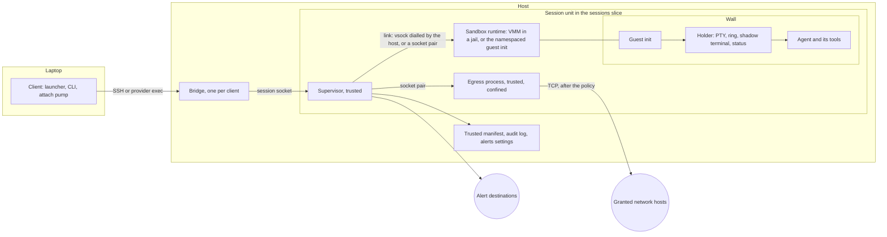

# Isolated sessions: spec

**Status:** proposed, 10 November 2026. **Decision:** [0029](decisions/0029-a-sandbox-per-session.md). **Plan:** [isolation-plan.md](isolation-plan.md). **Research:** [isolation](../research/isolation.md), [locations](../research/locations.md), [build facts](../research/build-facts.md). **CLI:** [cli-spec.md](cli-spec.md). **Issue:** [#100](https://github.com/iamlakshya/simstim/issues/100). **Roadmap:** O2, which widens X6 ([#13](https://github.com/iamlakshya/simstim/issues/13)).

This spec says what to build so that each session runs in its own sandbox. [The plan](isolation-plan.md) says in what order. Another coding agent will build it one pull request at a time, under [AGENTS.md](../../AGENTS.md) and [CONTRIBUTING.md](../../CONTRIBUTING.md). Task IDs such as P1.4 and H7 name tasks in the plan, which gives their order.

**How the design was chosen.** A Monte Carlo tree search looked at five decisions in order. They are the wall (L1), where the trusted parts run (L2), the lifecycle (L3), the doors (L4), and the supply chain and autonomy (L5). Five researchers expanded each node, and two judges scored each option for security, fit, convenience, scale and effort. The value was (0.35 security + 0.15 fit + 0.20 convenience + 0.15 scale + 0.15 effort) / 10, over 7 iterations. The best path is:

| Layer | Choice | Own value | Best below |
| --- | --- | --- | --- |
| L1 Wall | Wall drivers with levels and a floor pinned for each host | 0.575 | 0.687 |
| L2 Control | The holder inside the wall, a thin trusted supervisor outside | 0.678 | 0.687 |
| L3 Lifecycle | Cold boot from a verified image, state on disk only | 0.645 | 0.687 |
| L4 Doors | A wall without a network card, an egress process on the trusted side, sentinel secrets | 0.687 | 0.687 |
| L5 Supply chain | The laptop holds the digests: a signed, reproducible boot chain | 0.675 | 0.675 |

The path reaches L5, but the chosen L5 option secures only the project's own artefacts. It does nothing against a poisoned package or an injected prompt inside a session. So this spec completes L5 with grafts from the other L5 options, which the judges and the red team support. The grafts are package manager hardening and a registry gate, a review gate on `pull`, sentinel tripwires, and a guard on the model API. Each graft says where it came from.

[The research note](../research/isolation.md) gives the method, the full tree, the red team, the fact check and a check of the choice under six weight sets. Below L2, the choices hold under all six. At L2, the holder outside with a guest agent comes within 0.01 of the chosen option, and wins when convenience weighs more. The design keeps the holder inside, so that no memory-unsafe parser of hostile bytes runs on the trusted side. Section 14 comes from a second search of 4 iterations. Its best path is SSH add, then client placement with host admission, then tiers as a grant ceiling (0.732). That path holds under every weight set.

Every fact that no primary source confirms is marked UNVERIFIED. Where the fact check corrected a claim, this spec uses the correction.

**The second pass.** On 10 November 2026 the owner asked for more control: one config for all sessions that a narrower place can override, one-off exceptions, no forced strict defaults, a shell beside the agent, and research on automatic classifiers, so that many sessions can run at once. The owner also asked for a command line that is easy to guess. This pass adds the layers, profiles and locks of section 8, the unknown action and the classifier of 7.2 and 7.8, SSH keys (7.9), and shells in a sandbox (6.11). After AWS launched Nitro Sandboxes on 9 November 2026, it also adds a `nitro` driver for EC2 hosts (5.1, 11). A check of every feature of Docker Sandboxes and the hosted VM service added section 17. Every command now follows [0033](decisions/0033-one-command-grammar.md). [The research](../research/isolation.md#policy-for-parallel-work) and [the CLI study](../research/cli-dx.md) give the evidence.

**Words.** `<name>` is `brand.Name`, today `simstim`. Code never spells the product name outside `internal/brand` ([0007](decisions/0007-name-in-one-place.md)). Commands in this spec are written as users type them, `simstim …`. Section 14 writes paths and names with today's name, such as `~/.config/simstim/tiers.toml`. Code builds each of them from `brand`.

## 1. Goal, scope and non-goals

### 1.1 Goal

Each session runs in its own sandbox. A wall separates the sandbox from the host and from every other session. Nothing crosses the wall unless the user grants it: no file of the host, no network host, no secret value, no port and no device. The wall is on by default, at the strongest level that the host can run. The design must stay convenient enough that users keep it on.

The product reference is a sandbox service on hosts that the user owns: one command makes a sandbox, attaches to it, stops it, wakes it and forks it. Docker Sandboxes ([architecture](https://docs.docker.com/ai/sandboxes/architecture/)) and a hosted VM service show what users expect. This design differs in three ways. It runs on the user's own hosts, it keeps the agent's terminal bytes exact, and it is open source.

### 1.2 In scope

- A wall for each session, at one of four levels: none, process, gvisor and microvm (section 2).
- A floor for each host, pinned on the laptop, and recorded downgrades.
- A trusted supervisor for each session, outside the wall, and the holder inside it.
- Doors that are closed by default: files, network, secrets, ports, devices, paste and terminal output (section 7).
- Policy in layers: built-in, all sessions, a host, a repository, a profile and a session, with locks, one-off rules that end by themselves, and changes that reach running sandboxes (section 8).
- An unknown action for sites that no rule covers, and a classifier that decides them for work with nobody at the terminal (7.2, 7.8).
- Shells and commands in the same sandbox as the agent (6.11).
- SSH keys that a sandbox can use but not read (7.9).
- Secrets that the sandbox can use but not read (sentinels).
- Stop, wake on attach, restore after a reboot, fork and destroy.
- A verified boot chain for the microvm wall, and checks of the project's own artefacts.
- Fixes for holes that exist today, whatever wall a session has (phase 0).
- Hosts that the user adds: the sandbox probe, the root step, runtime delivery, tiers and the grant gate, placement, health, drain and purge (section 14).

### 1.3 Non-goals

- **No cloud service.** No account, relay or telemetry. Hosts stay the user's own.
- **No change to the agent's bytes.** The design observes risky terminal output and warns. It never filters it. An opt-in filter is an open question ([question 26](#15-open-questions)), not part of this plan.
- **No memory snapshots.** Every start is a cold boot. A stop loses the processes and the screen. The agent comes back with its resume command, as restore does today. This keeps secrets out of files and avoids clone-uniqueness bugs.
- **No native macOS host.** On a Mac, sessions run in a Lima VM, as today ([question 37](#15-open-questions)).
- **No Windows hosts.**
- **No defence against a compromised laptop,** or a compromised login account on a host. The design limits what each can reach, and says where it stops (3.4).
- **No judgement of code.** The review summary on `pull` flags risky files. It cannot find a backdoor in ordinary code.
- **No GPU or other device passthrough** in this plan.
- **The tool still never changes an agent's own permissions** ([design](../explanation/design.md#non-goals)). Policy acts at the doors, outside the agent.
- **No judgement of commands.** The classifier judges only what crosses a door. Whatever runs inside the sandbox stays inside it (7.8).

## 2. Terms

One name for each thing. Other documents and the code use these names and no others.

| Term | Meaning | In code |
| --- | --- | --- |
| host | A machine that runs the host helper and sessions, as today. | `client.Host` |
| laptop | The machine that runs the client, as today. | |
| session | One unit of work in the list: a name, an agent, a folder and a state, as today. `new` starts one. A walled session runs in one sandbox. | `host.Manifest` |
| agent | The AI coding CLI, or any program, that a session runs. Never the helper. | `agents.Agent` |
| sandbox | The isolated place where one or more sessions run, with all their processes. `new` makes a sandbox for its session. `shell` and `new --in` add sessions to a sandbox that exists. The sessions in a sandbox share its files, its policy and its secrets. | `wall.Sandbox` |
| shell session | A session that runs a login shell in the sandbox of another session, for commands that the user types (6.11). | `api.SessionInfo.SandboxOf` |
| wall | What separates a sandbox from the host and from other sandboxes. Never the name of a kind of sandbox. | `internal/wall` |
| level | How strong a wall is: `none` (W0), `process` (W1), `gvisor` (W2) or `microvm` (W3). `vz` is a later level for Mac hosts ([question 37](#15-open-questions)), and it ranks with `microvm`. | `wall.Level` |
| floor | Only this: the weakest level that a host may give a new session. The client pins it in `hosts.toml`. A host's tier sets the lowest floor allowed (14.8.2). | `client.Host.WallFloor` |
| downgrade | A session that runs below its host's floor because the user asked for that level by name. | `api.WallInfo.DowngradedFrom` |
| driver | The code that builds walls of one level, such as `process` or `chv` (Cloud Hypervisor). | `wall.Driver` |
| driver's probe | What a driver finds out about a host: whether it can run, and why not. | `wall.Probe` |
| sandbox probe | The read-only bridge request `sandbox.probe`. It runs each driver's probe and reports the host's features (14.3). | `api.CapProbe` |
| tier | How far the user trusts a host: `own`, `throwaway` or `shared`. The host never learns it (14.8). | `client.Tier` |
| trusted side | Everything outside the wall on the host: the bridge, the supervisor and the egress process. | |
| guest | Everything inside the wall. The guest is untrusted, the holder included. | |
| supervisor | The trusted process of one walled session. It is the main process of the session's systemd unit. | `internal/supervisor` |
| guest init | The host helper as the first process inside the wall. It sets the sandbox up, starts the holder and serves the link. | `internal/guest` |
| holder | As today: the PTY, the 8 MiB ring, the shadow terminal and the status engine. In a walled session it runs inside the wall. | `host.Holder` |
| link | The one byte stream between a supervisor and its guest init. It carries many streams. | `internal/link` |
| stream | One two-way byte stream inside a link. Each has a kind: `ctl`, `holder`, `egress`, `dns`, `port`, `put`, `bundle`, `exec`, `rport`, `agent`, `sftp`, `get` or `layer` (5.2). | `link.Stream` |
| door | One typed way across the wall: files, network, pushes, secrets, SSH keys, ports, devices, paste or terminal output (7). | `api.Door` |
| rule | One allow or one deny for one door and one target, in one layer, with a source and an optional end time. | `api.Rule` |
| grant | A rule that allows. A host's tier caps the grants that its sandboxes may get. | `api.Rule` |
| layer | One place that rules and settings come from: built-in, all sessions, a host, a repository, a profile or a session (8.2). | `api.Layer` |
| profile | A named set of settings and rules for a kind of work, such as `unattended`. A session uses at most one (8.3). | `client.Profile` |
| lock | A value or a deny that no narrower layer may change. Only the user's own layers can lock (8.2). | `api.Lock` |
| grant gate | The client's check that a host's tier allows each thing that leaves the laptop for it: a secret, the SSH agent, an alert token, a repository, a place in the auto pool (14.8). | `client.Allow` |
| grant ledger | The laptop's record of which grants each host got: names, never values. | `grants.json` |
| policy | The merged layers of one sandbox: its rules, locks, preset, unknown action and level. The supervisor keeps it. | `api.Policy` |
| preset | A named starting point for the network door: `locked`, `balanced` or `open`. Any layer may pick it. | `api.Preset` |
| unknown action | What the egress process does with a flow that no rule covers: `ask`, `deny`, `allow` or `classify` (7.2). | `api.Unknown` |
| classifier | The trusted code that decides a flow that no rule covers, when the unknown action is `classify`. It runs fixed checks first, then the judge (7.8). | `internal/egress/classify` |
| judge | The optional last step of the classifier: a model or a program that the user configures. It answers allow, deny or unsure. | `classify.Judge` |
| egress process | The trusted, confined process of one session that makes every network connection for it. | `internal/egress` |
| bound secret | A secret whose value stays in the egress process. The proxy puts it into requests to its bound hosts. | `api.SecretBound` |
| exposed secret | A secret whose value enters the guest's environment, as all secrets do today. | `api.SecretExposed` |
| sentinel | The random stand-in that the guest sees in place of a bound secret. Each start makes new ones. | `egress.Sentinel` |
| armed | A session whose egress process holds the values of its bound secrets. | `api.SessionInfo.Armed` |
| jail | The confinement of a trusted-side process that handles untrusted input: the VMM, the image converter, host-side git. A jail is not a wall. | `internal/jail` |
| image | A read-only root file system with a dm-verity tree, made from an OCI image and named by its digest. | `internal/image` |
| template | A user's own image, built on the laptop and named by its digest. It reaches a host only from the laptop (14.9.5). | `templates.json` |
| boot pair | The guest kernel and the tools image that the project builds and signs. | `guest/` |
| tools image | A read-only image with the guest helper and the shadow terminal. | `tools.erofs` |
| agents disk | A read-only image of the agents that the host has installed, for microvm sandboxes. | `agents.img` |
| session disk | The one writable disk of a microvm sandbox. | `disk.img` |
| trusted manifest | The session's `manifest.json`. Only the trusted side writes it. | `host.Manifest` |
| claim | A fact that the guest reports, such as the agent's state. It is kept apart from trusted facts and shown as claimed. | `host.Manifest.Guest` |
| audit log | `audit.jsonl` in the session folder: what the trusted side did and decided. It never holds a secret value. | `internal/supervisor/audit.go` |
| release manifest | The one list of digests of every trusted artefact of a release: the helper, the shadow terminal, the guest kernel, the tools image, the VMM and `runsc`. The client embeds it. | `internal/supply` |
| runtime | The artefacts that a host needs for walls: the VMM, `runsc` and the boot pair. The release manifest names each by digest. | |
| prepare | The sandbox probe, runtime delivery, the root step and a test boot, in that order (14.2.1). | `host prepare`, `sandbox.prepare` |
| root step | The one optional script that needs root on a host. The client builds it, and the user runs it through sudo or gives it to the machine's owner (14.4). | `client.RootScript` |
| namespace launcher | A small static program, `cmd/userns`, that makes a process wall's namespaces and mounts, then starts the guest init with no capabilities (4.1). On Ubuntu 23.10 or later, a root-owned copy runs under an `AppArmor` profile that lets it make user namespaces ([question 4](#15-open-questions)). | `cmd/userns`, `/usr/local/libexec/<name>/userns` |
| slot launcher | A root-owned program that starts each VMM as a slot account, through one sudo line (14.4.6, [question 27](#15-open-questions)). | `cmd/launch` |
| facts | A host's live numbers for placement. | `host.facts`, `api.HostFacts` |
| admission | The host's own check, under a lock, that a sandbox fits. | `admit.go` |
| pool | The hosts that `new auto` may contact. | `[host.place] pool` |
| footprint ledger | The host's record of each change that the helper made outside its own folders. | `footprint.json` |
| drain | A mark on a host that makes it refuse new sandboxes. | `drain.json` |
| purge | `host rm --purge`: remove everything that the tool put on a host. | `host.purge` |

The guest init is never called an agent, because "agent" means the AI CLI.

## 3. Threat model and security properties

### 3.1 Threats

| ID | Threat |
| --- | --- |
| T1 | A malicious dependency or tool runs code inside a session. |
| T2 | Prompt injection makes the agent exfiltrate code or secrets. |
| T3 | An autonomous agent does destructive things: `rm -rf`, a force-push, deleting cloud resources. |
| T4 | A compromised session attacks other sessions, the host or the laptop, including through terminal escape sequences. |
| T5 | Credentials are stolen, as against credentials misused while the session runs. |

The 2025 npm attacks show T1, T2 and T5 together. The Nx payload ran installed agent CLIs with flags that turn their approvals off, to list secret files, and pushed the results to public repositories in the victim's own GitHub account ([Snyk](https://snyk.io/blog/weaponizing-ai-coding-agents-for-malware-in-the-nx-malicious-package/)). The Shai-Hulud worm compromised more than 500 packages and spread by publishing with stolen tokens ([CISA](https://www.cisa.gov/news-events/alerts/2025/09/23/widespread-supply-chain-compromise-impacting-npm-ecosystem)). Anthropic reports that an injected attacker key uploaded files through an allowed model API ([Anthropic](https://www.anthropic.com/research/how-we-contain-claude)).

### 3.2 Trust boundaries

- **Trusted:** the client on the laptop, the bridge, the supervisor, the egress process and the host helper's binaries. The egress process is trusted but confined, because it parses hostile traffic.
- **Untrusted:** everything in the wall (the guest init, the holder, the shadow terminal, the agent and its tools), everything that a session wrote (its clone, its disk, its bundles, its claims), a repository's own files until the user trusts them, and a host's answers about itself. A compromised host can lie in its sandbox probe and its facts. The floor guards against mistakes, not against a hostile host.
- **Today's holes,** fixed in phase 0 whatever the wall:
  - Any process of the host user can attach to any holder socket and type into any session. `Holder.serve` in `internal/host/holder_conn.go` checks no peer and no role, and the agent's hook uses the full socket.
  - The shadow terminal parses hostile bytes in an unconfined child of the holder (`internal/host/vt_child.go`). Its Ghostty pin, `ad97d331`, is in the ranges of two advisories. In [GHSA-w9q4-5jvv-mcv4](https://github.com/ghostty-org/ghostty/security/advisories/GHSA-w9q4-5jvv-mcv4), terminal output alone can corrupt memory. In [GHSA-jqr7-69mm-v35h](https://github.com/ghostty-org/ghostty/security/advisories/GHSA-jqr7-69mm-v35h), a very wide terminal crashes when it is narrowed. The pin already holds the fixes of two others, GHSA-qjfx-r533-6vx3 and GHSA-3r5j-c6rj-xq2v. The holder caps a client's terminal size only at 65535 (`clamp16`). Fixed by 19.1 ([build facts](../research/build-facts.md#61-ghostty-and-its-advisories)).
  - `applyHook` stores any `session_id` that a hook sends (`internal/host/hooks.go`), and `resumeArgv` puts it into the resume command (`internal/host/restore.go`).
  - The launcher draws a session's reason without cleaning it (`internal/tui/detail.go`), and `oscSafe` removes only C0 and DEL (`internal/client/attach_notify.go`).
  - A paste whose words are all local files uploads them (`internal/client/attach_paste.go`). A session can put a path on the laptop's clipboard with OSC 52 first.
  - Setup trust is a yes or no for each repository, not tied to the script's content (`internal/client/trust.go`). Fixed by 19.2.
  - `copyWorktreeInclude` follows symlinks (`internal/host/worktree.go`). Host git runs in a session's worktree with the repository's own fsmonitor, hooks and filters, outside every session's unit (`removeWorktree`, and `SessionRepo` in `internal/client/pull.go`). Fixed by 19.3.
  - A VM that `host create lima` makes can reach services on the Mac's loopback address through `host.lima.internal`. Fixed by 19.4.
  - No job watches the pins that no package ecosystem covers, such as the Ghostty commit. Fixed by 19.5.
  - The generated SSH wrapper includes the user's `~/.ssh/config` first, so a `ForwardAgent yes` there reaches every host (`writeWrapper` in `internal/client/ssh.go`). Task H2 fixes it (14.8.5).

### 3.3 What the design guarantees

Each guarantee names the levels and the phase from which it holds.

| ID | Guarantee | Levels | From |
| --- | --- | --- | --- |
| G1 | Without a grant, no process in a sandbox can read or change a file outside it: the host user's home, SSH keys, agent logins, cloud credentials, other sessions' folders, the helper's files. | process, gvisor, microvm | P1 |
| G2 | Without a grant, a sandbox has no network. It has no network card and an empty network namespace. Every connection goes through the egress process. The egress process refuses loopback, private, link-local, shared (`100.64/10`) and unique local ranges, cloud metadata addresses and the host's own addresses unless a grant names them. No UDP, ICMP or raw packet leaves. | process, gvisor, microvm | P1 |
| G3 | DNS answers only granted names, and on a microvm gives unknown names a synthetic address (7.2). No name goes upstream before the policy allows it. | process, gvisor, microvm | P2 |
| G4 | A bound secret's value never enters the sandbox. The egress process puts it into one named header, only on its bound hosts, and only while the session is armed. On a bound host, a request with any other credential is refused. Elsewhere, a sentinel in a DNS name, an SNI or a plain or intercepted request is refused and raises an alert. The egress process cannot see into a spliced flow (N3). | process, gvisor, microvm | P2 |
| G5 | A sandbox reaches no socket, process, file or network of another sandbox. It does not reach the host's systemd user bus, its SSH agent or the holder sockets of unwalled sessions. The sessions inside one sandbox share it (6.11). | process, gvisor, microvm | P1 |
| G6 | The guest cannot change its own limits, level, policy, trusted manifest, audit log, alert destinations or alert settings. It can lie only in its claims about its own session. | process, gvisor, microvm | P1 |
| G7 | Nothing new listens on a host network port. No trusted-side process listens where a guest can connect: the supervisor dials into a microvm, and gives a process or gvisor sandbox one end of a socket pair. | all | P1 |
| G8 | The agent's bytes reach the user's terminal unchanged. The supervisor passes output frames on and never reads their payload. | all | P1 |
| G9 | A new session never starts below its host's pinned floor unless the user names the downgrade. The trusted manifest records it, the session's row shows it, and a `wall_downgraded` alert reports it. A repository's file, an agent's data or a host's answer may raise a level, never lower it. From P1 it holds for a session whose layers name a level. From P2.10, when walls are on by default, it holds for every session (6.1). | all | P1, P2.10 |
| G10 | A paste never uploads a file under a sensitive path. Nor does it upload a laptop file whose path a session wrote to the clipboard in the last 24 hours. A notice names each file that is uploaded. | all | P0 |
| G11 | Each trusted artefact that a host runs or boots for a session (the helper, the VMM, the guest kernel, the tools image, the user's image) matches a digest that the client holds. | microvm (all for the helper) | P4 |

### 3.4 What the design does not guarantee

| ID | Not guaranteed | Why, and what helps |
| --- | --- | --- |
| N1 | Safety from terminal escape sequences | Byte-exact is a project rule. Escape sequences reach the laptop's terminal. The client observes and warns (P7), and the docs say which terminal settings to change. |
| N2 | Safety from misuse of what is granted | A sentinel can be used on its bound hosts while the session runs. Path and method rules, live revoke and the audit log limit this. |
| N3 | No exfiltration through granted hosts | Spliced flows to a granted host can carry data. Interception, upload budgets and the model API guard narrow this. |
| N4 | Safety from kernel, KVM or VMM bugs | A process wall shares the host kernel. A microvm wall depends on KVM and the VMM. Jails, pins and `pins-watch` shorten the exposure. |
| N5 | Safety when the host's login account is compromised | Code that runs as the login user can drive every session on that host and read the egress processes' memory if it can trace them. Jails make sure that a VMM escape does not land as that user where a subuid is available. Slot accounts go further (14.4.6). |
| N6 | Safety when the laptop is compromised | The laptop holds every secret command and SSH key, as today. |
| N7 | A clean history | A backdoor in a reviewed commit passes every wall by design. The review summary flags risky files only. |
| N8 | True claims | The guest can lie about its own state, ports and alerts. The launcher shows claims as claimed. Trusted facts (end, out-of-memory kills, level, policy) come only from the trusted side. |
| N9 | The same strength on every host | A host without KVM runs process or gvisor walls. The floor and the row show which. |
| N10 | Safety from root on a host | Root sees the memory and disk of every sandbox there, and every secret sent. Tiers limit what goes there (14.8). Nothing hides what does. |

### 3.5 Coverage of each threat

| Threat | What stops it | What still passes | Phases |
| --- | --- | --- | --- |
| T1 | G1, G2, G5: the code meets an empty home, no host logins, no network. Root and home reset at each start, so a dropper in `~/.bashrc` does not persist. Package manager settings in the guest. Registry gates in the egress process. | The code runs inside with every open door. It persists in `/work` and in the agent's state folders. A backdoor commit can reach the laptop through `pull`. | P1, P2, P7 |
| T2 | G2, G3. The identity pin stops an attacker's key on an allowed model API. The model API guard refuses server-side fetch tools. Push rules refuse new repositories and gists. Upload budgets. Audit lines. | Data inside allowed spliced flows, pushes to granted session branches, and the model vendor itself. | P1, P2 |
| T3 | Damage stays in the sandbox. The host's repository is never touched: the session works on its own clone. Path rules refuse ref deletes, repository creation, workflow writes and runner registration. Cloud APIs are closed unless granted. | Destructive calls through a granted secret within the rules. Loss of the session's own uncommitted work (checkpoints in P5). | P1, P2, P5 |
| T4 | G1, G5, G6, G7. The parser of hostile bytes runs inside the wall. Jails for the VMM, the converter and host-side git. Phase 0 fixes: the hook socket, the peer check, cleaned text, the paste guard. | Terminal escape sequences (N1). Kernel and VMM bugs (N4). The laptop's git still parses a hostile pack on `pull`, with fsck on and no checkout. | P0, P1, P3 |
| T5 | G4 for bound secrets. G1 for the host's agent logins. The tool never copies login files into a sandbox. The grant gate keeps secrets off hosts of a lower tier (14.8). | Exposed secrets and logins made inside a sandbox can be stolen. The row shows a badge, and an alert reports each exposed secret. Misuse while armed (N2). | P1, P2 |

## 4. Design overview

A walled session has two halves. The trusted half runs in the session's systemd user unit, outside the wall: the supervisor and the egress process. The untrusted half runs inside the wall: the guest init, the holder with its ring and shadow terminal, and the agent. One link joins them. The client and the bridge do not change their path: the bridge still dials the session's socket, `paths.Socket(id)`. The supervisor serves that socket now, and passes each connection on to the holder inside the wall.

A sandbox may hold more than one session: a shell session beside the agent, or a second agent (6.11). Its sessions share one supervisor, one egress process and one link. Each session has its own holder inside the wall and its own session socket outside.



### 4.1 What runs where

| Part | process wall (W1) | microvm wall (W3) |
| --- | --- | --- |
| Supervisor, egress process | The session's unit, as the login user | The same |
| What makes the wall | The namespace launcher: new user, mount, PID, network, IPC, UTS and cgroup namespaces, the mounts, Landlock and seccomp. It then starts the guest init with no capabilities. | Cloud Hypervisor in a jail, on `/dev/kvm` |
| Link | One end of a socket pair that the guest init inherits | vsock: the supervisor connects to the VMM's Unix socket and sends `CONNECT <port>` |
| Holder, ring, shadow terminal, agent | Inside, on the host kernel | Inside, on the guest kernel |
| Root file system | The host's `/usr`, `/bin`, `/lib` and a filtered `/etc`, read-only | A verified image with an overlay that resets at each start |
| `/work/<repo>` | A folder in the session folder, bound into the sandbox | On the session disk |
| Network | An empty namespace. An explicit proxy on the guest's loopback. | No network card. A transparent redirect and an explicit proxy in the guest. |
| gvisor wall (W2, P6) | As the process wall, with gVisor's sentry between the guest and the host kernel | |

**The process wall's set-up (P1.5).** The namespace launcher, `cmd/userns`, builds the wall. It is a static binary with no dynamic loader, so `LD_PRELOAD` cannot reach it. It reads one JSON request from the supervisor on fd 3, and never takes a path to run. The request has a field `v`, the version of its format. The format only grows, so a launcher reads every version up to its own. It refuses a higher `v`, or a field that it does not know, so it never skips a step in silence. In order, it:

1. Sets `PR_SET_DUMPABLE` to 0, so that no other process of the user can trace it.
2. Makes new user, mount, PID, network, IPC, UTS and cgroup namespaces, and maps the host user to uid 0 in them. It then forks once. The child is PID 1 of the new PID namespace, and does the steps below.
3. Applies the mount plan of 7.1: the binds, a tmpfs home, a new `devpts`, the `/dev` nodes, a new `proc`, then `pivot_root`.
4. Brings up `lo` in the new network namespace. From P2.1, it also binds the DNS stub's UDP and TCP sockets on `127.0.0.53:53`, for the guest init to inherit. A port below 1024 needs a capability that the guest init lacks.
5. Makes a child user namespace that maps uid 0 of the outer one to uid 1000, `agent`, and gid 0 to gid 1000.
6. Sets `no_new_privs`, drops every capability, and loads the seccomp profile below and the Landlock rules.
7. Runs the guest init, `<helper> wall-init`, from `/opt/<name>/bin/` as uid 1000. It stays PID 1 of the new PID namespace.

On a host with Ubuntu's user-namespace restriction, the launcher is the root-owned copy of the `userns-apparmor` step. Its `AppArmor` profile puts the guest init into a child profile that denies every capability (14.4.2). The helper upgrades without root, so that copy can be older than the helper. A start whose request the copy refuses fails with `wall_setup`. `host prepare` then offers the `userns-apparmor` step again, which installs the new copy (14.3). On other hosts, the supervisor runs the launcher from the helper's own folder, with the same steps. The guest init needs no capability: it serves the link, the proxy on `lo` and the DNS stub, and starts the holder. The holder and the agent run as uid 1000 (17.10).

**The seccomp profile** (`internal/wall/process/seccomp.go`) allows every system call except these, which fail with `EPERM`:

- `unshare`, `setns`, and `clone` with any `CLONE_NEW*` flag. `clone3` fails with `ENOSYS` instead, so that the C library falls back to `clone`, whose flags seccomp can read. Docker's default profile does the same ([moby](https://github.com/moby/profiles/blob/main/seccomp/default.json)).
- The mount family: `mount`, `umount2`, `pivot_root`, `move_mount`, `open_tree`, `fsopen`, `fsmount`, `fsconfig`, `fspick` and `mount_setattr`.
- `keyctl`, `add_key`, `request_key`, `bpf`, `perf_event_open`, `userfaultfd`, `io_uring_setup`, `io_uring_enter`, `io_uring_register`, `kexec_load`, `kexec_file_load`, `init_module`, `finit_module` and `delete_module`.
- `socket` with any family but `AF_UNIX`, `AF_INET`, `AF_INET6` and `AF_NETLINK`. So `AF_VSOCK` and `AF_PACKET` fail.
- `socket(AF_NETLINK, …)` with any protocol but `NETLINK_ROUTE` (0), such as `NETLINK_NETFILTER`, `NETLINK_AUDIT`, `NETLINK_KOBJECT_UEVENT` and `NETLINK_SOCK_DIAG`.

`NETLINK_ROUTE` stays open because glibc's `getifaddrs` needs it: without it, Node's `os.networkInterfaces()` throws, and Go's `net.Interfaces` fails. In the empty network namespace, a `NETLINK_ROUTE` read shows only `lo`, and a change needs `CAP_NET_ADMIN`, which the agent lacks ([build facts](../research/build-facts.md#4-linux-walls)).

**Other ABIs.** `go-seccomp-bpf` sends a call from another architecture to the profile's default action, which here allows it ([filter.go](https://github.com/elastic/go-seccomp-bpf/blob/main/filter.go)). The library refuses x32 calls itself. So the profile also loads a second filter, which kills the process when the call's architecture is not the host's own: `AUDIT_ARCH_X86_64` or `AUDIT_ARCH_AARCH64`. This stops i386 calls through `int 0x80`, and 32-bit Arm calls. Every jail's profile (5.6) loads the same guard.

**Tests (P1.5).** The escape suite, `test/e2e/escape.py`, runs inside a sandbox and checks each of these:

1. `unshare -U`, `mount` and `bpf` fail with `EPERM`. `clone3` fails with `ENOSYS`.
2. `socket(AF_VSOCK)` and a `NETLINK_AUDIT` socket fail. `RTM_NEWADDR` on a `NETLINK_ROUTE` socket fails with `EPERM`.
3. `node -e 'console.log(os.networkInterfaces())'` lists `lo`.
4. The process status shows no capability in the guest init, the holder or the agent.
5. An unconfined process of the user that runs the namespace launcher, or traces it, gets no capability in any namespace.
6. `unshare` through the i386 `int 0x80` gate does not run, and an x32 call fails with `ENOSYS`.

### 4.2 A session from start to end

1. `simstim new devbox --agent claude --dir ~/src/app` picks the level: the host's floor unless the user asks for more, or names a downgrade.
2. The host makes a git bundle of the repository on the trusted side, writes the trusted manifest, and starts the session's unit with `<helper> supervise <id>`.
3. The supervisor starts the egress process, hands it the policy and the values of bound secrets, and gets their sentinels back.
4. The supervisor builds the sandbox with its driver and gets the link.
5. Over the `ctl` stream it sends `start`: the command, an environment made from a fixed base (never the host's login environment), the sentinels, the proxy settings and the terminal size. The base is `HOME=/home/agent`, `USER=agent`, `LOGNAME=agent` and `LANG=C.UTF-8`, a project choice. The supervisor adds the `PATH` of 7.1, and `TERM`, `COLORTERM`, `TERM_PROGRAM` and `TERM_PROGRAM_VERSION` as `sessionEnv` sets them today. It also adds `NODE_USE_ENV_PROXY=1`, the proxy and CA variables of 7.2, `brand.Env("HOOK_SOCK")` for the guest's hook socket, and the variables of 17.2. The guest init clones the bundle into `/work/<repo>`, starts the holder, and the holder starts the agent.
6. The client attaches. The supervisor passes frames to the holder and back. It checks frame types and sizes, and never reads the output's payload.
7. Every network flow from the agent becomes an `egress` stream. The egress process decides, makes the connection, swaps sentinels for values on bound hosts, and writes one audit line.
8. `pull` brings the work out as a git bundle into quarantine refs on the laptop. `stop` shuts the sandbox down and keeps `/work` and the agent's state folders. `rm` destroys it.

## 5. Components

| Component | Job | Runs | Trust | Code |
| --- | --- | --- | --- | --- |
| Client | Picks the host and the level, checks the floor and the tier, fetches secrets, shows badges, grants and reviews | Laptop | Trusted | `internal/client`, `internal/cli`, `internal/tui` |
| Bridge | Serves one client, as today. Forwards new requests to the supervisor. | Host, outside units | Trusted | `internal/host/bridge*.go` |
| Supervisor | Owns the sandbox, the unit's limits, the trusted manifest, the audit log, alerts, the policy and the link. Serves the session socket and passes its frames to the holder. | Host, the session's unit | Trusted | `internal/supervisor` (new) |
| Egress process | Makes every network connection: policy, DNS, splice or intercept, sentinels, audit lines | Host, the session's unit | Trusted, confined | `internal/egress` (new) |
| Jail | Confines trusted-side processes that touch untrusted input | Host | Trusted code, confined process | `internal/jail` (new) |
| Wall drivers | Probe, prepare, start, stop and destroy sandboxes | Host, in the supervisor | Trusted | `internal/wall`, `internal/wall/process`, `internal/wall/chv`, later `internal/wall/gvisor`, `internal/wall/firecracker`, `internal/wall/nitro` and `internal/wall/none` (21) |
| Link | Many streams over one byte stream, with flow control | Both sides | Parses hostile frames on the trusted side | `internal/link` (new) |
| Guest init | PID 1 in the sandbox: mounts, the network shim, the DNS stub, the holder's start, clean shutdown | Inside the wall | Untrusted | `internal/guest` (new) |
| Holder | As today, in a guest mode that listens on guest paths | Inside the wall | Untrusted | `internal/host/holder*.go` |
| Shadow terminal | As today. It now parses hostile bytes inside the wall. | Inside the wall | Untrusted | `vt/` |
| Image builder | Pulls OCI images, flattens them, writes ext4 with a verity tree | Host, in a jail | Trusted code, confined process | `internal/image` (new, P3) |
| Supply checks | The release manifest, digest checks, exec from a hashed descriptor, verity tables | Laptop and host | Trusted | `internal/supply` (new, P4) |
| Policy layers | The merge of layers, host pattern checks, locks | Laptop and host | Trusted | `internal/grant` (new), types in `internal/api` |
| Classifier | The steps of 7.8, and the judge's client | Host, in the egress process | Trusted | `internal/egress/classify` (new) |
| Grant gate | Checks each thing that leaves the laptop against the host's tier, and records it in the grant ledger | Laptop | Trusted | `internal/client/tier.go`, `grants.go` (new, 14.8) |
| Placement | Picks a host for `new`, from saved defaults or live facts | Laptop | Trusted | `internal/client/place.go`, `facts.go` (new, 14.10) |
| Sandbox probe, admission, purge | Report a host's features and facts, admit a sandbox under a lock, remove what the tool put on a host | Host | Trusted. The client treats their answers as claims. | `internal/host/capprobe*.go`, `facts.go`, `admit.go`, `purge.go` (new, 14) |

### 5.1 `internal/wall`

```go
// Package wall builds the wall around one session's sandbox.
package wall

// Level is how strong a wall is. A higher level is stronger.
type Level int

const (
    None    Level = 0 // W0: no wall, as before this change
    Process Level = 1 // W1: namespaces, Landlock and seccomp on the host kernel
    GVisor  Level = 2 // W2: gVisor's user-space kernel in front of the host kernel
    MicroVM Level = 3 // W3: a guest kernel on KVM
    // vz, a later level for Mac hosts (question 37), ranks with MicroVM.
)

// ParseLevel reads "none", "process", "gvisor" or "microvm".
func ParseLevel(s string) (Level, error)

// String returns the level's name, as users type it.
func (l Level) String() string

// Driver builds walls of one level on this host.
type Driver interface {
    Name() string // "process", "chv", later "gvisor", "firecracker", "nitro" and "none" (21)
    Level() Level
    // Probe says whether this host can run the driver, and why not.
    Probe(ctx context.Context) Probe
    // Prepare makes the sandbox's files from spec. It starts nothing.
    Prepare(ctx context.Context, spec Spec) (Sandbox, error)
    // Open returns a prepared sandbox again, for a supervisor that
    // starts after a reboot.
    Open(ctx context.Context, sessionDir string) (Sandbox, error)
}

// Sandbox is one session's sandbox.
type Sandbox interface {
    // Start boots the sandbox and returns the link to its guest init.
    Start(ctx context.Context) (net.Conn, error)
    // Stop asks the guest init to stop the agent and shut down, and waits
    // up to grace. The session's files and disk stay.
    Stop(ctx context.Context, grace time.Duration) error
    // Kill ends the sandbox at once.
    Kill() error
    // Wait returns when the sandbox has ended, and how.
    Wait() Exit
    // Destroy removes the sandbox's files. The sandbox must have ended.
    Destroy() error
    // Abilities lists what this sandbox can do beyond these methods.
    Abilities() Abilities
}

// Abilities are optional abilities of a sandbox.
type Abilities struct {
    Freeze bool // a consistent copy of /work for fork (P5)
    Reflink bool // copies that share blocks
}

// Spec describes the sandbox to prepare.
type Spec struct {
    ID         string
    SessionDir string
    Image      *ImageRef // microvm. nil for process, none and, in this plan, gvisor (21.4).
    Mounts     []Mount   // the files door
    StateDirs  []string  // the agent's folders that stay across starts
    MemoryMax  int64     // the unit's cap, decision 0024
    CPUs       int
    DiskMax    int64     // the session disk's cap, microvm
    Root       RootMode  // Reset (the default) or Keep
    Helper     string    // the helper version folder that the guest runs
}

// Mount is one granted folder.
type Mount struct {
    Host  string // opened by the supervisor with os.Root, never followed
    Guest string
    Write bool
}

// Probe is what a driver found on this host.
type Probe struct {
    Driver  string            `json:"driver"`
    Level   Level             `json:"level"`
    OK      bool              `json:"ok"`
    Reason  string            `json:"reason,omitempty"` // why not, in plain words
    Fix     string            `json:"fix,omitempty"`    // a command for the Try: hint
    Version string            `json:"version,omitempty"`
    Facts   map[string]string `json:"facts,omitempty"` // kernel, landlock_abi, kvm, apparmor_userns
}

// Best is the strongest level whose driver probed OK.
func Best(probes []Probe) Level

// Drivers lists the drivers built into this helper, strongest first.
func Drivers() []Driver
```

Each driver's probe runs inside the sandbox probe (`sandbox.probe`, 14.3): at `host add`, `host prepare`, `host show` and `host doctor`. Its result is cached in `StateDir()/walls.json`, keyed by `BootID()` and the helper's version. The sandbox probe always probes again and rewrites the cache, so a probe after the root step sees the change. Only a session's start reads the cache. The helper's command `wall probe --json` prints the same probes, for tests on a host (P1.1).

| Driver | Probe checks |
| --- | --- |
| `none` (P6.3) | Always passes on a host that runs sessions today. It builds no wall (21.6). |
| `process` | Linux 5.13 or later. A child makes a user and a mount namespace, writes its uid map and mounts a tmpfs. It does this directly, or through the namespace launcher of the root step (14.4.2). This test decides, not a sysctl: on Ubuntu 23.10 or later, `unshare(CLONE_NEWUSER)` succeeds, but the namespace has no capability ([build facts](../research/build-facts.md#4-linux-walls)). `kernel.apparmor_restrict_unprivileged_userns` is a fact only. The Landlock ABI from `landlock_create_ruleset(NULL, 0, LANDLOCK_CREATE_RULESET_VERSION)` is 1 or more. seccomp filters load. |
| `chv` | `/dev/kvm` opens read and write, and `KVM_GET_API_VERSION` answers 12. The host kernel is 6.8 or later ([Cloud Hypervisor README](https://github.com/cloud-hypervisor/cloud-hypervisor/blob/main/README.md)). The pinned `cloud-hypervisor` binary is in the artefact store with its digest. The user is in the group that owns `/dev/kvm`, or has an ACL entry on it (14.4.2). `systemd-detect-virt` is recorded as a fact. |
| `gvisor` (P6) | Linux 5.6 or later. The pinned `runsc` is present. The namespaces of 21.4 start, directly or through the namespace launcher. A smoke run of `runsc` with the flags of 21.4 succeeds. |
| `firecracker` (P6) | `/dev/kvm` as above, and a host kernel of 5.10, 6.1 or 6.18, the ones that Firecracker tests ([kernel policy](https://github.com/firecracker-microvm/firecracker/blob/main/docs/kernel-policy.md)). The pinned Firecracker is 1.17.0 or later ([AWS](https://aws.amazon.com/security/security-bulletins/2026-169-aws/)). The driver uses the MMIO transport only, and no jailer (21.5). |
| `nitro` (P6.4) | `/dev/nitro_enclaves` opens read and write. The parent kernel has the Nitro Sandboxes support of the `nitro_enclaves` driver: Amazon Linux 2023 `kernel6.18` from `6.18.51-120.162.amzn2023`, or a kernel whose `/sys/class/misc/nitro_enclaves/` has `mem_pool/` and `pcie_slots` ([Firecracker](https://github.com/firecracker-microvm/firecracker/blob/firecracker-v1.18/docs/nitro-sandboxes/getting-started.md)). That second test is an inference: the guide lists those files, but does not call them a test of support. A start that fails with "Failed to query hypervisor-supported flags" means an old driver, as the guide says. The driver uses virtio-pci, because Nitro Sandboxes are PCIe only ([comparison](https://github.com/firecracker-microvm/firecracker/blob/firecracker-v1.18/docs/nitro-sandboxes/comparison-with-kvm.md), 21.5). The pinned Firecracker is 1.18.0 or later. The pools and the slot budget fit one sandbox of the session's size. On a host where both this driver and `chv` pass, this one wins: its guest is a first-level guest, where `chv` on EC2 runs nested. |

A test-only driver, `plain`, starts the guest init as a child with no namespaces. It builds no wall. P1.4 uses it before the process wall exists.

### 5.2 `internal/link`

```go
// Package link carries many streams over one byte stream, between a
// supervisor and its guest init. Frames are proto frames of the types
// TStreamOpen, TStreamData, TStreamClose and TStreamWindow.
package link

// Kind is what a stream carries.
type Kind string

const (
    KindCtl    Kind = "ctl"    // one per link: start, stop, status, alerts
    KindHolder Kind = "holder" // one connection to the holder's socket
    KindEgress Kind = "egress" // one network flow out of the guest
    KindDNS    Kind = "dns"    // one DNS query out of the guest
    KindPort   Kind = "port"   // one forwarded connection into the guest
    KindPut    Kind = "put"    // one pasted file into the guest
    KindBundle Kind = "bundle" // a git bundle in (seed) or out (pull)
    KindExec   Kind = "exec"   // the output and exit code of one exec (6.11, P1.13)
    KindRPort  Kind = "rport"  // one connection from the guest to a laptop port (7.4, P1.9)
    KindAgent  Kind = "agent"  // one SSH agent connection from the guest (7.9, P2.13)
    KindSFTP   Kind = "sftp"   // one SFTP session of an editor (17.7, P2.15)
    KindGet    Kind = "get"    // one file copied out of the guest (P5.2)
    KindLayer  Kind = "layer"  // the guest's root as a tar stream, for image save (21.3, P5.5)
)

// Side is the end of a link.
type Side int

const (
    Supervisor Side = iota
    Guest
)

// Opener says which side may open each kind. The other side refuses a
// stream of another kind, or one from the wrong side, and counts it.
var Opener = map[Kind]Side{
    KindCtl: Supervisor, KindHolder: Supervisor, KindPort: Supervisor,
    KindPut: Supervisor, KindBundle: Supervisor, KindExec: Supervisor,
    KindSFTP: Supervisor, KindGet: Supervisor, KindLayer: Supervisor,
    KindEgress: Guest, KindDNS: Guest, KindRPort: Guest, KindAgent: Guest,
}

// Options bound a link.
type Options struct {
    Window     uint32 // credit for each stream, 256 KiB by default
    MaxStreams int    // open streams at once, 1024 by default
    MaxHeader  int    // the JSON header of an open, 4 KiB by default
}

// Session is one end of a link.
type Session struct{ /* … */ }

// New starts a link over conn.
func New(conn net.Conn, side Side, opt Options) *Session

// Open opens a stream of kind k with a JSON header.
func (s *Session) Open(ctx context.Context, k Kind, header any) (*Stream, error)

// Accept waits for a stream that the other side opened.
func (s *Session) Accept(ctx context.Context) (*Stream, error)

// Close ends every stream and the link.
func (s *Session) Close() error

// Stream is one stream. It is a net.Conn, and CloseWrite half-closes it.
type Stream struct{ /* … */ }

func (st *Stream) Kind() Kind
func (st *Stream) Header(v any) error // decodes the open's header
func (st *Stream) CloseWrite() error
```

Each stream has its own credit window, so a large download on an `egress` stream never holds back `holder` output. The writer of the link sends the frames of streams in turn, and `holder` and `ctl` streams go first when several wait.

**The numbers are targets (P1.2).** The window of 256 KiB starts from yamux's initial stream window ([yamux](https://github.com/hashicorp/yamux/blob/master/const.go), master, October 2026). The limits of 1,024 streams and a 4 KiB header are this project's own bounds, with no outside source. P1.2's benchmark passes 1 GiB through a socket pair for each window from 64 KiB to 1 MiB. P1.2 sets the default to the smallest window within 10 % of the best throughput, and records the numbers in its pull request. The 100 MiB/s on one core of section 12 is a target, not a pass mark.

### 5.3 `internal/supervisor`

```go
// Package supervisor is the trusted side of one walled session.
package supervisor

// Run supervises session id: it starts the egress process and the
// sandbox, serves the session's socket, and returns when the sandbox
// has ended and the session is stopped, ended or killed.
func Run(id string) error

// Supervisor holds one session's trusted state.
type Supervisor struct {
    id     string
    m      *host.Manifest // the trusted manifest, saved by save()
    sb     wall.Sandbox
    link   *link.Session
    egress *egressProc    // the child process, and its link
    policy *api.Policy
    audit  *auditLog
    alerts *alerts.Dispatcher
    mem    memWatch       // moved from holder_mem.go for walled sessions
    claims claims         // the guest's last reports, size-capped
}
```

The supervisor never runs, renders or interpolates guest data. It parses only link frames and the JSON of `ctl` events, each capped at 64 KiB. Every string that it keeps from a claim goes through `api.CleanText` first.

### 5.4 `internal/egress`

```go
// Package egress makes every network connection for one walled session.
package egress

// Run is the egress process of session id. It reads its policy and the
// values of bound secrets from fd 3, a socket pair to the supervisor. It
// makes the session's CA and the sentinels itself (7.2, 7.3). It sends
// back only the CA's certificate and the sentinels, never the CA's key.
// After start it opens no file. It sends each audit line to the
// supervisor on fd 3, and the supervisor appends it to the audit log.
// Only the supervisor writes that file.
func Run(id string) error

// Request is one flow or one HTTP request to decide on.
type Request struct {
    Host   string // from CONNECT, the SNI, or the synthetic address
    Port   int
    Method string // intercepted flows only
    Path   string // intercepted flows only, without the query
    Header http.Header
}

// Decision says what to do with a request.
type Decision struct {
    Action Action // Allow, Deny or Hold
    Mode   Mode   // Splice or Intercept
    Rule   string // the grant ID or the preset rule that decided
    Why    string // in plain words, for the audit line and the 403 body
}

// Engine is one session's api.Policy as the egress process uses it, with
// the rule tables of 7.2 built from it. It is not a second policy type.
type Engine struct{ /* … */ }

// Decide applies the policy. It finds the deciding rule with grant.Decide:
// the narrowest layer with a matching rule decides, and in that layer a
// deny wins over an allow (8.2).
func (e *Engine) Decide(r Request) Decision
```

### 5.5 Grants: `internal/api` and `internal/grant`

```go
// In internal/api, which has no dependencies.

// Door is one typed way across the wall.
type Door string

const (
    DoorNet    Door = "net"    // a host and port
    DoorPush   Door = "push"   // git pushes to one repository's session branches
    DoorMount  Door = "mount"  // a host folder
    DoorSecret Door = "secret" // a secret, bound or exposed
    DoorPort   Door = "port"   // a port forwarded to the laptop
    DoorPaste  Door = "paste"  // file types for drops and pastes
    DoorSSHKey Door = "ssh-key" // a key that the sandbox's own SSH agent holds (7.9)
    DoorDevice Door = "device" // reserved, no grant is possible in this plan
)

// LayerKind is where a rule or a setting comes from, broadest first (8.2).
type LayerKind string

const (
    LayerBuiltin LayerKind = "builtin" // the preset lists, the agent table, the refused ranges
    LayerAll     LayerKind = "all"     // the top level of config.toml
    LayerHost    LayerKind = "host"    // the host's entry in hosts.toml
    LayerRepo    LayerKind = "repo"    // the laptop's section, then the repository's own file
    LayerProfile LayerKind = "profile" // [profiles.<name>]
    LayerSession LayerKind = "session" // flags, --set, and rules made --in the session
)

// Unknown is what the egress process does with a flow that no rule covers.
type Unknown string

const (
    UnknownAsk      Unknown = "ask"
    UnknownDeny     Unknown = "deny"
    UnknownAllow    Unknown = "allow"
    UnknownClassify Unknown = "classify"
)

// Rule allows or denies one door for one target. A rule that allows is a grant.
type Rule struct {
    ID      string    `json:"id"`              // "g" and 6 base32 characters
    Allow   bool      `json:"allow"`
    Door    Door      `json:"door"`
    Target  string    `json:"target"`          // "api.stripe.com:443", "~/data", "3000"
    Mode    string    `json:"mode,omitempty"`  // "ro" or "rw", "read" or "write", "bound" or "exposed"
    Layer   LayerKind `json:"layer"`
    Name    string    `json:"name,omitempty"`  // the profile's name, the repository's remote or the host's name
    Source  string    `json:"source"`          // "preset", "agent", "user", "repo-file", "live", "classifier"
    Once    bool      `json:"once,omitempty"`  // ends after one flow
    Tools   []string  `json:"tools,omitempty"` // the names that --tools opens, such as "web_fetch" (7.2), or after the flows that wait on one held request (7.2)
    Expires time.Time `json:"expires,omitzero"`
}

// Lock is a value or a deny that no narrower layer may change.
type Lock struct {
    Key   string `json:"key"`             // "network.deny", "network.unknown", "sandbox.wall"
    Value string `json:"value"`           // for a deny, the target
    From  string `json:"from"`            // "config.toml" or the host's name
}

// Layer is one layer of section 8.2. Every layer has the same shape.
// internal/grant uses it as grant.Layer.
type Layer struct {
    Kind      LayerKind           `json:"kind"`
    Name      string              `json:"name,omitempty"`      // the profile, the repository's remote or the host
    Rules     []Rule              `json:"rules,omitempty"`
    Values    map[string]string   `json:"values,omitempty"`    // "sandbox.preset": "locked", "network.unknown": "deny"
    Lists     map[string][]string `json:"lists,omitempty"`     // "sandbox.secrets", with "!NAME" to drop an inherited item
    Locks     []Lock              `json:"locks,omitempty"`     // only from the layers for all sessions and for a host
    Untrusted bool                `json:"untrusted,omitempty"` // the repository's own file: it may only narrow
}

// Policy is one sandbox's merged policy.
type Policy struct {
    Level   string  `json:"level"`
    Preset  Preset  `json:"preset"`
    Unknown Unknown `json:"unknown"`
    Profile string  `json:"profile,omitempty"`
    Rules   []Rule  `json:"rules"`
    Locks   []Lock  `json:"locks,omitempty"`
    LayersHash string `json:"layers_hash"` // of the layers, to find a sandbox whose files changed (8.8). SessionInfo.LayersHash is the same value.
}

// CleanText removes C0 and C1 controls, DEL, bidirectional controls,
// zero-width characters and Unicode tag characters from s, and cuts it
// to max runes. The client draws every string that a host or a guest
// sends through it. It cleans a copy to draw, and keeps the raw value in
// memory and in the requests that go back. JSON output escapes these
// characters instead, and keeps the values. A folder suggestion that the
// cleaning would change is dropped, not offered.
func CleanText(s string, max int) string
```

```go
// Package grant merges the layers of a sandbox's policy and checks targets.
package grant

// Layer is api.Layer, one layer of section 8.2.
type Layer = api.Layer

// Merge applies the precedence of section 8.2: locks first, then the
// narrowest layer that sets a value or has a matching rule. downgrade is
// NewArgs.Downgrade. Only with it may the session layer's sandbox.wall
// go below floor (8.2, rule 5).
func Merge(floor string, downgrade bool, layers []Layer) (api.Policy, error)

// Decide finds the rule that decides one target, and its layer. It
// returns nil when no rule matches, and the caller takes the unknown action.
func Decide(p api.Policy, door api.Door, target string) *api.Rule

// CheckHost refuses a network target that is a wildcard that spans a
// public suffix or a private suffix of the Public Suffix List, or an
// internationalised name that the user did not type in its Unicode form.
func CheckHost(target string, typed bool) error

// Private reports whether target is an IP literal or a range inside a
// refused range of 7.2. The grant gate allows such a grant only on an
// own host (14.8.2), so CheckHost does not refuse it.
func Private(target string) bool
```

`CheckHost` uses `golang.org/x/net/publicsuffix` (BSD-3-Clause).

`Layer` lives in `internal/api` as `api.Layer`, because `NewArgs.Layers` carries it (10.6) and `internal/api` has no dependencies. `internal/grant` uses it as `type Layer = api.Layer`.

### 5.6 `internal/jail`

```go
// Package jail confines a trusted-side process that handles untrusted
// input: the VMM, the image converter, host-side git.
package jail

// Spec says how to confine one command.
type Spec struct {
    Argv    []string
    Env     []string
    Subuid  bool       // run as a subuid when /etc/subuid gives a range and newuidmap exists
    Net     NetMode    // NetNone: an empty network namespace. NetHost: the host's.
    Binds   []Bind     // the only paths in the new mount namespace
    Rules   []PathRule // Landlock rules, at the best ABI the kernel has
    Seccomp Profile    // "vmm", "converter", "git", "egress"
    Files   []*os.File // inherited from fd 3
}

// Command returns a command that starts argv inside the jail. Every jail
// also sets no_new_privs, and drops all capabilities before it runs argv.
// execve sets the dumpable flag to 1 again, so a program of the helper,
// such as egress, sets PR_SET_DUMPABLE to 0 itself before it reads fd 3.
func Command(ctx context.Context, s Spec) (*exec.Cmd, error)

// Userns says whether jails on this host get a user namespace: directly,
// or through the namespace launcher (14.4.2).
func Userns() bool
```

Libraries: `github.com/landlock-lsm/go-landlock` (MIT) and `github.com/elastic/go-seccomp-bpf` (Apache-2.0), with attribution in `NOTICE`. A jail that has a user namespace never shows `$XDG_RUNTIME_DIR` (the systemd user bus, other sessions' sockets, the SSH agent), `/dev/vhost-*` or the user's home.

**User namespaces.** Every jail uses `Binds`. The `vmm`, `converter` and `git` jails also use `NetNone`, and `Subuid` where it is possible. These three features need a user namespace. On Ubuntu 23.10 or later, a jail gets one only through the namespace launcher of the root step (14.4.2). The launcher serves jails as it serves process walls. Without one, `Command` still sets `no_new_privs`, Landlock and seccomp, and `Userns` reports false. It then needs Landlock ABI 3 (Linux 6.2) or later, because older ABIs cannot refuse `truncate`. On an older kernel, `Command` refuses the jail and says why. Landlock alone still stops the jail from tracing the supervisor or reading its memory ([build facts](../research/build-facts.md#4-linux-walls)).

| Feature | Without a user namespace |
| --- | --- |
| `Binds` | Landlock refuses every other path, but the paths stay visible. |
| `NetNone` | seccomp refuses `socket` with `AF_INET` and `AF_INET6`. |
| `Subuid` | None: the command runs as the login user. |
| Hiding `$XDG_RUNTIME_DIR` | Landlock controls `connect` to a Unix socket path only from ABI 9 (Linux 7.1). |
| Hiding the host's abstract Unix sockets | Landlock scopes them only from ABI 6 (Linux 6.12). |

So on Linux 6.8 (Ubuntu 24.04, Landlock ABI 4), such a jail can still connect to the systemd user bus. It can also reach the SSH agent's socket and the host's abstract sockets. The sandbox probe's `userns` is false there, and `host show` names this gap, with the hint `simstim host prepare <host>`. The `egress` jail uses `NetHost`, so only `Binds` and `Subuid` change for it.

## 6. Flows

Every flow below is for a walled session. A session at level `none` keeps today's flows, with the phase 0 fixes, until task P6.3 moves it onto the same path.

### 6.1 Create

1. **Level.** The client picks the host first (14.10.1). It then picks the level as 8.2 rule 5 says: the highest of the host's floor and the levels that the config layers ask for. `auto` means the floor. A config layer that asks for a level below the floor gets the floor, and `new` prints a line that says so ([question 90](#15-open-questions)). `--wall <level>` below the floor stops here with the error `wall_floor` (9.3), unless the command has `--downgrade` or the launcher's downgrade sheet got the typed level name. Until task P2.10, a session for which no layer names a level runs at `none`, as today, whatever the floor ([question 1](#15-open-questions)).
2. **Secrets.** The grant gate checks each secret against the host's tier (14.8.5). The client then fetches the values of the session's secrets, as today ([secrets](../how-to/secrets.md)). For each secret it also sends the mode: bound when the user's config or the agent table names its hosts (P2), exposed when the user passed `--expose NAME`. Before P2 every secret is exposed. For a secret that `[secrets.NAME]` binds, the client also sends `NewArgs.SecretBinds`: its hosts, header and format, never its value. The trusted manifest keeps them, so a restart and `arm` need only the values.
3. **Policy layers.** The client sends `new` with `NewArgs.Wall`, `NewArgs.Downgrade` and `NewArgs.Layers`: the layers of 8.2 that the laptop holds. These are all sessions, the host, the repository's sections (18.2), the profile and the session's flags, with the locks. For a folder that `--dir` names, the client first runs `repo.info` on the host (19.3). It picks the sections from the `origin` in the answer, and `new` names them ([question 107](#15-open-questions)). A later start of the session uses the names that the trusted manifest keeps. The host adds the built-in layer: the preset lists and the agent's needs. A `config.toml` with a syntax error stops `new` with exit code 2, so that no layer goes missing in silence ([CLI spec, 13.4](cli-spec.md#134-what-other-commands-do-with-a-broken-file)).
4. **Repository file.** If the folder is in a git repository with `.<name>/sandbox.toml`, the host reads it from the host's working tree, the trusted source, before any sandbox exists. Its denies, a stronger level and a tighter preset apply at once. Its proposed grants come back as a question (`CodeGrantQuestion`) with the file's SHA-256, unless the client's answers for that hash came with the request.
5. **Seed.** The host runs `git bundle create <SessionDir>/seed.bundle <branch>` in the source repository, in a `git` jail with `-c core.fsmonitor=false -c core.hooksPath=/dev/null`. The bundle holds the branch that the folder has checked out (or `--base`), with its history. Untracked files, stashes, other branches and `.git/config` never enter. A folder outside git gives an empty workspace, `/work/scratch`, and the row says "scratch". `--mount` brings such a folder in when the user wants it.
6. **Manifest and unit.** Admission runs first (14.10.3), and the trusted manifest is its reservation. The host writes the trusted manifest with `Wall`, `Policy` and the names and modes of the secrets, never their values. It starts the unit:

   ```text
   systemd-run --user --quiet --collect --unit=<prefix><id>.service --slice=<name>.slice \
     -p KillMode=mixed -p TimeoutStopSec=30 -p OOMPolicy=continue -p TasksMax=4096 \
     -p MemoryMax=<cap> -p MemorySwapMax=0 \
     <helper> supervise <id>
   ```

   Then it hands the secrets' values to the supervisor over the session's socket, as `deliverSecrets` does for a holder today.
7. **Egress.** The supervisor starts `<helper> egress <id>` in an `egress` jail, with a socket pair on fd 3. It sends the policy and the bound values, and gets one sentinel for each bound secret. It also sends the exposed values, which the egress process uses only to keep them out of the audit log (7.2). If the egress process ends while the sandbox runs, the supervisor refuses every new `egress` and `dns` stream. It records the session as not armed, and raises `sandbox_error`. It starts no second egress process, because the guest holds the first one's CA and sentinels. A stop and a resume make a new one.
8. **Sandbox.** The supervisor calls `Prepare` and `Start` on the driver, and gets the link. It opens the `ctl` stream and sends `seed` with a `bundle` stream. The guest init runs `git clone` from the bundle into `/work/<repo>`, as the agent's user, and checks out `<name>/<id>/<slug>`.
9. **Start.** The supervisor sends `start`. The guest init writes the holder's guest manifest under `/run/<name>/`, starts the holder, and the holder starts the agent, as `Holder.start` does today.
10. **Answer.** The supervisor records the run in the trusted manifest, writes the audit line `start` with the level and the policy's grant IDs, and the host answers `new` with the session's row. The client attaches.

### 6.2 Start on demand

A `stopped` session wakes on attach, as a stopped host does ([0013](decisions/0013-host-providers.md)).

1. Enter in the launcher, `attach` or `resume` on a stopped session sends `resume` with fresh secret values. The launcher fetches only the secrets that the host's `secrets` list names, as `u` does today.
2. The host runs `startAgain` for the first session of the sandbox (`SandboxOf`), under a lock for that sandbox, so two wakes never start it twice. That is the same unit name, a new supervisor, a cold start of the sandbox, and each session's command as 6.11 says. An agent comes back with its resume command from `resumeArgv`.
3. The agent finds its conversation in its state folder, which stayed on disk. The screen starts empty.
4. The client attaches. The launcher shows "Waking auth-fix on devbox…" while it waits.

### 6.3 Attach

1. The client sends `attach` to the bridge, which dials `paths.Socket(id)` as today.
2. The supervisor answers the hello with role `supervisor` and the features of section 10.5. For each connection it opens a `holder` stream whose header names the session. The guest init connects that stream to `/run/<name>/holder.sock` for the first session, or to `holder-<id>.sock` for another. It refuses an ID that is not in the sandbox.
3. The supervisor passes frames both ways. To the guest it passes `THello`, `TPing`, `TAttach`, `TInput`, `TResize`, `TDetach`, `TTrace` and the `TRequest` ops of 10.4. To the bridge it passes `THello`, `TError`, `TPong`, `TResponse`, `TAttached`, `TOutput`, `TSnapshot`, `TEnded` and `TEvent`. Any other type closes the connection. It never reads an output payload.
4. When the session is not armed (6.8) and the client has the values, the client sends `arm` before `attach`.

### 6.4 Add and remove a rule

1. `simstim policy allow api.stripe.com --in devbox/auth-fix` runs `grant.CheckHost` on the laptop. A `push` rule also asks the forge, with the real token on the laptop, whether the repository is public, and refuses a public one unless the user passed `--public`.
2. For the session layer, the client sends the bridge op `policy.add`. The bridge passes it to the supervisor, which checks the target again and records the rule in the session layer of the trusted manifest.
3. The supervisor merges the layers again (8.2), sends the new policy to the egress process, and writes the audit line `rule`.
4. Doors that change while the session runs: `net`, `push` and `port`. Doors that change at the next start: `mount`, `secret`, `ssh-key` and `paste`. For those, the answer says "applies at the next start".
5. For a wider layer (`--profile`, `--repo`, `--host` or `--all`), the client writes the rule to that layer's file. From task P2.14, it then sends the new layer with `policy.replace` to every running sandbox that the layer reaches (8.8). Before P2.14, the rule reaches a running sandbox at its next start, and the answer says so.
6. `simstim policy rm g7k2m4q --in devbox/auth-fix` removes the rule. The egress process closes every open flow that the rule allowed, and the supervisor writes the audit line `rule_rm`. A removed port rule stops listening at once.
7. A rule with `--once` ends after one flow. A rule with `--for` ends at its time. The supervisor removes it then, and writes the audit line `rule_end`.
8. Approving a held flow (7.2) adds a rule with the scope that the user picked (9.4) and the source `live`. A judge's allow adds a rule with the source `classifier` and the scope `once` or `session` (7.8).

### 6.5 Fork (P5)

1. `simstim fork devbox/auth-fix --count 3` asks the source's supervisor to freeze `/work`. On a microvm the guest runs `FIFREEZE` on the session disk's file system. On a process wall the supervisor writes 1 to `cgroup.freeze` of the sandbox's own cgroup. So every process of every session stops, whatever its process group. For this, P5.1 gives the unit `Delegate=yes` and the sandbox a child cgroup.
2. The supervisor copies the session folder for each child, with a reflink where the file system has one, or a sparse copy. On a microvm, it sends `freeze` again before each `max_ms` ends, so the guest never thaws during a copy. If a renewal fails, it deletes the unfinished copies, and `fork` fails. Then it thaws the source.
3. Each child gets a new ID, a trusted manifest with `ForkOf` and the parent's `Pulled`, the parent's grants, new sentinels and a new CA. At its first start, before the agent starts, the guest init renames the branches under `refs/heads/<name>/<parent id>/` to `refs/heads/<name>/<child id>/`. So `pull` and the `push` door see the child's own prefix. It cold-starts with the agent's `Fork` command from the agent table, such as `claude --resume {agent_session_id} --fork-session`. An agent without one starts with its continue command.
4. Each child's row shows "forked from auth-fix".
5. With separate accounts, the slot launcher's `copy` op makes the copies (21.9).

### 6.6 Stop and resume

1. `simstim stop devbox/auth-fix` sends the session op `stop`. The supervisor sends `stop` with `{"grace_ms":10000}` on the `ctl` stream (10.3). Every session of the sandbox stops with it.
2. The guest holder sends `SIGTERM` to the agent's process group and waits. The guest init syncs, unmounts the session disk and calls `reboot(2)`. A microvm's VMM then exits. A process wall's guest init exits.
3. After the grace, the supervisor kills the sandbox. It sets the state `stopped`, tells the egress process to drop its values, and exits. The unit ends.
4. `/work/<repo>` and the agent's state folders stay. Everything else in the home, `/tmp` and the root's overlay goes.
5. Resume is 6.2.

### 6.7 Destroy

1. `simstim rm devbox/auth-fix` on a session that is not the first of its sandbox, such as a shell session, ends only that session (6.11). On the first session, `rm` lists the other sessions of the sandbox and asks first. Then the steps below run, before anything stops.
2. When the sandbox runs, the supervisor sends `refs` with the commits that the client has pulled (`Manifest.Pulled`). The guest answers with each branch's tip, its count of commits that are not pulled, and whether the work tree has changes. When the sandbox is stopped, the supervisor uses the guest's last `refs` claim, and the message gives no count. A sandbox that never sent a claim counts as not pulled. When commits are not pulled, or the work tree has changes, `rm` refuses. Its message names what is left: "auth-fix has 3 commits that you have not pulled." Try: `simstim pull devbox/auth-fix`, or `simstim rm devbox/auth-fix --force`. The launcher's delete sheet says the same in its red rule. The host never runs git on the session's files to find out.
3. Then `rm` stops the sandbox as in 6.6, with a 5 s grace. The driver's `Destroy` removes the session folder: the clone or the session disk, the state folders, the audit log and the logs. `os.RemoveAll` follows no symlink.

### 6.8 Restore after a host reboot

1. The restore unit runs `<helper> restore` at boot, as today.
2. A sandbox in which any session's last claimed state was `working` starts again with all its sessions. At most 2 sandboxes start at a time, in the order of their last activity. Every other sandbox becomes `stopped`, with all its sessions, and wakes when a client attaches to any of them.
3. A session that starts again is not armed: its egress process has no values, because nothing on the host keeps them. Its row shows "secrets not armed". A request to a bound host gets `401` with the body "<name>: secrets not armed after a host restart. Try: simstim attach <host>/<session>".
4. The next attach sends `arm` with fresh values. This replaces today's "started without its secrets".

### 6.9 Upgrade

1. The client and the helper still upgrade apart. A supervisor runs from the helper version that started it. `prune` already keeps a version that a running process uses.
2. The guest helper always matches its supervisor. A process wall binds the supervisor's own version folder into the sandbox. A microvm boots the tools image of the supervisor's version.
3. The link's hello carries the version. A supervisor refuses a guest init of another version, with the error "the sandbox runs helper 0.4.0, and its supervisor 0.5.0. Try: simstim stop <s>, then resume it".
4. A running session keeps its version until its next start. The session socket's protocol only grows: new ops wait for a feature flag.
5. Runtime files upgrade as section 14.11.2 says. A running sandbox keeps its runtime until its next start.

### 6.10 Pull

1. `simstim pull devbox/auth-fix` sends the bridge op `pull.begin`. The supervisor opens a `bundle` stream. The guest runs `git bundle create - <branch> --not <base>` for its branches under `refs/heads/<name>/<id>/`, and streams it. `<base>` is the seed's head: the commit that the seed bundle held. The host records it in the trusted manifest as `SeedHeads`, from the seed bundle (6.1, step 5) or from the client for `--seed` (17.4). It never comes from the guest. Git refuses to make an empty bundle. So when no branch has a commit after `<base>`, the guest closes the stream with no bytes, and `pull` says that nothing is new. On a stopped sandbox, the host first starts the supervisor in a mode that boots the sandbox without its sessions and without secrets. The guest init then serves only the `bundle` stream, and the sandbox stops again after `pulled`.
2. The supervisor caps the bundle at `[sandbox] pull_max` (512 MiB by default) and passes it in 1 MiB chunks through `pull.read`, as `debug.read` does.
3. The client writes the bundle to a temporary file, and runs `git bundle verify`. When the laptop's repository lacks `<base>`, such as a seed's head that exists only on the host, the check fails. The client then sends `pull.begin` again with `"full":true`, and the guest bundles the whole history of its branches. After a check that passes, the client fetches the bundle with `--no-tags`, one explicit refspec and `-c transfer.fsckObjects=true -c fetch.fsckObjects=true -c core.hooksPath=/dev/null` into `refs/<name>/sessions/<host>/<id>/*`. So no tag, and no ref outside that quarantine, changes. It never checks out.
4. The client reads the diff from the base in the user's own repository and prints the review summary (7.1). After a full bundle, the laptop holds the base only when a branch still descends from it. Otherwise the review reads the diff from the empty tree, so every file counts as changed. It reads at most 1 MiB of each changed file, and flags a larger one by name and size without reading it. Git itself still inflates every object, so a hostile bundle can exhaust the laptop's memory during the fetch. That is a crash, not an escape. When nothing is flagged, or with `--allow-flagged`, it moves the branch `--into` (the session's branch name by default), as `pull` does today.
5. The client sends `pulled` with the commits it fetched, and the supervisor records them in `Manifest.Pulled`.
6. This path works over every transport, so `pull` now works on hosts made by `host create docker` and `e2b` too.

### 6.11 Shells and commands in a sandbox (P1.13)

Daily work needs a terminal beside the agent, in the same files: to run the tests, start a dev server or read the work. A shell on the host would need the host to run code in a folder that the sandbox can write, which the host never does (7.1). So the shell runs inside the sandbox.

1. `simstim shell devbox/auth-fix` asks the supervisor of auth-fix for a new session in its sandbox. The supervisor sends `spawn` on the `ctl` stream, with the session's new ID, the command, the agent's base environment (the proxy, CA and sentinel variables), `cwd` `/work/<repo>` and the terminal size. The command is the image's login shell, or `[sandbox] shell` from any layer.
2. The guest init starts a second holder, with its own socket `/run/<name>/holder-<id>.sock`. The supervisor serves the session socket `paths.Socket(<id>)` for it. The bridge, attach, replay by offset and alerts then work as for any session.
3. The new session's trusted manifest has `SandboxOf` set to the first session's ID. Its name is `<name>-sh`, then `<name>-sh2` and so on, unless `--name` gives one. `shell` attaches to the newest shell session of the sandbox when one runs, and starts one when none does. `--new` always starts one.
4. `simstim new devbox --in auth-fix --agent codex` starts a second agent in the same sandbox, in the same way.
5. `simstim exec devbox/auth-fix -- npm test` runs one command without a terminal. The supervisor sends `exec`. The guest init runs the command as the agent's user in `/work/<repo>`, streams its output on a new `exec` stream, and returns its exit code. `exec` exits with that code. `--timeout` limits it, 10 minutes by default. If `exec` fails before the command starts, it exits with 125. A command that cannot run gives 126, and one that is not found gives 127. A `--timeout` that runs out exits with 124 ([CLI spec, 5.2](cli-spec.md#52-exec)).

The rules:

- **One policy for each sandbox.** The sessions of a sandbox share its files, its network policy, its sentinels and its exposed secrets. A process in one session can reach the processes of another session in the same sandbox, so the sandbox is the unit of policy, not the terminal. A rule given `--in` a shell session applies to the whole sandbox, and the answer says so. For a wider door for a short time, use `--for 10m`.
- **A second agent.** `new --in` takes `--agent`, `--name`, `--task`, `--detach` and a command. A flag that changes the sandbox, such as `--wall`, `--mount`, `--profile`, `--set`, `--allow` or a size, is a usage error (exit code 2). The sandbox has one policy, and its settings come from its first session. So that any agent can join, a process wall binds the install folders of every agent that the host has. A microvm's agents disk already holds them all (20.4). Every sandbox keeps the state folders of every agent in the table. The new agent's `Egress` hosts join the built-in layer at once. The client fetches its secrets as `new` does. Their values go to the egress process, and only the new session's environment gets their sentinels or exposed values.
- **The same user.** A shell runs as the user `agent`, uid 1000, never as root. On a microvm with `--docker`, it is in the `docker` group, as the agent is.
- **Lifecycle.** The sandbox runs while any of its sessions runs. When the last one ends, the sandbox stops as in 6.6, and keeps `/work`. `stop` on any of its sessions stops the sandbox and all its sessions, and the answer lists them. `rm` on any session but the first, such as a shell session, ends only that session. `rm` on the first session destroys the sandbox, after it lists the other sessions and asks.
- **Waking.** A wake starts every session of the sandbox again. An agent comes back with its resume command, and a session started with a command of its own comes back with that command, as the hosted VM service's systemd units and Docker's long-running kits do. A shell session gets a fresh shell. So a dev server started with `new --in auth-fix --detach -- npm run dev` survives a stop.
- **Rows.** The launcher draws the sessions of one sandbox together: the first at the top, the others indented under it. `ls --json` adds `sandbox_of`.
- **History.** The home resets at each start (7.1), so a shell's history goes with it. `[sandbox] keep = [".bash_history"]` in any layer keeps named files of the home across starts, as `StateDirs` does for agents. `keep` refuses files that a shell runs at start, such as `.bashrc`, `.profile`, `.bash_profile`, `.zshrc` and `.zprofile`, because a dropper would hide there.
- **Unwalled sessions.** A session at the level `none` has no sandbox. `shell` on it opens a shell session on the host in the same folder, as `new <host> --dir <folder>` does today.

## 7. The doors

Each door is closed by the built-in layer. A rule in any layer opens it (8.2), and every decision goes into the audit log. The word in the second column names the door in `policy` commands, in config files and in the audit log.

| Door | Word | Closed by the built-in layer means | Opened by | Changes while running | Phase |
| --- | --- | --- | --- | --- | --- |
| Files | `mount` | Only the session's own clone, a private home and read-only system files | `mounts` in any layer, `--mount`, `policy allow mount` | No, next start | P1 |
| Network | `net` | No route out but the egress process, and that refuses all but the preset | `allow` in any layer, `--allow`, `policy allow`, the unknown action (7.2) | Yes | P1, P2 |
| Pushes | `push` | No push from the sandbox | `push` in any layer, `policy allow push` | Yes | P2 |
| Secrets | `secret` | No secret value in the guest | `secrets` in any layer, `--secret` (bound from P2), `--expose` | No, next start | P1, P2 |
| SSH keys | `ssh-key` | No SSH agent in the guest | `ssh_keys` in any layer, `policy allow ssh-key` (7.9) | No, next start | P2 |
| Ports | `port` | Nothing from the sandbox reaches the laptop | `forward`, `policy allow port` | Yes | P1 |
| Devices | `device` | No device beyond the basics | `--docker` on a microvm (P3). Nothing else in this plan. | No | P3 |
| Paste | `paste` | Images and PDF files only, no sensitive path | `paste = "any"` in any layer | No | P0, P1 |
| Terminal output | none | Bytes pass unchanged. Risky sequences are counted. | Nothing | Not a door that closes | P7 |

### 7.1 Files

**Default.** The sandbox sees:

- `/work/<repo>`: its own clone, from the seed bundle (6.1). It is writable, and it stays across stops.
- The home of the user `agent`, `/home/agent` on every wall: fresh at each start (tmpfs on a process wall, the overlay on a microvm). Only the `StateDirs` of the agents in the table stay, from the session folder or disk (6.11). For Claude Code that is `~/.claude/projects`, and for Codex the session folders and the thread file of 8.6. These hold what a resume needs and nothing that runs code, so a dropper in `~/.bashrc` or a hook in `~/.claude/settings.json` goes at the next start. A folder of `StateDirs` stays in place. A single file, such as Codex's `.codex/state_5.sqlite`, stays by copy, with the files whose names add `-wal`, `-shm` or `-journal` to it. SQLite keeps those beside a database ([SQLite](https://www.sqlite.org/tempfiles.html)). The guest init copies them into the home at each start. At a stop, after the agents and shells have ended, it copies them back, and deletes a kept copy whose file is gone. A sandbox that the supervisor kills keeps the copies of its last clean stop. The files of `keep` (6.11) stay in the same way. This is a project choice: a rename over such a file still works, and a database never mixes the files of two starts.
- `/tmp` and `/var/tmp`: fresh at each start.
- System files, read-only. On a process wall: the host's `/usr`, `/bin`, `/sbin`, `/lib` and `/lib64`, and a filtered `/etc`. That `/etc` holds only the entries that the data file `internal/wall/process/etc.toml` lists, such as `alternatives`, `ssl`, `ld.so.cache`, `nsswitch.conf` and `localtime`. So a host file such as `/etc/environment` or `/etc/gitconfig` stays out. In it, these files are replaced: `/etc/passwd` and `/etc/group` (the user `agent`, uid 1000, home `/home/agent`), `/etc/resolv.conf` (`nameserver 127.0.0.53`) and `/etc/hosts`. On a microvm: the image, with an overlay that resets at each start unless `[sandbox] system = "keep"`.
- The agents' install folders, read-only, at their host paths. On a process wall, these are the `InstallDirs` of each agent that the host has, and the folder of each resolved binary (6.11). On a microvm, the agents disk at `/opt/agents`.
- The agent's command, on a process wall. The trusted side finds the binary on the `PATH` of the login environment, as `new` does today, and passes that environment no further. The guest's `argv[0]` is the resolved binary. When it is a script that starts with `#!/usr/bin/env <name>`, the trusted side finds `<name>` the same way, and binds its folder too. The guest's `PATH` is these folders, then `/usr/local/bin:/usr/bin:/bin`.
- `/opt/<name>/bin`: the helper and the shadow terminal of the supervisor's version, read-only.
- `/run/<name>/`: the holder's socket, the hook socket, the paste folder and, from P2, the CA files.
- `/dev`: `null`, `zero`, `full`, `random`, `urandom`, `tty`, a new `devpts` and `/dev/shm`. No `/dev/kvm`, `/dev/vhost-*`, `/dev/fuse` or `/dev/net/tun`.
- `/proc`: on a process wall, a new `proc` that shows only the sandbox's own processes. On a microvm, the guest kernel's own.

The sandbox never sees the host user's home, `$XDG_RUNTIME_DIR` (the systemd user bus, the SSH agent, other sessions' sockets), `/root`, `/var/run/docker.sock`, `/run/user` or other sessions' folders.

**Grants.** `--mount <host-path>[:<guest-path>][:ro|:rw]`, read-only by default, at `/mnt/<base name>` unless a guest path is given. On a process wall it is a bind mount. The supervisor opens the path with `os.Root` and refuses one that leaves its root by a symlink. A writable mount is direct: the guest can plant `.envrc` or editor tasks there, so the row shows "direct folder". A writable mount of a folder in a git repository is refused with `mount_repo_rw`, and the hint is to work on the clone and `pull`. Read-only binds of `.git/hooks` and `.git/config` are not enough: git also reads `.git/commondir`, which can point it at hooks and config that the guest controls, so the host user's next `git` command would run them ([gitrepository-layout](https://git-scm.com/docs/gitrepository-layout)). Docker Sandboxes also lost a nested read-only mount after edits on the host ([issue 388](https://github.com/docker/sbx-releases/issues/388)). On a microvm, mounts are not possible in P3, because Cloud Hypervisor needs `virtiofsd` for folder sharing. `--mount` there fails with the hint to use `pull`, or `cp` from P5.

**`.worktreeinclude`.** A walled session copies none of the listed files. The laptop's `[repos."<remote>"] include = [".env"]` or `--include .env` copies them into the clone at seed time, through `os.Root`, and records each as an exposure in the audit log.

**Out.** Work leaves by `pull` (6.10), and from P5 by `cp`. The review summary flags these changes, from the data file `internal/client/review/flags.toml`:

| Flag | Paths or content |
| --- | --- |
| git | `.githooks/`, `.husky/`, `.gitmodules` (a value with a CR is refused, CVE-2025-48384), `.gitattributes` filters |
| CI | `.github/workflows/**`, `.gitlab-ci.yml`, `.circleci/**`, `azure-pipelines.yml`, `Jenkinsfile` |
| build and install | changes to `scripts` in `package.json`, `binding.gyp`, `Makefile`, `setup.py`, `build.rs`, `pyproject.toml` build settings |
| agent project files | each agent's `ProjectFiles`: `.claude/**`, `CLAUDE.md`, `.mcp.json`, `AGENTS.md`, `.codex/**` |
| editor and shell | `.vscode/tasks.json`, `.vscode/settings.json`, `.idea/**`, `.envrc` |
| registry config | `.npmrc`, `.yarnrc.yml`, `pip.conf`, `.cargo/config.toml` |
| this tool | `.<name>/**` |
| hidden text | bidirectional controls, zero-width and tag characters in added lines |
| secrets | an added line that holds the value of one of the session's secrets, or a sentinel, as fetched on the laptop |
| large | a changed file over 1 MiB, which the review lists by name and size and does not read |

**The host never runs git, and never follows a symlink, in a folder that a sandbox can write.** It only removes such folders. An unwalled session has no sandbox: the host runs git in its worktree only as 19.3 says ([question 77](#15-open-questions)).

### 7.2 Network

**Path of a flow.** No wall has a network card or a veth.

- **Process and gvisor walls:** the network namespace has only `lo`. The guest init serves an explicit proxy on `127.0.0.1:3128` and `[::1]:3128`, for `CONNECT` and absolute-form HTTP. The agent's environment gets `HTTPS_PROXY`, `HTTP_PROXY`, `ALL_PROXY` and their lower-case forms, `NO_PROXY=localhost,127.0.0.1,::1`, and the agent's own `ProxyEnv` from the agent table. A tool that ignores them fails closed.
- **Microvm wall:** the guest init also makes a `dummy0` interface with the default route, and a guest nftables rule that redirects all TCP to a transparent shim on `127.0.0.1:3129`. The shim reads the original address with `SO_ORIGINAL_DST`, and the DNS stub maps it back to the name (synthetic mode, below). UDP and ICMP have no path.
- Each flow becomes one `egress` stream, with the header `{"via":"explicit|transparent","host":"api.anthropic.com","port":443}`. The supervisor passes the stream to the egress process. The guest never gives an IP address that the egress process trusts: the egress process resolves the name itself.

**DNS (P2).** `/etc/resolv.conf` points to a stub on `127.0.0.53:53` in the guest. Each query becomes a `dns` stream with the raw DNS message. The egress process answers with `golang.org/x/net/dns/dnsmessage`:

- A granted name gets its real addresses (process and gvisor walls) or a synthetic address from `198.18.0.0/15`, unique for the session (microvm).
- On a microvm, a name that no rule covers also gets a synthetic address, under the unknown actions `ask`, `allow` and `classify`. The egress process looks nothing up. It decides when a flow reaches that address, as for any unknown flow.
- Any other name gets `NXDOMAIN`, and is never sent upstream. This stops DNS tunnelling.
- `HTTPS` and `SVCB` queries get an empty answer, so clients do not learn ECH keys.

Before P2 there is no stub, and lookups in the guest fail. Tools that use the proxy still work.

**Decisions.** For each flow the egress process:

1. Checks the locks. Then it finds the narrowest layer with a rule that matches the host and port (8.2). In that layer a deny wins over an allow. With no match, it takes the unknown action below.
2. Resolves the name and refuses every address in `internal/egress/rules/ranges.toml`: `0.0.0.0/8`, the private ranges of RFC 1918 (`10/8`, `172.16/12`, `192.168/16`), the shared address space (`100.64/10`), `127.0.0.0/8`, `169.254.0.0/16`, `192.0.0.0/24`, `198.18.0.0/15`, `224.0.0.0/4`, `240.0.0.0/4`, `::/128`, `::1/128`, `fc00::/7`, `fe80::/10`, `ff00::/8`, `fd00:ec2::254`, IPv4 inside `64:ff9b::/96` when the inner address is refused, and the host's own addresses, read at start. A grant that names such an address by number opens it. Short forms such as `10/8` stand for the full ranges. It then dials only an address that it checked, and keeps the name for the SNI and the certificate check. Every dial does this, those of the `http.Transport` (P2) and retries included. So a second lookup cannot bring in a refused address.
3. On port 443, reads the ClientHello, checks that the SNI equals the host, and refuses one that carries the `encrypted_client_hello` extension.
4. Splices, or, when a rule needs it, intercepts (P2).
5. Writes one audit line.

**Interception (P2).** Three things make a host intercepted: a bound secret on it, a method or path rule, or a class rule (registries, object stores, model APIs). From P7.1, the code hosts of the `balanced` preset are a class too (7.11). Every other allowed host is spliced after the SNI check.

- The egress process makes an ECDSA P-256 CA at each start, and keeps its key in memory only ([0032](decisions/0032-secret-values-in-memory-only.md)). It makes one leaf for each intercepted host and caches it for the session.
- The guest init writes the CA's certificate to `/run/<name>/ca.pem`, and a bundle of the image's system CAs plus that certificate to `/run/<name>/ca-bundle.pem`. The agent's environment gets `SSL_CERT_FILE` and `REQUESTS_CA_BUNDLE` (the bundle), `NODE_EXTRA_CA_CERTS` (the CA alone), `GIT_SSL_CAINFO` (the bundle), and the agent's own `CAEnv`, such as `CODEX_CA_CERTIFICATE` for Codex ([Codex PR 14178](https://github.com/openai/codex/pull/14178)). Claude Code reads `NODE_EXTRA_CA_CERTS` ([network config](https://code.claude.com/docs/en/network-config)).
- Upstream, the egress process makes its own TLS connection with the system roots, read at start, and full checks. It never weakens upstream TLS.
- It parses each request into a canonical form and matches rules on that form. It forwards the canonical form, never the raw bytes. It refuses duplicate `Host` headers, both `Content-Length` and `Transfer-Encoding`, an absolute-form target that differs from the SNI, and a query longer than 8 KiB. It also refuses a `Host` header or an HTTP/2 `:authority` that differs from the SNI. So the upstream request always names the host that the policy allowed. It uses one `http.Transport` for each session process. It pins the Go toolchain at or above the fixes for CVE-2026-56866 ([NVD](https://nvd.nist.gov/vuln/detail/CVE-2026-56866)) and CVE-2026-39825 (UNVERIFIED: no primary source was found for the second, and P2.2 checks it in Go's release notes).
- Before a rule reads a body, the egress process sends `Accept-Encoding: identity` upstream. It decodes a gzip or deflate body in either direction, up to 64 MiB, and forwards it decoded. It refuses a compressed body that decodes to more than that, or one in another encoding. So no echo, minted credential or model request hides inside compression.
- HTTP/1.1, HTTP/2, server-sent events and WebSocket upgrades pass through `httputil.ReverseProxy`. The egress process offers HTTP/2 to the guest through ALPN on every intercepted host. A proxy that spoke only HTTP/1.1 made one page 15 times slower in a 2026 test ([write-up](https://ronaldbradford.com/blog/2026-10-12-six-connections-and-a-long-queue/)).
- A host whose client pins its certificate or needs mTLS goes in the splice-only list, `internal/egress/rules/splice.toml`. It gets no secret.

**Presets.** The lists are data in `internal/egress/rules/presets.toml`, each entry with a source link.

| Preset | Allows | Meant for |
| --- | --- | --- |
| `locked` | The agent's `Egress` hosts (its model API and its login hosts) and nothing else | Untrusted repositories and research |
| `balanced` (the built-in default) | `locked`, plus package registries (GET and HEAD only from P2), plus code hosts for reading, plus pushes to granted repositories | Daily work |
| `open` | Every public host, still never the refused ranges or a locked deny, with secrets still bound and every flow logged | Exploration. The row shows "net: open". |

**Rules for services (P2).** Data in `internal/egress/rules/*.toml`:

| Service | Refused unless a grant names it |
| --- | --- |
| GitHub (`api.github.com`, `github.com`) | `POST /user/repos`, `POST /orgs/*/repos`, `PATCH /repos/*/*` that changes visibility, `POST /gists`, `PUT /repos/*/*/contents/.github/**`, `POST /repos/*/*/actions/runners/registration-token`, collaborator changes, and every git push but those of the `push` door |
| GitHub writes that move a ref (`api.github.com`) | `PUT` and `DELETE /repos/*/*/contents/**` whose `branch` is missing or outside `<name>/<id>/`. `POST`, `PATCH` and `DELETE /repos/*/*/git/refs/**` outside `refs/heads/<name>/<id>/`. Merges and renames: `POST /repos/*/*/merges`, `PUT /repos/*/*/pulls/*/merge`, `POST /repos/*/*/merge-upstream` and `POST /repos/*/*/branches/*/rename`. The GraphQL mutations that do the same outside that prefix: `createCommitOnBranch`, `createRef`, `updateRef`, `updateRefs`, `deleteRef`, `mergeBranch` and `mergePullRequest`. The proxy parses each GraphQL body, and refuses one that it cannot parse. |
| Git over HTTPS (`*/git-receive-pack`) | The proxy reads the pkt-line commands before the pack. It allows only refs under `refs/heads/<name>/<id>/`, and refuses deletes (a zero new ID), tags and every other ref. |
| npm (`registry.npmjs.org`) | Every method but GET and HEAD: no publish, unpublish, dist-tag or `/-/npm/v1/tokens` |
| PyPI, crates.io, Go proxy | Every method but GET and HEAD: no upload, publish or yank |
| Object stores (`*.s3.amazonaws.com`, `storage.googleapis.com`, `*.blob.core.windows.net`) | Every method but GET and HEAD, when a grant allows the host at all |
| Any bound host | Endpoints that mint or rotate tokens, listed for each service |

**Model APIs (P2, a graft from "Agent rows as policy" and the red team).** Model hosts are always intercepted. For each agent, `ModelGuard` in the agent table (8.6) names the wire format, the allowed paths and the allowed tool types. The egress process parses the JSON body of each model request. When the agent uses OpenAI's WebSocket mode, as Codex does, it also parses each `response.create` message on the socket ([build facts](../research/build-facts.md#2-model-apis)). It refuses:

- **A tool type that is not on the agent's list.** A `tools[]` entry passes when it has no `type`, or when its `type` is in `ModelGuard.Tools`. A type in `ModelGuard.Search` passes too, under every preset but `locked`. Every other type is refused, so a new dated server tool fails closed. The refused types include Anthropic's `web_fetch_*`, `code_execution_*` and `mcp_toolset`, and OpenAI's `mcp`, `file_search` and `code_interpreter`.
- **An MCP server that the provider calls.** Anthropic's top-level `mcp_servers` when it is not empty, and every OpenAI `mcp` tool, whether it names a `server_url`, a `connector_id` or a `tunnel_id` ([OpenAI](https://developers.openai.com/api/docs/guides/tools-connectors-mcp), [Anthropic](https://platform.claude.com/docs/en/agents-and-tools/mcp-connector)).
- **Content that the provider fetches by URL.** Anthropic `image` and `document` blocks with `source.type: "url"`, and OpenAI `input_image.image_url` and `input_file.file_url` with an `http` or `https` URL. A `data:` URL and a file ID pass. The egress process looks for them anywhere in the messages or the input, tool results included.
- **Web search under the `locked` preset.** Anthropic's `web_search_*` and OpenAI's `web_search` and `web_search_2025_08_26` send a query that the model wrote to a search provider. They pass under `balanced` and `open` when `ModelGuard.Search` names them, and `locked` refuses them ([question 71](#15-open-questions)).
- **File uploads** to the provider's file API (`POST /v1/files`).
- **A path that is not on the agent's list.** `/v1/messages/batches` is never on it, because batch results arrive later, outside the count of 17.8. `/v1/messages/count_tokens` may be on it, and counts no tokens.

Each refusal is an HTTP 403 in the API's own error shape, with the header `x-should-retry: false`, so that no SDK retries it. For Anthropic: `{"type":"error","error":{"type":"permission_error","message":"<line>"},"request_id":"req_<random>"}`. For OpenAI: `{"error":{"message":"<line>","type":"request_forbidden","param":null,"code":null}}`. The line reads `simstim: devbox/auth-fix may not use web_fetch_20260318 at api.anthropic.com. Try: simstim policy allow api.anthropic.com --tools web_fetch --in devbox/auth-fix`. Each refusal raises `egress_blocked`.

On a model host, the egress process reads the frames of a WebSocket itself, instead of passing the upgraded connection through `httputil.ReverseProxy`. It removes `permessage-deflate` from the upgrade's `Sec-WebSocket-Extensions`, so no message arrives compressed, and it refuses a frame with the compression bit (RSV1) set. A refused message closes the socket with code 1008 and the line as its reason, cut to 123 bytes. Codex then falls back to HTTPS, where the same request gets the 403 (UNVERIFIED: P2.4 checks it in a recording).

A grant `net <host> --tools <name>` opens refused types for one session. The names are `web_fetch` (Anthropic `web_fetch_*`), `web_search` (the search types under `locked`) and `code_execution` (Anthropic `code_execution_*` and OpenAI `code_interpreter`). The others are `mcp` (`mcp_servers`, `mcp_toolset` and OpenAI `mcp`), `url_content` (content by URL) and `files` (the file API). The lists come from recorded traffic of each first-class agent (task P2.4).

**Unknown sites (P2).** A flow that no rule covers gets the unknown action of the narrowest layer that sets one (8.2). Before P2, every unknown flow is refused.

| Action | What happens | Meant for |
| --- | --- | --- |
| `ask` | The flow becomes a held request (below). The session's state becomes `needs_input` with the source `network` and the reason "wants api.example.com:443", and an `egress_blocked` alert goes out. An answer opens the host at the scope that the user picks (9.4). | Work with a person at the terminal |
| `deny` | The flow is refused at once. | Unattended work with a known list |
| `allow` | The flow goes through. Its audit line has `"decision":"allow-unknown"`, and the first flow to each new host raises `egress_unknown` once. | Learning what a project needs, before `policy learn` (8.8) |
| `classify` | The classifier decides (7.8). | Unattended and parallel work |

The built-in layer sets `ask`. The guided setup asks once which action the user wants for all sessions, and writes the answer to `config.toml` ([question 43](#15-open-questions)).

**Held requests (P2.6).** A client gives up on a waiting connection when its own timer ends, and that timer depends on the mode ([build facts](../research/build-facts.md#2-model-apis)). So a held request outlives the flows that wait on it ([question 70](#15-open-questions)):

- **Explicit mode.** The egress process holds the flow before it answers `CONNECT`, or before it forwards an absolute-form request. It holds it for up to `[network] hold` (20 s). The model SDKs, Claude Code, npm, pnpm, cargo and the Go command wait that long under a read timer. pip gives up after 15 s. uv probably gives up after 10 s, and the Go command's timers come from memory. Both are UNVERIFIED, and P2.6 measures them.
- **Transparent mode (microvm).** The client has already sent its ClientHello, so a short connect timer runs. It is 5 s in the Python SDKs, and 10 s in Node, uv, pnpm and Go. The egress process holds such a flow for 3 s at most, whatever `hold` says.
- **The held request stays open.** When the hold ends, or the client gives up, the held request stays in the policy sheet and in `policy ls` for `[network] ask_open` (5 minutes). New flows to the same host and port join it, and open no second question. An answer opens the host at its scope, so the client's next try passes. Agents and most package managers try again by themselves, and pip makes 5 attempts.
- **What the guest sees.** A flow whose hold ends before an answer gets a 403 whose body is one line: `simstim: api.example.com:443 waits for an answer in devbox/auth-fix. Try: answer in the launcher (p), then run the command again`. In explicit mode the 403 answers `CONNECT`. In transparent mode on port 443, the egress process completes TLS with a leaf from the session's CA, then answers each request with the 403. On any other port it closes the stream with code 2 (refused), and the guest init resets the connection.
- **Answers.** `o` (once) adds one `--once` rule for each flow that waits on the held request, so they all go through. When none waits, it adds one rule, for the next flow to that host and port. Each rule ends after its flow, so a later flow asks again. `x` (refuse) and the end of `ask_open` close the held request. Each counts as one refusal: the count of 5 refusals below counts held requests, not flows. Under `classify`, each host and port that the classifier refuses counts as one refusal, whatever the count of its flows.

Docker Sandboxes refuses the first request at once, and lets a later try pass ([approvals](https://docs.docker.com/ai/governance/local/approvals/)). This design adds the hold in explicit mode, so that a quick answer needs no retry.

A refused flow gets a 403 whose body is one line, the same each time: `simstim: api.example.com is not allowed in devbox/auth-fix. Try: simstim policy allow api.example.com --in devbox/auth-fix`. After 5 refusals in 10 minutes, `ask` and `classify` stop: new unknown hosts are refused at once, and the row says so. A `policy` command on the session resets the count.

**Budgets (P2).** For each host that is not a model API and not a granted push remote, a session may upload `[network] upload_budget` (16 MiB by default) in each hour. After that, flows to the host wait as above, with an alert.

**Private addresses.** A `net` grant to a private range or to the host's LAN goes only to sandboxes on an `own` host (14.8.2).

**Audit line.** One JSON line for each flow, or for each request on an intercepted host:

```json
{"v":1,"t":"2026-11-09T10:12:03Z","kind":"net","host":"registry.npmjs.org","port":443,"mode":"intercept","method":"GET","path":"/left-pad","status":200,"up":512,"down":2048,"rule":"preset:balanced","secret":"","decision":"allow"}
```

It never holds a query string, a header value or a body. Before it writes a path, the egress process replaces each value of the session's secrets, bound or exposed, and each sentinel, with `[NAME]`. It cuts the path to 256 bytes.

### 7.3 Secrets

**Today.** A secret is a value that a command fetches on the laptop at the start, and that goes only into the agent's environment ([secrets](../how-to/secrets.md)). Naming a secret with `--secret` or the host's `secrets` list is the grant. The grant gate also checks it against the host's tier (14.8.2).

**Bound secrets (P2).** A secret is bound when its hosts are known: from `[secrets.NAME] hosts` in `config.toml`, or from the agent table's `Secrets` rows. Its value goes to the egress process only, and lives only in its memory ([0032](decisions/0032-secret-values-in-memory-only.md)). The guest sees a sentinel: the value's known prefix (such as `sk-ant-api03-`) and random characters of the same length and alphabet, new at each start, so format checks in the agent pass.

- **Swap.** On a bound host, the egress process puts the value into the named header only: `x-api-key`, `Authorization: Bearer`, or the password of `Authorization: Basic` for git over HTTPS. Never into a body or a URL.
- **Identity pin.** On a bound host, a request that carries any other credential in a credential header is refused, and raises `secret_misuse`. This stops an attacker's own key on an allowed model API.
- **Tripwire.** The egress process looks for sentinels in DNS names, SNIs, and the URL and headers of each plain HTTP or intercepted request. A sentinel there, outside a request to its bound host, is refused, and raises `secret_misuse`. A spliced flow is opaque, so a sentinel inside one passes (N3).
- **Echoes.** A response from a bound host that holds the value gets the sentinel in its place.
- **Minted credentials.** In responses from bound hosts, strings that look like credentials (rules from gitleaks, MIT, with attribution in `NOTICE`) are replaced by new sentinels that the egress process registers for the same host. This raises `secret_minted`. The new values stay in memory and go at the stop.
- **Arming.** A start after a host restart has sentinels but no values (6.8).

**Exposed secrets.** `--expose NAME` puts the value in the guest's environment, as today. Use it only for a tool that cannot use a sentinel. The row shows "exposed: NAME", the audit log records it, and the alert `secret_exposed` goes out once. In a walled session, a secret without known hosts is refused unless it is exposed by name (error `secret_unbound`).

**Agent logins.** A walled session never sees the host's login files (`LoginFiles` in the agent table), and the tool never copies them in. The supported paths:

| Agent | Path |
| --- | --- |
| Claude Code | An API key as `ANTHROPIC_API_KEY`, in `x-api-key`, or a long-lived token from `claude setup-token` as `CLAUDE_CODE_OAUTH_TOKEN`, each a bound secret for `api.anthropic.com` ([authentication](https://code.claude.com/docs/en/authentication)). The token starts with `sk-ant-oat01-`. It goes in `Authorization: Bearer`, beside `anthropic-beta: oauth-2025-04-20`, which the swap leaves as it is. Claude Code's docs name no header for the token, so this comes from a secondary source. It stays UNVERIFIED until P2.3 checks it against recorded traffic ([build facts](../research/build-facts.md#1-agent-data)). |
| Codex | An API key, bound to `api.openai.com` in `Authorization: Bearer`. The TUI does not read `OPENAI_API_KEY` as its credential: it reads the key that `codex login --with-api-key` saved. So the guest init runs the row's `Store` command with the sentinel at each start (8.6), and a failure stops the start with `secret_store` (9.3). `codex exec` also reads `CODEX_API_KEY`. A ChatGPT login is not bound in this plan. It works only as an exposed login made inside the sandbox, which the row shows. Docker Sandboxes shows that a swap can carry it, when the trusted side signs in and refreshes the token ([question 72](#15-open-questions)). |
| Others | An API key bound to the agent's model host, from the agent table. |

**SSH keys** have a door of their own (7.9). **Not supported in this plan:** forwarding the laptop's own SSH agent into a sandbox, AWS SigV4 keys, GCP service-account keys, mTLS client keys and signing keys. They need a re-signing door, which is an open question ([question 15](#15-open-questions)).

### 7.4 Ports

- **Default:** nothing from a sandbox reaches the laptop or the host.
- **Opened by:** `simstim forward devbox/auth-fix 3000`, which adds a `port` rule in the session layer, and the row shows it. `simstim policy allow port 3000 --in devbox/auth-fix` adds one without forwarding.
- **Path:** while the grant holds, the supervisor listens on the Unix socket `paths.PortSocket(id, port)`, `$XDG_RUNTIME_DIR/<name>/p/<id>/<port>.sock` (0600, in a 0700 folder). `forward` runs `ssh -N -L 127.0.0.1:<port>:<socket>`. Each connection becomes a `port` stream, and the guest init connects it to `127.0.0.1:<port>` inside the sandbox. No TCP port opens on the host.
- **List:** `ports` shows the guest's claim of its listening ports, marked as claimed, and the granted ones.
- **No port named:** for a walled session, `forward` with no ports lists the claimed ports and asks which to forward, and without a terminal it forwards none. The guest never chooses a laptop port alone. A Docker Sandboxes sandbox took another sandbox's OAuth callback port that way ([v0.42.0](https://github.com/docker/sbx-releases/releases/tag/v0.42.0)).
- **Browser:** pages from a session run in the laptop's browser at a localhost origin, which shares cookies with other local apps by port ([RFC 6265, 8.5](https://datatracker.ietf.org/doc/html/rfc6265#section-8.5)). The first forward of a walled session shows a notice that says so, and suggests `http://<id>.localhost:<port>`, which browsers send to the loopback address.
- **Transports:** `forward` stays SSH-only, as [0013](decisions/0013-host-providers.md) says.
- **Reverse (P1.9):** `forward --reverse <laptop port>[:<guest port>]` lets a sandbox reach one service on the laptop, such as a database, on `own` hosts only. The guest init listens on the guest's own loopback. Each connection becomes an `rport` stream (5.2) through the supervisor and the bridge to the client, which dials only that laptop port on `127.0.0.1`. Nothing listens on the host. The row shows it, and the audit log records each connection ([question 58](#15-open-questions)).

### 7.5 Devices

No device crosses the wall in this plan. The guest gets no `/dev/kvm`, so no sandbox runs a nested VM.

- **Docker inside (P3):** `--docker` on a microvm starts the image's `dockerd` in the guest on first use and puts the agent's user in the `docker` group, which is root in the guest. The row shows "docker". A process wall cannot run Docker: the seccomp filter refuses nested user namespaces and mounts.
- **The agents' own sandboxes:** Claude Code's sandbox uses bubblewrap ([sandboxing](https://code.claude.com/docs/en/sandboxing)). It fails inside a process wall, because nested user namespaces are refused. It works inside a microvm. The docs say so. The tool does not turn it off, because the tool never changes an agent's permissions.

### 7.6 Paste: the clipboard and image paste

- **Default (P1):** the image key and dropped files upload images (PNG, JPEG, GIF, WebP) and PDF files. Other types need `[sandbox] paste = "any"`.
- **Always refused (P0, for every session):**
  - a drop whose text equals an OSC 52 clipboard write from any session in the last 24 hours. The client keeps the SHA-256 of the last 256 OSC 52 writes, never the payloads. It keeps them in a 0600 file in its state folder, which every client process on the laptop shares.
  - files under `~/.ssh`, `~/.aws`, `~/.config`, `~/.gnupg`, `~/.kube`, `~/.docker`, `~/Library/Keychains`, and files named `.env`, `*.pem`, `*.key`, `id_*`, `credentials*`.
  - a path whose resolved form is such a file. The client resolves every symlink first, and checks the typed path and the resolved one. It opens the resolved path with `O_NOFOLLOW`, checks that the open file is the regular file that it checked, and reads through that descriptor.
- **Notice:** each upload raises an OSC 777 notice that names the file and its size, and the supervisor writes an audit line for walled sessions.
- **Path:** for a walled session the bridge sends the upload frames to the supervisor, which writes the file into the guest through a `put` stream, at `/run/<name>/paste/<name>`. The client pastes that guest path.

### 7.7 Terminal output

The bytes stay exact (G8). From P7, the client observes, reads only, and never changes a byte:

- It counts OSC 52 writes, notifications whose title copies the client's own `<name> · <host>` title, title and DECRQSS reports, OSC 1337 `File` and kitty file transfers. At detach, a notice sums them: "auth-fix wrote to your clipboard 3 times."
- At attach it reads the terminal's XTVERSION answer, from the queries that `simstim doctor terminal` sends, and warns when the version is in a known-bad range from the release manifest.
- The docs list the terminal settings that limit what remote output can do, such as Ghostty's `clipboard-write = ask`.

An opt-in guarded attach, which would drop some sequences, is not in this plan ([question 26](#15-open-questions)).

### 7.8 The classifier (P2.11, P2.12)

The classifier decides a flow that no rule covers, when the unknown action is `classify`. Many sessions can then run with nobody at their terminals. It judges only what crosses a door: a network destination and, from P2, a push target. It never judges a command inside the sandbox, because the wall holds whatever runs there.

The classifier makes fewer questions. It is not a wall. Every model judge that researchers tested with adaptive attacks could be fooled ([research](../research/isolation.md#policy-for-parallel-work)). The guarantees stay in the fixed parts: no network card, DNS only through the egress process, sentinels in place of secrets, the identity pin, the service rules, the upload budget and the review on `pull`.

The steps run in this order. Each step decides, or passes the flow on.

1. **Normalise.** Lower case, IDNA A-labels and no trailing dot. A name with a null byte or an empty label, or one longer than 253 bytes, is refused. An empty allow list never means "allow all". Both mistakes let flows past another sandbox's allowlist in 2025 ([write-up](https://oddguan.com/blog/second-time-same-sandbox-anthropic-claude-code-network-allowlist-bypass-data-exfiltration/)).
2. **Fixed denies.** The list is data in `internal/egress/rules/classify.toml`, each entry with a source link. A fixed deny is final, and no judge sees the flow.
   - An IP address that no rule names, as in a February 2026 npm campaign ([Socket](https://socket.dev/blog/stegabin-26-malicious-npm-packages-use-pastebin-steganography)).
   - Services that real attacks used to carry data out or to tunnel: `webhook.site` ([Wiz](https://www.wiz.io/blog/shai-hulud-npm-supply-chain-attack)), `*.requestcatcher.com` and `*.lhr.life` ([Panther](https://panther.com/blog/frankly-malicious-inside-a-38-package-npm-supply-chain-campaign-targeting-tech-giants)), `*.trycloudflare.com` ([Unit 42](https://unit42.paloaltonetworks.com/teampcp-supply-chain-attacks/)), `oast.fun` ([advisory](https://github.com/advisories/GHSA-j8vq-ph59-27pv)), and the other out-of-band test hosts that the Panther rules list. Some only by path: `discord.com/api/webhooks/*` and `api.telegram.org/bot*` ([Datadog](https://securitylabs.datadoghq.com/articles/mut-8964-an-npm-and-pypi-malicious-campaign-targeting-windows-users/)), and writes to `pastebin.com`. These path denies are service rules (7.2). The egress process always intercepts those hosts and checks each request, also after a judge or a person allows the host. Only a grant that names the path lifts one.
   - A lookalike: a name whose confusable skeleton ([UTS #39](https://www.unicode.org/reports/tr39/)) equals that of an allowed host but whose name differs, as in the March 2026 TeamPCP domains ([Unit 42](https://unit42.paloaltonetworks.com/teampcp-supply-chain-attacks/)).
   - A name with a label of 40 characters or more that looks random, as DNS tunnels use ([Unit 42](https://unit42.paloaltonetworks.com/detecting-dns-tunneling-campaigns/)). The length and the randomness test are starting values that P2.12 measures.
3. **Facts.** These are tags for the judge, never decisions on their own.
   - The registrable domain, from the [Public Suffix List](https://publicsuffix.org/), and whether the session already reaches it.
   - The domain's age, from RDAP ([RFC 9083](https://www.rfc-editor.org/rfc/rfc9083)), only with `[classifier] rdap = true`, because a lookup tells the registry which names the session asks for. A domain 32 days old or less is tagged new, after Unit 42's definition ([Unit 42](https://unit42.paloaltonetworks.com/newly-registered-domains-malicious-abuse-by-bad-actors/)). Answers are cached for a day. A timeout is "unknown", never "old".
   - A rank from a popularity list, only when the user points `[classifier] popularity` at a file. The tool ships no list, because the licence of the combined Tranco list is not stated ([Tranco](https://tranco-list.eu/)). A popular host is not a safe host: Discord, GitHub and Pastebin are all popular.
4. **The judge.** `[classifier] judge` picks it:
   - `none`, the built-in value: no judge. A flow that reaches this step is unsure.
   - `model`: a model API that the user names, such as Anthropic's or OpenAI's, or a local server that speaks the OpenAI chat format, such as Ollama on the host. Its key is a secret from `[secrets]`, bound to the endpoint's host, and the egress process holds it as it holds any bound secret.
   - `command`: a program on the host. It reads one JSON request on stdin and writes one JSON answer on stdout. Any other result is unsure.

   The judge gets structured fields only: the host, the port, the registrable domain, the facts, the method and the path when the egress process intercepts the host (never the query or the body), the repository's remote and its ecosystems as the trusted side read them at seed time, the agent's name, the profile's name, and the task line that the user gave with `new --task`. The host name, the method and the path are the fields that the guest chose. The request quotes them as data, and cuts the path to 256 bytes. The judge never gets a response body, the agent's text, a file's contents, or the agent's reasons.

   The judge answers `allow`, `deny` or `unsure`, with a reason of 200 characters at most and a scope. The scope is never wider than `[classifier] max_scope`: `once` or `session`, and `session` by default. A judge never writes a rule in a wider layer. The flow waits at most `[classifier] timeout` (5 s by default), and no answer is unsure. In transparent mode (microvm) the flow waits 3 s at most, as a held request does (7.2, [question 70](#15-open-questions)). A later answer still sets its rule at its scope, so the client's next try passes. A session gets at most `[classifier] rate` judge calls a minute (20 by default). Above that, flows are unsure.
5. **Unsure.** `[classifier] unsure` decides: `ask`, the built-in value, or `deny`, for unattended work.

Each step writes the flow's audit line with `"rule":"classify:<step>"` and the reason. The launcher shows, for each session, how many flows the classifier allowed. `policy log --by classifier` lists them, and `policy learn` turns them into rules that a person approves (8.8).

The judge's own requests leave from the trusted side, never from the guest. They are not telemetry: the user turns the judge on, names its endpoint, and sees each call in the audit log ([0031](decisions/0031-the-egress-process-is-not-a-relay.md)). A local model keeps every name on the host.

A judge that sees only destinations cannot see data inside a path, a query or a body sent to an allowed host. It cannot see a write to another account on an allowed host either. The service rules, the identity pin, the upload budget and the push door cover those.

### 7.9 SSH keys (P2.13)

- **Closed:** no sandbox gets an SSH agent unless a layer names a key.
- **Opened by:** `ssh_keys = ["DEPLOY_KEY"]` in any layer, or `policy allow ssh-key DEPLOY_KEY --in <host>/<session>`. Each name is a secret in `[secrets]` with `kind = "ssh-key"`, whose command prints a private key. The client fetches it at the start, as it fetches any secret, and the grant gate checks its tier (14.8.2).
- **How:** the supervisor keeps the key in memory only ([0032](decisions/0032-secret-values-in-memory-only.md)) and serves an SSH agent that holds only the named keys, over an `agent` stream. The guest init offers it at `/run/<name>/ssh-agent.sock` and sets `SSH_AUTH_SOCK`. The agent answers requests to list keys and to sign. It refuses requests to add, remove or lock keys, and every extension but `session-bind@openssh.com`, which it reads only to record the server's host key. Each signature writes an audit line with the key's fingerprint, and the server's host key when the client binds the agent connection to its session with the `session-bind@openssh.com` extension ([PROTOCOL.agent](https://github.com/openssh/openssh-portable/blob/master/PROTOCOL.agent)). Which OpenSSH release first sends it is UNVERIFIED, and P2.13's end-to-end push records whether the test's `ssh` sends it.
- **Network:** git over SSH still needs a `net` rule for the server and port 22. The egress process cannot read an SSH stream, so the push door's limits on refs do not apply there. Use a deploy key that can write to one repository only. The row shows "ssh-key: DEPLOY_KEY".
- **The laptop's own agent** never enters a sandbox. `new --ssh-agent` stays for one unwalled session on an `own` host (14.8.2). Its attach runs its own `ssh` with `-o ForwardAgent=yes` and `-o ControlMaster=no`, because a shared master that started without forwarding refuses it. The bridge of that connection points the link `<runtime dir>/agent-<id>.sock` at the connection's `SSH_AUTH_SOCK`. The session's own `SSH_AUTH_SOCK` names the link. So the agent works while a client is attached, also after `new` ends and after a new attach.

### 7.10 Package managers in the guest (P2.8)

A poisoned package is a common way for hostile code to reach a sandbox (T1). The wall holds such code, but it can persist in `/work` and reach the laptop through `pull`. So the guest init makes package managers refuse fresh versions and skip install scripts. These settings are defence in depth: guest root and the agent itself can unset them. The registry gates of 7.11 are the control that the guest cannot change.

**Levels.** `sandbox.package_managers` picks one of three levels ([question 74](#15-open-questions)). The supervisor sends it to the guest init in `start` (10.3), with `network.min_release_age`.

| Level | What the guest init writes |
| --- | --- |
| `guarded` (built in) | A minimum release age for each tool that has one, no dependency install scripts for npm, pnpm, Yarn and Bun, and the Go settings below |
| `strict` | `guarded`, and no source builds for pip and uv: `PIP_ONLY_BINARY=:all:` and `UV_NO_BUILD=1` |
| `off` | Nothing |

**How it writes them.** The guest init puts each tool's variables into the agent's environment, and into every shell and command of the sandbox (6.11). npm reads its environment before any npmrc file, so a repository's own `.npmrc` cannot undo them. pip and uv also put their variables above a project's files. A tool that reads a setting only from a file gets that file in the home, which is new at each start (7.1). The guest init never writes to `/etc`, because a process wall's `/etc` is read-only. A name in `sandbox.env` (17.2) replaces the guest init's value for that name, so a user can loosen one tool on purpose.

**The age.** `network.min_release_age` is a whole number of days, from `0d` to `365d`, and `7d` by default. `0d` writes no age setting. Each tool gets the age in its own unit. A change applies at the next start, because the guest init writes the settings once.

The settings of `guarded`, with N the age in days ([build facts](../research/build-facts.md#3-package-managers-and-registries)):

| Tool | Age | Scripts | Written as | Can a repository undo it? |
| --- | --- | --- | --- | --- |
| npm 11.10.0 or later | `min-release-age`, N days | `ignore-scripts=true` | `npm_config_min_release_age=N`, `npm_config_ignore_scripts=true` | No: the environment wins over every npmrc file |
| pnpm 10.16 or later | `minimumReleaseAge`, N × 1440 minutes | `ignoreScripts: true` | `~/.config/pnpm/config.yaml`. pnpm 11 ignores `npm_config_*`, and reads the age only from that file or `pnpm-workspace.yaml`. | UNVERIFIED: a repository's `pnpm-workspace.yaml` may win. P2.8 checks it. |
| Yarn 4.10 or later (Berry, UNVERIFIED) | `npmMinimalAgeGate`, N × 1440 as a plain number of minutes | `enableScripts: false` | `YARN_NPM_MINIMAL_AGE_GATE`, `YARN_ENABLE_SCRIPTS=false` | UNVERIFIED. P2.8 checks it. |
| Bun 1.3 or later (UNVERIFIED) | `[install] minimumReleaseAge`, N × 86400 seconds | `[install] ignoreScripts = true` | `~/.bunfig.toml` | UNVERIFIED: a project `bunfig.toml` may win. P2.8 checks it. |
| pip 26.1 or later (inferred, UNVERIFIED) | `--uploaded-prior-to`, `P<N>D` | none in `guarded` | `PIP_UPLOADED_PRIOR_TO=P<N>D` | No |
| uv 0.9.17 or later | `exclude-newer`, the time N days before the start, in RFC 3339 | none in `guarded` | `UV_EXCLUDE_NEWER=<time>`. A fixed time avoids the bug of a duration in that variable ([uv 18829](https://github.com/astral-sh/uv/issues/18829)). | No |
| cargo | none: no stable setting exists | none: `build.rs` and procedural macros always run | nothing | Only the gate of 7.11 covers crates |
| Go | none: no setting exists | none: the go command runs no module code | `GOTOOLCHAIN=local`, `GOPROXY=https://proxy.golang.org`, `GOSUMDB=sum.golang.org`, `GOVCS=*:off` | No: `go.mod` cannot set these |

- uv's fixed time moves forward only at a restart, so a long-running sandbox is stricter, never looser.
- What pip before 26.1 does with `PIP_UPLOADED_PRIOR_TO=P<N>D` is UNVERIFIED, because 26.0 may not take the form `P<N>D`. P2.8 checks it, and leaves the variable out for such a pip if it fails.
- A pip requirements file can still ask for `--no-binary` under `strict`, and the docs say so.

**Go.** Since Go 1.16 the go command acts as if `-mod=readonly` were set, so the guest sets no `GOFLAGS`. `GOTOOLCHAIN=local` stops the go command from downloading and running the toolchain that a `go.mod` asks for. A module that needs a newer Go then fails with a message that names `GOTOOLCHAIN`. `GOPROXY` without `,direct`, and `GOVCS=*:off`, keep every module fetch on the proxy, where the gate of 7.11 sees it. The guest init passes none of `GOPRIVATE`, `GONOPROXY`, `GONOSUMDB`, `GOINSECURE` and `GOFLAGS`. So private modules fail unless the user sets `GOPRIVATE`, `GOPROXY` and `GOVCS` in `sandbox.env`.

**Shown.** `show` prints the level and the age, such as "packages: guarded, 7 days".

**Errors.** `config check` and `new --set` refuse a bad value:

| Code | Message | Try |
| --- | --- | --- |
| `release_age_invalid` | network.min_release_age is "90m", and it must be a whole number of days from 0d to 365d. | Set `network.min_release_age = "7d"` in config.toml |
| `package_level_invalid` | sandbox.package_managers is "on", and it must be guarded, strict or off. | Set `sandbox.package_managers = "guarded"` in config.toml |

**Tests (P2.8).**

- Golden tests of the variables and files that the guest init writes for each level, with the ages `0d`, `1d` and `7d`.
- End to end, with a repository `.npmrc` that sets `ignore-scripts=false` and `min-release-age=0`: `npm config get ignore-scripts` says `true`, and `npm config get min-release-age` says `7`.
- `go env GOTOOLCHAIN GOPROXY GOVCS` prints `local`, `https://proxy.golang.org` and `*:off`, and `go env GOFLAGS` prints nothing.
- `pnpm config get minimumReleaseAge` prints `10080`. P2.8 records whether a repository file can lower the pnpm, Yarn and Bun settings, and corrects the table above.
- With `off`, the guest init writes nothing. With a name in `sandbox.env`, the user's value wins.

### 7.11 Registry gates (P7.1)

On an intercepted registry host, the egress process refuses three things, whatever the guest's settings say:

1. A version younger than `network.min_release_age`.
2. A version in the OSV malicious-package feed.
3. A tarball that a package manager fetches from a host that is not a registry.

The gate checks downloads, never metadata. Metadata passes unchanged, so the resolver still sees every version. The guest's settings (7.10) make the resolver pick an older version, and the gate refuses what still gets through.

**Publish times.** The gate trusts only a time that the registry sets, never one that the package's author sets ([build facts](../research/build-facts.md#3-package-managers-and-registries)):

| Registry | Download that it checks | Publish time that it trusts | How it gets the time |
| --- | --- | --- | --- |
| npm, `registry.npmjs.org` | `GET /<name>/-/<file>.tgz`, and the scoped form | `time[<version>]` in the full packument | It fetches `GET /<name>` with `Accept: application/json` itself, because abbreviated metadata has only `modified`. |
| PyPI, `files.pythonhosted.org` | each wheel or source distribution | `upload-time` of that file in the Simple JSON index | It fetches `https://pypi.org/simple/<project>/` with `Accept: application/vnd.pypi.simple.v1+json`, and finds the file by name. A new wheel on an old release is new. |
| crates.io, `static.crates.io` | `GET /crates/<name>/<name>-<version>.crate` | `version.created_at` | It fetches `https://crates.io/api/v1/crates/<name>/<version>`. |
| Go, `proxy.golang.org` | `GET /<module>/@v/<version>.zip` | `Timestamp` in index.golang.org: "the time it was first cached by proxy.golang.org" | From a mirror of the index window, below. Never the `.info` `Time`, which is the commit time that the author sets. |

**The Go window.** The index is a feed with a `since` parameter, not a lookup for one module. So each egress process keeps its own mirror of the feed in memory, from now minus the age, and opens no file for it (5.4). It builds the mirror at the session's first Go download. It holds a hash of each module path and version, and reads new entries each minute.

- A version in the window is young, and refused.
- A version that the proxy has never cached gets its first `Timestamp` when someone asks for it, so it is young too. So the gate first fetches `/<module>/@v/<version>.info` from the proxy itself, which makes the proxy cache a new version. It then reads the feed until the feed passes the time of that fetch, for up to 30 s. If the version appears, the gate refuses it.
- If the feed does not pass that time within 30 s, the gate refuses the download, and the line says why.
- UNVERIFIED: how soon the index lists a first fetch, how large a 7-day window is, and how long the go command waits for an answer. P7.1 measures all three, and corrects these numbers.

**Lookups from the trusted side.** The gate's own requests leave from the egress process, never from the guest. They go only to the registry that the guest already asked, or to index.golang.org for a Go download. They are not telemetry ([0031](decisions/0031-the-egress-process-is-not-a-relay.md)). The gate caches each answer for 10 minutes. When it cannot learn a publish time within 10 s, it refuses the download.

**The feed.** The OSV malicious-package records (`MAL-` IDs) for npm, PyPI, crates.io and Go come with each release, in `internal/egress/rules/feed/`. `simstim host upgrade <host> --feed` downloads a newer copy on the laptop from OSV's public data, and copies it to the host. Nothing fetches the feed by itself. The gate matches the ecosystem, the package name and the version.

**Tarballs and git.** npm, pnpm, Yarn, Bun, pip and uv name themselves in their `User-Agent`. When such a client fetches an archive from a host outside the table above, the gate refuses it. The gate reads only intercepted hosts. An archive from a spliced host passes, and the docs say so. An archive is a `.tgz`, `.tar.gz`, `.zip` or `.whl` file, or a path with `/tarball/` or `/tar.gz/`. This catches a package manager that follows a URL dependency. It does not stop code that fetches an archive itself: the network door covers that. A git dependency runs `git` itself, so the gate cannot tell it from a clone. pnpm refuses git and tarball sub-dependencies by default ([pnpm](https://pnpm.io/supply-chain-security)). A setting for npm, Yarn and Bun is UNVERIFIED, and P7.1 records one if it exists.

**What the guest sees.** A 403 whose body is one line, and an `egress_blocked` alert. The audit line has `"rule":"gate:age"`, `"gate:feed"`, `"gate:url"` or `"gate:unknown"`.

- `simstim: left-pad 1.4.0 is 2 days old, and devbox/auth-fix takes versions 7 days old or older. Try: pin an older version, or lower network.min_release_age with simstim policy edit`
- `simstim: evil-pkg 1.0.0 is in the malicious-package feed as MAL-2026-1234. Try: remove it from the dependencies`
- `simstim: npm fetched a tarball from codeload.github.com, and devbox/auth-fix takes packages from registries only. Try: depend on a registry version`
- `simstim: the publish time of left-pad 1.4.0 is unknown, so it is refused. Try: run the command again`

A lower `network.min_release_age` reaches the gate of a running session at once (8.8). The guest's settings keep the old age until the next start.

**Errors.**

| Code | Message | Try |
| --- | --- | --- |
| `feed_unavailable` | The malicious-package feed could not be downloaded: the connection timed out. The copy from the release stays in use. | `simstim host upgrade devbox --feed` again later |

**Tests (P7.1).**

- Unit tests with recorded answers: an npm packument with `time`, a PyPI Simple JSON page with `upload-time`, a crates.io version with `created_at`, and index lines.
- A Go version whose `.info` `Time` is 30 days old and whose index `Timestamp` is 1 day old is refused.
- A wheel uploaded yesterday to a release of last year is refused, and the old files of that release pass.
- A version in the feed is refused. A tarball from a code host with an `npm/` user agent is refused.
- A registry that does not answer within 10 s gives the "unknown" line.
- A fuzz test of the parser that maps a download path to a package and a version.
- Nothing fetches the feed unless a release carries it or the user runs `host upgrade --feed`.

## 8. Policy and config

### 8.1 Where policy lives

| File | Side | Written by | Holds |
| --- | --- | --- | --- |
| `~/.config/<name>/config.toml` | Laptop | The user, `policy edit`, and `policy allow` or `deny` with `--all`, `--repo` or `--profile` | The layer for all sessions (`[sandbox]`, `[network]`, `[classifier]`), `[lock]`, `[profiles.<name>]`, `[repos."<remote>"]`, `[secrets]`, `[secret_tiers]`, `[placement]`, `[images]` |
| `~/.config/<name>/hosts.toml` | Laptop | `host add`, `host create`, `host prepare`, `host set`, `host default`, and `policy allow` or `deny` with `--host` | `default`, and for each host: `wall_floor`, `repos`, its layer (`[host.sandbox]`, `[host.network]`, `[host.classifier]`), `[host.lock]`, the prepare cache (`[host.prepared]`) and `[host.place]` |
| `~/.config/<name>/tiers.toml` | Laptop | `host add`, `host create`, `host set … tier=`, `host rekey` | Each host's tier, host ID and pinned key fingerprint (14.6) |
| `~/.local/state/<name>/grants.json` | Laptop | The client | The grant ledger: names, never values (14.8.6) |
| `~/.local/state/<name>/grant-trust.json` | Laptop | The client | The user's answers to a repository file's proposals, by host, repository and the file's SHA-256 |
| `~/.local/state/<name>/setup-trust.json` | Laptop | The client | Setup trust, now by the script's SHA-256 (P0.6) |
| `~/.config/<name>/images.lock` | Laptop | The client (P3) | Image references and their digests, with each first conversion's root hash as a check value (20.8) |
| `.<name>/sandbox.toml` | Repository | The repository's authors | Narrowing rules and proposals. Untrusted. |
| `<SessionDir>/manifest.json` | Host | The supervisor | The sandbox's layers, its merged policy, its level, and its secret names and modes |

Policy never comes from the session's own files. The host reads a repository file from the trusted source at the start (6.1), never from the sandbox's clone or disk.

### 8.2 Layers and precedence

Every setting and every rule comes from a layer. The layers, broadest first:

| # | Layer | Where it lives | Written by |
| --- | --- | --- | --- |
| 1 | Built-in | The preset lists, the agent table and the refused ranges | The project |
| 2 | All sessions | The top level of `config.toml` | The user, or `policy … --all` |
| 3 | Host | The host's entry in `hosts.toml` | The user, or `policy … --host` |
| 4 | Repository | Each `[repos."<name>"]` in `config.toml` that matches, in the order of 18.2, then the repository's own file (8.5) | The user, or `policy … --repo`. The repository's authors, untrusted. |
| 5 | Profile | `[profiles.<name>]` in `config.toml`, picked by `--profile` or by a `profile` key in a broader layer | The user, or `policy … --profile` |
| 6 | Session | The flags of `new`, `--set`, and rules made `--in` the session | The user, the launcher, and the classifier at session scope only |

Every layer has the same shape: the tables `sandbox`, `network` and `classifier`. A key means the same thing in every layer, and `config check` refuses a key that a layer may not hold. `new --set network.unknown=deny` sets any key for one session. clig.dev puts flags above project files and project files above user files, and these layers follow that order ([clig.dev](https://clig.dev/#configuration)).

A rule in a file keeps no ID there. Its ID is `g`, then the first 6 characters of a SHA-256 in base32, in lower case. The hash covers the rule's layer kind, layer name, allow or deny, door, target and mode, one on each line. Two equal rules in one layer count once, and each layer lists its rules in the order of their IDs. So the same files give the same layers at each read, and the same hash (8.8). These are project choices.

1. **A narrower layer overrides a broader one.** For a value, such as `preset` or `network.unknown`, the narrowest layer that sets it wins.
2. **For a destination, the narrowest layer with a matching rule decides.** In that layer, a deny wins over an allow. A session can allow a host that all sessions deny, and a profile can deny a host that a repository allows.
3. **Lists add up.** `mounts`, `secrets`, `ssh_keys`, `include`, `keep`, `copy_in` and `caches` gather from every layer. A narrower layer drops an inherited item with a leading `!`, as in `secrets = ["!GITHUB_TOKEN"]`. `env` merges by name, and for each name the narrowest layer wins (17.2).
4. **Locks win over every layer.** A `[lock]` table at the top level of `config.toml`, or in a host's entry, holds values and denies that no narrower layer may change. A flag or a rule that tries fails with `policy_locked`, and names the lock. kubectl also stops when a flag conflicts with a file, instead of choosing one in silence ([kubectl conventions](https://github.com/kubernetes/community/blob/master/contributors/devel/sig-cli/kubectl-conventions.md)). The repository's own file cannot lock. A `config.toml` that does not parse may hide a lock. So from P1.12, each command that writes or sends layers or secrets stops with exit code 2 and `Try: simstim config check`. These are `new`, `resume`, `fork`, `image pull` and each `policy` command that writes or sends layers. `policy lockdown` still works, because its layer comes from no file. `ls` and `attach` warn, send no layers and arm no secrets (8.8).
5. **The level** is the highest of the host's floor and the levels that the config layers ask for. A config layer below the floor gets the floor, with a line that says so ([question 90](#15-open-questions)). `--wall <level>` below the floor fails with `wall_floor`. Only `--wall <level> --downgrade`, or the launcher's typed confirmation, goes below the floor. Then the level is exactly the one named, and the downgrade is recorded. Until task P2.10, a session that no layer gives a level runs at `none` (6.1, step 1). From P2.10, `none` also needs `--downgrade`, even on a host whose floor is `none`. Without it, `new` fails with `wall_floor` ([question 6](#15-open-questions)).
6. **The repository's own file only narrows.** Its denies, a stronger level, a tighter preset and a stricter unknown action apply at once. Its allows are proposals. They apply only after the user's answer for that file's hash.
7. **The tier caps every layer.** No layer gives a host what its tier refuses (14.8.2). The caps are settings too, in `tiers.toml`.
8. **A profile comes after the repository,** because the user picks it for this run.

`policy ls` prints every rule and value with the layer that it comes from, as `git config --show-origin` does. `policy check <target> --in <host>/<session>` prints the one rule that decides, its layer, and the unknown action when no rule matches. Both work before a session exists: `--repo`, `--profile` and `--host` name the layers to merge.

### 8.3 `config.toml`

The comments on the fields in `internal/client/config.go` are the config reference, and `just docs` writes `docs/reference/config.md` from them. This is the only place that specifies these keys.

```toml
# The top level is the layer for all sessions. Narrower layers override it (8.2).

[sandbox]
wall = "auto"          # auto = the host's floor | none | process | gvisor | microvm
preset = "balanced"    # locked | balanced | open
profile = ""           # a profile that every session uses unless a narrower layer names another
system = "reset"       # reset | keep: whether system changes stay across starts (microvm)
image = "default"      # default (pinned by the release) or an OCI reference pinned in images.lock (microvm)
disk_max = "20G"       # the session disk's cap: hard on microvm, soft on process (17.1)
idle_stop = "never"    # stop a walled session after this long with no client and no work
paste = "media"        # media (images and PDF files) | any
pull_max = "512M"      # the largest bundle that pull brings back
cp_max = "256M"        # the most that one cp copies, in either direction (21.1)
checkpoints = 10       # checkpoints to keep for microvm sandboxes where reflinks work. 0 turns them off (21.2)
docker = false         # a Docker engine inside microvm sandboxes
decoys = true          # decoy credential files whose values are tripwires (21.7, P7.2)
shell = ""             # the shell that `shell` starts. Empty: the image's login shell.
keep = []              # files of the home to keep across starts, such as ".bash_history"
mounts = []            # host folders, such as "~/data:/mnt/data:ro"
secrets = []           # names from [secrets] that every session gets
ssh_keys = []          # names from [secrets] with kind = "ssh-key" (7.9)
push = false           # push to this session's branches on the origin
cpus = 0               # 0: from the template or the agent table (17.1)
memory = ""            # such as "8G". Empty: from the template or the agent table
env = {}               # variables that the guest can read, such as { LOG_LEVEL = "debug" } (17.2)
copy_in = []           # laptop files to copy in at each start (17.3)
copy_max = "64M"
seed_max = "512M"      # the largest seed from the laptop (17.4)
keep_caches = true     # keep package caches across starts, in this sandbox only (17.5)
caches = []            # more cache folders, or "!path" to drop one
max_run = ""           # stop the sandbox this long after its start, such as "4h" (17.6)
stop_grace = "10s"     # how long .<name>/stop may run before the agent gets SIGTERM, at most "60s" (17.11)
sudo = false           # sudo inside a microvm guest (17.10)
package_managers = "guarded" # guarded | strict | off: package manager settings in the guest (7.10)

[sandbox.image_policy]   # leave it out to trust each image's first digest (P4.5)
identity = ""            # the cosign certificate identity that must sign images
issuer = ""              # the OIDC issuer of that identity
trusted_root = ""        # a Sigstore trusted_root.json on the laptop. Empty: the one that the client embeds (20.8)

[network]
allow = []             # hosts that sessions may reach
deny = []              # hosts that sessions may not reach
unknown = "ask"        # ask | deny | allow | classify: a flow that no rule covers (7.2)
hold = "20s"           # how long a flow waits for an answer under ask
ask_open = "5m"        # how long a held request stays open after its flows end (7.2)
upload_budget = "16M"  # for each host and hour, except model APIs and push remotes
min_release_age = "7d" # whole days: package managers and registry gates refuse younger versions (7.10, 7.11)
model_budget = 0       # tokens that model API requests may use, 0 for no limit (17.8)

[classifier]           # used when unknown = "classify" (7.8)
judge = "none"         # none | model | command
endpoint = ""          # model: such as "https://api.anthropic.com", or "http://127.0.0.1:11434/v1" for a local server
model = ""             # model: the model's name at that endpoint
key = ""               # model: a name in [secrets], bound to the endpoint's host
command = ""           # command: a program on the host
unsure = "ask"         # ask | deny
max_scope = "session"  # once | session: the widest scope that a judge's answer gets
timeout = "5s"         # how long a flow waits for the judge
rate = 20              # judge calls for each session and minute
rdap = false           # look up a domain's age
popularity = ""        # a file of ranked domains on the host

[lock]                 # values and denies that no narrower layer may change
network.deny = ["pastebin.com"]

[profiles.unattended]  # a profile has the same tables as the top level
network.unknown = "classify"
classifier.unsure = "deny"

[profiles.untrusted]
sandbox.preset = "locked"
sandbox.package_managers = "strict"
sandbox.wall = "microvm"
network.unknown = "deny"

[secrets]
GITHUB_TOKEN = "gh auth token"   # the plain form: a command, as today

[secrets.ANTHROPIC_API_KEY]
run = "security find-generic-password -s anthropic-api-key -w"
hosts = ["api.anthropic.com"]    # bound: the value stays in the egress process
# on_hosts = ["box"]            # the only saved hosts that may get the value (18.2)
# header = "x-api-key"           # when the agent table gives none
# format = "{value}"             # "Bearer {value}", or "basic:x-access-token:{value}"

[secrets.DEPLOY_KEY]
run = "op read op://dev/api-deploy-key/private-key"
kind = "ssh-key"                 # served by the sandbox's own SSH agent (7.9)

[secret_tiers]
CLAUDE_LAB = "shared"            # the lowest tier that may get this secret. Unlisted secrets: own.

[repos."github.com/acme/api"]    # the repository's origin, without the scheme and .git
sandbox.profile = "web"
sandbox.push = true
sandbox.secrets = ["STRIPE_TEST_KEY"]
sandbox.include = [".env.test"]  # files to copy into the clone at seed time
sandbox.wall = "microvm"
network.allow = ["api.stripe.com"]

[repos."github.com/acme/*"]      # every repository of one owner. An exact name adds to it, and wins for a value (18.2).
sandbox.host = ["mac1", "mac2"]   # the host when the invoker names none (18.2)

[placement]                      # for new auto (14.10.5)
strategy = "spread"              # spread or pack
prefer = ["box", "nuc"]          # earlier names rank first, after the wake class (14.10.5)
wake = "ask"                     # ask, always or never: a wake that costs money

[images]
fetch = "auto"                   # auto, host or laptop: how runtime files and images reach a host (14.9.3)

[machines.e2b]                   # new --machine e2b: one machine for each session (21.8)
token_command = ""               # a command that prints the API key. Empty: E2B_API_KEY or the E2B CLI's login
template = ""                    # empty: the template that host create e2b uses
```

`--images` on `host add` and `host prepare` overrides `[images] fetch` for one command.

### 8.4 `hosts.toml`

This is the only place that specifies these keys. Each new field of `client.Host` has a doc comment, so `just docs` writes it into the configuration reference. `default` is a field of `hostsFile`, not of `Host`.

```toml
# The host that `new` uses when you name none. `simstim host default box` sets it.
default = "box"

[[host]]
name = "box"
ssh = "me@box"
labels = { location = "home" }        # metadata: shown, never used to pick a host (18.2)
wall_floor = "microvm"           # the floor: pinned by host add, host create and host prepare, changed by host set
# Repositories that may be sent to this host in clone mode. Only shared hosts use it.
repos = ["github.com/example/*"]

[host.network]                   # this host's layer has the same tables as the top level of config.toml
allow = ["pypi.internal.example:443"]
deny = []

[host.lock]                      # values and denies that no narrower layer may change on this host
network.unknown = "deny"

# Written by host add and host prepare. A cache: the client probes again when it is missing.
[host.prepared]
level = "gvisor"                 # the level at the last prepare
level_after_root = "microvm"
runtime = "2026.11.0"
arch = "amd64"
mem_total = 67430096896          # bytes, checked against later facts
prepared_at = 2026-11-09T10:00:00Z

# For `new auto`. Leave it out to take the defaults.
[host.place]
pool = false                     # in the auto pool: true by default for own hosts, false otherwise
features = ["gpu"]               # what this host offers, for --need (14.10.5)
mandatory = ["gpu"]              # a request must name all of these to use this host
cost = "free"                    # free or paid: what a wake of this host costs
max_sandboxes = 0                # 0: no limit but memory
```

A host saved before this change has no `wall_floor`. Until the user runs `host set <host> floor=<level>`, `host prepare` or `host add` again, `--wall auto` uses the strongest level from the host's sandbox probe at that start, and pins nothing. The launcher says so once for each such host: "box has no wall floor yet. Try: simstim host prepare box".

An older client that saves `hosts.toml` drops the keys above, because `SaveHosts` writes the file from its own struct. The floor then behaves as for a host saved before this change, and the prepare cache is probed again. Tiers live in `tiers.toml` for this reason (14.6).

The environment variable `SIMSTIM_DEFAULT_HOST` (`brand.Env("DEFAULT_HOST")`) overrides `default`. It cannot be `SIMSTIM_HOST`, because provider scripts already get that name (`internal/client/provider.go`).

### 8.5 A repository's own file

```toml
# .simstim/sandbox.toml, committed in the repository. Untrusted.
[sandbox]
wall = "microvm"      # may raise the level, never lower it
preset = "locked"     # may tighten the preset, never loosen it

[network]
allow = ["api.stripe.com"]  # proposals: the client asks once for each version of this file
deny = ["*.example.net"]    # applied at once
unknown = "deny"            # may make the unknown action stricter: allow, classify, ask, deny
```

The file has no `[classifier]` table and no `[lock]`, and it cannot name a host, a profile, a mount, a secret or an SSH key. A repository's own settings must never choose who judges its traffic. Claude Code also never reads its classifier's rules from a repository's settings, so that a repository cannot add its own allow rules ([auto mode config](https://code.claude.com/docs/en/auto-mode-config)).

The client shows the proposals once, with the file's short hash, and keeps the answer in `grant-trust.json`. A change to the file asks again. The client sends the answers with that hash, as `NewArgs.GrantHash`. The host applies them only when the hash equals that of the file it read, and asks again otherwise.

### 8.6 Agent and service data

New fields in `internal/agents.Agent`. All are data, and no code branches on an agent's name.

```go
// Egress lists the hosts the agent needs: its model API and its login.
// The locked preset allows these and nothing else. An entry with a path,
// such as "api.github.com/copilot_internal/", makes the host intercepted,
// and allows only that path. A path that ends in "/" also allows every
// path below it. A path without one allows that exact path only.
Egress []string `json:"egress,omitempty"`
// Secrets binds the agent's credential variables to hosts and headers.
Secrets []SecretBinding `json:"secrets,omitempty"`
// CAEnv names variables that point the agent at a CA file.
CAEnv []string `json:"ca_env,omitempty"`
// ProxyEnv are extra variables that make the agent use HTTPS_PROXY.
ProxyEnv map[string]string `json:"proxy_env,omitempty"`
// IDPattern is a regular expression for the agent's own session ID. An ID
// enters a resume command only when it matches. The host checks it when a
// hook reports it, and again before each resume, so it also checks an ID
// that an older helper saved. An ID that the host chose itself (IDSource
// "chosen") needs no match. Without a pattern, the host keeps no other ID.
IDPattern string `json:"id_pattern,omitempty"`
// DangerFlags are arguments that turn the agent's own approvals off. The
// host refuses a command with one unless the user typed that argument:
// the same argument, with the same values, in the session's own command.
// "--flag" is a switch. "--flag=*" takes one value, any value.
// "--flag=a|b" takes one value and counts only with one of these, and
// "--flag!=a|b" with any value but these. "--flag=..." takes a list of
// values, up to the next argument that starts with "-". A value is joined
// with "=", joined to a short flag, or the next argument. The value "{}"
// stands for a JSON object.
DangerFlags []string `json:"danger_flags,omitempty"`
// DangerText is text that makes any argument dangerous, such as
// "bypassPermissions" inside a --settings value. The host checks it as it
// checks DangerFlags. It checks the argument as written, and the keys and
// strings that it decodes to: a JSON object, or a key=value override
// whose value is TOML. "key!=a|b" is that key with any value but these,
// and "key=*" is that key with any value.
DangerText []string `json:"danger_text,omitempty"`
// StateDirs are folders, or single files, under the home that a resume
// needs. A sandbox keeps them across starts, and nothing else in the home.
StateDirs []string `json:"state_dirs,omitempty"`
// InstallDirs are folders under the home that hold the agent's files.
// A process wall binds them read-only. The agents disk copies them.
InstallDirs []string `json:"install_dirs,omitempty"`
// ProjectFiles are paths in a repository that the agent reads as its own
// settings. pull flags changes to them.
ProjectFiles []string `json:"project_files,omitempty"`
// Fork starts a copy of the agent's conversation under a new ID.
// {agent_session_id} is replaced.
Fork []string `json:"fork,omitempty"`
// ModelGuard is the wire format and the allowed paths and tools of the
// agent's model API.
ModelGuard *ModelGuard `json:"model_guard,omitempty"`

// SecretBinding says how one variable is used.
type SecretBinding struct {
    Env    string   `json:"env"`    // "ANTHROPIC_API_KEY"
    Hosts  []string `json:"hosts"`  // "api.anthropic.com"
    Header string   `json:"header"` // "x-api-key"
    Format string   `json:"format"` // "{value}"
    Prefix string   `json:"prefix,omitempty"` // kept in the sentinel, "sk-ant-api03-"
    Source string   `json:"source"` // a link to the agent's docs
    // Store is a command that saves the sentinel where the agent reads its
    // key, with the sentinel on stdin. The guest init runs it at each start.
    Store  []string `json:"store,omitempty"` // ["codex", "login", "--with-api-key"]
}

// ModelGuard says what the egress process lets through to a model API (7.2).
type ModelGuard struct {
    Wire      string   `json:"wire"`                // "anthropic-messages", "openai-responses" or "openai-chat"
    Hosts     []string `json:"hosts"`               // "api.anthropic.com"
    Paths     []string `json:"paths"`               // "POST /v1/messages"
    Tools     []string `json:"tools"`               // tools[].type values that pass, such as "custom"
    Search    []string `json:"search,omitempty"`    // web search types, refused under the locked preset
    WebSocket bool     `json:"websocket,omitempty"` // the agent may use WebSocket mode on a listed path
    Source    string   `json:"source"`              // the recordings in internal/agents/testdata/traffic/
}
```

Values for the first-class agents:

| Field | Claude Code | Codex |
| --- | --- | --- |
| `Egress` | `api.anthropic.com`, `platform.claude.com`, `claude.ai`, `claude.com`, `sso.claude.com` ([network config](https://code.claude.com/docs/en/network-config)) | `api.openai.com` for an API key. `chatgpt.com`, only the paths of `ModelGuard`, and `auth.openai.com` for a ChatGPT login ([build facts](../research/build-facts.md#1-agent-data)) |
| `Secrets` | `ANTHROPIC_API_KEY` in `x-api-key`, prefix `sk-ant-api03-` (UNVERIFIED: no source in build facts, and P2.3's manual check confirms it). `ANTHROPIC_AUTH_TOKEN` in `Authorization: Bearer`. `CLAUDE_CODE_OAUTH_TOKEN` in `Authorization: Bearer`, prefix `sk-ant-oat01-` (the header is UNVERIFIED, 7.3). | `OPENAI_API_KEY` in `Authorization: Bearer`, with the `Store` command `codex login --with-api-key`. `CODEX_API_KEY` in the same header, for `codex exec`. |
| `CAEnv` | `NODE_EXTRA_CA_CERTS` | `CODEX_CA_CERTIFICATE`, `SSL_CERT_FILE` |
| `IDPattern` | a UUID: `^[0-9a-f]{8}-[0-9a-f]{4}-[0-9a-f]{4}-[0-9a-f]{4}-[0-9a-f]{12}$` | a UUID, as above: Codex makes UUIDv7 IDs |
| `DangerFlags` | `--dangerously-skip-permissions`, `--allow-dangerously-skip-permissions`, `--permission-mode!=default\|manual\|plan` (every other mode, `acceptEdits`, `auto`, `dontAsk` or `bypassPermissions`, changes what runs without a prompt), `--allowedTools=...`, `--allowed-tools=...` and `--add-dir=...` (each takes a list), `--plugin-dir=*`, `--plugin-url=*` (a plugin can bring hooks), and `--settings!={}` (a path to a settings file, which no check can read) | `--dangerously-bypass-approvals-and-sandbox`, `--yolo`, `--dangerously-bypass-hook-trust`, `--approve-for-me`, `--not-so-yolo`, `--profile=*`, `-p=*`, `-a=never`, `--ask-for-approval=never`, `--add-dir=*` and `--search`, which widen what the agent may do without a prompt, and `--enable=web_search\|web_search_request` (`--enable FEATURE` is `-c features.FEATURE=true`: `FeatureToggles` in `cli/src/main.rs`) |
| `DangerText` | `bypassPermissions`, `defaultMode!=default\|manual\|plan`, `permissionMode!=default\|manual\|plan` (a subagent in `--agents`), `permissions.allow`, `additionalDirectories` (the settings form of `--add-dir`), `PermissionRequest` and `PreToolUse` (hooks that can approve a tool call), and `autoAllowBashIfSandboxed!=false` and `sandbox.enabled!=false` (sandboxed Bash runs without a prompt, and the first is true by default). They catch `--permission-mode bypassPermissions`, and the decoded values of `--settings` and `--agents`. | `danger-full-access`, `approval_policy`, `sandbox_mode`, `approvals_reviewer`, `default_permissions`, `permissions=*`, `permissions.`, `profile=*`, `sandbox_workspace_write`, and the `-c` forms of the flags: `web_search!=disabled\|cached\|false` (`--search` sets `web_search="live"`, and the default is `cached`), `web_search_request!=false` (a legacy toggle for `live`) and `hooks.state` (where hook trust is kept). They catch `-s danger-full-access`, and the keys of `-c` with their values decoded as TOML. |
| `StateDirs` | `.claude/projects` | `.codex/sessions`, `.codex/archived_sessions`, and the file `.codex/state_5.sqlite`, which holds thread names. Whether a resume by ID needs the file is UNVERIFIED. P2.17 checks it, as a manual check for the owner if it needs a prompt, and drops the file if not. |
| `InstallDirs` | `.local/share/claude` | none: the binary's folder is enough |
| `ProjectFiles` | `.claude/`, `CLAUDE.md`, `.mcp.json` | `AGENTS.md`, `.codex/` |
| `Fork` | `claude --resume {agent_session_id} --fork-session` ([CLI reference](https://code.claude.com/docs/en/cli-reference)) | `codex --no-daemon fork {agent_session_id}`: a unit test in Codex keeps `--no-daemon` before `fork` |
| `ModelGuard` | wire `anthropic-messages` on `api.anthropic.com`. Paths and tool types from recordings (P2.4). `Search` holds the `web_search_*` type that Claude Code's WebSearch uses. | wire `openai-responses` on `api.openai.com` and `chatgpt.com`, with `WebSocket` on. Paths and tool types from recordings (P2.4). |

The values come from each agent's docs or source on 10 November 2026 ([build facts](../research/build-facts.md#1-agent-data)). A list of flags cannot see a settings file. So `--settings` with a path is refused, but Claude Code also starts in bypass mode from `permissions.defaultMode` in the user's own settings. In a sandbox the home is new at each start (7.1), so no such file stays.

`DangerFlags` and `DangerText` are a deny list. They catch a bug in the table, an old manifest, or a flag that a helper of another version wrote. They cannot list every spelling in every version of an agent, and until phase 1 the agent can write the manifest that the check reads, so the check is not a wall. Each new version of an agent needs its flags checked again, by the watch of P0.9 or a step of the release.

`Egress` leaves three kinds of host out on purpose. `downloads.claude.ai` is the updater, and agents do not update in a sandbox ([question 21](#15-open-questions)). `mcp-proxy.anthropic.com` serves claude.ai connectors, which a rule can grant. The telemetry hosts are optional. Both agents read the proxy variables themselves, and neither runs on Node. Claude Code's `LoginFiles` also gain `~/.config/anthropic/`, where a keyless Console sign-in keeps its profile (P2.17).

The agent table also gets a hint for each agent about a low-value token that a `shared` host may get, such as a token from `claude setup-token` (14.2.3). The size of a sandbox for each agent is data there too ([question 14](#15-open-questions)).

Service rules are data in `internal/egress/rules/`: `presets.toml`, `ranges.toml`, `splice.toml`, `github.toml`, `npm.toml`, `pypi.toml`, `crates.toml`, `goproxy.toml`, `objectstores.toml` and `secrets-patterns.toml`. Each entry has a source link.

### 8.7 Examples

**An open-source repository that you do not know.** The profile `untrusted` of 8.3 gives a locked microvm that refuses every unknown site:

```sh
simstim new devbox --agent claude --dir ~/src/unknown-lib --profile untrusted
```

The agent reaches its model API and nothing else. `npm install` fails, and the agent sees a 403 that names `simstim policy allow registry.npmjs.org --in devbox/<s>`.

**Your own work repository.** The section `[repos."github.com/acme/api"]` of 8.3 gives the profile `web`, Stripe's API with a sentinel, and pushes to `refs/heads/simstim/<id>/*` on the origin:

```sh
simstim new devbox --agent claude --dir ~/src/api
```

**One exception for one session.** It ends by itself after an hour:

```sh
simstim policy allow api.example.com --in devbox/auth-fix --for 1h
```

`--once` allows one connection only, and two connections that start together cannot both use it. Without `--for` or `--once`, the rule lasts as long as the session.

**A rule for every session.** It reaches every running sandbox at once (8.8):

```sh
simstim policy deny paste.example.net --all
```

**Parallel work with nobody watching.** A judge on a local model, then four sessions with the profile `unattended` of 8.3:

```toml
[classifier]
judge = "model"
endpoint = "http://127.0.0.1:11434/v1"
model = "my-local-model"
```

```sh
for n in 1 2 3 4; do
  simstim new devbox --agent claude --dir ~/src/api --profile unattended \
    --name "issue-$n" --task "Fix issue $n" --detach --json
done
```

Each session runs without stopping for a question. A site that the rules do not cover goes to the judge, and a site that the judge is unsure about is refused. `policy log --by classifier` lists what the judge allowed, and `policy learn` turns it into rules for the next run.

**A shell beside the agent.** It shares the agent's files and policy (6.11):

```sh
simstim shell devbox/auth-fix
```

**A quick look with the old behaviour.** On a host whose floor is `process`:

```sh
simstim new devbox --wall none --downgrade -- htop
```

The row shows `!` and "none, below the floor process", and a `wall_downgraded` alert goes out.

### 8.8 Changing policy while sessions run (P2.14)

1. **A command changes running sandboxes.** `policy allow`, `deny` and `rm` write the rule to its layer's file. The client then sends the new layers with the op `policy.replace` (10.4). They go to every running sandbox that the layer reaches, on every host that the client can reach. The client contacts the hosts in parallel, and waits at most 5 s for each. Network and push rules change at once. So do the values that the egress process reads: those of the `network` and `classifier` tables, `sandbox.preset` and `sandbox.push`. Every other value applies at the next start. That includes the level, the image, `system`, sizes, mounts, secrets, SSH keys, paste and the package settings that the guest init writes (7.10). The answer says so. The trusted manifest keeps the values that run. So `ls` and `show` report the level that runs, and name a new level as "at the next start". "At once" means:
   - The egress process swaps its policy in one step, and answers with the hash of the new layers. A flow meets the old policy or the new one, never a mix.
   - Every new flow, and every new request or WebSocket message on an intercepted host, meets the new policy.
   - A held request that the new policy allows goes through. One that it refuses ends refused.
   - An open flow that the new policy refuses closes at once, spliced or intercepted. On an intercepted host that stays allowed, each open request, response or WebSocket that a new rule refuses ends at once too. An open spliced flow also closes when the new policy would intercept its host, such as for a new path rule. Its next connection then meets the rules. `policy rm` does the same (9.1). Docker Sandboxes keeps such connections open until a restart ([build facts](../research/build-facts.md#3a-live-policy-changes)).
   - The client prints each sandbox's change only after its hash comes back. The target is 2 s or less for 10 sandboxes on 3 reachable hosts (section 12). No comparable tool documents such a time, so P2.14 measures it.
   - **Order.** The client holds a lock on `policy.lock` in its state folder while it writes a layer file and sends the layers. `policy.replace` carries the hash of the layers that it replaces. The supervisor refuses a replace whose hash is not its own, and answers with its own hash. The client then reads its files again, and sends them with that hash, at most 3 times. After that, the sandbox counts as not reached (step 3).
2. **A hand edit waits for a start, or for `policy apply`.** `policy apply` shows the change for each sandbox and asks, then sends it. `-y` answers yes. With input off and without `-y` or `--dry-run`, it fails with exit code 4 ([CLI spec 6.2](cli-spec.md#62-prompts)). `--dry-run` only shows it, as Terraform's plan does ([Terraform](https://developer.hashicorp.com/terraform/cli/commands/plan)). Each sandbox records a hash of its layers: the hex SHA-256 of the layers that `policy.replace` carries, as Go's `encoding/json` writes them. These are all sessions, the host, the repository's sections and the profile, with their locks. The built-in layer, the repository's own file, the session's layer and a lockdown stay out. So a rule made `--in` a session changes no hash. `ls` marks a session whose layers differ from the laptop's files with `~`, and `show` names the layer that changed. A `policy` command sends the files as they are, so a hand edit in them goes with it, and the answer shows that change.
3. **A host that the client cannot reach** gets the change at its next contact. The client records each such host in `policy-pending.json` in its state folder. The next `attach`, `ls`, `new` or `policy` command that reaches a recorded host sends the layers again, as step 1 does, and clears the record. It sends nothing to a host that is not recorded, so a hand edit alone still waits (step 2). The answer lists the hosts that the client could not reach. `allow`, `deny`, `rm` and `apply` still exit 0.
4. **Lockdown.** `policy lockdown [--host <h>]` adds a lock layer to every running sandbox that it reaches: `unknown = "deny"`, the preset `locked`, and every allow of the session layer paused. The session's denies stay in force. It closes every open flow that the lock layer refuses. The supervisor keeps the lock layer in the trusted manifest, so it holds across a restart of the session. The client records the lockdown in `lockdown.json` in its state folder. Each host that it reaches keeps it too, in `StateDir()/lockdown.json`, and adds the lock layer to each later start there. So a start from another laptop gets the layer as well. It is the step to take when something looks wrong. A lockdown that misses a host with running sandboxes fails with `policy_unreached`, and names that host. The client applies it there at its next contact. `policy lockdown --off` lifts it, after the user types the word `lockdown`, or passes `--confirm=lockdown`. It removes `lockdown.json` from the laptop and from each host that it reaches. Without a terminal and without `--confirm`, it fails with `lockdown_confirm`.
5. **Learn.** `policy learn <host>/<session> [--repo <r> | --profile <p> | --all]` reads the session's audit log. It proposes one rule for each host that the unknown action `allow` let through, that the judge allowed, or that a person allowed at a hold, with the count of flows. The user picks rules from a list, and the client writes them to the layer. `--dry-run` prints them. `-y` writes every rule of the list. With input off and without `-y` or `--dry-run`, it fails with exit code 4. Harden-Runner builds its baseline from past runs in the same way, and offers a policy from it ([baseline](https://docs.stepsecurity.io/github-actions/harden-runner/baseline)).
6. **Edit.** `policy edit [--repo <r> | --profile <p> | --host <h> | --all]` opens the file at that layer's table in `$EDITOR`. It then runs `config check`, and `policy apply --dry-run`.

**Errors** (9.3): `policy_unreached` and `lockdown_confirm`.

**Tests (P2.14).**

- A race test of the swap: flows during a swap meet the old policy or the new one, never a mix.
- An open spliced flow closes when a new layer refuses its host, or adds a path rule to it. So do an intercepted server-sent events response, an upload in progress and an idle WebSocket. A held request ends when a new layer decides it.
- End to end, on two or more hosts that the owner allows: `policy deny x --all` with 10 running sandboxes and no narrower rule for `x`. Each egress process refuses `x` within 2 s, and an open stream to `x` closes.
- End to end: with one host's SSH blocked by the test, `policy lockdown` fails with `policy_unreached` and names that host. After the block lifts, the next `ls` applies the lock layer there.
- `ls` shows `~` after a hand edit, until `policy apply`.
- During a lockdown, a session's deny of a host that a broader layer allows still refuses it.
- Two replaces that arrive out of order: the older one is refused, and the sandbox keeps the newer layers.
- A session that allows `x` itself still reaches it after `policy deny x --all` (8.2, rule 2).
- A replace that raises `sandbox.wall` changes no running level, and `show` names the new level as "at the next start".
- With a `config.toml` that does not parse, `ls` sends no layers.

## 9. The CLI and the launcher

Every command follows [0033](decisions/0033-one-command-grammar.md): session verbs at the top level, a noun and a verb for everything else, and every rule of every door under `policy`. Session commands take `<host>/<session>`, and the host may be left out when the name is unique. The shared parts come from [the CLI plan](cli-plan.md): errors with a "Try:" line, exit codes, prompts only at a terminal, `--no-input`, `--json` and pickers. Run `just docs` after each change to a command, a flag, a config key or a key.

### 9.1 Commands

`<layer>` below is one of `--in <host>/<session>`, `--profile <p>`, `--repo <r>`, `--host <h>` or `--all`. `--repo .` means the origin of the current folder's repository. A `policy` command that changes a rule needs a layer. Without one it asks at a terminal, and fails elsewhere with `layer_missing`. `--once`, `--for` and `--tools` need `--in`, because a file layer keeps no end time and no tool list. With another layer they are a usage error (exit code 2). `policy ls` and `policy check` may name `--repo`, `--profile` and `--host` together, to merge those layers before a session exists (8.2).

| Command | Does | Phase or task |
| --- | --- | --- |
| `simstim new [<host>\|auto] … [--wall auto\|none\|process\|gvisor\|microvm] [--downgrade] [--profile <p>] [--set <key>=<value>]… [--preset locked\|balanced\|open] [--allow <host>]… [--deny <host>]… [--mount <path>[:<guest>][:ro\|:rw]]… [--expose <NAME>]… [--include <path>]… [--task <text>]` | Starts a session in a new sandbox. The host comes from section 14.10.1. The other flags stay as today. `--task` is one line about the work, which the launcher shows and the judge reads (7.8). | P1, P1.12, P2, H12 |
| `simstim new [<host>] --in <session> … [-y]` | Starts another agent in that session's sandbox. Any agent that the host has can join, with no restart (6.11). | P1.13 |
| `simstim new [<host>\|auto] … [--untrusted] [--ssh-agent]` | `--untrusted` sets the request tier (14.8.4). `--ssh-agent` forwards the laptop's SSH agent to one unwalled session on an `own` host (14.8.2). | H5 |
| `simstim new auto … [--need arch=…,tier=…,<feature>] [--dry-run] [--allow-wake]` | Places the session on a host from live facts, and explains the choice (14.10.5) | H13 |
| `simstim new <host> … [--image <ref>] [--keep-system] [--docker]` | Microvm options | P3 |
| `simstim new [<host>] … [--cpus <n>] [--memory <size>] [--env K[=V]]… [--env-file <file>] [--copy <laptop path>[:<guest path>]]… [--seed <laptop folder>] [--seed-dirty]` | Sizes, variables, files from the laptop and a seed from the laptop (17.1 to 17.4) | P1.14 |
| `simstim new [<host>] … [--rm] [--count <n>]` | A throwaway sandbox, and many at once (17.6) | P1.16 |
| `simstim forward <host>/<session> --reverse <laptop port>[:<guest port>]` | One laptop service inside the sandbox, on `own` hosts (7.4) | P1.9 |
| `simstim prune [<host>] [--stopped-before <time>] [--dry-run] [-y]` | Removes stopped sandboxes that have nothing to pull (17.6) | P1.16 |
| `simstim events [<host> \| <host>/<session>] [--follow] [--json]` | Streams session and sandbox events (17.6) | P1.16 |
| `simstim ssh-config [--remove]` and `simstim ssh-proxy <session>.<host>.<name>` | Editors and plain SSH tools, with SSH ending in the client (17.7) | P2.15 |
| `simstim shell <host>/<session> [--new] [--name <n>]` | Opens a shell session in that session's sandbox, or attaches to its newest one (6.11) | P1.13 |
| `simstim exec <host>/<session> [--timeout <time>] -- <command…>` | Runs one command in the sandbox, prints its output, and exits with its code (6.11) | P1.13 |
| `simstim policy allow [<door>] <target> <layer> [--once \| --for <time>] [--public] [--tools <name>,…] [--idn] [--dry-run]` | Adds an allow rule. `<door>` is a word from section 7, and `net` when left out. Prints the rule's ID and when it applies. | P1, P1.12, P2 |
| `simstim policy deny [<door>] <target> <layer> [--dry-run]` | Adds a deny rule | P1.12 |
| `simstim policy rm <id or target> <layer>` | Removes a rule. Open flows that it allowed close. | P1, P1.12 |
| `simstim policy ls [<layer>] [--json]` | Lists the merged policy: the level, the preset, the unknown action, the locks, held requests, and every rule with its layer and end time | P1, P1.12 |
| `simstim policy check <target> [<layer>]` | Prints the rule that decides a target and its layer, or the unknown action when no rule matches | P1.12 |
| `simstim policy log [<layer>] [--door <word>] [--by classifier] [--since 1h] [--follow] [--json]` | Shows the door decisions from the audit log, as `sbx policy log` does | P1 |
| `simstim policy edit [<layer>]`, `policy apply [--dry-run] [-y]`, `policy learn <host>/<session> [<layer>] [--dry-run] [-y]`, `policy lockdown [--host <h>] [--off] [--confirm=lockdown]` | Edits, applies, learns and locks down (8.8) | P2.14 |
| `simstim stop <host>/<session>` | Shuts the sandbox down, and keeps `/work` and the agents' state. It stops every session in the sandbox. | P1 |
| `simstim attach [<host>/<session>]` | As today. It also wakes a stopped sandbox, and offers to restart an ended agent. | P1 |
| `simstim resume <host>/<session>` | As today, and it also wakes a stopped sandbox | P1 |
| `simstim rm <host>/<session> [--force] [-y]` | Ends the session. On the first session of a sandbox, it destroys the sandbox. It refuses while commits are not pulled, unless `--force`. | P1 |
| `simstim show <host>/<session> [--json]` | Everything about one session: its level, its layers, its unknown action, its rules and its counts | P1.8 |
| `simstim pull <host>/<session> [--into <b>] [--force] [--allow-flagged]` | For a walled session: a bundle into quarantine refs, the review summary, then the branch. `--allow-flagged` moves the branch even when the review flags files. | P1 |
| `simstim forward <host>/<session> [port…]` | As today. For a walled session it also adds a `port` rule. | P1 |
| `simstim ls [<host>] [--json]` | Text shows each session's level, and indents the sessions of one sandbox. JSON adds the new fields of `SessionInfo` (10.6), and `usage` from P2.16 (17.8). | P1, P1.13, H13 |
| `simstim host show <host> [--json]` | Each driver's probe, the level now and after the root step, the floor, the tier, the room, the health, and the names of what was sent to the host (14.8.6) | P1, H5 |
| `simstim host set <host> <key>=<value>…` | Changes named host settings: `floor`, `tier`, `drain` (a reason, or `off`), `idle`. A floor below the tier's lowest floor is refused (14.8.2). Lowering a tier asks first. | P1, H4, H14 |
| `simstim host add <name> <target> [--tier own\|throwaway\|shared] [--host-key SHA256:…] [--root-step run\|print\|skip] [--images auto\|host\|laptop] [--no-sandbox] [--yes]` | As today, and it pins the host key, asks the tier and prepares the host (14.2.1). With `--yes`, `--tier` is needed. `--no-sandbox` keeps today's flow. | H3, H4, H10 |
| `simstim host prepare <host> [--root-step run\|print\|skip] [--images auto\|host\|laptop] [--delegate-io] [--nitro-slots <n>] [--separate-accounts]` | The sandbox probe, runtime delivery, the root step and a test boot | H7, H9, H10, P6.4, H17 |
| `simstim host upgrade <host>` | Updates the helper and the runtime | H9 |
| `simstim host upgrade <host> --feed` | Also downloads the malicious-package feed on the laptop and copies it to the host (7.11). A third level, `host feed sync`, would break the depth rule of CLI spec 2.2. | P7.1 |
| `simstim host rekey <host> [--confirm <host>]` | Replaces the pinned host key after the user types the host's name, or with `--confirm` (14.7.1) | H3 |
| `simstim host default [<host>\|auto] [--clear]` | Prints, sets or clears the default host (14.10.1) | H12 |
| `simstim host rm <host> [--purge] [--destroy] [--force] [--root-step run\|print\|skip] [--confirm <name>]` | Forgets the host, then asks about each further part. `--purge` removes everything that the tool put on the host (14.12). `--purge` and `--destroy` need the typed name, or `--confirm`. | H15 |
| `simstim host invite <name> [--label <key>=<value>,…] [--key <file>] [--ttl <duration>]` | Prints a code for a machine that will join, with a key for that host only (18.3) | H20 |
| `simstim host join [--account <name>] [--cpus <n>] [--memory <size>]` | On the machine: makes the account, the path and, on a Mac, the VM, then prints a reply code (18.3, 18.4) | H20, H21 |
| `simstim host add <name> --accept - [--address <address>]` | Reads the reply, pins its host keys and adds the host (18.3) | H20 |
| `simstim host leave` | On a joined machine: undoes what `host join` did (18.4) | H20, H21 |
| `simstim host set <host> label.<key>=<value>` | Sets or removes a label, which is metadata (18.2) | H19 |
| `simstim host doctor <host> [--fix] [--json]` | As today, with a "Sandboxes" block, health items and the route | P1.1, H14, H16 |
| `simstim image ls [<host>]`, `image pull <ref> <host> [--update]`, `image rm <digest> <host>` | Lists, prepares and removes images on a host. `--update` pins a tag that moved, after it shows both digests (20.8). | P3.2, P4.5 |
| `simstim image save <host>/<session> <ref> [--allow-flagged] [--replace]` | Saves the root's changes as an image on that host, after a scan for secrets and a review (microvm, 21.3) | P5.5 |
| `simstim fork <host>/<session> [--name <n>] [--count <n>] [--detach]` | Copies a stopped or frozen sandbox into new sessions | P5 |
| `simstim cp <host>/<session>:<path> <local> [-f] [--allow-flagged]` and `cp <local> <host>/<session>:<path> [-f]` | Copies files and folders out of or into a running sandbox, with a size cap and a review of files that run code (21.1) | P5.2 |
| `simstim rewind <host>/<session> [<n>] [--list] [-y]` | Lists the checkpoints of a microvm sandbox, or puts its session disk back to checkpoint n (21.2) | P5.4 |
| `simstim new --machine <provider> …` | Makes one provider machine for the session, and removes it at `rm` (21.8) | P7.4 |

### 9.2 What users of other tools will find

| Docker Sandboxes (`sbx`) | A hosted VM service | This design |
| --- | --- | --- |
| `sbx run` | `new` | `simstim new` |
| `sbx exec -it <name> bash` | `ssh` | `simstim shell` |
| `sbx exec` | `exec` | `simstim exec` |
| `sbx policy allow network <host>` | firewall rules inside the VM | `simstim policy allow <host> --in <s>`, or `--all` for every session |
| `sbx policy log` | | `simstim policy log` |
| `sbx policy check network` | | `simstim policy check` |
| `sbx secret set` | environment secrets | `[secrets.NAME]` with `hosts` |
| `sbx stop`, `sbx rm` | `stop`, `delete` | `simstim stop`, `simstim rm` |
| | `resume` | `simstim attach`, or `resume` |
| | `fork` | `simstim fork` (P5) |
| `sbx cp` | `scp` | `simstim cp` (P5) |
| Templates | Environments | Profiles, images and `image save` (P3, P5) |

### 9.3 Errors

Each error has a message and a `Try:` line ([style](style.md)). The host sends a `proto.Error` with `Code`, and the client prints it. Section 14.14 lists the errors of hosts you add.

| Code | Message | Try |
| --- | --- | --- |
| `wall_floor` | devbox runs sessions at microvm or stronger, and process is weaker. | `simstim new devbox --wall process --downgrade` (records a downgrade), or `simstim host set devbox floor=process` |
| `wall_unavailable` | The microvm wall needs /dev/kvm, and devbox has none. | `simstim host show devbox` (shows what this host can run) |
| `wall_setup` | devbox needs a one-time root step before it can run process walls: Ubuntu limits user namespaces. | `simstim host prepare devbox` (runs or prints the root step) |
| `wall_helper_old` | The helper on devbox is too old for walls. | `simstim host upgrade devbox` |
| `policy_locked` | A lock in config.toml denies api.stripe.com, so no layer can allow it. | `simstim policy edit --all`, and remove it from `[lock] network.deny` |
| `policy_unreached` | The lockdown did not reach box, so its sandboxes still run without it. | Run `simstim policy lockdown` again when box is back, or `simstim host doctor box` |
| `lockdown_confirm` | Lifting a lockdown needs the word lockdown, and there is no terminal to type it. | `simstim policy lockdown --off --confirm=lockdown` |
| `layer_missing` | Say where the rule goes: a session, a profile, a repository, a host or all sessions. | `simstim policy allow api.example.com --in devbox/auth-fix` |
| `grant_wildcard` | `*.vercel.app` covers sites of many owners. | Grant the one host you need, such as `myapp.vercel.app` |
| `grant_idn` | `gіthub.com` holds characters that are not Latin. Its ASCII form is `xn--gthub-…`. | Type the name as you mean it, with `--idn` |
| `grant_public` | acme/site is a public repository, so each push publishes. | `simstim policy allow push github.com/acme/site --in <s> --public` |
| `secret_unbound` | GITHUB_TOKEN has no hosts, so it would enter the sandbox as a plain value. | Add `hosts = ["api.github.com", "github.com"]` to `[secrets.GITHUB_TOKEN]`, or pass `--expose GITHUB_TOKEN` |
| `secret_store` | `codex login --with-api-key` failed in auth-fix, so Codex has no key there. | `simstim new devbox --agent codex --expose OPENAI_API_KEY`, which puts the real key in the sandbox |
| `sandbox_stopped` | auth-fix on devbox is stopped. | `simstim attach devbox/auth-fix` (wakes it) |
| `sandbox_busy` | auth-fix on devbox is starting or stopping. | Wait a moment, then try again |
| `setup_outside` | The setup script of ~/src/app, .simstim/setup, points outside the repository, so it cannot run. | Make `.simstim/setup` a file in the repository, or start with `--no-setup-script` (19.2) |
| `git_scope` | Could not start git in a scope on devbox: Failed to connect to bus. | `simstim host doctor devbox` (19.3) |
| `unpulled` | auth-fix has 3 commits that you have not pulled. | `simstim pull devbox/auth-fix`, or `simstim rm devbox/auth-fix --force` |
| `pull_flagged` | The work changes files that run code on your laptop or in CI: `.github/workflows/ci.yml`, `.claude/settings.json`. | Review them with `git diff <base> refs/simstim/sessions/devbox/<id>/…`, then `simstim pull devbox/auth-fix --allow-flagged` |
| `mount_microvm` | microvm sandboxes cannot share a folder in this version. | `simstim pull`, or `simstim cp` |
| `mount_repo_rw` | ~/src/app is in a git repository, so a sandbox can mount it only read-only. | Work on the sandbox's clone, then `simstim pull devbox/auth-fix` (7.1) |
| `digest_mismatch` | A runtime file on devbox, such as the helper or the VMM, does not match the digest in this client. | `simstim host upgrade devbox` (installs the files again) |
| `image_bad_layer` | A layer of ghcr.io/acme/dev:1 has a path that leaves the image: `../etc/passwd`. | Rebuild the image, or use another one (20.2) |
| `image_too_large` | ghcr.io/acme/big:1 unpacks to more than 16 GiB, the cap for an image. | Use a smaller image (20.2) |
| `image_root_mismatch` | ghcr.io/acme/dev@sha256:ab12… gave another root hash on nuc than on devbox. nuc deleted its copy. | `simstim host doctor nuc`, and report both root hashes as a bug (20.2) |
| `image_in_use` | auth-fix on devbox still uses ghcr.io/acme/dev@sha256:ab12…. | `simstim rm devbox/auth-fix`, then remove the image (20.2) |
| `image_moved` | ghcr.io/acme/dev:1 now points at sha256:cd34…, and images.lock pins sha256:ab12…. | `simstim image pull ghcr.io/acme/dev:1 devbox --update`, after you check the new image (20.8) |
| `image_signature` | ghcr.io/acme/dev@sha256:ab12… has no signature that `[sandbox.image_policy]` accepts. | Sign it with cosign, or change `[sandbox.image_policy]` in config.toml (20.8) |
| `sandbox_boot` | auth-fix on devbox did not boot: its guest init did not answer within 60 s. | `simstim host doctor devbox` (20.3) |
| `agents_disk` | devbox could not build the agents disk: claude's install folders hold more than 500,000 files. | `simstim host doctor devbox` (20.4) |
| `runtime_advisory` | cloud-hypervisor 51.1 on devbox has a known advisory: GHSA-f47p-p25q-83rh. | `simstim host upgrade devbox` (20.9) |
| `judge_unavailable` | The judge at 127.0.0.1:11434 did not answer, so unknown sites are unsure. | Start the model server, or set `classifier.judge = "none"` |
| `ssh_key_kind` | DEPLOY_KEY is not an SSH key. | Add `kind = "ssh-key"` to `[secrets.DEPLOY_KEY]` in config.toml |
| `keep_refused` | `.bashrc` runs at every start, so `keep` cannot hold it. | Keep `.bash_history`, and put start-up commands in the image |
| `cp_too_big` | The copy from auth-fix holds 1.2 GiB, and cp copies at most 256 MiB. | `simstim pull devbox/auth-fix` for work in git, or raise `sandbox.cp_max` in config.toml |
| `cp_path` | /etc/shadow is outside the folders that cp reaches: /work, the agent's home folder, /tmp and /mnt. | Copy from a path under one of those folders |
| `cp_git` | out/.git/hooks/pre-commit would land in a .git folder on your laptop. | Copy the files you need, without their .git folder |
| `cp_exists` | ./notes.md already exists on your laptop. | `simstim cp devbox/auth-fix:/work/app/notes.md ./notes.md -f` (replaces it) |
| `cp_flagged` | The copy holds files that run code on your laptop or in CI: .envrc, .githooks/pre-commit. | Read them with `simstim shell devbox/auth-fix`, then add `--allow-flagged` |
| `cp_unwalled` | auth-fix runs with no wall, so its files are your own files on devbox. | `scp devbox:<path> .` |
| `rewind_off` | Checkpoints are off on devbox: ext4 cannot clone files. | `simstim host show devbox` (says what turns them on) |
| `rewind_unknown` | auth-fix has no checkpoint 7: it keeps 4. | `simstim rewind devbox/auth-fix --list` |
| `image_wall` | image save needs a microvm sandbox, and auth-fix runs at process. | `simstim new devbox --wall microvm`, set it up there, then save |
| `image_secret` | /etc/app/config.json holds the value of ANTHROPIC_API_KEY, so image save stopped and kept nothing. | Remove it with `simstim shell devbox/auth-fix`, then save again |
| `image_flagged` | The changes add files that run code at login or at start: /etc/profile.d/tools.sh. | Read them with `simstim shell devbox/auth-fix`, then add `--allow-flagged` |
| `image_exists` | devbox already has an image named devtools. | Add `--replace`, or pick another name |
| `image_elsewhere` | devtools was made on devbox, so only devbox can use it. | `simstim new devbox --image devtools`, or build a template on your laptop (14.9.5) |
| `machine_provider` | lima cannot make a machine for each session. Only e2b can. | `simstim new --machine e2b` |
| `machine_token` | No API key for e2b: E2B_API_KEY is not set, and the E2B CLI is not logged in. | Add `[machines.e2b] token_command = "<command>"` to config.toml |
| `env_is_secret` | GITHUB_TOKEN is a secret in config.toml, so --env cannot pass it. | `simstim new devbox --secret GITHUB_TOKEN` (17.2) |
| `copy_sensitive` | ~/.ssh/id_ed25519 is a file that the paste guard refuses, so it was not copied. | Pass a secret with `--secret`, or a repository's .env with `--include` (17.3) |
| `sudo_wall` | sandbox.sudo needs a microvm sandbox, and auth-fix runs at process. | `simstim new devbox --wall microvm --set sandbox.sudo=true` (17.10) |

In the guest, a refused flow gets a 403 whose body is one line: `simstim: api.example.com is not allowed in devbox/auth-fix. Try: simstim policy allow api.example.com --in devbox/auth-fix`.

### 9.4 The launcher

- **Session rows** get a one-cell mark between the state glyph and the name: `▣` microvm, `▤` gvisor, `□` process, a space for none. A downgraded session shows a yellow `!` in its place. The golden tests in `internal/tui/testdata` change with it.
- **The line under the list** adds the level: `~/src/app · microvm · 6.1 of 8 GiB · s4`. A downgrade reads "! none, below the floor process" in yellow. Exposed secrets read "exposed: GITHUB_TOKEN" in yellow. A session that is not armed reads "secrets not armed: attach to arm them". A claimed state is followed by a faint "(claimed)" when the row has room. The unknown action shows when it is not `ask`, with the classifier's count: "net: classify, 3 allowed". A session whose layers differ from the laptop's files shows "policy changed: apply" in faint text.
- **Sessions of one sandbox** sit together. The first is at the top, and the others are indented under it with their own state glyphs (6.11).
- **A held flow:** the session needs input, and the line reads "● wants api.example.com:443   p policy".
- **Host rows** add the floor, the room and health, as section 14.2.6 draws them. The tier shows only when it is not `own`.
- **The policy sheet** opens with `p` on a session. Its rule says the level, the preset, the unknown action and the profile. Held requests come first, in yellow, with the registrable domain in bold and the ASCII form of an internationalised name. Then the rules by door, each with its layer, faint. Keys: `o` allow once, `enter` allow for this session, `r` allow for this repository, `f` allow for the session's profile, `x` refuse, `del` remove the selected rule, `esc` close. The sheet never offers "all sessions": that needs `policy allow --all`, typed. After 5 refusals in 10 minutes, it stops asking and says so.
- **A shell:** `t` on a session opens a shell session in its sandbox, or attaches to the newest one (6.11).
- **The new-session form** gets a `Wall` row: `auto (microvm)  process  none…`. Picking a level below the floor opens the downgrade sheet: a red rule, "Run below the floor of devbox?", the list of what the session loses, and a field where the user types the level's name. It also gets a `Host` row (14.2.6).
- **The add-host sheet** gains the steps Tier, Sandboxes and Root step (14.2.6).
- **The delete sheet** for a walled session says what goes: the sandbox, its clone or disk, its state and its audit log, and the count of commits not pulled.
- **Waking:** Enter on a stopped session shows "Waking auth-fix on devbox…", then attaches.
- **Notices:** "Stopped auth-fix on devbox. Its work stays." "Granted api.stripe.com to auth-fix for this session." "Revoked api.stripe.com from auth-fix."
- **The palette** adds six commands. Each has a `[keymap]` name of the form `<noun>: <verb>`, as the palette's other commands do. They are `session: policy`, `session: policy log`, `session: shell`, `session: stop`, `policy: lockdown` and, from P5, `session: fork`. The names are a project choice. Stop and lockdown have no default key, as the debug commands have none.
- **Attached:** nothing changes. The session owns every row and column. Placement, prepare and the root step print before an attach, never during it.

| Key | Where | Action |
| --- | --- | --- |
| `p` | Sessions | Open the policy sheet |
| `t` | Sessions | Open a shell in the session's sandbox |
| `o` | Policy sheet | Allow the held request once |
| `enter` | Policy sheet | Allow it for this session |
| `r` | Policy sheet | Allow it for this repository |
| `f` | Policy sheet | Allow it for the session's profile |
| `x` | Policy sheet | Refuse it |
| `del` | Policy sheet | Remove the selected rule |

## 10. Protocol changes

Frame types and fields are append-only ([architecture, 4](../explanation/architecture.md#4-protocol)). The protocol's major version stays `1`. A peer ignores a type it does not know, and a new feature waits for its flag in the hello. This section lists every change to the protocol. A row may point to the subsection of section 14 that specifies it.

### 10.1 New frame types

These four travel on a link. Between the client and the bridge, they carry only the streams of an op that streams (10.5). Their payloads are binary.

| Type | Code | Payload |
| --- | --- | --- |
| `TStreamOpen` | `0x50` | u32 stream ID (little-endian), then the JSON header: `{"kind":"egress", …}` |
| `TStreamData` | `0x51` | u32 stream ID, then the bytes |
| `TStreamClose` | `0x52` | u32 stream ID, then u8: 0 both ways, 1 the sender's writes only, 2 refused |
| `TStreamWindow` | `0x53` | u32 stream ID, then u32 bytes of new credit |

The supervisor gives odd stream IDs and the guest gives even ones, so both can open at once. A link starts with `THello` both ways: role `supervisor` or `guest`, and the helper's version. The supervisor refuses a guest of another version (6.9).

**A hostile peer.** Each stream starts with `Window` bytes of credit each way (5.2), and only `TStreamWindow` adds more. A side closes the whole link when the other side breaks one of these rules:

- an open whose ID has the wrong parity, or is not above the last ID that side opened
- a frame for an ID that was never opened, or data after the sender's own close
- data beyond the credit that the receiver gave, or credit that would pass the largest u32

A frame for a stream that the receiver has closed is dropped, because the sender may not have seen the close yet. A header above `MaxHeader`, a kind that the side may not open, and an open past `MaxStreams` close only that stream, with code 2 (refused). The supervisor raises `sandbox_error` when it closes a link.

### 10.2 Stream headers

| Kind | Opened by | Header | Then |
| --- | --- | --- | --- |
| `ctl` | supervisor | `{}` | proto frames: `TRequest` from the supervisor, and `TResponse` and `TEvent` from the guest. Each `TResponse` carries the `ID` of its `TRequest` |
| `holder` | supervisor | `{"session":"<id>"}` | the holder's protocol, unchanged. The guest init connects it to the holder of that session (6.11). |
| `egress` | guest | `{"via":"explicit\|transparent","host":"…","port":443}` | raw bytes of the flow |
| `dns` | guest | `{}` | one DNS message each way |
| `port` | supervisor | `{"port":3000}` | raw bytes |
| `put` | supervisor | `{"name":"shot.png","size":123456,"sha256":"…"}`, with `"path":"/work/app/data.csv"` and `"replace":true` for `cp` (21.1) | the file's bytes, then a close with code 1. The guest checks `size` and `sha256`. It answers with one JSON object, `{"path":"<guest path>"}` or `{"error":<proto.Error>}` such as `cp_exists`, then closes with code 0. Without `path`, the file goes to the paste folder (7.6). |
| `bundle` | supervisor | `{"dir":"in","repo":"app"}`, `{"dir":"out","base":"<sha>"}`, or `{"dir":"out","full":true}` for the whole history (6.10) | a git bundle |
| `exec` | supervisor | `{"id":"<exec id>"}` | the command's output in records: one byte, 1 for stdout or 2 for stderr, then a u32 length (little-endian) and the bytes. The last record is one byte 0, then the exit code as a u32, 128 plus the signal's number for a signal (6.11). |
| `agent` | guest | `{}` | the SSH agent protocol, for the keys of 7.9 |
| `rport` | guest | `{"port":5432}`, the guest port of a reverse forward | raw bytes, which go only to the laptop port that the grant names (7.4) |
| `sftp` | supervisor | `{}` | the SFTP protocol, which the guest init serves as the user `agent` (17.7) |
| `get` | supervisor | `{"path":"/work/app/out.txt","max":268435456}` | the file's bytes, then a close. More than `max` bytes closes the stream as refused (21.1). |
| `layer` | supervisor | `{}` | the guest's whole root as one tar stream, without the paths that 21.3 leaves out, under the caps of 20.2 (21.3) |

### 10.3 `ctl` operations

From the supervisor to the guest init, as `TRequest`:

| Op | Arguments | Answer |
| --- | --- | --- |
| `seed` | `{"repo":"app","branch":"main","into":"<name>/<id>/<slug>","bundle_stream":7}` | `{"head":"<sha>"}` |
| `start` | `{"session":"<id>","argv":[…],"env":[…],"cwd":"/work/app","cols":120,"rows":40,"hooks":[…],"ca_pem":"…","proxy":"http://127.0.0.1:3128","dns":"real\|synthetic","state_dirs":[…],"package_managers":"guarded","min_release_age":"7d"}` | `{"agent_pid":12}` |
| `stop` | `{"grace_ms":10000}` | `{}`, then the guest shuts down |
| `freeze`, `thaw` | `freeze`: `{"max_ms":5000}`. `thaw`: `{}` | `{}`. The guest thaws by itself after `max_ms` (6.5, 21.2). |
| `cp.list` | `{"path":"/work/app/out","max_entries":10000}` | `{"entries":[{"path":"a/b.txt","type":"file","size":12}]}` (21.1) |
| `changes` | `{"max_entries":100000}` | `{"paths":["/usr/local/bin/tool"]}`: the paths in the upper folder of the root overlay, for the review of `image save` (21.3) |
| `refs` | `{"pulled":["<sha>",…]}` | `{"refs":[{"name":"refs/heads/…","sha":"…","unpulled":3}],"dirty":false}` (6.7) |
| `spawn` | `{"session":"<id>","argv":[…],"env":[…],"cwd":"/work/app","cols":120,"rows":40,"ephemeral":false}` | `{"pid":31}`. The guest init starts another holder in the same sandbox (6.11). |
| `exec` | `{"id":"<exec id>","argv":[…],"cwd":"/work/app","timeout_ms":600000}` | `{}`, then the output on an `exec` stream |

From the guest to the supervisor, as `TEvent`, each capped at 64 KiB and at 20 a second. `status`, `alert`, `agent_id` and `ended` carry `session`, the ID of the session that they are about. The supervisor drops one whose session is not in its sandbox. The supervisor cleans every string with `api.CleanText` and keeps them as claims:

| Event | Fields |
| --- | --- |
| `status` | `state` (one of the session states), `source` (64 characters at most, `^[a-z0-9:._-]+$`), `reason` (200 runes), `full_screen` |
| `alert` | `kind` (`needs_input`, `turn_done` or `memory`), `detail` (500 runes) |
| `agent_id` | `id`, checked against the agent's `IDPattern` before it is kept |
| `ports` | a list of up to 64 ports |
| `refs` | as the `refs` answer without the counts, after the seed, after each commit that a hook reports, and at a stop |
| `ended` | `exit_code`, `signal` |
| `mem` | `current`, `max`, `events` of the guest's cgroup (microvm) |
| `heartbeat` | every 5 s. After 15 s of silence the supervisor raises `link_silent`. |

`status`, `alert`, `agent_id` and `ended` also carry `session`: the ID that `start` or `spawn` gave. The supervisor drops such an event when that ID is not a session of its sandbox.

### 10.4 The session socket

The supervisor serves `paths.Socket(id)` with the holder's protocol. It answers some ops itself, passes some to the guest holder, and refuses the rest.

| Op | Handled by | Notes |
| --- | --- | --- |
| `info` | supervisor | From the trusted manifest, with claims marked |
| `rename`, `kill` | supervisor | |
| `peek`, `send` | passed to the guest holder | |
| `ports` | both | The claim, and the granted ports |
| `debug.*` | both | The supervisor's own files, and the guest's through the `ctl` stream |
| `secrets` | supervisor | Only before the sandbox starts, as today |
| `policy.ls`, `policy.add`, `policy.rm`, `policy.check` | supervisor | New |
| `policy.replace` | supervisor | New: the new layers for every layer but the session's, and the hash of the layers that they replace (8.8) |
| `policy.log` | supervisor | New: `{"since":"…","door":"net","by":"classifier","max":500}` |
| `spawn`, `exec` | supervisor | New: a session or a command in the same sandbox (6.11) |
| `stop` | supervisor | New |
| `arm` | supervisor | New: `{"env":{"NAME":"value"}}`, values for bound secrets |
| `pull.begin`, `pull.read`, `pulled` | supervisor | New |
| `cp.list`, `cp.read`, `checkpoints`, `rewind`, `image.save`, `image.keep`, `image.drop` | supervisor | New: sections 21.1 to 21.3 |
| `hook` | refused | Hooks reach the guest holder's hook socket only |

`TUploadBegin`, `TUploadChunk` and `TUploadEnd` are now accepted on the session socket too, for walled sessions (feature `put`).

The holder of an unwalled session (P0.2) checks the peer of each connection that it accepts. The wait for secrets at its start (`awaitSecrets` in `internal/host/secrets.go`) checks it too. It reads `SO_PEERCRED`, whose credentials are those of the peer at `connect` time ([unix(7)](https://man7.org/linux/man-pages/man7/unix.7.html)), then `/proc/<pid>/cgroup`. Where the kernel has `SO_PEERPIDFD` (Linux 6.5, [kernelnewbies](https://kernelnewbies.org/Linux_6.5)), the holder also gets a pidfd. After it reads the cgroup, it checks with `pidfd_send_signal(pidfd, 0)` that the same process still lives. So a reused pid cannot pass. A peer whose cgroup path lies under `<name>.slice` gets only `hello` and `ping`, and the error `forbidden` for anything else. That slice holds every session's unit and the git scopes of 19.3. A peer whose cgroup the holder cannot read counts as inside. So does a peer of another user, root included, and a peer whose cgroup file has no path below the root. cgroup v1 shows `/` for a process that is exiting, and an unused v2 hierarchy shows `0::/` beside it. The session socket takes no `hook` events. The helper reads its own cgroup the same way, in one shared check. When it runs inside a session, or on Linux cannot read or parse its own cgroup file, it refuses every act on a session with `forbidden`. In the bridge, that is `attach` and the requests `delete`, `resume`, `restore`, `send`, `peek`, `rename` and `kill`. Among the helper's commands, it is `rm` and `restore`. A cgroup namespace can show a process in a session's unit at `/`. So where the user has a systemd user manager, the helper also refuses when its cgroup namespace is not the manager's, which it reads through the peer of the manager's private socket in `/run/user/<uid>/systemd/`, and when its own cgroup file has no path below the root. Without this check, the helper would stop and remove sessions through the systemd user manager. The check holds a session's own processes, not what they start elsewhere. A process in a session can still ask the systemd user manager (`systemd-run --user --scope`), cron or `ssh` to start a process outside `<name>.slice`, or move itself out of the slice by writing its pid to a `cgroup.procs` file that the user owns. That process passes the check (N5). Only a wall closes this gap (G5). Hooks use the new hook socket, `paths.HookSocket(id)`, at `h/<id>.sock` in the runtime folder, beside `s/<id>.sock`. Its path is as long as the session socket's, so it fits wherever that fits. It accepts only the role `hook` and the op `hook`. With the peer check, it refuses a peer in another session's unit, in a git scope, or whose cgroup the holder cannot read. It accepts a peer in the session's own unit, `<prefix><id>.service`, or below it, where the folder right after `<name>.slice` is that unit. It also accepts a peer outside every session, which could do more on the session socket. So one session cannot send hook events to another.

**Without a systemd user manager,** sessions have no unit, so the holder cannot tell a session's process from another process of the user. It keeps the role check alone: the hook socket accepts only `hook`, and the agent's environment names only the hook socket. Any process of the user can still dial a session socket. `host doctor` reports the check "session sockets" as weak there, with the hint to run sessions under systemd's user manager. With a user manager, the doctor asks each running holder, with the op `sockets`, whether it checks its peers. It reports the check as weak, with the hint to resume them, while a holder runs without it. That is a holder from before P0.2, which does not know the op, whatever files lie beside it. It is also a holder that started without a systemd user manager, and still runs after the manager came back. Each keeps its state until a resume or a restore starts a new holder.

### 10.5 Bridge ops, features and hello

New bridge ops. The bridge serves the ops of section 14 in a new `internal/host/bridge_sandbox.go`, as `handleMore` does in `bridge_ops.go`.

| Op | Feature | What it does | Specified in |
| --- | --- | --- | --- |
| `sandbox.probe` | `sandbox` | The sandbox probe. Read-only. It answers `api.CapProbe`, which holds each driver's probe as `[]api.WallProbe`. | 14.3, 14.15 |
| `sandbox.prepare` | `sandbox` | A test boot of a sandbox, after runtime delivery and the root step | 14.2.1 |
| `runtime.status` | `sandbox` | The runtime files that the host holds, and the bytes so far of a download | 14.9.3 |
| `runtime.fetch` | `sandbox` | The host downloads the files that the client names by digest | 14.9.3 |
| `runtime.install` | `sandbox` | The host checks files that the laptop copied, and moves them into the store | 14.9.3 |
| `image.ls`, `image.pull`, `image.install`, `image.status`, `image.rm` | `images` | List the host's images, fetch one by digest, check the layers that the laptop copied, report progress, and remove one | 20.2 |
| `host.facts` | `facts` | The host's facts and health items | 14.10.2, 14.11.1 |
| `host.drain` | `drain` | Sets or clears the drain mark | 14.11.3 |
| `port.reverse` | `rport` | Carries each `rport` stream from the session's supervisor to the client, on an `own` host only. The client dials only the laptop port that `forward --reverse` named, on `127.0.0.1`, and closes the stream when that port refuses. | 7.4 |
| `host.purge` | `purge` | Removes what the helper put on the host, and reports it | 14.12 |
| `policy.ls`, `policy.add`, `policy.rm`, `policy.check`, `policy.replace`, `policy.log`, `spawn`, `exec`, `stop`, `arm`, `pull.begin`, `pull.read`, `pulled` | `policy`, `spawn`, `stop`, `arm`, `pull.bundle` | The bridge passes these to the session's supervisor | 6, 10.4 |
| `cp.list`, `cp.read`, `checkpoints`, `rewind`, `image.save`, `image.keep`, `image.drop` | `cp`, `rewind`, `image.save` | The bridge passes these to the session's supervisor, from P5 | 10.4, 21.1 to 21.3 |

**Ops that stream.** `exec`, `events.watch` and `port.reverse` go on after their answer, and so do the `sftp` and `port` channels of `ssh-proxy` (17.7). Each such op takes a bridge connection of its own, through the same SSH control connection. After the op's `TResponse`, that connection carries only the op's streams, in the frames and under the rules of 10.1. The host side opens each stream with an odd ID, and its header names the kind: `exec`, `rport`, `sftp`, `port` or `events`. The bridge passes the frames between the client and the supervisor unchanged, and serves `events` itself. When the client closes a stream, the supervisor closes the guest's stream, and kills an `exec` command.

The helper never runs a root step, so no bridge op does (14.4.1). The client builds the root step and runs it through `ssh -t … sudo` (14.4).

New features in the bridge's hello: `wall`, `policy`, `spawn`, `stop`, `arm`, `pull.bundle`, `put`, `sandbox`, `facts`, `drain`, `purge` and `events`. The op `events.watch` streams the events of 17.6 until the client closes it. Later: `sftp` (P2.15). Later: `classify` (P2), `ssh-key` (P2), `images` (P3), `fork`, `cp`, `rewind` and `image.save` (P5, section 21). `spawn` covers `shell` and `exec`. `wall` means that the helper can start walled sessions. `sandbox` means that it serves the sandbox probe and the runtime ops. A client that needs a feature the helper lacks fails with `wall_helper_old`. Its message is "too old for sandboxes" (14.14) for the features of sections 14 and 20, and that of 9.3 for the others.

New fields in the hello and in requests:

- `proto.Hello` gains a field `HostID`, with the JSON name `host_id` (14.7.2).
- `api.NewArgs` gains `Need *Need`, `PlacedBy string` and `PlaceReason string` (14.10, 14.15), beside the fields of 10.6.
- New error codes: `no_room`, `draining`, `level_below`, `runtime_missing`, `unsaved`, `busy` and `launcher_refused` (14.15, 21.9).
- Section 20 adds the error codes `image_bad_layer`, `image_too_large`, `image_root_mismatch`, `image_in_use`, `image_moved`, `image_signature`, `sandbox_boot`, `agents_disk` and `runtime_advisory`.

### 10.6 Types in `internal/api`

```go
// NewArgs, new fields.
Wall      string  `json:"wall,omitempty"`      // "auto", or a level
Downgrade bool    `json:"downgrade,omitempty"` // the user named a level below the floor
Floor     string  `json:"floor,omitempty"`     // the floor that the client pinned
Layers    []Layer `json:"layers,omitempty"`    // the layers of 8.2 that the laptop holds, with their locks
Profile   string  `json:"profile,omitempty"`   // the profile's name, for the row
Task      string  `json:"task,omitempty"`      // new --task: one line about the work, for the row and the judge
In        string  `json:"in,omitempty"`        // new --in: the session whose sandbox this session joins (6.11)
SecretModes map[string]string `json:"secret_modes,omitempty"` // NAME: "bound" or "exposed"
SecretBinds map[string]SecretBind `json:"secret_binds,omitempty"` // NAME: how config.toml binds it, never the value
GrantAnswers map[string]bool  `json:"grant_answers,omitempty"` // proposal: yes or no, for the file's hash
GrantHash string            `json:"grant_hash,omitempty"`    // the SHA-256 of the file that GrantAnswers answer (8.5)
Need        *Need  `json:"need,omitempty"`         // what the sandbox asks of the host (14.15)
PlacedBy    string `json:"placed_by,omitempty"`    // "auto", or "" for a named host
PlaceReason string `json:"place_reason,omitempty"` // the line that won, such as "awake, image cached, most room"

// WallProbe is one driver's probe, as the client sees it.
type WallProbe struct {
    Driver  string            `json:"driver"`
    Level   string            `json:"level"`
    OK      bool              `json:"ok"`
    Reason  string            `json:"reason,omitempty"`
    Fix     string            `json:"fix,omitempty"`
    Version string            `json:"version,omitempty"`
    Facts   map[string]string `json:"facts,omitempty"`
}

// WallInfo is a session's wall, in its row.
type WallInfo struct {
    Level          string `json:"level"`
    Driver         string `json:"driver"`
    Version        string `json:"version,omitempty"`
    Floor          string `json:"floor,omitempty"`
    DowngradedFrom string `json:"downgraded_from,omitempty"`
    Preset         string `json:"preset,omitempty"`
}

// SecretBind is how the egress process uses one bound secret of config.toml.
type SecretBind struct {
    Hosts  []string `json:"hosts"`
    Header string   `json:"header,omitempty"` // "x-api-key", when the agent table gives none
    Format string   `json:"format,omitempty"` // "{value}" or "Bearer {value}"
}

// SessionInfo, new fields.
Wall     *WallInfo `json:"wall,omitempty"`
Armed    bool      `json:"armed,omitempty"`
Exposed  []string  `json:"exposed,omitempty"`  // names of exposed secrets
Claimed  bool      `json:"claimed,omitempty"`  // the state comes from the guest
Held     []string  `json:"held,omitempty"`     // "api.example.com:443", flows that wait
SandboxOf string   `json:"sandbox_of,omitempty"` // the first session of this session's sandbox (6.11)
Unknown  string    `json:"unknown,omitempty"`  // the unknown action, when it is not ask
Classified int     `json:"classified,omitempty"` // flows that the classifier allowed
LayersHash string  `json:"layers_hash,omitempty"` // compared with the laptop's files (8.8)
Stopped  bool      `json:"stopped,omitempty"`  // state "stopped"
Outdated bool      `json:"outdated,omitempty"` // its runtime is older than the client's (14.11.2)
PlacedBy    string    `json:"placed_by,omitempty"`    // "auto", or "", from the trusted manifest (14.10.5)
PlaceReason string    `json:"place_reason,omitempty"` // shown by ls --json

// HostInfo, new field.
Walls []WallProbe `json:"walls,omitempty"`

// A new state.
const StateStopped = "stopped"
```

`--mount`, `--include` and `--keep-system` travel in the session's entry of `Layers`, as `sandbox.mounts`, `sandbox.include` and `sandbox.system = "keep"`. `NewArgs` has no fields of their own for them.

`api.CapProbe`, `api.Need`, `api.Health`, `api.HostFacts` and the error codes of section 14 are in 14.15.

### 10.7 The trusted manifest

New fields in `host.Manifest`. Each name joins the `known` list in `Manifest.UnmarshalJSON`.

```go
Wall        *WallRecord       `json:"wall,omitempty"`         // level, driver, version, floor, downgraded_from, reason, at
Policy      *api.Policy       `json:"policy,omitempty"`
Layers      []api.Layer       `json:"layers,omitempty"`       // the layers that the merge used, the session's and a lockdown's included (8.2, 8.8)
SecretModes map[string]string `json:"secret_modes,omitempty"` // names and modes, never values
SecretBinds map[string]api.SecretBind `json:"secret_binds,omitempty"` // hosts, header and format, never values
Armed       bool              `json:"armed,omitempty"`
Guest       *GuestClaims      `json:"guest,omitempty"`        // the last status, ports and refs claims
Pulled      []string          `json:"pulled,omitempty"`       // commits that the client fetched
Image       *ImageRecord      `json:"image,omitempty"`        // ref, digest, root hash (P3)
Disk        *DiskRecord       `json:"disk,omitempty"`         // path, cap (P3)
Agents      string            `json:"agents,omitempty"`       // the agents disk's SHA-256 (P3.5, 20.4)
ForkOf      string            `json:"fork_of,omitempty"`      // (P5)
Limits      *Limits           `json:"limits,omitempty"`       // declared: the memory that admission reserved (14.10.3)
PlacedBy    string            `json:"placed_by,omitempty"`    // "auto", or "" (14.10.5)
PlaceReason string            `json:"place_reason,omitempty"`
Runtime     string            `json:"runtime,omitempty"`      // the runtime label the sandbox started with (14.9.1)
SandboxOf   string            `json:"sandbox_of,omitempty"`   // the first session of this sandbox (6.11)
SetupHash   string            `json:"setup_hash,omitempty"`   // the setup hash at the start (19.2)
SeedHeads   map[string]string `json:"seed_heads,omitempty"`   // repository: the commit that its seed bundle held, the base of pull (6.10)
```

New paths in `internal/paths`: `HookSocket(id)`, `AuditLog(id)`, `SupervisorLog(id)`, `WorkDir(id)`, `SessionStateDir(id)`, `SessionDisk(id)`, `VsockSocket(id)`, `VMMSocket(id)`, `PortSocket(id, port)`, `ArtefactsDir()`, `ImagesDir()` and `WallProbes()`. Section 14 adds the files of 14.5 under `StateDir()`: `host-id`, `place.lock`, `drain.json`, `footprint.json` and `sandboxes-started`. Section 8.8 adds `lockdown.json` there.

### 10.8 Alerts

New event kinds in `internal/alerts`, added to `Kinds` and to `DefaultEvents`:

| Event | When |
| --- | --- |
| `wall_downgraded` | A session starts below its host's floor, or with the `open` preset |
| `egress_blocked` | A held request opens, or the model API guard or a registry gate refuses a request. At most one a minute for each session. |
| `secret_misuse` | A sentinel goes to the wrong place, another credential goes to a bound host, or a request carries a decoy's value (21.7) |
| `secret_minted` | A bound host answers with a new credential |
| `secret_exposed` | A session starts with an exposed secret |
| `link_silent` | The guest init has not sent a heartbeat for 15 s |
| `egress_unknown` | Under `network.unknown = "allow"`, the first flow to a host that no rule names (7.2). Once for each host. |
| `model_budget` | A session passes `network.model_budget`, and the egress process starts to refuse model requests (17.8) |
| `disk_full` | A process wall's session folder passes `sandbox.disk_max`, or the host's file system has less than 5 % free. The supervisor then stops the sandbox (17.1). |
| `sandbox_ready` | A sandbox has started, and its guest init answers (17.6) |
| `sandbox_stopped` | A sandbox stops: by `stop`, by `idle_stop` or by `max_run` (17.6) |
| `sandbox_error` | A sandbox fails to start, or its wall fails while it runs (17.6) |
| `health_degraded` | A host gets a health item that it did not have (14.11.1) |
| `health_recovered` | A host's last health item goes (14.11.1) |

`secret_misuse` and `link_silent` skip the once-a-minute rule, as a session's end does ([0026](decisions/0026-end-and-memory-alerts.md)). For a walled session, the `DETAIL` variable of a command destination holds text that the guest wrote. A new variable, `<NAME>_DETAIL_FROM=guest`, says so, and the docs say never to put `DETAIL` into code.

## 11. Platform matrix and fallbacks

"Without root" is what the host gives before the root step of section 14.4. "After the root step" is what it gives after.

| Platform | Strongest level | Floor that `host prepare` pins | Notes | Fallback |
| --- | --- | --- | --- | --- |
| Linux with KVM, host kernel 6.8 or later (Ubuntu 24.04, Debian 13), `/dev/kvm` open to the user (mode 0666, as upstream systemd sets it since v236, or the user already in `kvm`) | microvm (Cloud Hypervisor) | microvm | No root step needed for the level | process |
| Linux with KVM, `/dev/kvm` 0660 `root:kvm` and the user not in `kvm` (the default of Debian and Ubuntu) | without root: process (gvisor from P6). After the root step: microvm | the probe's best at that time | The root step's `kvm-acl` opens `/dev/kvm` at once, and `kvm-group` keeps it after a reboot (14.4.2). Debian and Ubuntu build systemd with `-Ddev-kvm-mode=0660`, so both set 0660 ([build facts](../research/build-facts.md#4-linux-walls)). Their default server images lack `setfacl`, so there `kvm-group` alone opens it, after the next reboot (14.4.2). | process |
| Linux with KVM, host kernel below 6.8, such as 5.10 or 6.1 (Debian 12) | process until P6.2, then microvm (Firecracker) | process | Cloud Hypervisor needs 6.8 or later. Firecracker tests 5.10, 6.1 and 6.18 only ([kernel policy](https://github.com/firecracker-microvm/firecracker/blob/main/docs/kernel-policy.md)). | process |
| Linux without KVM: Hetzner Cloud ([FAQ](https://docs.hetzner.com/cloud/servers/faq/)), most VPS, EC2 types without Nitro Enclaves, GCE Arm, E2 and AMD types other than N4D, Azure Arm sizes | process, gvisor from P6 | process, then gvisor from P6.1 ([question 2](#15-open-questions)) | No nested virtualisation. No root step can give these hosts microvm. | Move the host to a type with it |
| EC2 with Nitro Enclaves, launched with `--enclave-options Enabled=true`: most M, C and R families from the 5th generation on, Intel, AMD and Graviton, except their smallest and most metal sizes ([EC2](https://docs.aws.amazon.com/AWSEC2/latest/UserGuide/amazon-ec2-nitro-sandboxes.html)) | without root: process (gvisor from P6). After the root step: microvm (`nitro`, from P6.4) | the probe's best at that time | Firecracker 1.18 drives Nitro Sandboxes through `/dev/nitro_enclaves`, with no `/dev/kvm`. The parent needs Amazon Linux 2023 `kernel6.18`. Memory is donated whole, with no balloon ([question 53](#15-open-questions)). | nested microvm where the type has it, else process |
| Cloud VM with nested virtualisation: EC2 M7i, C7i, R7i, M8i, C8i, R8i, X8i, I7i and variants, all Intel ([AWS](https://docs.aws.amazon.com/AWSEC2/latest/UserGuide/amazon-ec2-nested-virtualization.html)). GCE Intel types except E2 and memory-optimised, and AMD N4D ([GCE](https://docs.cloud.google.com/compute/docs/instances/nested-virtualization/overview)). Azure x86 sizes such as Dsv6. | microvm | microvm | Slower: Google warns of 10 % or more for CPU-bound work. P3.8 measures it. | process |
| Ubuntu 23.10 or later, any of the above | as above | as above | Unprivileged user namespaces need an `AppArmor` profile ([Ubuntu](https://ubuntu.com/blog/ubuntu-23-10-restricted-unprivileged-user-namespaces)). The root step's `userns-apparmor` installs it for the namespace launcher, which starts the guest init with no capabilities (14.4.2). Without it, process and gvisor walls are refused, and jails run without namespaces (5.6). Ubuntu 24.04 sets `apparmor_restrict_unprivileged_userns=1`. 25.04 and later also set `apparmor_restrict_unprivileged_unconfined=1` ([build facts](../research/build-facts.md#4-linux-walls)). | microvm, which needs no user namespace for the guest |
| A host where the user has no sudo | as the rows above say for "without root" | the probe's best | The machine's owner runs the printed root step (14.2.2). | |
| Mac, Apple M3 or later, macOS 15 or later | microvm, inside a Lima VM | microvm | `host create lima` turns on `nestedVirtualization` where Lima's own check passes (19.4). Lima supports it with `vmType: vz` on M3 or later and macOS 15 or later ([Lima template](https://raw.githubusercontent.com/lima-vm/lima/master/templates/default.yaml)). | process |
| Mac, Apple M1 or M2 | process, inside a Lima VM | process | No nested virtualisation. gvisor from P6. | none |
| Mac, Apple silicon, as a host itself | none: no native helper in this plan | | `vz` is a later level for such hosts. It needs a darwin helper, launchd and an entitled binary ([question 37](#15-open-questions)). | A Lima VM, as above |
| Any Mac host while the laptop sleeps | | | A local Lima VM stops with the laptop. Sessions that must outlive the lid belong on a remote host. | |
| Host made by `host create docker` | none | none | Docker's default seccomp profile refuses `unshare`, and there is no `/dev/kvm` ([Docker](https://docs.docker.com/engine/security/seccomp/)). Tier `own`. | Use `--wall none --downgrade`, or another host |
| Host made by `host create e2b`, or a machine of `new --machine e2b` (21.8) | the probe's answer: gvisor or process where it passes, else none (UNVERIFIED: step 1 of P7.4 runs the probe there) | the probe's answer. Below gvisor, a session needs `--downgrade`, because the tier is `shared` (14.8.2). | Each E2B sandbox is a Firecracker microVM. Pause keeps memory, with any exposed secret, at E2B. Tier `shared` ([question 32](#15-open-questions)). | none, with a downgrade |
| Host made by `host create lima` | as for the Mac above, or the Linux host's KVM | | `host create lima` also sets `networkOpts.hostLoopback: false`, so the guest cannot reach the laptop's loopback services. The default is true since Lima 2.3. Lima refuses the setting with QEMU, so a Lima VM on a Linux laptop can still reach that laptop's loopback, and `host doctor` warns (19.4). Tier `own`. | |
| Windows host | none | | No helper | |
| Windows laptop | as the host allows | | The client runs. Paste paths and notices behave as today. | |

The full microvm wall needs Linux on amd64 or arm64, systemd with cgroup v2, and a kernel that the chosen VMM supports.

**Ideas left out on purpose.** libkrun is not a driver on Linux. Its own security model says that the VMM serves devices with its own permissions, and its TSI networking uses the VMM's host network ([security model](https://github.com/libkrun/libkrun/blob/main/docs/security-model.md)). Kata Containers is not a driver either: it adds a root containerd, shim and `virtiofsd`.

## 12. Performance targets, and how to measure them

The figures from upstream are for small configurations. Firecracker reaches the guest's init in 125 ms or less, and its VMM uses 5 MiB or less, with 1 vCPU, 128 MiB, a minimal kernel and the serial console off ([specification](https://github.com/firecracker-microvm/firecracker/blob/main/SPECIFICATION.md)). A session's guest with 1 to 2 GiB and a fuller kernel starts slower. No official start figure for Cloud Hypervisor was found. So each target below is a target to measure, on the 4 GB test host and on one KVM host with 8 GB or more.

| What | Target | How to measure |
| --- | --- | --- |
| Key to PTY, added by the supervisor and the link | p50 0.3 ms or less, p99 2 ms or less | The debug trace (`--debug=attach`) gives the bridge's read and the holder's write of each key. Compare a `none` and a `process` session on the same host, 1,000 keys each, with `scripts/bench.sh`. |
| Output through the supervisor | 100 MiB/s or more on one core | A Go benchmark in `internal/link` and `internal/supervisor` that passes 1 GiB through a socket pair, beside `internal/client/attach_bench_test.go` |
| Start to the agent's first output, process wall | 700 ms or less above a `none` session, at p50 | `scripts/time-to-agent.sh` with `--wall process`, 20 runs |
| Start to the holder's answer, microvm, image cached | 1.5 s or less on bare-metal KVM, 4 s or less nested, at p50. Both are project targets, with no upstream figure. | `time-to-agent.sh` with `--wall microvm`. The supervisor's log has a time for each step: VMM up, kernel, guest init, holder. |
| Wake on attach | The start above, plus 0.5 s or less | `time-to-agent.sh --stop-first` |
| Stop | 5 s or less at p95 | The supervisor's log, from `stop` to the unit's end |
| Memory for each idle walled session, above a `none` session | process: 40 MiB or less. microvm: each part of 20.10 within its budget. That is 96 MiB inside the guest above the agent's own use. Outside the guest, it is a reserve of 128 MiB plus 1/256 of the size. | `memory.current` of the unit with the agent idle for 60 s, read by `ls --json`. For microvm, also the split of 20.10. |
| Density on the 4 GB test host (2.9 GiB for sessions) | 3 idle Claude Code sessions at process, 2 at microvm with 1 GiB guests | An end-to-end script that starts the target count of idle sessions, checks that each answers, and records each unit's memory. It never starts sessions until one fails. The largest count that fits is the memory for sessions divided by each sandbox's size plus its reserve (20.10). |
| A spliced flow's set-up, without DNS | 3 ms or less added, at p50 | A Go benchmark with a local TLS server, direct against through the egress process |
| An intercepted request, leaf certificate cached | 10 ms or less added, at p50 | The same benchmark |
| Spliced throughput | 200 MiB/s or more | The same benchmark |
| The digest check before the bridge (P4.1) | 25 ms or less at p50 | `time-to-agent.sh`, the dial step |
| A first image conversion, 1 GiB image | 90 s or less (an estimate to check) | `simstim image pull <ref> devbox` with `time` |
| A flow that the classifier's fixed steps decide | 1 ms or less added, at p50 | A Go benchmark in `internal/egress/classify` |
| A judge's answer | 5 s at most, by the timeout. The p50 is to measure, for a local model and for an API. | The times in the audit lines over P2.12's test set |
| A rule for all sessions, to every running sandbox | 2 s or less for 10 sandboxes on 3 reachable hosts | An end-to-end script that times `policy deny --all` until each egress process refuses the host |
| `shell` to a prompt, sandbox running | 300 ms or less above a plain `attach`, at p50 | `scripts/time-to-agent.sh --shell`, 20 runs |
| A reinstall after a restart, with kept caches | within 20% of a reinstall with no restart | npm and pnpm on a fixture project, in P1.15 |
| `ssh auth-fix.box.<name>` to a prompt | 300 ms or less above `shell`, at p50 | P2.15 |
| An event, from the guest to `events --follow` | 200 ms or less at p50 | P1.16 |
| A checkpoint, from `freeze` to `thaw`, microvm on XFS or Btrfs | 1 s or less at p95, an estimate to check | P5.4, from the supervisor's log (21.2) |
| `npm install` of a fixture project, gvisor against process | No target. P6.1 records both times. | P6.1 (21.4) |
| Key to PTY on the `none` driver, against today's path | The key-to-PTY target above | P6.3 (21.6) |

A target that a measurement misses opens an issue before the phase ends. It does not block the phase unless it is the key-to-PTY target, which guards the project's first principle.

## 13. The project rules this design bends

Each line that says "bent" needs the owner's yes, and each rule change needs its own decision record ([governance](../../GOVERNANCE.md)).

| Rule | Bent? | How the design keeps the rest |
| --- | --- | --- |
| The agent's bytes reach the terminal unchanged | No | The supervisor passes output frames on without reading them. The client only observes. Placement, prepare and the root step print before an attach, never during it. An opt-in filter would bend this rule ([question 26](#15-open-questions)). |
| Nothing new listens on a host | No, under [0030](decisions/0030-local-sockets-do-not-listen.md). **Bent** on a Mac host (18.7). | No new TCP or UDP port, loopback included. A Mac host is the one exception: Lima's host agent listens on the Mac's loopback (18.7). That needs the owner's yes before H21 merges. The supervisor serves the session's existing Unix socket path. Forwarded ports are Unix sockets, as SSH reaches them. Cloud Hypervisor's API socket is a Unix socket for the supervisor only (0600, 0700 folder). No trusted process listens where a guest can connect: the supervisor dials into a microvm, and the other walls get one end of a socket pair. Inside the guest, the proxy listens on the guest's own loopback. Decision 0030 records that a Unix socket in a folder that only the user can reach, and a VM socket that only one sandbox's VMM can reach, are not listening on a host ([question 23](#15-open-questions)). |
| No relay | No, under [0031](decisions/0031-the-egress-process-is-not-a-relay.md) | The egress process runs on the user's own host, for one session, under the user's grants. Decision 0031 records that it is not a relay ([question 24](#15-open-questions)). The laptop copies its own files to its own hosts, and no bytes go from one host to another. Jump hosts, tunnels and overlays are the user's own set-up, on machines that the user owns (14.13). The tool runs no tunnel. |
| No telemetry | No | A judge's requests go only to an endpoint that the user names, and the audit log records each one ([0031](decisions/0031-the-egress-process-is-not-a-relay.md)). Image pulls and artefact downloads are fetches that the user starts. A host may download the runtime from the release ([question 39](#15-open-questions)): that is new outbound traffic, but it reports nothing. The malware feed of P7 comes with releases or by a sync the user starts. |
| The tool stores no secrets | No, under [0032](decisions/0032-secret-values-in-memory-only.md) | No value is ever written. But the egress process holds the values of bound secrets, and the session's TLS key, in memory for the whole session. Today the holder drops values as soon as the agent starts. Decision 0032 records this ([question 25](#15-open-questions)). The laptop arms them again after a host reboot. No memory snapshot is ever made. The supervisor and the egress process set `PR_SET_DUMPABLE` and `RLIMIT_CORE` to 0 themselves, before they read any value. A jail's own setting does not last, because `execve` sets the flag to 1 again. The docs and `security.md` must say this plainly. A login that a user makes inside a sandbox is written by the agent, on the session's disk, and the row shows it. `tiers.toml` and the grant ledger hold names, times and host IDs, never values. |
| Principle 7: small and boring, one binary on each side | **Bent** | Hosts that run microvm walls also hold a VMM, a guest kernel, a tools image, an agents disk and images (later `runsc`). The client stays one binary and embeds only digests. The guest helper is the same binary as the host helper. |
| Setup needs no root, except `sudo -n poweroff` for idle stop | **Bent** | The root step of `host prepare` (14.4) may run root steps once: the kvm ACL and group, linger, the namespace launcher's `AppArmor` profile, `kernel.io_uring_disabled=2`, a list of blocked vsock modules, and subuid ranges. The client builds the script and shows every line first. It runs the script through sudo in the user's terminal only after a yes, and never at attach. The helper never runs a root step (14.4.1, [question 29](#15-open-questions)). |
| A new trust decision: the trusted side decrypts session TLS | **New** | Interception is only for bound hosts, model APIs, registries and object stores. The CA's key lives in one process's memory for one session. Upstream TLS stays strict. It needs its own decision record and every maintainer's yes before P2.2 ([question 16](#15-open-questions)). |
| The tool never changes an agent's permissions | No | Policy acts at the doors. The model API guard refuses some server-side tools at the proxy, as a network rule refuses a host. The package manager settings that the guest init writes change tools, not the agent. The agent's own sandbox is not turned off. |
| `internal/host/fix.go`: "Nothing here uses sudo" | No | Nothing in `fix.go` runs sudo, and the helper never runs a root step. The client runs `ssh -t … sudo`, and the user types the password into sudo (14.4.1). |
| The user's SSH settings win | Changed for saved hosts | The host key pin and the forwarding options go on the `ssh` command line, where they win over the user's config (14.7.1, 14.8.5). Records 0034 and 0035 state this ([decision records](isolation-plan.md#decision-records)). |
| Agents are data | No | Low-value token hints and each agent's sandbox size go in `internal/agents` (8.6). The classifier's fixed lists are data in `internal/egress/rules/classify.toml`. |
| Decision 0002, one holder for each session | No, but extended | Still one holder, now in the wall, plus a supervisor, an egress process and, for a microvm, a VMM, in the same unit |
| Decision 0024, the memory cap | Extended | A microvm's guest memory is the session's size. The unit's cap adds a reserve for the VMM, the supervisor, the egress process and page tables: 128 MiB plus 1/256 of the size (20.10). The balloon device returns freed pages. Admission refuses a sandbox that does not fit, where 0024 lowers a request to the limit (14.10.3). Record 0040 extends 0024 for a guest's memory, and record 0042 amends it for admission ([decision records](isolation-plan.md#decision-records)). |
| Decision 0013 and the design's non-goal "no promise that a process survives a host reboot" | Extended | A stopped session keeps its files, not its processes. An idle stop, when the user turns it on, stops processes too. Principle 2 holds while a session runs. `host create e2b` gives the tier `shared` ([question 32](#15-open-questions)), in record 0036. |
| Clean-room | No | The design follows public docs. It copies no code, prompts or assets from Docker Sandboxes, a hosted VM service, Nomad (BUSL-1.1) or any closed tool. |
| Licences | No, but read the detail | Cloud Hypervisor is Apache-2.0 and BSD-3-Clause, both together ([CONTRIBUTING](https://github.com/cloud-hypervisor/cloud-hypervisor/blob/main/CONTRIBUTING.md)): the BSD notice ships. The guest kernel is GPL-2.0: it ships as a separate file with its source and config in each release, never linked. `go-landlock` (MIT), `go-seccomp-bpf` (Apache-2.0), `go-containerregistry` (Apache-2.0), `x/net` (BSD-3-Clause), `sigstore-go` (Apache-2.0) and `hiddeco/sshsig` (Apache-2.0, [sshsig](https://github.com/hiddeco/sshsig)) are compatible. `hcsshim` is MIT at v0.15.0 ([LICENSE](https://github.com/microsoft/hcsshim/blob/v0.15.0/LICENSE)), and it raises the module's `go` line to 1.26.8 (20.2). gitleaks rules (MIT) get attribution in `NOTICE`. |

## 14. Hosts you add

This section specifies how a user adds machines of their own as sandbox hosts, and how `new` opens a sandbox on one of them. It covers the three layers of [Your own hosts](../research/isolation.md#your-own-hosts): attach, placement and fleet. Sections 1 to 13 specify the sandbox itself: the VMM, the guest, the egress process, the grants inside a sandbox, and how a session starts in a sandbox. This section names each point where the two meet.

Task IDs H1 to H18 name tasks in [the plan](isolation-plan.md), which folds H1, H6 and H8 into other tasks. They are not the layers of the search.

### 14.1 Scope

Section 2 defines the words of this section.

**In the first version:**

- Linux hosts that `host add` reaches over SSH, and hosts that `host create` makes.
- The sandbox probe, the root step, runtime delivery and a test boot.
- Host identity: a pinned host key and a host ID.
- Tiers, and one grant gate on the laptop.
- Named placement, then `new auto`.
- Health, runtime upgrades and drain.
- Leave and wipe.
- Docs for hosts behind NAT.

**Later, each behind an open question (section 15):** separate accounts for sandboxes (the slot launcher and slot accounts), Mac hosts, layered templates, image patches, warm pools, team hosts and timed loans.

**Not planned:** live moves between hosts, a tunnel that the tool runs, and copies from one host to another.

### 14.2 From a bare machine to an open sandbox

These screens show a release with every driver. Before phase 6 there is no `gvisor` level, and a host that shows `gvisor` here gives `process` instead.

#### 14.2.1 A desktop where the user has sudo

The machine runs Debian 13 with KVM. The user's account on it is `me`, and `ssh me@box` already works with a key.

```text
$ simstim host add box me@box
Connecting to box (me@box)…
  ✓ connected in 1.9s: linux/amd64
  ✓ host key SHA256:3f9a…c1 pinned, from your known_hosts

Who else has root on box?
  1  Only me                  own
  2  Someone else             shared
  3  A machine for one task   throwaway
Tier (1, 2 or 3): 1

simstim needs a small helper on the host to keep sessions alive.
    What   simstim-host 0.6.0-1a2b3c4d, 9.3 MB, SHA-256 checked
    Where  ~/.local/share/simstim/bin/0.6.0-1a2b3c4d/
    Also   turn on linger, install this terminal's terminfo
  Nothing listens on the network. To remove it later, run `simstim host rm box --purge`.

Install it? [y/N] y
  ✓ installed simstim-host 0.6.0-1a2b3c4d
  ✓ linger: turned on
  ✓ restore unit: installed
  ✓ terminfo xterm-ghostty: installed
  ✓ Debian 13, 16 CPUs, 62.8 GiB, 57.3 GiB of it for sessions

Sandboxes on box
  ✓ kernel 6.12, systemd 257, cgroup v2 with cpu, memory and pids
  ✓ /dev/kvm present, Intel VT-x
  ✕ /dev/kvm not open to me (crw-rw---- root kvm)
  ✓ Landlock ABI 6, seccomp, user namespaces
  ✓ 210 GiB free in ~/.local/share/simstim, xfs with reflink
  ✓ box can reach the release
  Level now: gvisor. After one root step: microvm.

Prepare box for sandboxes?
    What   runtime 2026.11.0: cloud-hypervisor 54.0 (7.4 MB), guest kernel 6.18 (11 MB),
           and the image agent-base@1a2b3c4d (1.0 GB)
    Where  ~/.local/share/simstim/artefacts/ and images/
    How    box downloads them from the release, and checks each SHA-256 against this client
Prepare it? [Y/n] y
  ✓ cloud-hypervisor 54.0     7.4 MB   sha256 ok
  ✓ guest kernel 6.18        11.0 MB   sha256 ok
  ✓ agent-base@1a2b3c4d       1.0 GB   sha256 ok   9.8s

One step needs root on box. It does only this:
  1 kvm-acl    setfacl -m u:me:rw /dev/kvm
               Why: open /dev/kvm now, without a restart of your sessions.
               Undo: setfacl -x u:me /dev/kvm
  2 kvm-group  usermod -aG kvm me
               Why: keep access to /dev/kvm after a reboot.
               Undo: gpasswd -d me kvm
  The script is 1.4 KB, SHA-256 9c1e…44. It adds no daemon, package, port or setuid program.
  It leaves an undo script in /var/lib/simstim/root-steps/me/undo.sh.
Run it now with sudo on box? You type your password into sudo, not into simstim. [y/N/p=print] y
[sudo] password for me:
  ✓ 1/2 kvm-acl
  ✓ 2/2 kvm-group
  ✓ microvm walls ready: a test sandbox booted in 0.9s and was deleted

box is ready: own, floor microvm, room for 13 sandboxes of 4 GiB.
Start one with `simstim new box --agent claude`.

$ simstim new box --agent claude --dir ~/src/app
Starting on box: microvm, 4 GiB, 2 CPUs, agent-base@1a2b3c4d
```

The agent's own screen then fills the terminal, byte for byte. Every line above prints before the attach, never during it.

#### 14.2.2 A machine where the user has no sudo

```text
Sandboxes on lab
  ✓ kernel 6.8, systemd 255, cgroup v2 with cpu, memory and pids
  ✓ /dev/kvm present, AMD-V
  ✕ /dev/kvm not open to me (crw-rw---- root kvm)
  ✕ user namespaces are restricted (kernel.apparmor_restrict_unprivileged_userns = 1)
  ✕ no sudo for me
  Level now: none. After one root step: microvm.

The root step needs the machine's owner. It is in ./simstim-root-lab.sh (SHA-256 51a0…9e).
  Ask them to run: sudo sh simstim-root-lab.sh
  Then run: simstim host prepare lab
```

The host is saved with the level `none`, because a process wall needs a user namespace (5.1). Once walls are the default, `new lab` needs `--wall none --downgrade` there until the owner runs the script ([question 6](#15-open-questions)). The script also holds the `userns-apparmor` step, so that process walls work there too.

#### 14.2.3 A teammate's machine

The user picks tier 2 at the question. The client then prints:

```text
lab is shared. Its floor is gvisor or stronger, never process.
It never gets your SSH agent or alert tokens. It gets a secret only when
[secret_tiers] in config.toml marks it shared. It is not in the auto pool.

Repositories that may be sent to lab (patterns, empty for none): github.com/example/*
```

The root step defaults to print, for the machine's owner. Later:

```text
$ simstim new lab --agent claude --secret ANTHROPIC_API_KEY
lab is a shared host, so it does not get ANTHROPIC_API_KEY.
Try: make a low-limit token for lab (claude setup-token), save it as CLAUDE_LAB under [secrets], and add CLAUDE_LAB = "shared" under [secret_tiers].
```

#### 14.2.4 A cloud VM with no KVM

```text
Sandboxes on vps
  ✓ kernel 6.12, systemd 257, cgroup v2 with cpu, memory and pids
  ✕ no /dev/kvm: this VM has no nested virtualisation
  ✓ user namespaces allowed
  Level: gvisor. No root step can give vps the microvm level.
```

An EC2 instance on Graviton, launched with the enclave option, on Amazon Linux 2023 (P6.4):

```text
Sandboxes on ec2
  ✓ kernel 6.18.51, systemd 252, cgroup v2 with cpu, memory and pids
  ✕ no /dev/kvm: this instance has no nested virtualisation
  ✓ Nitro Sandboxes: /dev/nitro_enclaves present, 8 vCPUs give a budget of 40
  ✕ /dev/nitro_enclaves not open to ec2-user (crw-rw---- root root)
  Level now: process. After one root step: microvm (nitro).
```

#### 14.2.5 Several hosts and `new auto`

This is the second step of placement (task H13).

```text
$ simstim new auto --agent claude --dry-run
Placing a sandbox: 4 GiB, 2 CPUs, microvm, agent-base@1a2b3c4d
  host   verdict  why                                   room    image    rtt   level
  box    chosen   awake, image cached, most room        41 GiB  cached   2ms   microvm
  nuc    fits     awake, image missing (1.0 GB)          9 GiB  missing  4ms   microvm
  cloud  fits     stopped, paid wake                     -      cached   -     microvm
  lab    skipped  shared: not in the auto pool           -      -        -     gvisor
  mini   skipped  asleep, and it has no wake             -      -        -     -
Nothing was started.
```

#### 14.2.6 Launcher screens

**Hosts.** The row adds the floor and the room. The tier shows only when it is not `own`.

```text
  ⢄⡠⠊ simstim  hosts                                     4 hosts · 1 needs you
  ────────────────────────────────────────────────────────────────────────────

  ▍ 1 ● box     3 sessions · 1 needs you     microvm   41 GiB free    2ms  ⣀⣀⣀⣀⣀⣀⣀⣼
    2 ● nuc     1 session                    microvm    9 GiB free    4ms  ⣀⣀⣀⣀⣀⣀⣀⣀
    3 ● lab     shared                       gvisor     6 GiB free   38ms  ⣀⣀⣀⣀⣀⣀⣀⣀
    4 ◌ cloud   stopped                                                    ⣀⣀⣀⣀⣀⣀⣀⣀

    ssh me@box · own · key pinned · Debian 13 · 16 CPUs · runtime 2026.11.0
```

- The floor is faint. It is yellow when it is `process`, or when a `level-drift` health item holds (14.11.1).
- `draining` replaces the summary, in yellow, while a host drains.
- A host with a `blocks_new` health item shows `✕` as its state, with the item's text under the list.
- In a narrow terminal, the room goes first, then the floor.
- Facts from a `shared` host show "reported by lab" in the details line.

**Add a host.** The sheet of [the UX spec, 2.10](ux-spec.md#210-add-a-host) gains three steps. The new order: Where, Test, **Tier**, Install the helper, **Sandboxes**, **Root step**, Ready, Agents, Install then log in, Done.

```text
  ── Add a host ──────────────────────────────────────────────── step 3 of 10 ──

    Who else has root on box?

    ▍ 1 Only me                  own: gets your secrets when you ask
      2 Someone else             shared: no secret unless you mark it
      3 A machine for one task   throwaway: short-lived secrets only

    ↑↓ pick   enter next   esc back
```

```text
  ── Root step on box ─────────────────────────────────────────── step 6 of 10 ──

    One step needs root on box. It does only this:

      1 kvm-acl     setfacl -m u:me:rw /dev/kvm
                    open /dev/kvm now · undo: setfacl -x u:me /dev/kvm
      2 kvm-group   usermod -aG kvm me
                    keep access after a reboot · undo: gpasswd -d me kvm

    SHA-256 9c1e…44. You type your password into sudo, not into simstim.

    enter run with sudo   p print for the owner   s skip
```

Enter hands the terminal to `ssh -t … sudo` with Bubble Tea's `ExecProcess`, as an editor would run, and takes it back when sudo ends.

**New session.** The dialog gains a host row. With a default host or `auto`, `n` opens it with no host selected, instead of the toast "Choose a host, then press n."

```text
  ── New session ───────────────────────────────────────────────────────────

    Host     ‹ auto ›  box: 41 GiB free, image cached, 2ms
    Agent    claude
    Folder   ~/src/app
    Name     app

    tab next   ←→ host   enter start   esc cancel
```

### 14.3 The sandbox probe

**When it runs:** in `host add` after the doctor line, in `host prepare`, in `host show`, in `host doctor` (a "Sandboxes" block), and again after the root step.

**What it is:** the bridge request `sandbox.probe`, behind the feature `sandbox`. Its argument is `{"release_url": "<url>"}`, or `{}` when images come from the laptop. It changes nothing on the host. The reflink test makes two files in `artefacts/incoming/` and deletes them at once. It runs each driver's probe of section 5.1, and returns them in `walls`.

| Fact | How the helper reads it | Field |
| --- | --- | --- |
| System | `runtime.GOOS`, `runtime.GOARCH`, `uname -r`, `/etc/os-release` | `os`, `arch`, `kernel`, `distro` |
| User | `user.Current()` | `user`, `uid` |
| systemd | First line of `systemctl --version`. `SystemdUser()`, `lingerOn()` | `systemd`, `user_manager`, `linger` |
| cgroups | `/sys/fs/cgroup/cgroup.controllers` exists. The user manager's `cgroup.controllers`, from `userManagerCgroup()` | `cgroup_v2`, `delegated` |
| `/dev/kvm` | `os.Stat`: mode, owner and group | `kvm.present`, `kvm.mode`, `kvm.group` |
| `/dev/kvm` works | `open(O_RDWR\|O_CLOEXEC)`, then `ioctl(KVM_GET_API_VERSION)` returns 12 | `kvm.usable` |
| ACL | The `system.posix_acl_access` xattr, parsed for an entry with the user's uid | `kvm.acl_user` |
| `kvm` group | `user.Current().GroupIds()`, `os.Getgroups()` for the process now, and the `Groups:` line of `/proc/<pid>/status` for the user manager, whose PID is in `user@<uid>.service/init.scope/cgroup.procs` | `kvm.in_group`, `kvm.in_group_now`, `kvm.in_group_manager` |
| CPU | `vmx` or `svm` in `/proc/cpuinfo` flags (amd64) | `cpu_virt` |
| Inside a VM | `systemd-detect-virt`, when present | `virt` |
| Nitro | `/dev/nitro_enclaves` exists, its mode, owner and ACL, and whether it opens. `/sys/class/misc/nitro_enclaves/`: the CPU pool, the memory pool and `pcie_slots`. The instance's vCPU count. | `nitro.present`, `nitro.usable`, `nitro.acl_user`, `nitro.pools` |
| Landlock | `landlock_create_ruleset(NULL, 0, LANDLOCK_CREATE_RULESET_VERSION)` | `landlock_abi` |
| seccomp | A `Seccomp:` line in `/proc/self/status` | `seccomp` |
| User namespaces | `/proc/sys/user/max_user_namespaces` > 0, and the test of the `process` probe (5.1). In that test, a child makes a user and a mount namespace and mounts a tmpfs, directly or through the namespace launcher. `kernel.apparmor_restrict_unprivileged_userns` is read as a fact. When root owns `/usr/local/libexec/simstim/userns`, the helper compares its SHA-256 with that of the launcher in its own folder. | `userns`, `apparmor_userns`, `userns_copy_current` |
| `io_uring` | `/proc/sys/kernel/io_uring_disabled` | `io_uring_disabled` |
| vsock modules | The block list of the `vsock-modules` step exists | `vsock_blocked` |
| Subordinate IDs | A range for the user in `/etc/subuid` and `/etc/subgid`, and `newuidmap` and `newgidmap` on `PATH` (package `uidmap`) | `subuid`, `has_newuidmap` |
| Tools | `exec.LookPath("setfacl")` | `has_setfacl` |
| sudo | `/usr/bin/sudo` exists. `sudo -n true` exits 0, with a 3 s timeout | `sudo`, `sudo_passwordless` |
| Disk | `paths.DataDir()`: `diskFree`, `statfs` type, a `FICLONE` test | `disk_free`, `disk_fs`, `reflink` |
| Memory | `MemTotal()`, `DefaultMemoryMax()` | `mem_total`, `mem_for_sessions` |
| Root steps done | `/var/lib/simstim/root-steps/<user>/applied.json`, read only when root owns it and nobody else may write it | `root_steps` |
| Runtimes | Each `artefacts/runtime/*.json` | `runtimes` |
| Release | An HTTPS `HEAD` of `release_url`, with a 3 s timeout, only when the argument has one | `release_reachable` |
| History | The count in `sandboxes-started` | `started` |
| Drivers | Each driver's probe (5.1) | `walls` |

**The levels.** `api.LevelsFor(probe, runtime)` returns the level now and the level after the root step. It takes the strongest driver whose probe passed. Its default:

| Level now | When |
| --- | --- |
| `microvm` | `kvm.usable` or `nitro.usable`, and the runtime has a VMM for this kernel and architecture |
| `gvisor` | Not `microvm`, `userns`, and the runtime has `runsc` (P6) |
| `process` | Neither, with `userns`, `landlock_abi` 1 or more and `seccomp` |
| `none` | Not even that. Sandboxes are off on this host. |

The level after the root step is `microvm` when `kvm.present` or `nitro.present`, and the runtime has a VMM for this kernel and architecture. Otherwise it is the stronger of `gvisor` and `process` whose driver only `apparmor_userns` stops (21.4), and the level now in every other case.

**The root needs.** The client, not the helper, turns the probe into root steps:

- `kvm-acl`: `kvm.present`, not `kvm.usable`, `has_setfacl`, and `walls` lists a driver of the level `microvm`.
- `kvm-group`: `kvm.present`, not `kvm.in_group`, `kvm.group` is `kvm`, and `walls` lists a driver of the level `microvm`.
- `linger`: `linger` is off.
- `delegate-io`: only with `host prepare --delegate-io`, when `io` is not in `delegated`.
- `subuid`: the user has no range, and `has_newuidmap`. Without `newuidmap`, a range gives a jail nothing, so the client does not offer the step.
- `userns-apparmor`: the namespace test of the `process` probe fails, and `apparmor_userns` restricts user namespaces ([question 4](#15-open-questions)). It also comes back when `userns_copy_current` is false.
- `io-uring-off`: `io_uring_disabled` is below 2.
- `vsock-modules`: `vsock_blocked` is false, and the level after the root step is `microvm`.
- `nitro-acl` and `nitro-udev`: `nitro.present`, not `nitro.usable`, and `has_setfacl`.
- `nitro-slots`: only with `host prepare --nitro-slots <n>`, when `pcie_slots` is lower.

`host doctor <name> --json` gains a `sandbox` object with the whole probe.

**The test boot.** `sandbox.prepare` starts one sandbox at the level that the probe gives now, through admission (14.10.3) and the start of 6.1. It uses the release manifest's default image where the level needs one, 512 MiB, 1 CPU, no grant, no secret and no seed. The guest init runs `true`. The helper then destroys the sandbox and its folder, also after a failure, after 60 s, or when the client goes away. The answer holds the boot time, or the error `sandbox_boot` (9.3). A failed test boot pins no floor. `host add` prints the error, and the host stays saved without one. The test boot runs no workload, so it does not count in `sandboxes-started`.

### 14.4 Privileges: the root step

#### 14.4.1 Rules

- The helper never runs a root step, and never runs sudo in a way that can ask for a password. It runs `sudo -n` in four places only. `Setup` turns linger on, and idle stop powers the host off, as today. The probe runs `sudo -n true`, and the helper runs the slot launcher (21.9). The client starts the root step's sudo, in a terminal that the user sees, and the user types the password into sudo. The comment in `internal/host/fix.go`, "Nothing here uses sudo", stays true.
- Every step is optional. A host without the root step keeps a weaker level, and the client names it.
- The root step never adds a daemon, a package, a listening port or a setuid program.
- Three steps change the machine for every user: `userns-apparmor`, `io-uring-off` and `vsock-modules`. The client marks them "machine-wide" before it runs them. Every other step changes only the login user's own access.
- The second phase (14.4.6) adds a sudoers line, only after the owner's yes.

#### 14.4.2 The steps

| ID | Line | Why | Undo |
| --- | --- | --- | --- |
| `kvm-acl` | `setfacl -m u:<user>:rw /dev/kvm` | Open `/dev/kvm` now. A group change would need a restart of the user manager, which stops every session. udev keeps the entry when the device changes. A reboot loses it. | `setfacl -x u:<user> /dev/kvm` |
| `kvm-group` | `usermod -aG kvm <user>` | Keep access after a reboot, when the ACL is gone. | `gpasswd -d <user> kvm` |
| `linger` | `loginctl enable-linger <user>` | Sessions survive logout. Offered only when `Setup`'s own `sudo -n` failed. | `loginctl disable-linger <user>` |
| `delegate-io` | Write `/etc/systemd/system/user@<uid>.service.d/50-simstim-delegate.conf` with `Delegate=cpu cpuset io memory pids`, then `systemctl daemon-reload` | Cap each sandbox's disk I/O. After the script, the client runs `systemctl --user daemon-reexec` as the user, so that the user manager reads its controllers again. Running sessions continue. | Remove the file, then `systemctl daemon-reload` |
| `subuid` | `usermod --add-subuids <range> --add-subgids <range> <user>`, for 65,536 IDs that the script picks on the host, as root. It takes the lowest free block at or above `SUB_UID_MIN` of `/etc/login.defs`, 100,000 by default. A free block overlaps no line of `/etc/subuid` or `/etc/subgid`, and no ID in `/etc/passwd` or `/etc/group`. The script stops when no block fits below `SUB_UID_MAX`. It writes the block that it took into `applied.json` and `undo.sh`. Accounts of a directory service are not in those files, and the docs say so. | Let jails run the VMM, the image converter and host-side git as a subuid (5.6) | `usermod --del-subuids <range> --del-subgids <range> <user>` |
| `userns-apparmor` | Copy the namespace launcher to `/usr/local/libexec/simstim/userns` (root, 0755). Write `/etc/apparmor.d/simstim-userns` and load it with `apparmor_parser -r`. The profile is below. | Process and gvisor walls, and jails with namespaces, on Ubuntu 23.10 or later ([question 4](#15-open-questions)). Machine-wide, but only that program gets capabilities, and nothing that it starts keeps one. | Unload the profile, then remove it and the launcher |
| `io-uring-off` | Write `kernel.io_uring_disabled = 2` to `/etc/sysctl.d/50-simstim.conf`, then load that file with `sysctl` | Close `io_uring` to every process on the machine, as the seccomp profile already does inside a process wall (4.1). Machine-wide. | Remove the file, then set the value that the step recorded before |
| `vsock-modules` | Write `/etc/modprobe.d/50-simstim-vsock.conf`, which blocks `vsock_loopback`, `vmw_vsock_virtio_transport` and `vhost_vsock` | No sandbox needs these modules, so blocking them removes kernel code from reach. Machine-wide. | Remove the file |
| `nitro-acl` | `setfacl -m u:<user>:rw /dev/nitro_enclaves` | Open the Nitro Enclaves driver now, for the `nitro` driver (P6.4) | `setfacl -x u:<user> /dev/nitro_enclaves` |
| `nitro-udev` | Write `/etc/udev/rules.d/50-simstim-nitro.rules`, whose rule runs the same `setfacl` when the device appears | Keep access after a reboot | Remove the file |
| `nitro-slots` | Write a number to `/sys/class/misc/nitro_enclaves/pcie_slots` | Room for more sandboxes. Optional, and lost at the next reboot. | Write back the number that the step recorded |

Without `setfacl`, the step is `kvm-group` only, and the client says: "Access starts after the next reboot of box." The `nitro` steps need `setfacl`. A reserved memory pool for Nitro Sandboxes needs a kernel parameter and a reboot, so it is never a root step. The docs show it. Without it, the driver takes contiguous memory at each start.

**Packages.** The root step adds no package (14.4.1). Default Ubuntu server cloud images (24.04, 25.10, 26.04) and the Debian 13 cloud image ship neither `acl` (`setfacl`) nor `uidmap` (`newuidmap`, `newgidmap`) ([build facts](../research/build-facts.md#4-linux-walls)). On such a host, the client offers neither `kvm-acl` nor the `nitro` steps nor `subuid`, and jails run without a subuid (5.6). `host show` names each missing package, and the line that installs it by hand, such as `sudo apt install acl uidmap` ([question 79](#15-open-questions)).

**`/dev/kvm`.** Debian and Ubuntu build systemd with `-Ddev-kvm-mode=0660`, so `/dev/kvm` is 0660 `root:kvm`. Upstream systemd uses 0666 since v236. The ACL of `kvm-acl` survives a udev `change` event, because udev changes the mode only when the bits differ, and never removes an ACL entry. This is source reading. UNVERIFIED by test: H7's test runs `udevadm trigger --action=change /dev/kvm`, then `getfacl /dev/kvm`. A reboot loses the ACL, because `/dev` is a devtmpfs in memory. The `kvm` group also opens `/dev/vhost-net` and `/dev/vhost-vsock`, which have the same group and mode, so no jail shows them (5.6).

**A VMM that runs as a subuid.** The ACL names the login uid. So it does not cover a `vmm` jail that runs as a subuid. That jail reaches `/dev/kvm` only through the `kvm` group, which it keeps: it never calls `setgroups` (Go `SysProcAttr.Credential.NoSetGroups`). A unit's processes get the groups of the user manager, which holds the groups that it had when it started ([build facts](../research/build-facts.md#4-linux-walls)). So the jail uses a subuid only when the probe's `kvm.in_group_manager` is true. Until the user manager restarts after `kvm-group`, the VMM runs as the login user, and `host show` says so (P3.3).

**`delegate-io`.** `user@.service` delegates `pids`, `memory` and `cpu` by default (`cpu` from systemd 252). The user manager reads its controllers only when it starts, and a re-execution counts as a start. So after the script, the client runs `systemctl --user daemon-reexec` as the user, over plain SSH. Running units stay. UNVERIFIED: that `daemon-reload` gives the running `user@<uid>.service` the `io` controller. H7's test checks that a session's `io.max` can be written after the step.

**The `userns-apparmor` profile.** It follows the pattern of Ubuntu's own profile for bubblewrap, `bwrap-userns-restrict` ([`AppArmor`](https://gitlab.com/apparmor/apparmor/-/raw/master/profiles/apparmor/profiles/extras/bwrap-userns-restrict)), for this project's launcher:

- The profile `simstim-userns` attaches to `/usr/local/libexec/simstim/userns` only. It allows `userns,`, the `mount`, `umount` and `pivot_root` rules, and the capabilities of the set-up in 4.1: `sys_admin`, `setuid`, `setgid` and `net_admin`. It allows no `ptrace (tracedby)`, so `AppArmor` refuses a tracer.
- It runs every program through the stack `pix /** -> &simstim-userns//&simstim-userns-child`. The stack is needed because the launcher sets `no_new_privs` before it starts the guest init.
- The child profile `simstim-userns-child` allows files, sockets, signals and `ptrace` inside the sandbox, and has `audit deny capability,`. So nothing that the launcher starts keeps a capability, in any namespace.
- The profile starts with `abi <abi/4.0>,`, which the `AppArmor` of Ubuntu 24.04 reads. UNVERIFIED: that the stacked transition works on 24.04. P1.5's test checks it.

Ubuntu calls a profile that allows `userns` for a program that can run any code "a trivial bypass" ([Ubuntu](https://discourse.ubuntu.com/t/understanding-apparmor-user-namespace-restriction/58007)). This profile avoids it. The program that holds capabilities is static and root-owned, and takes only a request. It starts other code only in the child profile.

#### 14.4.3 How the client builds the script

`client.BuildRootScript` writes the script and its undo script from Go templates. It refuses:

- A user name that does not match `^[a-z_][a-z0-9_-]{0,31}$`, or that is `root`.
- A uid that is not a whole number above 0.
- A `nitro-slots` step without a number above 0.
- Any step ID that is not in 14.4.2 or 14.4.6.

The probe chooses steps through booleans only. No string from the host enters the script except the checked user name and uid. The script never uses `$USER`, because sudo sets it to the target user. For the user `me` and the steps `kvm-acl` and `kvm-group`, the script is:

```sh
set -eu
umask 022
d='/var/lib/simstim/root-steps/me'
install -d -m 0755 /var/lib/simstim /var/lib/simstim/root-steps "$d"
cat > "$d/undo.sh.new" <<'UNDO'
#!/bin/sh
# Undoes the root step that simstim showed on 2026-11-09. Run it as root.
gpasswd -d 'me' kvm
setfacl -x 'u:me' /dev/kvm
rm -rf '/var/lib/simstim/root-steps/me'
rmdir /var/lib/simstim/root-steps /var/lib/simstim 2>/dev/null
exit 0
UNDO
chmod 0700 "$d/undo.sh.new"
mv -f "$d/undo.sh.new" "$d/undo.sh"
echo '1/2 kvm-acl'
setfacl -m 'u:me:rw' /dev/kvm
printf '{"user":"me","steps":["kvm-acl"],"at":"2026-11-09T10:00:00Z"}\n' > "$d/applied.json"
chmod 0644 "$d/applied.json"
echo '2/2 kvm-group'
usermod -aG kvm 'me'
printf '{"user":"me","steps":["kvm-acl","kvm-group"],"at":"2026-11-09T10:00:00Z"}\n' > "$d/applied.json"
echo __ROOT_STEP_DONE__
```

The script writes the undo script before it changes anything, and records each step in `applied.json` as soon as the step works. So a step that fails leaves records of every step before it. An undo line for a step that never ran fails, and the undo script goes on. The undo script lists the steps in reverse order. A later root step puts its own undo lines before those of the earlier steps, in a new `undo.sh` that it moves into place. Its `applied.json` lists the earlier steps too.

#### 14.4.4 How it runs

The user picks one of three modes. `--root-step run|print|skip` on `host add`, `host prepare` and `host rm --purge` picks it without a question.

- **run:** the client runs `ssh -t -F <wrapper> <pin options> -- <target> /usr/bin/sudo /bin/sh -c '<script>'` through `SSH.RunRoot`. It quotes the script with single quotes, and writes `'\''` for each single quote in it. It prints the SHA-256 of the exact text before it sends it. It checks for `__ROOT_STEP_DONE__`, then probes again. The probe, not the exit code, says whether the step worked.
- **print:** the client writes `./simstim-root-<host>.sh` (0600) and prints its SHA-256 and the line `sudo sh simstim-root-<host>.sh`. The machine's owner runs it from a root console. `host prepare` then probes again.
- **skip:** nothing. The host keeps the level it has now.

The default mode:

| Tier | Default |
| --- | --- |
| `own`, `throwaway` | `run` when this laptop has started no sandbox on this host ID and the probe reports `started` = 0. `print` after that, because a compromised account could capture the password. |
| `shared` | `print`. `--root-step run` works only after the user types the host's name. |

With `--yes`, the mode is `print` unless `--root-step` says otherwise. `--root-step run --yes` works only when the probe says `sudo_passwordless`. Otherwise it fails before it sends the script, with the error in section 14.14.

#### 14.4.5 Records

- **On the host:** `/var/lib/simstim/root-steps/<user>/applied.json` (root, 0644) and `undo.sh` (root, 0700). The machine's owner can undo the step without the client: `sudo sh /var/lib/simstim/root-steps/<user>/undo.sh`.
- **Machine-wide steps** (14.4.1) keep one more record, for the whole machine: `/var/lib/simstim/root-steps/machine.json` (root, 0644). For each such step, it holds the state before the first user's step, and the users whose steps need it. A step that finds its change already there adds its user, and changes nothing. An undo removes its user. It undoes the step, back to the recorded state, only when no user is left.
- **On the laptop:** `~/.local/state/simstim/hosts/<name>/root-steps.json` holds the steps, the script's SHA-256, the mode, the time and the host ID. This is the record that `host rm --purge` trusts.

#### 14.4.6 Second phase: separate accounts

This phase starts only after [question 27](#15-open-questions). It closes the main gap of the first phase: a VMM escape lands in the login user's account.

- `host prepare --separate-accounts` asks for this phase. It adds two root steps that 14.4.3 accepts. `launcher` installs the slot launcher and the sudoers line (H17), and `slots` adds the slot accounts and the store (H18). Their undo removes the sudoers line first.
- The root step adds the slot launcher, a static, signed program at `/usr/local/libexec/simstim/launch` (root, 0755).
- It adds one sudoers line, `/etc/sudoers.d/simstim-<user>`: `<user> ALL=(root) NOPASSWD: /usr/local/libexec/simstim/launch ""`. The `""` allows no arguments. The slot launcher reads a JSON request on stdin.
- It adds 16 system accounts, `simstim-s00` to `simstim-s15`, with no home and no login shell.
- It moves the runtime store to `/var/lib/simstim/store/` (root, read-only), with each sandbox's disk in `/var/lib/simstim/vms/<id>/` (the slot account and the login user's group, 02770, as 21.9 says).
- For each start, the slot launcher checks the request and each digest against the store. It then takes a free slot under a lock, makes the sandbox's folder, and starts the VMM in a jail as the slot account. It never passes a string from the request to the jail unchecked.
- The egress process stays in the login user's unit, so an escaped VMM cannot read its memory.
- The slot launcher accepts a new version of itself only when the release key of decision [0017](decisions/0017-release-signatures.md) signed it, and it is newer. It checks that signature in Go (14.9.2). Upgrades then need no password.
- The level label becomes `microvm (own account)`.

Section 21.9 specifies the slots, the store, the requests and the tests of this phase.

### 14.5 Files and paths

**On the host:**

| Path | Contents | Owner |
| --- | --- | --- |
| `~/.local/share/simstim/artefacts/sha256/<hex>` | Runtime files by digest, 0444, or 0555 for the VMM and `runsc` (`paths.ArtefactsDir()`, H9, sealed by P4.2) | The login user |
| `~/.local/share/simstim/artefacts/runtime/<runtime>.json` | The release manifest's runtime entries that a client sent, by runtime label | The login user |
| `~/.local/share/simstim/artefacts/incoming/` | Partial downloads and copies, 0700 | The login user |
| `~/.local/share/simstim/images/` | Images by digest, with their verity trees (`paths.ImagesDir()`, P3.2) | The login user |
| `~/.local/share/simstim/images/<hex>/` | One image: `rootfs.img` with its verity tree (0444), and `image.json` (20.2) | The login user |
| `~/.local/share/simstim/images/incoming/` | Layer blobs while a pull or a copy runs, 0700 (20.2) | The login user |
| `~/.local/share/simstim/images/agents/` | Agents disks by SHA-256, and `source.json` (20.4) | The login user |
| The session folder | A sandbox's session disk and sockets (10.7) | The login user |
| `~/.local/state/simstim/sandboxes-started` | The count of sandboxes started | The login user |
| `~/.local/state/simstim/host-id` | The host ID, 0600 | The login user |
| `~/.local/state/simstim/place.lock` | The admission lock | The login user |
| `~/.local/state/simstim/drain.json` | The drain mark | The login user |
| `~/.local/state/simstim/footprint.json` | Each change outside the helper's own folders | The login user |
| `/var/lib/simstim/root-steps/<user>/` | `applied.json` and `undo.sh` | root |
| `/var/lib/simstim/root-steps/machine.json` | The machine-wide steps, the state before them, and the users that need them (14.4.5) | root |

**On the laptop:**

| Path | Contents |
| --- | --- |
| `~/.config/simstim/hosts.toml` | New keys: section 8.4 |
| `~/.config/simstim/tiers.toml` | Each host's tier, host ID and pinned key fingerprint (0600) |
| `~/.config/simstim/ssh/known_hosts-<name>` | The pinned host key (0600) |
| `~/.cache/simstim/runtime/sha256/<hex>` | Runtime files that the laptop fetched, to copy to a host |
| `~/.cache/simstim/images/blobs/sha256/<hex>` | Image layers that the laptop fetched, to copy to a host (20.2) |
| `~/.cache/simstim/facts.json` | The last facts of each host |
| `~/.cache/simstim/placements.json` | This laptop's auto placements of the last 10 minutes |
| `~/.local/state/simstim/grants.json` | The grant ledger: names, never values (0600) |
| `~/.local/state/simstim/templates.json` | The digest of each template that the laptop built |
| `~/.local/state/simstim/hosts/<name>/` | `root-steps.json`, `baseline.json`, `sandboxes.json` |
| `./simstim-root-<host>.sh` | A printed root script (0600) |

### 14.6 Configuration

Section 8.4 specifies the keys that this section adds to `hosts.toml`: `default`, `repos`, the prepare cache in `[host.prepared]`, and `[host.place]`. Section 8.3 specifies its keys in `config.toml`: `[placement]`, `[images]` and `[secret_tiers]`. Tiers live in a file of their own.

#### 14.6.1 `tiers.toml`

```toml
# Tiers of simstim hosts. Edit with `simstim host set <host> tier=<tier>`.
migrated = 2026-11-09T10:00:00Z

[[host]]
name = "box"
tier = "own"
host_id = "6f1d0c9e7a2b4c3d8e9f0a1b2c3d4e5f"
key = "SHA256:3f9a…c1"
set_at = 2026-11-09T10:00:00Z
```

An older client's `SaveHosts` writes `hosts.toml` from its own struct, so it drops keys that it does not know. So tiers live in `tiers.toml`, which older clients never write.

- **Migration.** When `tiers.toml` does not exist, the first client that reads it writes every host in `hosts.toml` as `own`. It copies the fingerprint of each `known_hosts-<name>` that H3 wrote into `key`, and sets `migrated`. Today's hosts keep today's behaviour.
- **After the migration,** a host in `hosts.toml` with no entry, for example one that an older client added, has no tier. It counts as `shared`. In a terminal, the client asks the tier question at its next use.

### 14.7 Host identity

#### 14.7.1 The pinned host key

This applies to hosts reached over SSH, Lima hosts included. Docker and E2B hosts have no host key.

At `host add`, `client.PinHostKey`:

1. Runs `ssh -G -F <wrapper> <target>` to read `hostname`, `port`, `hostkeyalias` and `userknownhostsfile`.
2. Looks up the host's keys in the user's own known hosts files with `golang.org/x/crypto/ssh/knownhosts`, which also matches hashed entries. It copies each plain key that matches into `~/.config/simstim/ssh/known_hosts-<name>`, with the host field set to `simstim-<name>`. It never copies a `@cert-authority` or `@revoked` line, and never pins a key that a `@revoked` line names. A host that only a `@cert-authority` line matches goes to step 3, which pins the host's own key. `HostKeyAlias` would make its certificate fail the check of its names. With `--host-key SHA256:…`, it copies only the key with that fingerprint. When none has it, step 3 runs.
3. When there is no match, it connects once, as the items below say. That connection offers no key and no password (`-o PreferredAuthentications=none`), so it ends after the key exchange:
   - With `--host-key SHA256:…`, it connects once with `StrictHostKeyChecking=accept-new` into a temporary file, compares the fingerprint, and keeps it or fails.
   - In a terminal, it connects once with `StrictHostKeyChecking=ask`, so `ssh` shows the fingerprint and asks.
   - With `--yes`, it accepts the key on first use, and prints: "host key SHA256:3f9a…c1 pinned on first use. Check it on the machine: ssh-keygen -lf /etc/ssh/ssh_host_ed25519_key.pub".
4. Keeps the pin in `known_hosts-<name>`, which is the record. It prints "host key SHA256:… pinned" and where the pin came from: "from your known_hosts", "matched --host-key" or "on first use". From H4 on, the client also copies its fingerprint into the host's `key` in `tiers.toml` (14.6.1), for `host show` and `host rekey`.

From then on, `SSH.baseArgs` adds these options on the command line, where they win over every config file:

```text
-o HostKeyAlias=simstim-<name>
-o UserKnownHostsFile=<config>/ssh/known_hosts-<name>
-o StrictHostKeyChecking=yes
-o UpdateHostKeys=no
-o GlobalKnownHostsFile=/dev/null
-o VerifyHostKeyDNS=no
-o KnownHostsCommand=none          (OpenSSH 8.5 or later)
```

Without the last three, other sources could accept another key. These are a wildcard or `@cert-authority` line in the system's known hosts file, an SSHFP record in DNS, and the user's `KnownHostsCommand`. The client reads `ssh -V`, and passes `KnownHostsCommand=none` only to OpenSSH 8.5 or later, which knows the option.

- The pin covers the destination only. Jump hosts follow the user's own config, because options on the command line do not reach the nested `ssh` of a ProxyJump. A jump host cannot read or change the session, because the session to the destination is end-to-end SSH with a pinned key.
- A changed key makes `ssh` exit with 255 and "REMOTE HOST IDENTIFICATION HAS CHANGED". `sshError` turns that into the error in section 14.14.
- `simstim host rekey <name> [--host-key SHA256:…]` gets the new key as step 3 does, with no key and no password offered. It shows the old and the new fingerprint, asks the user to type the host's name, replaces the pin, and, from H4 on, sets the tier to `shared`.
- `ForgetHost` also removes `known_hosts-<name>`.
- `PinHostKey` and `host rekey` connect with `-o ControlMaster=no`. After they write the pin, they stop the host's master with `ssh -O exit`. So no master that `ssh` made before the pin serves a pinned connection.
- A host saved before H3 has no pin. Its next connection runs steps 1 to 3 first, and prints where the pin came from. Without a terminal, step 3 pins on first use, as with `--yes`.
- From H4 on, the client does not connect to a host whose `key` is in `tiers.toml` and whose `known_hosts-<name>` is missing or unreadable. It fails as for a changed key, and `host rekey` makes a new pin.

#### 14.7.2 The host ID

- On its first run, the helper writes 16 random bytes, in hex, to `~/.local/state/simstim/host-id` (0600). It writes a temporary file, then links it to that name, which fails when the file exists. A helper that loses this race reads the winner's ID. An ID that is not 32 hex characters is an error, and the helper never replaces it.
- The bridge's hello carries it: `proto.Hello` gains a field `HostID`, with the JSON name `host_id` (10.5).
- The client stores it in `tiers.toml` the first time. When a later hello carries a different ID, the client prints the warning in section 14.14, sets the tier to `shared`, and marks the host in the launcher.
- The host ID is a hint, not proof. A copied home folder, or a compromised account, can return the same ID.

### 14.8 Tiers and grants

#### 14.8.1 The scale

`shared` < `throwaway` < `own`.

| Tier | Means |
| --- | --- |
| `own` | Only the user has root on the machine. |
| `throwaway` | The user's own machine, made for one task, that may be lost. It gets only short-lived secrets. |
| `shared` | Someone else has root: a teammate's or a company's machine, or a hosted service. |

The host never learns its tier. The client enforces every rule in this section, and only the client.

#### 14.8.2 What each tier may get

| Grant | `own` | `throwaway` | `shared` |
| --- | --- | --- | --- |
| A secret from `[secrets]` | Yes | Only when `[secret_tiers]` marks it `throwaway` or `shared` | Only when `[secret_tiers]` marks it `shared`, and in a terminal after "Send CLAUDE_LAB to lab? Its owner can read it. [y/N]" |
| The laptop's SSH agent, for one session at level `none` with `new --ssh-agent`. No sandbox ever gets it (7.9). | Yes | No | No |
| An SSH key for a sandbox's own agent (7.9) | Yes | Only when `[secret_tiers]` marks it `throwaway` or `shared` | Only when `[secret_tiers]` marks it `shared`, after a question |
| An alert token (`host alerts set --token-cmd`, or a webhook URL with a credential) | Yes | No | No |
| A repository in clone mode | Any | Any | Only those that match `repos` |
| Port forward, image paste | Yes | Yes, with a notice about localhost cookies | Yes, with the notice |
| A reverse port forward, `forward --reverse` (7.4) | Yes | No | No |
| A place in the auto pool | Yes, unless `pool = false` | Only for `new auto --untrusted`, or when the request names `throwaway` | Only when the request names `shared`, or `pool = true` is set by hand |
| The default host | Yes | Yes | No |
| The root step in `run` mode | Default at first add | Default at first add | Only after typing the host's name |
| Silent runtime upgrades | Yes | Yes | No: the client asks |
| A `net` grant to a private range or the LAN (7.2) | Yes | No | No |
| The lowest floor allowed | `process`, with a notice | `process`, with a notice | `gvisor` |
| A user template | Yes | Yes | Only one named with `--template` on that start |

`--ssh-agent` and `net` grants to private ranges are doors of section 7. This section only gates them. `host set … floor=` refuses a floor below the tier's lowest floor. Lowering a host's tier raises its floor to that tier's lowest floor when the floor is below it ([question 5](#15-open-questions)). Some hosts cannot run their tier's lowest floor, such as a Docker host, which runs only `none`. The client then pins the probe's best level, `host show` marks the host "below its tier's floor", and each new session there needs `--downgrade` ([question 6](#15-open-questions)).

#### 14.8.3 The tier at each way in

| Way in | Tier |
| --- | --- |
| `host add` or `setup --host` in a terminal | The question in 14.2.1. It has no default answer. |
| `host add --yes` without `--tier` | None. The command fails with exit code 4, "needs an answer", and names `--tier` ([question 50](#15-open-questions)). |
| `host create lima`, `host create docker` | `own` |
| `host create e2b` | `shared` ([question 32](#15-open-questions)) |
| `host add --provider-script` | The question. With `--yes`, it needs `--tier`, as in the first row. |
| `host add --accept` | The question. It shows the reply's suggestion: `shared` for a Mac enrolled in MDM (18.4). |
| A host that existed before the migration | `own` |
| A host with no entry after the migration | `shared` until the user answers |

`simstim host show <name>` prints the tier. `simstim host set <name> tier=own|throwaway|shared` sets it.

- **Lowering** asks first at a terminal, and `--yes` answers it in a script. Then it works at once. The client lists the sessions that hold grants the new tier refuses. It says that a value already sent cannot be taken back.
- **Raising** needs a connection that passes the pinned key, and the user must type the host's name, or pass `--confirm <name>`.

#### 14.8.4 Request tier

`new --untrusted` sets the session's ceiling to `min(host tier, throwaway)`. Its grants follow the column of that ceiling: `throwaway` on an `own` or `throwaway` host, and `shared` on a `shared` host. The client records the ceiling with the session in `hosts/<name>/sandboxes.json` (14.5). `resume` and `arm` check against it, never against the host's tier alone. With `auto`, it prefers `throwaway` hosts.

#### 14.8.5 Where the client checks

All checks call `client.Allow`, which returns a `*client.UserError` with a hint. `Allow` asks no question. When a grant needs the question of 14.8.2, `Allow` returns a `*client.ConfirmError`. The CLI command or the launcher then asks it once, at a terminal, and sets `Outbound.Confirmed` on a yes. Later checks in the same command then pass. With input off, the command treats a `*client.ConfirmError` as a refusal.

1. `newCmd` (`internal/cli/session.go`), before `FetchSecrets`, so a refused secret never asks for a password.
2. `Conn.NewSession` (`internal/client/ops.go`), next to `RequireSecrets`, as a second check of `NewArgs.Secrets`.
3. `Conn.Resume` and `ResumeSecrets` (`internal/client/resume.go`).
4. The launcher's new-session form (`internal/tui/actions.go`): it hides secrets above the tier. Its backend's secret fetch checks again.
5. `alertsSetCmd` (`internal/cli/alerts.go`).
6. `forwardCmd` (`internal/cli/forward.go`): the notice below `own`.
7. `client.Filter`, for `new auto`.
8. Prepare: the root step's default mode, and silent upgrades.
9. `arm`, before an attach and after a reconnect (6.3, P2.3). It sends a value only when `Allow` passes for the host's tier and the session's ceiling at that time.

`SSH.baseArgs` also turns off forwarding for every host, whatever its tier:

```text
-o ForwardAgent=no -o ForwardX11=no -o PermitLocalCommand=no -o GSSAPIDelegateCredentials=no
```

The generated config starts with the same four settings and `ClearAllForwardings yes`, before its first `Include`. A `ProxyJump` hop is a second `ssh` that reads the generated config through `-F` but gets none of the `-o` options, so the hop forwards nothing either, and opens none of the forwards or the tunnel of a config. `forward` keeps its ports, because its command line says `ClearAllForwardings=no`, and ssh reads the command line first. The guided setup's first check (`SSHWorks`), which runs before a host is saved, uses a generated config of its own with the same first lines. Each generated config includes the system's SSH config last, because ssh skips it when `-F` names another file: `/etc/ssh/ssh_config`, or `%ProgramData%\ssh\ssh_config` on Windows.

Every connection but that of `forward` also adds `-o ClearAllForwardings=yes`: the bridge, `Run`, `Shell`, the `git` command of `pull`, the debug bundle's commands and `SSHWorks`. So a shared master never holds a forward from a config file. The shared master's socket has a name that older clients did not use (`nf-%C`), so no session uses a master that an older client started with the agent forwarded. When the client cannot make a private folder for that socket, every connection is one of its own, so the user's own `ControlPath` never names the master, and the client neither stops nor checks a master. `SSHWorks` and the debug bundle's log connect with `-o ControlMaster=no -o ControlPath=none`.

`SSH.Forward` has a connection of its own (`-o ControlMaster=no -o ControlPath=none`), so its forwards end when it ends and never enter the shared master. It keeps its own `-L` options, and adds `-o ClearAllForwardings=no`, so that the user's config cannot clear them. Before it starts, it reads `ssh -G` with its own options. It refuses when the user's config adds a `RemoteForward` or a `Tunnel` for the host, because `forward` opens only the ports that the user names. It refuses `ForkAfterAuthentication yes`, which would leave the forward running in the background after `forward` ends. OpenSSH 8.7 added `ForkAfterAuthentication`. OpenSSH 8.0 to 8.6, which the client supports, reject the option on the command line and in a config file. So the client asks ssh once with `ssh -G`, which connects to nothing, whether it knows the option. Where it does, the generated config's first lines also say `ForkAfterAuthentication no`, so neither the host nor a hop goes to the background. A ControlPersist master still does, because ssh sets that for itself. Where it does not, the line is left out, and the check of `forward` stays. It also refuses when it cannot read every line that `ssh -G` prints, because a line that it cannot read hides the lines after it. Each `ssh -G` waits at most 2 s for its output after ssh ends or is stopped. This fix ships first, on its own, as task H2 ([question 40](#15-open-questions)).

An option on the command line wins only where ssh keeps the first value. List options, such as `SendEnv` and the forwards, add to a list in the order that ssh reads them. They need a clearing option, such as `ClearAllForwardings`, or a line at the end of the generated config ([0034](decisions/0034-ssh-options-on-the-command-line.md)).

The user's config can also send the laptop's environment to the host's sshd, where the host's root can read it. For a host below `own`, the generated config ends with `SendEnv -*` and `SendEnv LANG LC_*`. These clear every `SendEnv` of the user's and the system's config. A `SetEnv` value can name a variable of the laptop. So the client refuses to connect to such a host while `ssh -G` shows a `setenv` line. H5 adds both.

#### 14.8.6 The grant ledger

`~/.local/state/simstim/grants.json` records, for each grant: the host's name and ID, the kind, the name, the first and last time, and a count. It never holds a value.

```text
$ simstim host show lab
…
Sent to lab (shared, host ID 6f1d…4e5f)
  secret     CLAUDE_LAB              sent 3 times, last 9 Nov 14:02
  ssh agent  never
  ssh keys   never
  repos      github.com/example/web
  pastes     2 images
```

`host rm`, `host rm --destroy` and `host rm --purge` end with the rotate list:

```text
Rotate these secrets, which lab got: CLAUDE_LAB.
```

### 14.9 Images and templates

#### 14.9.1 The release manifest

Each client release embeds one release manifest, `release-manifest.json` (the table of section 5, `internal/supply`, task P4.1). It lists every trusted artefact of the release by digest. This section names the format of its entries:

```json
{
  "release": "0.6.0",
  "runtime": "2026.11.0",
  "items": [
    {"kind": "helper", "name": "simstim-host", "arch": "amd64", "sha256": "…"},
    {"kind": "vt", "name": "simstim-vt", "arch": "amd64", "sha256": "…"},
    {"kind": "vmm", "name": "cloud-hypervisor", "version": "54.0", "arch": "amd64",
     "sha256": "…", "size": 7365360, "url": "https://github.com/…/releases/download/v0.6.0/…",
     "licence": "Apache-2.0 AND BSD-3-Clause", "eol": "2027-01-06", "host_kernel": ">=6.8"},
    {"kind": "kernel", "name": "guest", "version": "6.18", "arch": "amd64", "sha256": "…",
     "size": 11534336, "url": "…", "licence": "GPL-2.0-only", "source_url": "…"},
    {"kind": "tools", "name": "tools", "arch": "amd64", "sha256": "…", "root_hash": "…",
     "salt": "…", "url": "…"}
  ],
  "advisories": [
    {"id": "GHSA-f47p-p25q-83rh", "kind": "vmm", "name": "cloud-hypervisor", "before": "51.2", "severity": "high"}
  ]
}
```

- `runtime` is a label that changes when any runtime item changes. Hosts and the launcher show it, and the host's cache keeps the files of the two newest labels (14.9.4).
- Each item has `kind`, `name`, `version`, `arch`, `sha256`, `size` and `url`. The example leaves some of them out. An `image` item (20.2) has `digest`, `root_hash` and `data_blocks` instead of `version`, `sha256`, `size` and `url`.
- The kinds are `helper`, `vt`, `userns` (the namespace launcher of 4.1), `vmm`, `kernel`, `tools`, `image`, `gvisor` (21.4) and `launch` (the slot launcher of 14.4.6). Section 18.4 adds `lima` (the Lima release for macOS on arm64) and `vm-image` (the base image of a Mac host's VM), for Mac hosts.
- The release manifest has no key, minimum version or expiry of its own. The client embeds it, and the release that carries the client is signed as decision [0017](decisions/0017-release-signatures.md) says. Each start names its runtime files by the client's digests, so a host cannot roll back to an older runtime ([question 30](#15-open-questions)).
- Every `url` points at the project's own release, never at a third party. Each GPL item has a `source_url`.
- `advisories` is the known-bad list of task P4.6. Each entry has a `kind`: `vmm`, `kernel`, `gvisor`, `terminal` or `laptop_terminal`. The client refuses a microvm start on a host whose VMM or guest kernel is in it. It also refuses a gvisor start whose `runsc` is in it (21.4). A `terminal` entry names a range of the terminal library on hosts, and `ls` marks sessions on such a host `exposed` (7.7).
- The release manifest pins one image: the default image, `agent-base` in these examples, by digest and verity root hash. `images.lock` on the laptop pins each image that the user names by digest (8.1, 20.8). It also keeps the first conversion's root hash, as a check value and not a pin (20.2). A host never supplies a pin.
- Section 20 gives the rest of the format. 20.1 adds the `tools` fields `root_hash`, `salt` and `data_blocks`, and 20.2 the `image` entry. 20.5 adds each runtime entry's `fsverity`, and 20.9 its `released`. 20.9 also gives the fields and the match rule of `advisories`.

#### 14.9.2 Checks

Before the helper installs a file or starts a sandbox, it checks each file's size before it reads it, and its SHA-256 after. It checks them against the digests that the client sends from its release manifest and `images.lock`. The supervisor checks them again before it runs or boots a file (P4.2). The client checks the helper itself before each connection (P4.1). `dial` runs `sha256sum -c` on the host against the helper's digest in the release manifest, and starts the bridge only when it passes. A mismatch stops the dial with `digest_mismatch` (9.3). The check adds 25 ms or less at p50 (12).

One check cannot use the client's digests: the slot launcher's own updates (14.4.6), because it runs as root and cannot trust the login user. It checks a signature by the release key of decision [0017](decisions/0017-release-signatures.md) instead. That check runs in Go, with `github.com/hiddeco/sshsig` (Apache-2.0). Nothing calls `ssh-keygen` for it, so the client's OpenSSH minimum version stays 8.0 ([question 38](#15-open-questions)). For each architecture, the release signs an envelope, `launch-<arch>.json`, with the namespace `<name>-launch`: `{"role":"launch","arch":…,"version":…,"sha256":…}` (21.9). The launcher checks the signature, then checks the binary's SHA-256, its own architecture and a newer version against the envelope.

#### 14.9.3 Delivery

`[images] fetch` in `config.toml`, or `--images` on `host add` and `host prepare`, picks the way ([question 39](#15-open-questions)):

| Mode | How |
| --- | --- |
| `host` | The request `runtime.fetch` gives the helper the missing items from the client's release manifest: each one's URL, size and SHA-256. The helper downloads each item from its `url` over HTTPS into `incoming/<hex>.<random>.part`, a name of its own for each transfer. It stops at the item's size, checks the SHA-256, and moves it to `artefacts/sha256/<hex>` with `rename`. A file that is already there wins, and the part file goes. |
| `laptop` | The client downloads each item into `~/.cache/simstim/runtime/sha256/`, checks it, and copies it to the host over the transport, as `upload` in `internal/client/bootstrap.go` does: `cat > "$HOME/.local/share/simstim/artefacts/incoming/<hex>.<random>.part"`. Then `runtime.install`, which names that part file, makes the helper check it and move it into place. |
| `auto` | `host` when the sandbox probe says `release_reachable`, otherwise `laptop`. When a host download fails, it falls back to `laptop` once, and says so. |

- Progress shows one line for each file, with its size, its time and `sha256 ok`. In `host` mode the client asks `runtime.status` once a second for the bytes so far.
- Images never install in the background. VMMs and kernels may (14.11.2).
- No host ever gets a file from another host, or a key to another host ([question 35](#15-open-questions)).

#### 14.9.4 The cache on a host

The helper keeps a file when:

- One of the two newest runtime labels names it.
- A session's manifest names it, for a session that is not deleted.
- Or it arrived in the last hour.

`simstim-host prune` removes the rest. `host doctor --fix` offers the same as the fix `old-runtime`.

#### 14.9.5 User templates

A template is a user's own image (section 2). User templates come after this plan ([the plan](isolation-plan.md)), and these rules bind that later work. Their delivery follows these rules:

1. A user template is built on the laptop. The client records its digest in `~/.local/state/simstim/templates.json` when it builds it.
2. It reaches a host only from the laptop, through the `laptop` path above, with the hash checked again on the host.
3. The client never builds a template on a host, never copies one from a host, and never accepts a digest that a host reports for a template or a runtime file.
4. A `shared` host gets a user template only when the user names it with `--template` on that start.

Two other kinds of image follow their own rules:

- **Registry images.** The laptop pins each OCI image that the user names to its manifest digest. The host's image builder pulls by that digest, so the registry's bytes are checked, and converts the image in a jail (P3.2). The trusted manifest records the converted image's root hash.
- **Saved images.** An image that `image save` makes (P5.5) stays on the host that made it. Only sessions on that host can use it, and the launcher marks it "made on <host>". To use it on another host, build a template on the laptop. The laptop records the digest that the host reports for it in `images.lock`, tied to that host. This is the only digest that the client takes from a host, and the client uses it only on that host. Rule 3 still holds for templates and runtime files.

#### 14.9.6 An image missing at `new`

On an `own` or `throwaway` host, in a terminal, `new` asks: "box lacks agent-base@1a2b3c4d (1.0 GB). Get it now? [Y/n]". Without a terminal, it fails with the error in section 14.14. On a `shared` host it always asks.

### 14.10 Placement

#### 14.10.1 Which host `new` uses

The grammar is `new [<host> | auto | -] [flags] [-- command…]`. Only one word before `--` can name a host. A command always goes after `--`.

`client.ResolveHost` picks the host in this order:

1. A host named on the command line.
2. `-`: the host of the last session that the launcher attached to (`tui.LastSession`).
3. `auto`: section 14.10.5 (task H13).
4. No host: a rule, which is `sandbox.host` from the narrowest layer that sets it: the session's `--set`, its profile, then its repository (18.2). Then `SIMSTIM_DEFAULT_HOST`, then `default` in `hosts.toml`, then the only saved host that is not `shared`.
5. Otherwise, the error in section 14.14, which lists the hosts with room.

- `auto` and any name that starts with `-` cannot name a host. `ValidHostName` refuses them.
- `simstim host default <name>` sets the default. `host default` prints it. `host default --clear` removes it. `host default auto` makes `auto` the default, after task H13.
- A `shared` host cannot be the default.

#### 14.10.2 Facts

The bridge request `host.facts`, behind the feature `facts`, returns `api.HostFacts`: about 1 KB of JSON from about six small files.

| Field | From |
| --- | --- |
| `host_id`, `boot_id`, `at` | `host-id`, `BootID()`, the host's clock |
| `os`, `arch`, `level`, `runtime` | The last sandbox probe, the installed runtimes |
| `mem_total`, `mem_for_sessions` | `MemTotal()`, `DefaultMemoryMax()` |
| `mem_reserved`, `room` | Section 14.10.3 |
| `mem_available` | `meminfoBytes("MemAvailable:")` |
| `pressure_mem`, `pressure_cpu` | `some avg10` in `/proc/pressure/memory` and `/proc/pressure/cpu`. `load1` from `/proc/loadavg` when PSI is missing |
| `disk_free`, `reflink` | `diskFree(paths.DataDir())`, the last probe |
| `sandboxes`, `images` | The session manifests, `artefacts/sha256/` and `images/` |
| `on_battery` | `/sys/class/power_supply/*/online` |
| `drain` | `drain.json` |
| `health` | Section 14.11.1 |

- The launcher asks each online host for facts every 10 s, on its own connection. This is a new request, because `onLatencyTick` does no I/O today. Facts never hold up a drawing ([0011](decisions/0011-instant-launcher.md)).
- The client keeps the last facts of each host in `~/.cache/simstim/facts.json`, by host name and host ID. The CLI uses entries younger than 30 s.
- Every facts request dials with `WithoutWake`, so it never starts a machine. Today's `Dial` wakes a host of a provider script with `WakeOnAttach` without that check (`internal/client/conn.go`). H11 adds the check.

#### 14.10.3 Admission on the host

Every start of a sandbox goes through admission. That is `host.New` before section 6.1 starts it, a resume or a wake (6.2), a fork's child (6.5), and a restore at boot (6.8). A start without `Need` takes its memory from the sandbox's own size, and gets no level or runtime check. Admission always counts the size that the helper starts, never a smaller `Need.Memory`. A restore at boot skips step 2, because its sessions ran before the restart. It leaves a session that does not fit `stopped`. The steps:

1. Take `place.lock` with `flock(LOCK_EX)`, as `lockSession` does. Wait at most 5 s, then refuse with the code `busy`.
2. Refuse with `draining` when `drain.json` exists.
3. Refuse with `runtime_missing` when a file that `Need.Runtime` names by digest is not in the store. The client then installs it (14.11.2).
4. Refuse with `level_below` when the host's level now is weaker than `Need.MinLevel`.
5. Work out what is reserved. A session counts when its manifest has the current `boot_id`, and its unit's cgroup exists. A session in the state `starting` that has no unit yet counts for 2 minutes. A session whose manifest has `SandboxOf` adds nothing, because the unit of its sandbox counts once (6.11). Add its `limits.declared` when it has a sandbox, or its `memory.current` when it has none.
6. `room` is `DefaultMemoryMax()` less what is reserved. Refuse with `no_room` when `Need.Memory` plus the VMM overhead is more than `room`. For a microvm, the overhead is the reserve of 20.10. The error's `Data` holds fresh facts.
7. Write the manifest with `limits.declared`, state `starting`, `placed_by` and `place_reason`. The manifest is the reservation.
8. Release the lock. Then start the sandbox.

On a host with the `nitro` driver, admission also refuses with `no_room` in these cases:

- The sandbox's vCPUs would take the instance past 5 times its vCPU count.
- The slot budget has no room.
- The session's memory and the VMM overhead are more than the free memory of the Nitro pool.

Nitro donates a sandbox's memory whole, with no balloon ([EC2](https://docs.aws.amazon.com/AWSEC2/latest/UserGuide/amazon-ec2-nitro-sandboxes.html)).

A sandbox that does not fit is refused, not made smaller. This differs from [0024](decisions/0024-memory-cap.md), which lowers a session's request to the limit. Sessions without a sandbox keep 0024's rule. Admission counts declared memory, with no overcommit ([question 13](#15-open-questions)).

#### 14.10.4 Named placement

`new box` checks the fit through admission. On `no_room`, the hint names the hosts whose cached facts show room, best first.

#### 14.10.5 `new auto`

`client.Place` does these steps:

1. **Need.** Memory and CPUs come from the sandbox's size, which 17.1 picks ([question 14](#15-open-questions)). `--need arch=arm64,gpu` adds the architecture and features. A feature is a word that the user gives a host in `[host.place] features` (8.4). The client matches it, and the host never sees it. `--need tier=throwaway` or `--need tier=shared` lets the pool hold hosts of that tier (14.8.2). `MinLevel` is `microvm`, or the level that `--wall` or the config names. `gvisor` is the weakest level that `auto` takes, and `process` is never allowed for `auto` ([question 5](#15-open-questions)). A request that names an `own`-tier secret needs an `own` host. The client works out the need for each candidate, because a host's layer can change the size, and its floor can change the level (8.2).
2. **Candidates.** The hosts in the pool, by section 14.8.2 and `[host.place]`, whose `features` hold every feature that the request names, and whose `mandatory` features the request names. Hosts outside the pool are never contacted.
3. **Facts.** Cached facts younger than 30 s. For the rest, all at once, `Dial` with `WithoutWake` and a deadline of 2.5 s for the whole fan-out. A host that misses it is "away". A stopped machine host is classed by its lifecycle's `Status`, without a dial. Its architecture, level and image come from its last facts in `facts.json`, of any age, and it passes the room check. A stopped host with no facts there is skipped. After a wake, the client fetches its facts again, and filters it again.
4. **Filter.** A host is rejected, with a reason, when:
   - It is away and has no wake.
   - It drains, or has a `blocks_new` health item for the level that the request needs. `runtime-missing` does not reject a host that may get silent upgrades (14.8.2). `new` installs the missing files on the host that it picks, before admission (14.11.2).
   - Its architecture, level or tier do not match.
   - Its room, less this laptop's in-flight placements of the last 60 s, is less than the need.
   - Its free disk is less than the missing image plus the sandbox's disk.
   - Its `max_sandboxes` in `[host.place]` is above 0, and its facts count that many sandboxes or more. This laptop sets the limit, and it counts the sandboxes of every client.
   - Its facts disagree with `[host.prepared]`: `mem_total` differs by more than 1 %, `arch` differs, or `level` is stronger than at prepare time.
5. **Rank.** A fixed order, not a weighted sum, so one line explains each choice:
   1. Awake, then a free wake (Lima, Docker, a script with `cost = "free"`), then a paid wake (E2B, a script with `cost = "paid"`).
   2. The order in `[placement] prefer`.
   3. The image cached.
   4. Near: a round trip of 10 ms or less.
   5. One band lower when memory pressure is 10 % or more, CPU pressure is 50 % or more, or the host is on battery.
   6. One band lower when the host took more than half of this laptop's last 4 or more auto placements in 10 minutes, and another host passes the filter.
   7. `spread`: the most room. `pack`: the least room that fits.
   8. The fewest sandboxes.
   9. The host's name.

   Rules 5 and 6 each add one to a penalty, which sorts right after rule 1. So a host under pressure ranks after each host of its wake class with a lower penalty. Hosts that `prefer` does not name rank after those that it names.
6. **Wake.** Only when no awake host passes. A free wake runs with a progress line. A paid wake asks "No awake host can take it. Wake cloud (e2b, billed while it runs)? [y/N]", unless `--allow-wake` is given or `wake = "always"`. With `wake = "never"`, it fails.
7. **Admit.** Before it sends `new`, the client adds the placement to `placements.json` under `flock`. A parallel start on this laptop then counts it (step 4). It sends `new` to the first host. On `no_room`, it removes that entry, updates the host's facts from the error, and tries the next host, at most 3 hosts in all. When every awake host that passed refuses, the next host may need a wake, and step 6 applies to it.
8. **Record.** The placement stays in `placements.json`. The manifest's `placed_by` is `auto`, and `place_reason` is the winning line, for example "awake, image cached, most room". `ls --json` shows both.

`--dry-run` prints the table of 14.2.5 and starts nothing.

### 14.11 Health, upgrades and drain

#### 14.11.1 Health

The helper adds health items to each facts reply. The client adds the three that need its own records. Each item has an ID, a severity (`ok`, `warn` or `blocks_new`), a text and a hint.

| ID | When | Severity |
| --- | --- | --- |
| `level-drift` | The level now is weaker than the level at prepare. The client compares them. | `blocks_new` for the stronger level |
| `runtime-missing` | The host lacks a runtime file that the client's release manifest names. The client compares them. | `blocks_new` for the microvm level |
| `runtime-eol` | The VMM is past its `eol` | `warn` |
| `advisory` | A running sandbox uses a VMM or kernel that an advisory names | `warn` |
| `reboot` | `/var/run/reboot-required` exists | `warn` |
| `disk-low` | Free disk under 10 %, or under twice the largest image | `warn`. Under one image: `blocks_new` |
| `memory-pressure` | `some avg10` memory pressure of 10 % or more | `warn` |
| `vm-crashed` | A VMM ended with an error in the last 24 hours | `warn` |
| `drain` | `drain.json` exists | `blocks_new` |
| `linger` | Linger is off | `warn` |
| `clock` | The host's clock differs from the laptop's by more than 5 minutes. The client compares them. | `warn` |
| `mac-on-battery` | A Mac host runs on its battery (18.4) | `warn` |
| `mac-sleep-on` | A Mac host may sleep on mains power (18.4) | `warn` |

Health shows in the launcher's host row and details, in `host ls`, and in `host doctor`. Health is self-reported. It catches drift and accidents, not an attacker.

#### 14.11.2 Upgrades

- **The helper:** as today. `Dial` installs a missing version, and old holders keep theirs.
- **VMMs and kernels:** `new`, `host prepare`, and the launcher after it connects compare the host's `runtime.status` with the client's release manifest. On an `own` or `throwaway` host, the client installs the missing small files at once, with one progress line. On a `shared` host, it asks first.
- **Images:** never in the background (14.9.6).
- **Running sandboxes** keep their runtime. Their manifest records the runtime label. `ls` and the launcher mark a session `outdated` when its runtime is older than the client's, and `exposed` when an advisory names it. The hint says to end the session when it is idle and start a new one.
- **Rollback:** each start names its runtime files in `Need.Runtime`, by the digests of the client's release manifest. A host cannot start an older runtime for that client, because the client never names one. Two laptops on different client versions may start different runtimes on one host. The known-bad list in each release manifest refuses a runtime with a known advisory (P4.6).

#### 14.11.3 Drain

- `simstim host set <name> drain=<reason>` writes `drain.json` on the host, through the request `host.drain` (feature `drain`).
- While the mark is there, admission refuses new sandboxes with `draining`. Running sandboxes keep running. `new auto` skips the host.
- `simstim host set <name> drain=off` removes the mark.
- The docs give the order for a host restart: drain, wait or stop sessions, restart, undrain. Restore at boot ([architecture, 3.9](../explanation/architecture.md#39-host-reboot-and-respawn)) brings eligible sessions back.

### 14.12 Leave and wipe

`simstim host rm <name>` keeps today's behaviour: it forgets the host, and prints the rotate list.

`simstim host rm <name> --purge [--force] [--confirm <name>] [--delete-logins] [--root-step run|print|skip]` removes everything that the tool put on the host:

1. **Ask.** The typed name of [CLI spec 11.3](cli-spec.md#113-host-rm): "This stops 3 sessions. Type box to remove everything simstim put on it, or press Enter to keep it:". `--confirm <name>` gives the name. It refuses while a session works, unless `--force`, as `host rm --destroy` does.
2. **Purge on the host.** The request `host.purge` (feature `purge`) makes the helper:
   1. Write the drain mark with the reason `purge`, under `place.lock`. While the mark says `purge`, every start fails with `draining`, walled or not. Then, unless `--force`, refuse with `unsaved` when a worktree has work that is not pushed, or a sandbox has commits that are not pulled (6.7). The refusal lists them, and removes the mark again.
   2. Stop and delete every session.
   3. Disable and remove the restore and idle units, and run `systemctl --user revert simstim.slice`.
   4. Undo each entry of `footprint.json`, newest first: for example, turn linger off when the helper turned it on, and remove terminfo entries that it wrote.
   5. Remove `artefacts/`, `images/`, `worktrees/`, `~/.local/state/simstim` and `~/.config/simstim` on the host.
   6. Remove `~/.local/share/simstim`, its own folder. Then reply with a report of what it removed and what it could not, and exit. A running program keeps its code after its file goes.
3. **Undo the root step.** The client runs, prints or skips `undo.sh`, by the rules of 14.4.4, using its own `root-steps.json` as the record.
4. **Agent logins.** The report lists the agents' login files that exist, from the agent table (`~/.claude/.credentials.json`, `~/.codex/auth.json` and the rest). The client asks "Delete these logins on box? [y/N]", and `--delete-logins` answers yes. The default is no, as for every question that deletes something (CLI spec 6.2). On a `shared` host, the question first says: "lab is shared, so its owner can read these logins." With input off and no flag, the logins stay, and the client says so.
5. **Check for changes.** The client runs the same read-only shell command as at add time, and compares it with `baseline.json`. It covers the hashes of `~/.bashrc`, `~/.profile`, `~/.bash_profile`, `~/.zshrc`, `~/.config/fish/config.fish`, `~/.ssh/authorized_keys` and `~/.ssh/rc`, the list of `~/.config/systemd/user/`, and `crontab -l`. It prints each change that the footprint does not explain: "Changed since you added box: ~/.bashrc, crontab." The check is best effort, because a compromised account can lie to a shell command too.
6. **Your key.** The client says: "Your SSH key stays in ~/.ssh/authorized_keys on box. simstim did not add it, so it does not remove it."
7. **Rotate.** It prints the rotate list from the grant ledger.
8. **Forget.** It removes the host from `hosts.toml` and `tiers.toml`, and removes `known_hosts-<name>`, the generated SSH config, and `~/.local/state/simstim/hosts/<name>/`.

A purge that stops part way can run again, because the host stays saved until step 8. The client then dials without installing the helper. When the helper is gone, it says so, skips step 2, and goes on from step 3.

The footprint ledger: `Setup`, `InstallRestoreUnit`, `IdleSetup`, `limitSessions` and `installTerminfo` each add an entry before they change anything. An entry holds the kind, the path or unit, the state before, and the time.

A wipe is best effort. Deleted files can stay on SSDs and on copy-on-write file systems, and a value already sent cannot be recalled.

### 14.13 Hosts behind NAT

The tool sets up no tunnel and runs no relay. A new how-to, "Reach a host behind NAT", gives the paths in order ([question 36](#15-open-questions)):

1. Direct, with a public address and a firewall that admits only known addresses.
2. The user's own overlay: Tailscale with a tag and grants, or Headscale. A machine that the user does not own joins as a Tailscale share, which cannot start connections.
3. `ProxyJump` through a machine that is already reachable.
4. Last, a reverse SSH tunnel to an always-on machine that the user owns, with the machine owner's consent. The rendezvous account uses `restrict,port-forwarding,permitlisten="localhost:<port>",command="/bin/false"`, and `AllowTcpForwarding remote` with `AllowStreamLocalForwarding no` in a `Match` block. The key then holds the tunnel with `ssh -N`, but runs no command and opens no Unix socket. The laptop reaches it with `ProxyJump` and the pinned host key.

Section 18.6 applies this to hosts in more than one location. `host doctor` prints the route, from `ssh -G`: `route: direct`, `route: jump via <alias>`, `route: proxy command`, or `route: tailnet` for an address in `100.64/10` or a name under `ts.net`. The launcher's details line shows the same word.

### 14.14 Errors

Every error is a `client.UserError`. Its exit code comes from [the CLI spec, 5.3](cli-spec.md#53-the-codes-of-the-isolation-spec).

| When | Message | Hint (Try:) |
| --- | --- | --- |
| No KVM access, at `new` with `--wall microvm` (`level_below`) | box gives the gvisor level, and this session asks for microvm. | `simstim host prepare box --root-step run`, or `simstim new box --wall gvisor` |
| No `/dev/kvm` at all | vps has no /dev/kvm, so no root step can give it the microvm level. | `simstim new vps --wall gvisor`, or pick a host with KVM: `simstim host ls` |
| `--root-step run` on a shared host, without the typed name | lab is a shared host, so its owner runs the root step. | `simstim host prepare lab --root-step print` |
| No sudo | The account me has no sudo on lab. | `simstim host prepare lab --root-step print`, and give the script to the machine's owner |
| `--root-step run --yes` without passwordless sudo | sudo on box needs a password, and --yes means that nobody types it. | `simstim host prepare box --root-step print`, or run it again without `--yes` |
| A package that a root step needs is missing (a note in `host show`) | box lacks setfacl (package acl), so /dev/kvm opens only after the next reboot. | `sudo apt install acl uidmap` on box, then `simstim host prepare box` |
| Lima before 2.3.0, at `host create lima` | Lima 2.2.1 is too old for host create: 2.3.0 or later can keep the VM away from your Mac's loopback services. | Update Lima (`https://lima-vm.io/docs/installation/`), then run this again (19.4) |
| A Lima VM that reaches the Mac's loopback (a doctor warning) | box can reach services on your Mac's loopback address. | `limactl stop <instance>`, then `limactl edit --set '.networkOpts.hostLoopback = false' <instance>`, then `limactl start <instance>` |
| A root step failed | The root step on box stopped at kvm-group: usermod: group 'kvm' does not exist. | `simstim host doctor box` |
| A user name that the script cannot use | The account name "a b" on box cannot go in a root script. | Run the steps by hand, as `simstim host doctor box --fix` prints them |
| A host download failed | box could not download cloud-hypervisor 54.0: connection refused. | `simstim host prepare box --images laptop` |
| A checksum mismatch | agent-base did not match its SHA-256 on box, so it was deleted. | `simstim host prepare box` |
| A runtime file missing (`runtime_missing`) | box lacks cloud-hypervisor 54.0 of this client's release. | `simstim host prepare box` |
| An image missing, no terminal | box lacks agent-base@1a2b3c4d (1.0 GB). | `simstim host prepare box` |
| A changed host key | box's host key changed: SHA256:3f9a…c1 was pinned, and the host shows SHA256:77b0…02. | If you reinstalled box: `simstim host rekey box`. Otherwise, do not connect. |
| A changed host ID (a warning) | box answers with a different host ID, so its tier is now shared. | If it is the same machine: `simstim host set box tier=own` |
| A secret above the tier | lab is a shared host, so it does not get ANTHROPIC_API_KEY. | Make a low-limit token for lab, and mark it under `[secret_tiers]` in config.toml |
| The SSH agent above the tier | lab is a shared host, so it does not get your SSH agent. | Use a deploy key made for lab, or bring the work back with `simstim pull` |
| An alert token above the tier | lab is a shared host, so it does not get an alert token. | `simstim host alerts set lab --ntfy <topic>` without a token |
| A repository outside `repos` | lab may not get github.com/example/api. | Add a pattern to the `repos` of lab in hosts.toml, for example `github.com/example/api` |
| No tier after the migration | box has no tier yet, so it counts as shared. | `simstim host set box tier=own`, or `tier=throwaway`, or `tier=shared` |
| `no_room`, named host | box has no room for a 4 GiB sandbox: 2.1 GiB free of 57.3 GiB. | `simstim new nuc` (9 GiB free), or end a session: `simstim ls box` |
| `no_room` on every host | No host in the pool can take a 4 GiB microvm sandbox. | `simstim new auto --dry-run` |
| `draining` | box is draining (kernel update), so it takes no new sandboxes. | `simstim host set box drain=off`, or pick another host |
| `busy` | box is busy with another start. | Try again in a few seconds. |
| No host given, no default | Name a host: you have 3 hosts and no default. | `simstim new box`, or set one: `simstim host default box` |
| A shared host as the default | lab is a shared host, so it cannot be the default. | `simstim host set lab tier=own`, only if nobody else has root on lab |
| A reserved name | "auto" cannot name a host. | Pick another name. |
| Two words before `--` | new takes one host. A command goes after --. | `simstim new box -- htop` |
| Waking is off | No awake host can take this sandbox, and waking is off. | `simstim new auto --allow-wake` |
| Facts that disagree | box reports 128 GiB of memory, but had 62.8 GiB at prepare, so auto placement skips it. | `simstim host prepare box` |
| Purge while a session works | 2 sessions on box are working. | `simstim host rm box --purge --force` |
| Purge with unsaved work (`unsaved`) | box has a worktree with work that is not pushed: ~/.local/share/simstim/worktrees/app/fix-12ab. | `simstim pull box/12ab`, then purge again, or add `--force` |
| A helper without the feature (`wall_helper_old`) | The helper on box is too old for sandboxes. | `simstim host upgrade box` |
| No free slot under separate accounts (`no_room`) | box has no free slot: 16 sandboxes run under accounts of their own. | `simstim ls box`, then stop one |
| The slot launcher refused a request (`launcher_refused`) | The slot launcher on box refused the start: a process of simstim-s03 still runs. | `simstim host doctor box` |

### 14.15 Go sketches

The names below are new unless the text names them as today's code.

```go
// Package api (internal/api/hostcap.go)

// A level travels as its name, as in WallInfo: "none", "process", "gvisor"
// or "microvm". "vz", a later level for Mac hosts, ranks with "microvm".

// LevelsFor says which level a host gives now, and after the root step.
// It applies the table of section 14.3.
func LevelsFor(p CapProbe, r RuntimeStatus) (now, afterRoot string)

// KVM is what the probe found out about /dev/kvm.
type KVM struct {
    Present    bool   `json:"present"`
    Usable     bool   `json:"usable"`
    Mode       string `json:"mode,omitempty"`
    Group      string `json:"group,omitempty"`
    ACLUser    bool   `json:"acl_user,omitempty"`
    InGroup    bool   `json:"in_group,omitempty"`
    InGroupNow bool   `json:"in_group_now,omitempty"`
    InGroupManager bool `json:"in_group_manager,omitempty"` // the user manager's own groups hold kvm
}

// Nitro is what the probe found out about /dev/nitro_enclaves (P6.4).
type Nitro struct {
    Present bool             `json:"present"`
    Usable  bool             `json:"usable"`
    ACLUser bool             `json:"acl_user,omitempty"`
    Pools   map[string]int64 `json:"pools,omitempty"` // the CPU pool, the memory pool, pcie_slots and the vCPU count
}

// CapProbe is the answer to sandbox.probe. It never holds a secret.
type CapProbe struct {
    OS                       string      `json:"os"`
    Arch                     string      `json:"arch"`
    Kernel                   string      `json:"kernel"`
    Distro                   string      `json:"distro"`
    User                     string      `json:"user"`
    UID                      int         `json:"uid"`
    Systemd                  int         `json:"systemd"`
    UserManager              bool        `json:"user_manager"`
    Linger                   bool        `json:"linger"`
    CgroupV2                 bool        `json:"cgroup_v2"`
    Delegated                []string    `json:"delegated"`
    KVM                      KVM         `json:"kvm"`
    CPUVirt                  string      `json:"cpu_virt"`
    Virt                     string      `json:"virt"`
    Nitro                    *Nitro      `json:"nitro,omitempty"` // present, usable, acl_user and pools (14.3)
    LandlockABI              int         `json:"landlock_abi"`
    Seccomp                  bool        `json:"seccomp"`
    UserNS                   bool        `json:"userns"`
    UserNSRestricted           bool        `json:"apparmor_userns"`
    IOURingDisabled          int         `json:"io_uring_disabled"`
    VsockBlocked             bool        `json:"vsock_blocked"`
    Subuid                   bool        `json:"subuid"`
    HasSetfacl               bool        `json:"has_setfacl"`
    HasNewuidmap             bool        `json:"has_newuidmap"`
    Sudo                     bool        `json:"sudo"`
    SudoPasswordless         bool        `json:"sudo_passwordless"`
    DiskFree                 int64       `json:"disk_free"`
    DiskFS                   string      `json:"disk_fs"`
    Reflink                  bool        `json:"reflink"`
    MemTotal                 int64       `json:"mem_total"`
    MemForSessions           int64       `json:"mem_for_sessions"`
    RootSteps                []string    `json:"root_steps,omitempty"`
    Runtimes                 []string    `json:"runtimes,omitempty"`
    ReleaseReachable         *bool       `json:"release_reachable,omitempty"`
    Started                  int         `json:"started"`
    Walls                    []WallProbe `json:"walls"` // each driver's probe, section 5.1
}

// Need is what a sandbox asks of a host. Admission checks it.
type Need struct {
    Memory   int64    `json:"memory"`
    CPUs     int      `json:"cpus,omitempty"`
    Arch     string   `json:"arch,omitempty"`
    MinLevel string   `json:"min_level,omitempty"`
    Image    string   `json:"image,omitempty"`
    Runtime  []string `json:"runtime,omitempty"` // digests from the client's release manifest
}

// Health is one line of a host's health.
type Health struct {
    ID       string `json:"id"`
    Severity string `json:"severity"` // ok, warn or blocks_new
    Text     string `json:"text"`
    Try      string `json:"try,omitempty"`
}

// HostFacts is the answer to host.facts. Section 14.10.2 lists its fields.
type HostFacts struct { /* … */ }

// Error codes for placement and runtimes.
const (
    CodeNoRoom         = "no_room"
    CodeDraining       = "draining"
    CodeLevelBelow     = "level_below"
    CodeRuntimeMissing = "runtime_missing"
    CodeUnsaved        = "unsaved"
    CodeBusy           = "busy"
    CodeLauncherRefused = "launcher_refused" // the slot launcher refused a request (21.9)
)
```

`api.NewArgs` gains `Need *Need`, `PlacedBy string` and `PlaceReason string`. `proto.Hello` gains `HostID`.

```go
// Package client (internal/client/tier.go)

// Tier is how far the user trusts a host. The host never learns it.
type Tier int

// The tiers, from least to most trusted.
const (
    TierUnknown Tier = iota
    TierShared
    TierThrowaway
    TierOwn
)

// OutboundKind is a kind of thing that leaves the laptop for a host.
type OutboundKind string

// Outbound is one thing that may leave the laptop, by kind and name.
// It is not api.Rule, which opens a door inside a sandbox.
type Outbound struct {
    Kind      OutboundKind
    Name      string
    Confirmed bool // the user said yes to the question of 14.8.2 (14.8.5)
}

// Allow says whether h, at tier t, may get o. A refusal is a *UserError.
// A grant that needs a yes at a terminal is a *ConfirmError (14.8.5).
func Allow(h Host, t Tier, o Outbound, s Settings) error

// Tiers is tiers.toml.
type Tiers struct { /* migrated, entries */ }

// LoadTiers reads tiers.toml, and migrates once when it does not exist.
func LoadTiers(hosts []Host) (Tiers, error)

// Of returns a host's tier. A host with no entry counts as shared.
func (t Tiers) Of(name string) Tier

// SetTier saves a host's tier, its host ID and its key fingerprint.
func SetTier(name string, t Tier, hostID, key string) error
```

```go
// Package client (internal/client/pin.go, rootstep.go, grants.go)

// PinHostKey pins h's host key, from the user's known hosts or on first
// use, and returns its fingerprint.
func PinHostKey(ctx context.Context, h Host, want string, interactive bool) (string, error)

// Rekey replaces h's pinned key after the user confirms.
func Rekey(ctx context.Context, h Host) (oldKey, newKey string, err error)

// RootStepID names one root step.
type RootStepID string

// RootScript is a root step as the user sees it, and as sudo runs it.
type RootScript struct {
    User   string
    Steps  []RootStep
    Text   string
    Undo   string
    SHA256 string
}

// BuildRootScript writes the script for ids from fixed templates.
// nitroSlots is the number of --nitro-slots for the step nitro-slots, or 0.
func BuildRootScript(user string, uid int, ids []RootStepID, nitroSlots int) (RootScript, error)

// RootStepsFor turns a probe into the root steps the host needs. r gives
// the level after the root step (14.3). nitroSlots is --nitro-slots, or 0.
func RootStepsFor(p api.CapProbe, r api.RuntimeStatus, delegateIO bool, nitroSlots int) []RootStepID

// RunRoot runs rs with sudo on the host, in the user's terminal.
func (s *SSH) RunRoot(ctx context.Context, rs RootScript, out io.Writer) error

// RecordGrant adds one grant to the ledger: a name, never a value.
func RecordGrant(h Host, hostID string, o Outbound) error
```

```go
// Package client (internal/client/facts.go, place.go)

// FetchFacts asks each host for its facts at once, without waking any.
func FetchFacts(ctx context.Context, hosts []Host, deadline time.Duration) map[string]FactsResult

// Candidate is one host as placement sees it.
type Candidate struct {
    Host    Host
    Tier    Tier
    Facts   *api.HostFacts
    RTT     time.Duration
    Wake    string // awake, free, paid or none
    Verdict string // chosen, fits or skipped
    Reason  string
}

// Filter drops the hosts that cannot or may not take need, with a reason.
func Filter(c []Candidate, need api.Need, req Request) (ok, rejected []Candidate)

// Rank orders the hosts that passed, by the fixed order of section 14.10.5.
func Rank(c []Candidate, s Settings, recent []Placement) []Candidate

// Explain prints the dry run's table.
func Explain(ranked, rejected []Candidate, need api.Need) string

// ResolveHost picks the host for new, by the order of sections 14.10.1 and
// 18.2. rule is sandbox.host from the layers, or nil. It returns the hosts of
// a rule's list in order, and none for auto, which Place then ranks. The
// string says what picked the host.
func ResolveHost(arg string, rule []string, hosts []Host, t Tiers) ([]Host, string, error)
```

`Conn` gains `CapProbe`, `Prepare`, `RuntimeStatus`, `RuntimeFetch`, `RuntimeInstall`, `Facts`, `Drain` and `Purge`. The launcher's `Conn` interface (`internal/tui/backend.go`) gains `Facts`, and its fake backend follows.

```go
// Package host

// CapabilityProbe answers sandbox.probe. It changes nothing on the host.
func CapabilityProbe(releaseURL string) api.CapProbe // capprobe.go, capprobe_linux.go, capprobe_other.go

// Facts answers host.facts.
func Facts() api.HostFacts // facts.go

// admit checks need under place.lock, writes the manifest, then calls start.
func admit(m *Manifest, need api.Need, start func() error) error // admit.go

// HostID returns this host's ID, and makes it on first use.
func HostID() string // hostid.go

// SetDrain sets or clears the drain mark.
func SetDrain(on bool, reason string) error // drain.go

// RecordFootprint adds one change outside the helper's folders to the ledger.
func RecordFootprint(c Footprint) error // footprint.go

// Purge removes what the helper put on the host, and reports it.
func Purge(a api.PurgeArgs) (api.PurgeResult, error) // purge.go

// RuntimeFetch, RuntimeInstall and RuntimeStatus serve the runtime requests.
func RuntimeFetch(a api.RuntimeFetchArgs) error // runtime_install.go
```

The bridge serves the new requests in a new `bridge_sandbox.go`, as `handleMore` does in `bridge_ops.go`: `sandbox.probe`, `sandbox.prepare`, `runtime.status`, `runtime.fetch`, `runtime.install`, `host.facts`, `host.drain` and `host.purge`. It adds the features `sandbox`, `facts`, `drain` and `purge` (10.5).

### 14.16 Tests

**Unit and golden tests:**

- `api.LevelsFor` and the order of levels: a table of probes.
- `BuildRootScript`: one golden script and undo script for each mix of steps in `internal/client/testdata/root/`. It refuses `root`, `a b`, `$(id)`, `-x`, a name of 33 characters and a uid of 0. No script contains `$USER`. The SHA-256 is stable.
- `RunRoot`'s quoting: a fuzz test that any text survives the single quotes unchanged.
- `RootStepsFor` and the default mode: a table of probes, tiers and histories.
- `SSH.baseArgs`: the forwarding options are always there. The pin options are there when `known_hosts-<name>` exists. A missing pin file stops a host whose `key` is in `tiers.toml`. The generated config starts with the forwarding options and `ClearAllForwardings yes`, and a `ProxyJump` hop reads them. `ClearAllForwardings=yes` is on every connection but `Forward`. `Forward` has `ClearAllForwardings=no` and a connection of its own, and refuses a `RemoteForward`, a `Tunnel` or `ForkAfterAuthentication yes` from the config. The shared master's socket is `nf-%C`. A host below `own` gets `SendEnv -*`, and a `setenv` line stops it.
- `PinHostKey`: known hosts files with plain, hashed and `[host]:port` entries, `@cert-authority` and `@revoked` lines, and with none. A `--host-key` that differs from the known hosts. The connection of step 3 offers no key.
- `Allow`: every kind of outbound item against every tier, with and without `[secret_tiers]`.
- `LoadTiers`: the migration, and a host with no entry after it.
- The grant ledger: a test puts a secret value in the environment, starts a session, and checks that the value is in no file under the state folder.
- `Filter`, `Rank` and `Explain`: tables, including in-flight placements, the share rule, facts that disagree, and a fixed order for ties.
- `Place`: fake connections that refuse with `no_room`, then accept, and a host that hangs past the deadline.
- `ResolveHost` and the grammar of `new`: a table, including `auto`, `-`, two words before `--`, and `--` first.
- Probe parsers: fixture files for `cpuinfo`, `os-release`, `cgroup.controllers` and ACL xattr bytes, on any OS.
- Admission: two processes admit at once under `hosttest`, and the total never passes the room. Manifests of another boot, and of ended units, do not count. A unit whose socket does not answer still counts, and a shell session of a sandbox adds nothing.
- Runtime install: a wrong SHA-256 deletes the part file. A size over the item's stops the copy. A file whose digest the client did not send is refused.
- Purge: under `hosttest`, the files in the home folder after `host add` then `host rm --purge` are the same as before `host add`.
- Launcher: golden screens for the host rows with floor, tier and room, the tier sheet, the sandboxes sheet, the root step sheet and the host row of the new-session dialog. A model test: `n` with a default host opens the dialog.

**End-to-end tests:** a new `test/e2e/sandbox_hosts.py`, run with `E2E_ONLY=sandbox-hosts`. Test hosts are other people's machines: the suite never uses `--root-step run` unless the host's owner sets `E2E_ROOT=run`.

1. `host add --tier own --root-step print --yes`: the probe block prints, the root script prints with its SHA-256, and nothing changes outside the user's home.
2. With `ForwardAgent` naming a throwaway agent in a throwaway client SSH config, a session on the host has no `SSH_AUTH_SOCK`.
3. With a wrong key in `known_hosts-<name>`, the client refuses to connect, with the message of section 14.14.
4. A `shared` host never gets an `own`-tier secret: the start is refused, and `env` on the host lacks it.
5. With images through the laptop, each file arrives and checks. A file changed on the way is deleted.
6. After the sandbox start of section 6.1 exists: sandboxes fill the room, and the next start gets `no_room`. While drained, a start gets `draining`.
7. `host rm --purge` leaves no file that the helper made.

### 14.17 Docs and decision records

Each task ships its docs, a CHANGELOG line, and `just docs` after a change to a command, a flag or a key. [The plan](isolation-plan.md) gives the tasks and their order.

Records 0029 to 0033 already exist in this branch. The owner accepted 0030 and 0033 on 11 November 2026, and 0029, 0031 and 0032 are still proposed. The plan lists eleven new records, 0034 to 0044, and the task whose pull request carries each one ([decision records](isolation-plan.md#decision-records)). Each record lands beside the code that it decides.

## 15. Open questions

This is the only full list. Each question has its options and a recommended default. [The plan](isolation-plan.md) names the questions that each task depends on, and builds the defaults.

### Walls and lifecycle

1. **When are walls on by default?**
   - (a) Now, in phase 1.
   - (b) After phase 2, when bound secrets work and agents can log in.
   - (c) Never: opt-in only.
   - **Recommended:** (b). In phase 1, every secret is exposed and agents need a token in their environment. A default then would break logins and teach users to downgrade.
2. **On a small host, the strongest level or the densest level that meets the floor?**
   - (a) The strongest level that the host can run.
   - (b) The densest level that still meets the floor, such as `process` where microvm guests would not fit.
   - **Recommended:** (a). A host may pin a lower level by name, with `host set … floor=`.
3. **Which microvm VMM?**
   - (a) Cloud Hypervisor first, Firecracker later for older kernels.
   - (b) Firecracker only.
   - (c) libkrun.
   - **Recommended:** (a): Cloud Hypervisor on host kernels 6.8 or later, pinned at v54.0, with v52.0 as the advisory floor (20.3). Firecracker comes later for older kernels. Firecracker 1.18 also drives Nitro Sandboxes on EC2 ([question 53](#15-open-questions)). No libkrun and no Kata (section 11). libkrun's own model gives the guest the VMM's host permissions, so it does not fit a Linux wall.
4. **How do process walls get user namespaces on Ubuntu 23.10 or later?**
   - (a) An `AppArmor` profile for a root-owned copy of a small launcher in `/usr/local/libexec/<name>/`: the namespace launcher.
   - (b) Turn the restriction off for the whole host with the sysctl.
   - (c) No process walls on such hosts.
   - **Recommended:** (a). The launcher does every step that needs a capability. It then starts the guest init through an `AppArmor` stack, into a child profile that denies every capability (14.4.2). Ubuntu's own profile for bubblewrap does the same. A profile that let a program that the user can write keep capabilities would be a bypass for any of the user's processes.
5. **Where may the `process` level run?** It shares the user's account and the host's kernel.
   - (a) Everywhere.
   - (b) On `own` and `throwaway` hosts, labelled "shares your account", never chosen by `new auto`, and with no `own`-tier secrets unless the user asks.
   - (c) Nowhere.
   - **Recommended:** (b). On a `shared` host, `process` is below the tier's lowest floor, so it runs there only with `--downgrade` (14.8.2).
6. **Hosts that can run only `none`, such as Docker hosts, and E2B hosts where the probe finds no wall (21.8), once walls are the default?**
   - (a) Refuse new sessions there without `--downgrade`.
   - (b) Allow them, with a badge.
   - **Recommended:** (a).
7. **A host kernel with a known unpatched local root bug?**
   - (a) Doctor lowers the floor by itself.
   - (b) Doctor warns, and the user decides.
   - **Recommended:** (b), because distributions backport fixes without changing the upstream version. Section 20.11 gives the list's format and its match rule.
8. **The guest's root file system across starts?**
   - (a) Reset at each start, keeping `/work` and the agent's state.
   - (b) Keep it, as Docker Sandboxes do.
   - **Recommended:** (a), with `system = "keep"` for those who want it.
9. **Idle stop for sandboxes?**
   - (a) Never.
   - (b) 2 hours, for microvm sandboxes only.
   - **Recommended:** (a) in phase 1, then (b) after the phase 3 measurements (P3.8). The 2 hours are a project choice, with no outside source. P3.8 sets the default only when wake on attach meets its target in section 12.
10. **Keep the last screen across a stop?** Saving the ring's tail would keep output that can hold secrets, on a disk that the guest controls.
    - (a) Yes.
    - (b) No.
    - **Recommended:** (b), as restore after a reboot does today.
11. **Memory snapshots later?**
    - (a) Not in this plan.
    - (b) Later, only for sessions whose secrets are all bound.
    - **Recommended:** (a). Look at (b) again only for sessions whose secrets are all bound.
12. **Encrypt a stopped session's disk with a key that the laptop sends at each start?**
    - (a) Yes.
    - (b) Not now.
    - **Recommended:** (b). It would block a restore without the laptop.
13. **Memory overcommit for sandboxes?**
    - (a) None: admission counts declared memory, as the Firecracker balloon docs advise.
    - (b) Up to 1.25 times, with a balloon.
    - **Recommended:** (a).
14. **The size of a sandbox when the user names none?** `sessions.memory_max = "auto"` means the whole host's share today, which would fit one sandbox on a host.
    - (a) The template's size.
    - (b) A size for each agent in the agent table.
    - (c) A fixed 4 GiB.
    - **Recommended:** (a), with (b) as the template's default, so that agents stay data.

### Doors and secrets

15. **Which logins and keys work in a sandbox?**
    - (a) API keys and long-lived tokens as bound secrets, and nothing else.
    - (b) Also exposed logins, with a badge.
    - (c) Also an OAuth broker in the egress process that refreshes tokens in memory.
    - (d) Also a re-signing door for AWS and SSH.
    - **Recommended:** (a) and (b) now, with (c) and (d) as later research. A broker that writes refreshed tokens back to a file would bend "stores no secrets" and needs a new record ([0032](decisions/0032-secret-values-in-memory-only.md)).
16. **TLS interception and body checks on model API hosts?** Without them there is no identity pin and no guard against server-side fetch.
    - (a) Yes.
    - (b) No.
    - **Recommended:** (a), in its own decision record, accepted before the interception task (P2.2) merges.
17. **May sandboxed sessions push?**
    - (a) Never: work leaves by `pull` only.
    - (b) With a `push` grant, only to the session's own branches, and to a public repository only when the user names it.
    - **Recommended:** (b).
18. **What may a repository's own file do?**
    - (a) Narrow only.
    - (b) Narrow, and propose grants that the user answers once for each file hash.
    - (c) Grant.
    - **Recommended:** (b).
19. **File drops and ports?**
    - (a) Images and PDF files only, and a grant for each port.
    - (b) As today.
    - **Recommended:** (a).
20. **How much T1 control comes with the default flip?**
    - (a) Package manager settings only (P2.8).
    - (b) Also the registry gates (P7.1).
    - **Recommended:** (a), then (b) in phase 7.
21. **May agents update themselves in a sandbox?**
    - (a) No: process walls bind the host's agents read-only, and microvm sandboxes get an agents disk.
    - (b) Yes, with their update hosts in the preset.
    - **Recommended:** (a). `agents install` on the host updates them.
22. **Do machine-per-session hosts (P7.4) get real secret values?**
    - (a) Never.
    - (b) Only as exposed secrets, recorded as such.
    - **Recommended:** (b).

### Project rules

23. **Do Unix sockets and VM sockets count as listening under [GOVERNANCE.md](../../GOVERNANCE.md)?** The session sockets, the forwarded ports and the VMM's vsock socket need them.
    - (a) No: only network ports count, written in a record.
    - (b) Yes.
    - **Recommended:** (a), in decision [0030](decisions/0030-local-sockets-do-not-listen.md).
24. **Is a sandbox's egress process a relay?**
    - (a) No: it runs on the user's own host, for one session, under the user's grants.
    - (b) Yes.
    - **Recommended:** (a), in decision [0031](decisions/0031-the-egress-process-is-not-a-relay.md).
25. **May bound secret values and a per-session TLS key live in the trusted side's memory for the whole session?** Today the holder drops values as soon as the agent starts.
    - (a) Yes, in memory only, never in a file.
    - (b) No.
    - **Recommended:** (a), in decision [0032](decisions/0032-secret-values-in-memory-only.md).
26. **An opt-in guarded attach, or a filter for terminal escapes from `shared` and `throwaway` hosts?** It would drop OSC 52 writes, title reports and file transfers. It bends byte-exact and needs every maintainer's yes.
    - (a) Advice only: set the terminal's clipboard writes to "ask".
    - (b) An opt-in filter for sessions marked untrusted, or for hosts of those tiers.
    - **Recommended:** not now. Advise users to set their terminal's clipboard writes to "ask", ship the observer (P7.3), measure, then decide.

### Hosts you add

27. **Separate accounts for sandboxes?** On the first path, a VMM escape reaches the login user's account.
    - (a) Keep sandboxes as the login user, and say so plainly.
    - (b) Add the slot launcher and slot accounts (H17, H18) as an option.
    - (c) Make them the default wherever the root step runs.
    - **Recommended:** (b) in the first version, then (c) after an outside review of the slot launcher.
28. **A separate system user for the trusted side?** It would protect the egress processes' memory from a compromised login account. It changes how SSH reaches the helper.
    - (a) Yes.
    - (b) Not now.
    - **Recommended:** (b). Subuid jails for the processes that touch untrusted input.
29. **May host set-up run one-time root steps?** The steps of 14.4.2: the kvm ACL and group, linger, the namespace launcher's `AppArmor` profile, `kernel.io_uring_disabled=2`, blocked vsock modules and subuid ranges.
    - (a) Yes, each line shown first and run only after a yes.
    - (b) No: print the commands for the user.
    - (c) On a machine that the user does not own, only the machine's owner runs the printed script.
    - **Recommended:** (a), with (b) when the user has no sudo. On `shared` hosts, (c) by default, and `--root-step run` needs the typed host name. A machine of `new --machine` is the one exception: it is new and holds nothing, so its root step runs without the name (21.8). The owner confirmed this on 11 November 2026, the exception included.
30. **Which key signs what the client trusts?**
    - (a) The release key of decision [0017](decisions/0017-release-signatures.md).
    - (b) A separate key, kept offline or in hardware.
    - (c) (b), with a check in a transparency log.
    - **Recommended:** (a). The release key signs each release, and the client embeds the release manifest. The owner adds a hardware key for the signed-tag gate (P4.4). A transparency log comes later.
31. **A key of its own for each shared host?** A key that the user makes (ideally a FIDO key), installed with `restrict`, `expiry-time` and a forced command. It changes `ssh <host>` for those hosts.
    - (a) Required for `shared` hosts.
    - (b) A docs recipe.
    - (c) Neither.
    - **Recommended:** (b).
32. **The tier of E2B and other hosted providers?**
    - (a) `own`.
    - (b) `shared`.
    - (c) A fourth tier, `provider`.
    - **Recommended:** (b).
33. **Where tiers live, and what `--yes` means?**
    - (a) In `hosts.toml`.
    - (b) In `tiers.toml`, which older clients never write.
    - **Recommended:** (b). `host add --yes` without `--tier` fails, and names the flag ([question 50](#15-open-questions)).
34. **The word for how far the user trusts a host?**
    - (a) "tier", with `own`, `throwaway` and `shared`.
    - (b) "level".
    - (c) "trust", with `owned`, `borrowed` and `throwaway`.
    - **Recommended:** (a), because "level" names a wall's strength and "trust" names setup-script trust (`SetupTrust`).
35. **Copies from one host to another?**
    - (a) Never.
    - (b) Through the laptop, with a fresh hash check.
    - **Recommended:** (a). A host gets runtime files from the release or the laptop, templates from the laptop, and registry images by a digest that the laptop pins. A saved image stays on the host that made it (14.9.5).
36. **Hosts behind NAT?**
    - (a) Docs for the user's own overlay only.
    - (b) Also a hardened reverse-tunnel recipe, last, on a machine that the user owns.
    - **Recommended:** (b), with the machine owner's consent stated.
37. **A native macOS host, with a `vz` level?**
    - (a) In the first version.
    - (b) Later, after a test of Apple's Virtualization framework from an SSH session, and of the keychain rule for Linux guests.
    - **Recommended:** (b). Until then a Mac runs sandboxes in a Lima VM. There, microvm needs nested virtualisation on M3 or later with macOS 15 or later. A Mac at another location joins with `host join` (18.4).
38. **How are signatures checked?**
    - (a) Raise the client's OpenSSH minimum version from 8.0 to 8.1, for `ssh-keygen -Y verify`.
    - (b) Check in Go on both sides.
    - **Recommended:** (b), so the client's OpenSSH minimum version stays 8.0.
39. **May a host download the runtime itself?** A host that fetches the runtime from the release makes new outbound traffic. The connectivity note said that hosts never need the internet for simstim.
    - (a) Laptop only.
    - (b) `auto`: the host fetches from the release when it can, and the laptop copies the files otherwise.
    - (c) The host only.
    - **Recommended:** (b), with `fetch = "laptop"` for anyone who wants the old rule.
40. **Ship the forwarding fix first?**
    - (a) Ship H2 now, on its own.
    - (b) Ship it with the tiers.
    - **Recommended:** (a).
41. **Team hosts and timed loans?**
    - (a) Build them now.
    - (b) Wait for demand. A teammate's machine is a `shared` host meanwhile.
    - **Recommended:** (b). If they come, call them "loans", because "lease" already names E2B's renewal (`Leaser`, `keepLease`).

### Project

42. **How fast does the project answer an advisory for the VMM, the kernel or Ghostty?**
    - (a) A fixed time.
    - (b) Best effort.
    - **Recommended:** (a): a release within 7 days, with the known-bad list (P4.6) in that release. It covers an advisory with a CVSS score of 7.0 or more, and any advisory whose range holds a current pin (20.9). The 7 days are a project choice. The nearest outside norm is the linux-distros list, whose members release a fix within 10 days of a public issue ([distros](https://oss-security.openwall.org/wiki/mailing-lists/distros)).

### Policy, shells and the classifier

43. **What does the built-in layer do with a site that no rule covers, and what does the guided setup offer?**
    - (a) `ask`.
    - (b) `deny`.
    - (c) `classify`.
    - (d) `allow`.
    - **Recommended:** (a) for the built-in layer: it never lets an unknown site through in silence, and it needs no setting. The guided setup asks once, offers all four, and writes the answer to `config.toml`. It suggests `ask` for work at a terminal, and `classify` with `unsure = "deny"` for parallel work.
44. **Can a narrower layer allow a host that a broader layer denies?**
    - (a) Yes. The narrowest layer with a matching rule decides, and `[lock]` holds what must never change.
    - (b) No. A deny in any layer wins, as in Docker Sandboxes.
    - **Recommended:** (a). The owner asked for one-off exceptions to a common config. Locks keep a deny that nothing can lift.
45. **Does the classifier ship with a judge turned on?**
    - (a) No. `judge = "none"` is built in. `model` and `command` are the user's choice.
    - (b) Yes, a model judge with the agent's own key.
    - **Recommended:** (a). A remote judge sends names to a third party, and every judge tested with adaptive attacks could be fooled. The fixed steps work without one.
46. **How wide is a judge's allow?**
    - (a) The session.
    - (b) One flow.
    - **Recommended:** (a) in the built-in layer, so that a session does not ask the judge again for each connection. Profiles for unattended work may set `max_scope = "once"`.
47. **Do the sessions of one sandbox share its policy?**
    - (a) Yes.
    - (b) Each terminal gets its own.
    - **Recommended:** (a). Processes in one sandbox can reach each other, so a policy for each terminal would not hold.
48. **Where does `shell` run?**
    - (a) Inside the sandbox.
    - (b) On the host, in the sandbox's folder.
    - **Recommended:** (a). The host never runs code in a folder that a sandbox can write (7.1).
49. **Can a sandbox get the laptop's own SSH agent?**
    - (a) No. Named keys only, from the sandbox's own agent (7.9).
    - (b) Yes, while a client is attached, on `own` hosts.
    - **Recommended:** (a). The laptop's agent holds every key the user has, and its forward ends when the laptop sleeps.
50. **What does `host add --yes` do without `--tier`?**
    - (a) It fails, and names the flag to pass.
    - (b) It takes `shared`.
    - (c) It takes `own`.
    - **Recommended:** (a). A script then never changes its meaning in silence ([the CLI study](../research/cli-dx.md#3-what-the-isolation-spec-adds)).
51. **What does a walled session do with a folder outside git?**
    - (a) It gets an empty workspace, and the row says "scratch".
    - (b) It is refused.
    - **Recommended:** (a), so that today's first command, `new my-vps --name first`, keeps working.
52. **Does the judge see the task line of `new --task`?**
    - (a) Yes.
    - (b) No.
    - **Recommended:** (a). It is the user's own words, and the only trusted statement of what the work needs. Conseca and Progent build their policies from the user's trusted request in the same way ([research](../research/isolation.md#policy-for-parallel-work)).

### Nitro Sandboxes on EC2

53. **Should EC2 hosts use Nitro Sandboxes?**
    - (a) Yes: a `nitro` driver at the `microvm` level, on Firecracker 1.18.0 or later. It wins over nested KVM where both work. It comes in phase 6, after the Firecracker driver.
    - (b) No: nested KVM on the Intel types that have it, and `gvisor` elsewhere.
    - **Recommended:** (a). It gives EC2's Graviton, AMD and most Intel types a hardware wall, with a first-level guest and no nested overhead, at no extra charge ([EC2](https://docs.aws.amazon.com/AWSEC2/latest/UserGuide/amazon-ec2-nitro-sandboxes.html), [research](../research/isolation.md#101-aws-nitro-sandboxes-on-ec2)).
54. **Direct mode or confidential mode?**
    - (a) Direct mode. Confidential mode with attestation later, for `shared` EC2 hosts, under its own record.
    - (b) Confidential mode always.
    - **Recommended:** (a). The trusted side runs on the parent, and the user owns the instance. Confidential mode needs the proposed DMB patches in the guest kernel, and it hides only the guest's memory: the work disk and the network still pass through the parent.

### Parity with Docker Sandboxes and a hosted VM service

55. **A desktop and computer use?**
    - (a) No built-in stream. An image with a desktop and a VNC server, reached with `forward`, works today.
    - (b) A built-in desktop stream, as the hosted VM service has.
    - **Recommended:** (a). A stream adds a large parser of hostile data on the laptop, and `forward` already reaches a server in the sandbox. Computer use works the same way: an image with a virtual display and a computer-use MCP server needs nothing to cross the wall ([parity](../research/parity.md#33-sharing-desktops-and-snapshots)).
56. **Public URLs for a sandbox's ports?**
    - (a) No. `forward` reaches the laptop only.
    - (b) Yes, through a relay.
    - **Recommended:** (a). A public URL needs a relay or a listener, which the project's rules forbid. A docs recipe shows `forward` with the user's own tunnel, ending on a machine that the user owns, as [0031](decisions/0031-the-egress-process-is-not-a-relay.md) allows.
57. **Devices inside a sandbox: `/dev/kvm`, a GPU or FUSE?**
    - (a) None in this plan.
    - (b) `/dev/kvm` in microvm guests, as the hosted VM service has.
    - **Recommended:** (a), except FUSE in a microvm guest with `sandbox.sudo` or `--docker`, because that guest kernel is inside the wall. `/dev/kvm` and a GPU widen the wall: nested virtualisation exposes the host's hypervisor, and a GPU needs device passthrough.
58. **A laptop or host port inside a sandbox?**
    - (a) No.
    - (b) An explicit reverse forward of one laptop port, on `own` hosts.
    - **Recommended:** (b). It is a door towards the laptop, so the user names the one port, and nothing listens on the host (7.4).
59. **An SDK, a REST API, webhooks or OpenTelemetry?**
    - (a) The CLI with `--json`, exit codes and `events` serves scripts. Alerts serve webhooks, and an `otlp` format sends events to a collector that the user names.
    - (b) A local API server.
    - **Recommended:** (a). A server would listen, and the CLI already gives every operation.
60. **Root inside a sandbox?**
    - (a) Off. `sandbox.sudo = true` on a microvm only.
    - (b) On by default, as both products do.
    - **Recommended:** (a). A process wall relies on the guest's user IDs. A microvm does not, so root there is the user's choice.
61. **Share package caches between sandboxes?**
    - (a) No: kept caches stay in each sandbox, and images give warm starts.
    - (b) A shared read-only cache on each host.
    - **Recommended:** (a). Some tools do not check what they read from a cache ([parity](../research/parity.md#5-performance)).
62. **How do editors reach a sandbox?**
    - (a) SSH that ends in the client, with `ssh-config`.
    - (b) An SSH server inside the sandbox.
    - **Recommended:** (a). A server in the sandbox is under the sandbox's control. Docker Sandboxes ends SSH outside the sandbox too.
63. **Does a seed from the laptop include uncommitted work?**
    - (a) Only with `--seed-dirty`, through a temporary index that writes no ref.
    - (b) Always.
    - **Recommended:** (a). Untracked files can hold secrets, so the user asks for them by name.
64. **A host-side MCP gateway or a shared skills store?**
    - (a) No. MCP servers run in the sandbox behind the same doors. Skills arrive by `copy_in`.
    - (b) A gateway on the host, as Docker has.
    - **Recommended:** (a). URL servers work through a `net` rule and a bound secret, and stdio servers run inside the sandbox. Docker's gateway runs the stdio servers that the user registers on the host, outside the wall ([architecture](https://docs.docker.com/ai/sandboxes/architecture/)).

65. **How does a host get a private registry image?**
    - (a) The laptop pulls it with its own registry login, and copies it to the host, as `fetch = "laptop"` does for runtime files.
    - (b) A registry token goes to the host as a secret.
    - **Recommended:** (a). No registry token leaves the laptop, and the host checks the digest as for any image (14.9).

### Hosts in more than one location

66. **How is a session's host picked?**
    - (a) By a hard rule: a rule's list of hosts refuses every host outside it, even one that the invoker names.
    - (b) By the invoker. When the invoker names no host, a rule picks one by profile, repository or organisation, then the default host does.
    - **Recommended:** (b), as the owner decided on 10 November 2026. Hosts are known by their names, and labels are metadata. A secret's optional `on_hosts` keeps one hard limit where the user wants it.
67. **How does a machine join?**
    - (a) Only through `host add` from the laptop.
    - (b) Also `host invite` and `host join`: the machine prepares itself, and the laptop then connects to it.
    - (c) The machine connects to the laptop, or to a service.
    - **Recommended:** (b). The owner asked to prepare a Mac from its own keyboard. (c) needs a listener or a relay, which the project's rules forbid.
68. **How does a Mac host restart with FileVault on?**
    - (a) The docs give `sudo fdesetup authrestart` for a planned restart. After any other, a person at the Mac or an SSH session that reaches its LAN unlocks it.
    - (b) A `host restart` command that uses the user's own admin login on the Mac.
    - (c) It does not. After a rare restart, the Mac's user logs in at the Mac, and the launch daemon starts the VM.
    - **Recommended:** (c), as the owner decided on 11 November 2026. The tool needs no unlock from far away and no admin login on the Mac. (a) keeps an unlock key in memory until the restart.
69. **May a Mac that an organisation manages with MDM be a host?**
    - (a) No.
    - (b) Yes, at the tier `shared`, after `host doctor` shows what MDM controls, and with the advice to ask the organisation's IT team first.
    - **Recommended:** (b). The organisation's admins have root through MDM, which is what `shared` means.

### From the fact check of 10 November 2026

The research of 10 November 2026 checked the facts that the build depends on ([build facts](../research/build-facts.md), [locations](../research/locations.md)). These questions came from it.

70. **How long does a flow wait under `ask`, and what happens when its client gives up first?** Many clients give up after 5 to 15 s in transparent mode, and pip after 15 s in both modes ([build facts](../research/build-facts.md#2-model-apis)).
    - (a) One hold of 20 s in both modes, and a refusal after it.
    - (b) In explicit mode, a hold of up to 20 s before the `CONNECT` reply. In transparent mode, a hold of 3 s at most. In both, the held request stays open for 5 minutes, so the client's next try passes after the answer.
    - (c) A refusal at once in both modes, with the question kept open, as Docker Sandboxes does.
    - (d) In transparent mode, TLS completes at once with a leaf from the session's CA, and the hold moves to the client's longer read timer.
    - **Recommended:** (b). (a) fails most transparent clients and pip. (c) makes every answer wait for a retry. (d) would intercept every unknown host, and break clients that pin certificates or speak no HTTP.

71. **Does the model API guard let a web search tool through?** The query, which the model wrote, goes to a search provider. Claude Code's WebSearch uses Anthropic's server tool.
    - (a) Always, for an agent whose row names it.
    - (b) Under `balanced` and `open` only. `locked` refuses it, and `--tools web_search` opens it for one session.
    - (c) Never without a grant.
    - **Recommended:** (b). Untrusted work runs under `locked`, and daily work keeps the agent's search. Web fetch stays refused under every preset, because it fetches any URL that the conversation holds.

72. **How does a ChatGPT login (Codex) reach a walled session?** Docker Sandboxes signs in on the host, and its proxy refreshes Codex's tokens ([build facts](../research/build-facts.md#1-agent-data)). So a header swap can carry the login, when the trusted side refreshes the token.
    - (a) Only as an exposed login made inside the sandbox, which the row shows.
    - (b) A sign-in for the sandbox alone, made on the trusted side with the host's own `codex login --device-auth` and a private `CODEX_HOME`. The egress process reads the tokens into memory, removes the file, refreshes them at `auth.openai.com/oauth/token`, and the guest sees sentinels.
    - (c) The laptop's own login, sent as a bound secret.
    - **Recommended:** (a) in P2.3, then (b) as a later task with its own decision record. The sign-in writes a token file for a moment, which bends [0032](decisions/0032-secret-values-in-memory-only.md). (b) is option (c) of [question 15](#15-open-questions), made concrete. Never (c): a refresh in the sandbox may rotate the refresh token, and end the laptop's own login. Whether OpenAI rotates it is UNVERIFIED.

73. **What counts against `network.model_budget` when an answer reports no usage?** A Chat Completions stream has usage only when the client asks for it, and a cut stream has none.
    - (a) Nothing: the request is free.
    - (b) An estimate: the bytes of the request body and of the answer, divided by 4, rounded up.
    - (c) The egress process adds `stream_options.include_usage` to the request.
    - **Recommended:** (b). (a) lets a client escape the budget, and (c) changes what the client receives. The estimate overcounts on purpose, so a budget refuses early rather than late (17.8).

74. **How strict are the package manager settings by default?** Refusing source builds for pip and uv stops build code at install, but breaks packages that have no wheel for the guest.
    - (a) `guarded` built in: release ages, no install scripts for npm, pnpm, Yarn and Bun, and the Go settings. `strict` adds `PIP_ONLY_BINARY=:all:` and `UV_NO_BUILD=1`.
    - (b) `strict` built in.
    - (c) `off` built in, and the user turns them on.
    - **Recommended:** (a), with `strict` in the `untrusted` profile of 8.3. cargo's build scripts and the agent's own commands run code anyway, so `strict` adds little to daily work (7.10).

75. **Which Ghostty commit does the shadow terminal pin, and with which Zig?** The fixes for GHSA-w9q4 and GHSA-jqr7 need Zig 0.17. The repository builds with Zig 0.16.
    - (a) The tag `vt-1.0.0`, the first libghostty-vt release, with Zig 0.17.0 for the whole build, in one pull request (P0.1).
    - (b) Stay on Zig 0.16, and carry the two fixes as patches on the old pin.
    - (c) The app's tag `v1.4.0`, with Zig 0.17.0.
    - **Recommended:** (a), as the owner decided on 11 November 2026. A libghostty-vt tag gives each later bump a name that P0.9 can compare. Patches on an old commit need a review at each bump ([build facts](../research/build-facts.md#61-ghostty-and-its-advisories)).

76. **How large may a terminal be?** GHSA-jqr7 says to cap the columns, and names no number. Ghostty itself allows 65535.
    - (a) 4096 columns and 2048 rows for the PTY and the shadow terminal, and at most 1000 columns and 500 rows for the holder's Go screen model.
    - (b) 4096 columns and 4096 rows for all three.
    - (c) 65535, Ghostty's own limit.
    - (d) 1024.
    - **Recommended:** (a), as the project's own choice, made in P0.1. A screen 7,680 pixels wide with cells 6 pixels wide holds 1,280 columns, so 4096 leaves room for any real window. Rows are taller than columns are wide, so 2048 rows leave room too. P0.1 measured the cost (19.1). The shadow terminal at 4096 by 4096 held 629 MiB with its 10,000 lines of scrollback full and the alternate screen on, and 488 MiB at 4096 by 2048. The Go screen model at 4096 by 4096 held 3.6 GiB, and 7.2 GiB on the alternate screen. At 1000 by 500 it holds 113 MiB, and 227 MiB on the alternate screen. The launcher's preview uses the same 1000 by 500.

77. **How does the host run git in an unwalled session's repository?** The session can write the repository's config. `git status` can run a filter that the config names.
    - (a) With `-c core.fsmonitor=false -c core.hooksPath=/dev/null` only.
    - (b) Never: no `git status` before `rm` and `pull`, as the research proposed ([research 9.1](../research/isolation.md#91-do-now-before-any-wall)).
    - (c) With those options, and each operation in a scope under `<name>.slice`, where the peer check of P0.2 holds whatever git starts.
    - **Recommended:** (c). (a) leaves the filters open, and (b) loses the check that stops `rm` from deleting work that nobody committed. Walled sessions keep the rule of 7.1 (19.3).

78. **How does `host create lima` find out whether the Mac can run a VM inside its VM?**
    - (a) The chip's name from `sysctl -n machdep.cpu.brand_string`, M3 or later, and `sw_vers` 15 or later.
    - (b) Ask Lima: create the VM with `--nested-virt`. On Lima's own refusal, turn it off with `limactl edit`, and start again.
    - (c) Leave it to P3.7.
    - **Recommended:** (b). Lima asks Apple's `isNestedVirtualizationSupported`, which stays right for chips whose names a pattern would miss. The research asked for a probe, not a name ([research 9.1](../research/isolation.md#91-do-now-before-any-wall), 19.4).

79. **The root step adds no package, but default server images lack `acl` and `uidmap`. What then?** Ubuntu's server images 24.04 to 26.04 and Debian 13's cloud image have neither `setfacl` nor `newuidmap`.
    - (a) Keep the rule. Without `setfacl`, `kvm-group` alone opens `/dev/kvm` after the next reboot. Without `newuidmap`, jails run without a subuid. `host show` names the packages, and the line that installs them.
    - (b) Install the two packages in the root step, marked "machine-wide".
    - (c) Set the ACL with a `systemd-tmpfiles` line, `a+ /dev/kvm - - - - u:<user>:rw`, which needs no package.
    - **Recommended:** (a) now. P3.7 tests (c) across a reboot on a VM that the test makes. If the entry holds there, a new record moves `kvm-acl` to (c). (b) would bend 14.4.1 for two packages that the user can add with one line ([build facts](../research/build-facts.md#4-linux-walls)).

80. **Is a microvm's size the guest's RAM, or the unit's whole cap?** The unit also holds the VMM, the supervisor and the egress process.
    - (a) The size is the guest's RAM. The unit's cap adds a reserve, and admission counts both.
    - (b) The size is the unit's cap, and the guest gets the size less the reserve.
    - **Recommended:** (a). A user who asks for 4 GiB gets 4 GiB of RAM in the guest. Admission already adds the VMM overhead (14.10.3). The reserve is 128 MiB plus 1/256 of the size (20.10).

81. **Where does a user image's root hash come from?** The host converts the image, and the guest's verity table needs the root hash.
    - (a) From the first conversion. The laptop records it in `images.lock` as a check value, and every later conversion must match it.
    - (b) The laptop converts each image itself, and pins the root hash.
    - (c) Each host's own conversion, with no check.
    - **Recommended:** (a). The digest stays the only pin, and a host can only make a start fail. (b) parses hostile layers on the laptop, outside any jail. (c) misses a converter that differs between hosts (20.2).

82. **How does the supervisor keep the VMM and the kernel to their digests between the check and the start?**
    - (a) fs-verity where the store's file system has it. Otherwise a sealed `memfd` copy, which it hashes.
    - (b) Hash the open file, then run it from that descriptor.
    - (c) fs-verity only, and no microvm on other file systems.
    - **Recommended:** (a). (b) misses a write into the same file after the hash. (c) leaves out ext4 file systems made without the `verity` feature. The copies cost about 19 MiB for each session (20.5).

83. **How does the host kernel list match a distribution's kernel?** Distributions backport fixes without changing the upstream version ([question 7](#15-open-questions)).
    - (a) By the kernel package version where the list has a row for the distribution. Otherwise by the upstream version, reported as "maybe".
    - (b) By the upstream version only.
    - (c) No match: doctor lists the advisories, and the user checks.
    - **Recommended:** (a). It is exact on Debian and Ubuntu, and it never reports a bug as present when the package already has the fix. Section 20.11 gives the rule.

84. **What does a start do when an image's tag now points at another digest?**
    - (a) It uses the digest that `images.lock` pins. `image pull` refuses the new digest until the user passes `--update`.
    - (b) It refuses until the user accepts the new digest.
    - (c) It follows the tag.
    - **Recommended:** (a). A lock file keeps each start the same until the user chooses, and a start needs no registry. (c) lets whoever controls the tag change what boots (20.8).

85. **Decoy credential files in sandboxes (P7.2)?** No source measures decoys inside a sandbox. Canary keys caught a real CI breach when the attacker checked them, and worms check the keys that they find (21.7).
    - (a) On by default, only in forms that no tool sends by default. `[sandbox] decoys = false` turns them off.
    - (b) Off by default.
    - (c) None: sentinels are the only tripwires.
    - **Recommended:** (a). A wall does not stop a harvester that reads the sandbox's own files, and a decoy turns that read into an alert. The cost is a data file. The risk is a false alarm, which P7.2's tests bound.

86. **A provider machine for each session (P7.4)?** The research scored one provider machine per session lowest of its layer, at 0.423 ([research](../research/isolation.md#54-one-provider-machine-per-session-node-15)). That option replaced the supervisor. P7.4 keeps the supervisor and the egress process, and runs a wall inside the machine (21.8).
    - (a) Build it, as section 21.8 says, last in phase 7.
    - (b) Drop it. The docs show `host create e2b` and `new --rm` for one session by hand.
    - **Recommended:** (a). It serves users who own no host that can run walls, and it reuses the E2B provider. If phase 7 runs late, it is the first task to drop.

87. **Checkpoints (P5.4): on by default, and how many?** A checkpoint shares blocks with the session disk. It costs the blocks that change after it (21.2).
    - (a) On for microvm sandboxes where reflinks work, keeping the last 10.
    - (b) Off unless `sandbox.checkpoints` is set.
    - (c) One for every turn, until the session stops.
    - **Recommended:** (a). `sandbox.checkpoints = 0` turns them off. (c) has no bound on the disk that old blocks hold.

88. **How does the gvisor wall get its namespaces (P6.1)?** A non-root `runsc` calls `unshare(CLONE_NEWUSER)` itself, so Ubuntu's restriction stops it ([facts](../research/build-facts.md#4-linux-walls)).
    - (a) The helper makes the user and network namespaces, or on Ubuntu 23.10 or later the namespace launcher of 14.4 does. `runsc` runs inside them as uid 0.
    - (b) `runsc --rootless`.
    - (c) The OCI user-namespace mode, with `newuidmap`.
    - **Recommended:** (a). It needs the same root step as the process wall (21.4). `--rootless` refuses `create`, has no save and restore, and makes its own user namespace. The OCI mode needs `newuidmap`, which server images lack.

89. **Slot accounts and the store (H18)?** No source sets a number. Nix runs builds as build users from a root-owned store. No more builds run at once than it has build users, and its installer makes 32 ([facts](../research/build-facts.md#7-later-phases)).
    - (a) 16 slot accounts, and the store in `/var/lib/<name>/store/`.
    - (b) A number that `host prepare` asks for.
    - (c) One account for each sandbox, made at each start.
    - **Recommended:** (a). With the default size of 4 GiB (17.1), 16 sandboxes need 64 GiB. A later root step can add slots when a host runs out. (c) would run `useradd` as root at each start.

90. **What does a config layer's level below the host's floor do?**
    - (a) It fails with `wall_floor`, as `--wall` below the floor does.
    - (b) The client raises it to the floor, and `new` prints a line that says so.
    - **Recommended:** (b). A layer states a minimum for many hosts, and the floor is one host's own minimum, so the higher one wins. `--wall` on the command line names one start, so a level below the floor there fails without `--downgrade`.

### From the owner's choice of 11 November 2026

91. **If the test by hand of 18.4 fails, how does a Mac host start its VM?**
    - (a) From a launch agent in the session of the Mac's user, who stays logged in. This avoids a daemon, which Apple's staff call unsafe for the framework (18.4). The VM's disk, with the agents' logins, then belongs to that user. Anyone at the unlocked Mac can read it.
    - (b) It does not. Mac hosts wait for a Lima or macOS release that passes the test.
    - **Recommended:** (a), as the owner decided on 11 November 2026, with a warning in `host join` and in `host doctor`. The hidden account still holds the narrow key, so the laptop's path stays the same. A screen lock closes the new gap.

On 11 November 2026 the owner also confirmed these choices of the design:

- The exit codes of the isolation spec's errors, in [CLI spec 5.3](cli-spec.md#53-the-codes-of-the-isolation-spec).
- The release manifest's kinds `lima` and `vm-image` for Mac hosts (14.9.1).
- The Cloud Hypervisor pin lands in P3.1, so that CI boots the guest kernel under the VMM that ships (20.1).
- The test by hand of 18.4 runs on macOS 15 and on the newest macOS of that day.

### From the spec review of 11 November 2026

The review of this spec on 11 November 2026 raised these choices. The text already takes each recommended default, unless the question says otherwise.

92. **Whose layers does a running sandbox keep when two laptops have different config files?** Each laptop sends its own layers at each start, and with `policy.replace` (8.8). The order of 8.8 step 1 keeps each write whole. It does not make one laptop's layers win over the other's. So a laptop whose files lack a deny can remove that deny from a running sandbox.
    - (a) The layers of the laptop that wrote last. The other laptop's `ls` marks the session with `~`, and `show` names the layer that differs (8.8 step 2).
    - (b) The laptop that started the sandbox owns its layers. A `policy.replace` from another laptop fails, and names that laptop.
    - (c) The host keeps the layers that it last received. A laptop sends only the layer that its command changed, and the host merges it.
    - **Recommended:** (a), as 8.8 takes it. Policy lives in the laptop's files (8.1), and (c) would move it to the host. (b) would refuse a deny from the second laptop, when a quick deny matters most. `~` shows which sandboxes run another laptop's layers.

93. **How does `new --in` add another kind of agent to a sandbox?** A new kind of agent needs its install folders, `StateDirs`, `Egress` hosts and bound secrets in the sandbox (6.11).
    - (a) The sandbox stops and wakes once, after a question at a terminal or with `-y`. The agent's needs join at that start, and every session comes back, as **Waking** in 6.11 says.
    - (b) Every sandbox binds the install folders, and keeps the state folders, of every agent that the host has, from its first start. The new agent's `Egress` hosts join the built-in layer at once, and its secrets go to the egress process. No session stops.
    - (c) `new --in` refuses an agent whose folders the sandbox lacks, until the user restarts the sandbox.
    - **Recommended:** (b), as **A second agent** in 6.11, the binds of 7.1 and the agents disk of 20.4 take it. A microvm's agents disk already holds every agent, so the two walls behave the same. (a) stops the work of every session in the sandbox, and (c) leaves that restart to the user. The `Egress` hosts of every agent from the first start would widen each sandbox's network for agents that never join.

94. **Where does a walled session's setup hash come from?** The host computes it from the scripts in its working tree (19.2). A walled session runs the scripts from its clone, which holds only the committed content of the seed bundle (6.1 step 5, 17.11). So the user's yes can cover other bytes than those that run.
    - (a) From the host's working tree, as for an unwalled session (19.2).
    - (b) From the committed scripts in the seed bundle. The host reads `.<name>/setup` and `.<name>/resume` from the bundled commit, with `git cat-file` in the `git` jail.
    - (c) No hash for a walled session. The scripts run without a question, because they run inside the wall.
    - **Recommended:** (a), as 19.2 takes it. One rule serves walled and unwalled sessions, and the user can read the file that the question names. A walled session runs the scripts inside the wall, as the user `agent` (17.11), so other bytes can harm only the sandbox. (c) would run a repository's code that nobody accepted.

95. **Should `pull` limit git's memory on the laptop?** `pull_max` caps the compressed bundle (6.10 step 2). Git still inflates every object during the fetch, so a hostile bundle can exhaust the laptop's memory (6.10 step 4).
    - (a) No limit. A crash of the laptop's git is not an escape, and the review reads at most 1 MiB of each file.
    - (b) The client parses the pack's object headers in Go before git runs, and refuses an object above a size.
    - (c) The client runs the fetch under a memory limit of the laptop's OS, where the OS has one.
    - **Recommended:** (a), as 6.10 step 4 takes it. The crash loses no work and runs no code. (b) adds a second pack parser to the trusted side, and (c) protects only some laptops.

96. **How long does the paste guard remember OSC 52 writes?** The client cannot know where every clipboard text came from, so G10 bounds the guard in time (7.6).
    - (a) 24 hours. The client keeps the SHA-256 of the last 256 writes, never the payloads, in a 0600 file that every client process on the laptop shares.
    - (b) The life of one client process, in memory.
    - (c) No memory. The client asks before it uploads any pasted list of paths.
    - **Recommended:** (a), as 7.6 and G10 take it. A shared file catches a write from one session and a drop in another, across client processes. (b) forgets at each new client, and (c) asks at every drop, so users learn to say yes.

97. **May `agents install` and `agents login` run at `none` without `--downgrade`, and does the login session end when the login ends?** G9 starts a session below the floor only when the user names the downgrade. These commands change the host's own installs and login files, which no sandbox reaches. Claude Code's login runs the agent itself, so its session is an unwalled agent below the floor.
    - (a) The command names `none` for the user, so it needs no `--downgrade`. The trusted manifest records a downgrade, the row shows `!`, and a `wall_downgraded` alert goes out. The session runs until the user ends it.
    - (b) As (a), but the client ends the session when its check after a detach finds the login ([CLI spec 12.3](cli-spec.md#123-agents-login)).
    - (c) Both commands need `--downgrade`, as every other start below the floor does.
    - **Recommended:** (a), as [CLI spec 12](cli-spec.md#12-agents-install-and-log-in-c8) takes it from P2.10. A command whose only purpose is the host's own files is the user's choice of that level. The row's `!` and the alert keep the open session in view. (c) adds a flag to a command that has no walled form.

98. **What does `--docker` do on a `process` or `gvisor` wall, or with an image that has no `dockerd`?** `--docker` starts the image's `dockerd` (7.5), and the default image has none (20.2). The text takes no default yet. Each case needs a code, with its kind, in [CLI spec 5.3](cli-spec.md#53-the-codes-of-the-isolation-spec).
    - (a) Both fail before the agent starts. On a `process` or `gvisor` wall, `--docker` fails with a new `docker_wall`, `KindRefused`, exit code 5, as `sandbox.sudo` fails with `sudo_wall` (17.10). When the guest init finds no `dockerd` in the image, the start fails with a new `docker_missing`, `KindFailed`, exit code 1. Its hint names `--image`. The default image stays without Docker.
    - (b) As (a) on those walls, and the default image carries Docker, so only a user's image can lack it.
    - (c) As (a) on those walls, and the tools image carries a static `dockerd` for every image.
    - **Recommended:** (a). It follows `sudo_wall`, and keeps the default image small for the many sessions that never run Docker. (c) puts Docker into the signed, reproducible tools image that every microvm boots (20.6).

99. **Does an SSH `direct-tcpip` channel need a port grant that already exists?** Editors such as VS Code forward a port on their own when a remote program listens on it (17.7).
    - (a) Yes. A channel to a port that no grant opens gets a refusal that names `policy allow port`.
    - (b) No. The channel grants its port, as `forward` does, so an editor's automatic forwarding works.
    - **Recommended:** (a), as 17.7 takes it. With (b), a port that the guest opens makes the editor open a channel, so the guest picks a laptop port, which 7.4 forbids. The user grants each port once, with `forward` or `policy allow port`.

100. **What formats a microvm's session disk?** The session disk starts as a sparse file, and the tools image holds no `mkfs` (20.3).
     - (a) The host's `mkfs.ext4`, from e2fsprogs. The jail formats the file once, at the first start, under a temporary name, then renames it.
     - (b) A static `mkfs.ext4` in the tools image, which the guest runs at its first start.
     - (c) A formatter in Go, in the guest init.
     - **Recommended:** (a), as 20.3 takes it. The format runs on an empty file before any guest code runs, and the microvm probes check that `mkfs.ext4` is there. (b) and (c) add a formatter that the project must build and keep.

101. **How does a host keep free disk space when sparse session disks grow?** A microvm's session disk is sparse, so `sandbox.disk_max` reserves no host space, and admission counts memory only (17.1, 14.10.3).
     - (a) Each supervisor reads the free space of the session folder's file system every minute. Below 5 %, it stops its sandbox with `disk_full`.
     - (b) Admission reserves `sandbox.disk_max` of host disk for each sandbox, and refuses a start that does not fit.
     - **Recommended:** (a), as 17.1 takes it. The 5 % is a project choice. (b) would count disk that most sandboxes never use, and refuse starts on small hosts.

102. **When does a restored session get its `copy_in` files?** The client reads them on the laptop at each start, but a restore after a host reboot has no laptop to read (17.3, 6.8).
     - (a) The next attach sends them, as it sends `arm`. Until then, the row says "copies not sent".
     - (b) The host keeps the last copies of each session, so a restore sends them at once.
     - **Recommended:** (a), as 17.3 takes it. Each start then gets the laptop's current files, and the host keeps no store of laptop files. (b) would keep them on a host that may be `shared`.

103. **What does `--memory-max` do on a walled session?** Today `--memory-max` caps the memory of one session. A walled session also has a size, from `--memory` or `sandbox.memory` (17.1).
     - (a) It sets the same size as `--memory`. The two flags together fail with exit code 2.
     - (b) It keeps its own meaning: a cap on the session's unit, beside the sandbox's size.
     - (c) It fails on a walled session, and its message names `--memory`.
     - **Recommended:** (a), as 17.1 takes it. A sandbox has one size, which admission counts (14.10.3), and scripts that pass `--memory-max` today keep working. (b) gives one sandbox two limits that can disagree. (c) breaks those scripts once walls are on by default.

104. **What does `ssh-config` do with an `ssh` that lacks the fix of CVE-2023-51385?** Before OpenSSH 9.6, `ssh` passes a host name with shell characters to the shell of `ProxyCommand`, and the block uses `%n` (17.7).
     - (a) It probes `ssh` with such a name, and writes nothing when `ssh` accepts it. The error names OpenSSH 9.6.
     - (b) It writes a literal `Host` block for each session, with no `%n`, and writes the file again when sessions change.
     - **Recommended:** (a), as 17.7 takes it. One block serves every session, so the file never goes stale. OpenSSH 9.6, and the distributions' backports of its fix, pass the probe. (b) writes to `~/.ssh` at each new session.

105. **May a Mac host's Lima host agent listen on a TCP port on the Mac's loopback?** Decision [0030](decisions/0030-local-sockets-do-not-listen.md) counts a loopback port as listening, and Lima's host agent listens on one (13, 18.7).
     - (a) Yes, in a new decision record that names a Mac host as the one exception to 0030. It needs every maintainer's yes. Through sshd, only the account's key reaches the port.
     - (b) No. A Mac host needs a path with no TCP port, such as a Unix socket that Lima serves, or Mac hosts wait.
     - **Recommended:** (a), unless H21 finds that Lima can serve the VM's SSH on a Unix socket. Whether it can is UNVERIFIED. Sections 13 and 18.7 mark the bend, and H21 waits for this answer before it merges.

106. **Does the purge's question about agent logins default to yes on a `shared` host?** The owner of a `shared` host can read the logins that stay there. [CLI spec 6.2](cli-spec.md#62-prompts) says that every question that deletes something defaults to no.
     - (a) No, on every host. `--delete-logins` answers yes. On a `shared` host, the question first says that the host's owner can read these logins (14.12 step 4).
     - (b) Yes on a `shared` host, as an exception to CLI spec 6.2, and no on other hosts.
     - **Recommended:** (a), as 14.12 step 4 takes it. The login files belong to the agent, and the user may still run the agent on that host by hand. One rule for every deleting question keeps the prompts predictable, and the warning names the risk.

107. **How does the client find the repository's sections for a host folder that `--dir` names?** The client picks the sections on the laptop (6.1, step 3), but the folder's `origin` is on the host. A session at `none` can write the folder's `.git/config`. So it can name a wider section for a later walled session.
     - (a) The host reads the `origin` with `repo.info` (19.3), and the client picks the sections from it. `new` names them. The trusted manifest keeps their names, so later starts of that session do not read the folder again.
     - (b) As (a), and the client also keeps the `origin` of each host folder in its state folder. When it changes, `new` asks at a terminal, and fails with exit code 4 without one.
     - (c) A host folder gets the sections of a repository only when `new --repo <name>` names it. Without the flag, `new` applies no section, and says so.
     - **Recommended:** (a), as 6.1 step 3 takes it. The repository's own file (6.1, step 4) and setup trust (19.2) already trust the host's working tree. A process that writes that tree runs as the login user, which N5 leaves out. (b) adds a store and a question for the same gap. (c) makes each `--dir` session name its repository twice.
108. **Should session units lose access to the user manager's bus and to `/sys/fs/cgroup`?** The peer check of 10.4 holds a session's own processes only. A process in a session can still ask the user manager to start a process outside `<name>.slice`, stop a session's unit with `systemctl --user`, or move itself out of the slice through a `cgroup.procs` file that the user owns.
     - (a) Do nothing until walls hold sessions (G5). The docs say that the check is a speed bump, not a wall.
     - (b) Hide only the bus: give session units their own `DBUS_SESSION_BUS_ADDRESS`, and no `XDG_RUNTIME_DIR/bus`.
     - (c) Hide both, as an opt-in: (b), plus `InaccessiblePaths=` or `ProtectControlGroups=` and a private mount namespace through the unit's properties.
     - **Recommended:** (a). Agents and their tools use `systemctl --user` and user timers in a session, and (b) or (c) would break them. The mount properties of (c) may need user namespaces or root on some distributions, which ties into question 4 and the root step of H7. Each would also need a test on each target distribution. Walls close the gap for every session at once.

### Decided by the design

The research raised four more questions, and the design answers them, so they are not open. No wall has a guest network card, and all egress goes through the egress process (7.2, decision [0029](decisions/0029-a-sandbox-per-session.md)). The client embeds the release manifest, so the runtime needs no rollback floor, key or expiry of its own (14.9.1, 14.11.2). The supervisor dials into the guest, so no trusted-side process listens where a guest can connect (G7, decision [0030](decisions/0030-local-sockets-do-not-listen.md)). The names of these files follow the roadmap.

## 16. Risks and mitigations

| Risk | Mitigation |
| --- | --- |
| A VMM or KVM bug lets a guest out. Cloud Hypervisor and Firecracker both had serious advisories in 2026, such as GHSA-f47p-p25q-83rh, CVE-2026-5747 and CVE-2026-122192. | The VMM runs in a jail as a subuid where possible, with no network, a minimal mount namespace, Landlock, seccomp and no core dumps. Raw disks with backing files off. `pins-watch`, the known-bad list, and the advisory time of [question 42](#15-open-questions). |
| A VMM escape lands in the login user's account. From there it can read `~/.ssh` and the agents' logins, rewrite the helper, and reach every later sandbox on that host. | Jails with a subuid where one is available (5.6). The client checks the helper's digest before each dial (P4.1). The docs and the level label say so plainly. The slot launcher and slot accounts are the second phase (14.4.6, [question 27](#15-open-questions)). |
| The process wall shares the host kernel. A kernel bug that a sandbox can reach breaks it, such as CVE-2024-1086 through user namespaces ([NVD](https://nvd.nist.gov/vuln/detail/CVE-2024-1086)). | The seccomp profile refuses nested user namespaces, `io_uring`, `AF_VSOCK`, `bpf` and others. The row and docs say what the level is worth. microvm is the floor wherever KVM exists. |
| Ubuntu's user namespace limit has known bypasses ([Qualys](https://www.qualys.com/2025/three-bypasses-of-Ubuntu-unprivileged-user-namespace-restrictions.txt)), and the profile opens user namespaces for its launcher. | The namespace launcher is a root-owned copy that sandboxes never see. The docs say what the profile allows. The step is optional and marked machine-wide (14.4.1). |
| The root step's ACL and `kvm` group open `/dev/kvm` to every process of the user, and three steps change the machine for every user. | The client shows each line with its reason and its undo, and marks the machine-wide steps. `delegate-io` is scoped to `user@<uid>.service.d`. A root-owned `undo.sh` lets the machine's owner undo the step without the client. |
| The egress process parses hostile HTTP, TLS and DNS while it holds the session's secret values. | A process for each session, with only that session's values. Landlock with no file access, seccomp, no core dumps. Canonical requests. Fuzz tests from the first version. A pinned Go toolchain. |
| Interception weakens TLS, as most interception products did in one study ([NDSS 2017](https://www.ndss-symposium.org/ndss2017/ndss-2017-programme/security-impact-https-interception/)). | Interception only where a rule needs it. Strict upstream TLS with system roots. A CA for each session, in memory only. A splice-only list for pinned clients. |
| Data leaves through granted hosts: spliced flows, a CDN that accepts a different `Host` from the SNI, granted pushes. | SNI checks, no ECH, wildcards across shared suffixes refused, object stores limited to reads, upload budgets, audit lines, the `locked` preset for untrusted work. |
| Granted secrets are misused while the session runs. | Path and method rules, live revoke, audit lines, tripwires, and new sentinels at each start. |
| Root on a host sees the memory and disk of every sandbox there, and every secret sent (N10). | Tiers and the grant gate limit what goes there. `[secret_tiers]` and the agents' low-value token hints. The rotate list says what to change. |
| Agent rows and service rules go stale as agents change their hosts, endpoints and tools. A stale row breaks an agent or leaves a gap. | Rows have source links. Recorded traffic tests run on each release. Unknown model endpoints fail closed with a clear error, so a break is visible. |
| Hostile terminal output reaches the laptop, such as a title report that became command injection (CVE-2024-56803, [NVD](https://nvd.nist.gov/vuln/detail/CVE-2024-56803)). | Byte-exact stays. The observer (P7.3), the docs on terminal settings, the XTVERSION warning, and the open question on a guarded attach ([question 26](#15-open-questions)). |
| A backdoor in a commit passes the review, and users tire of reviews. | The summary lists only flagged files. It flags files that run code. `--allow-flagged` is explicit each time. |
| The laptop's git parses a hostile pack on `pull`. | `git bundle verify`, fsck on fetch, hooks off, no checkout. The client warns when the laptop's git is older than the fixes for CVE-2025-48384. |
| One maintainer must keep a guest kernel, a VMM, images and rules up to date. | Kernel updates on a schedule, not for each CVE. Reproducible builds. `pins-watch`. Phases that each ship on their own. |
| Nested virtualisation is slow, and its cost on Lima and cloud hosts is not measured. | P3.8 measures it. A host may pin `process` when microvm is too slow. |
| Density on small hosts: a microvm holds guest memory. | The balloon returns freed pages. A stopped session uses no memory. Admission refuses a sandbox that does not fit (14.10.3). The density targets of section 12. |
| A tool ignores `HTTPS_PROXY`. Node's `fetch` reads it only with `NODE_USE_ENV_PROXY=1`, from Node 24.0.0 and 22.21.0, and its `http` module from 24.5.0 and 22.21.0 ([Node](https://nodejs.org/api/cli.html)). Claude Code, Codex and Mistral Vibe do not run on Node, and read the proxy variables themselves ([build facts](../research/build-facts.md#1-agent-data)). | The base environment of every sandbox sets `NODE_USE_ENV_PROXY=1`. `ProxyEnv` in the agent table. The transparent proxy on microvms. The 403 or the failed lookup names the problem. |
| Claude Code's own sandbox fails inside a process wall, because nested user namespaces are refused. | The docs say so. microvm runs it. The tool does not change the agent's settings. |
| A compromised login account on the host defeats the checks there (N5). It can also capture the sudo password through its shell start files. | `security.md` says so. Subuid jails for the processes that touch untrusted input. [Question 28](#15-open-questions) for a separate user. The root step runs through sudo by default only at the first add, before any sandbox has run there, and is printed for the owner after that (14.4.4). |
| A compromised host lies in its sandbox probe to get a weaker floor, or in its facts to attract sessions with secrets. | The floor is pinned on the laptop at set-up. Later probes can only raise it, and the user confirms any change. Facts are checked against the values at prepare time. A host that takes most placements ranks lower, and the reason for each placement is recorded (14.10.5). Tiers cap what any host gets. |
| Health is self-reported. It catches drift and accidents, not an attacker. | The client computes `level-drift` and `clock` from its own records. The floor and the tier stay on the laptop. |
| The host ID authenticates nothing. A copied home folder or a compromised account can return the same ID. | The pinned host key on the `ssh` command line is the real check (14.7.1). A changed host ID drops the tier to `shared`. |
| Plain `ssh`, older clients and other tools ignore tiers. | Tiers live in `tiers.toml`, which older clients never write. A host with no entry counts as `shared`. The docs say that only this client enforces tiers. |
| The pin and the forwarding options on the command line do not reach ProxyJump hops. | The session to the destination is end-to-end SSH with a pinned key, so a jump host cannot read or change it. The docs say that jump hosts follow the user's own config. |
| A value already sent to a host cannot be recalled, and a wipe leaves data on SSDs and copy-on-write file systems. | The grant ledger's rotate list at `host rm` and `--purge`. `--purge` says that it is best effort, and checks the home folder against its baseline. |
| A compromised laptop drives every host with one key and an open ControlMaster (N6). | Out of scope. The docs say so, and recommend FIDO keys. A key of its own for each shared host is [question 31](#15-open-questions). That `sshd` checks `expiry-time` only at login is UNVERIFIED. |
| A reverse tunnel puts a key to the rendezvous on a borrowed host, and an allow-all tailnet lets a host reach the laptop. | Docs only: a hardened tunnel recipe on a machine that the user owns, and Tailscale shares for borrowed machines (14.13). The tool runs no tunnel ([0031](decisions/0031-the-egress-process-is-not-a-relay.md)). |
| A template built on a host, or copied from one, poisons the fleet. | Templates come from the laptop or the release only. No host-to-host copies, and no host key on another host (14.9.5, [question 35](#15-open-questions)). |
| A host that downloads the runtime itself makes new outbound traffic, and a download can be changed on the way. | The host checks each file's size and SHA-256 against the client's digests (14.9.2). `fetch = "laptop"` keeps the old rule ([question 39](#15-open-questions)). |
| A Mac host's VM does not start from a launch daemon for an account that has never logged in, or a macOS update breaks that start. | Lima's contributors report that a Linux VM starts from a boot daemon with nobody logged in. The keychain need applies to macOS guests. H21 ends with a test by hand (18.4), and each macOS update is tested again, because Apple does not support the Virtualization framework in a daemon. [Question 91](#15-open-questions) holds the way out if the test fails. |
| An older client that saves `hosts.toml` drops `wall_floor` and the new host keys. | A host without a floor uses its probe's best level and pins nothing, and the launcher says so (8.4). Tiers stay in `tiers.toml`. |
| Converting an untrusted image attacks the converter on the trusted side. | A pure Go converter in a jail with no network, digests checked first, and caps on size and entries. |
| Nitro Sandboxes on EC2 depend on one parent kernel: the documented support is in Amazon Linux 2023 `kernel6.18`. | The `nitro` driver's probe checks the driver's files, not the distribution's name. Other EC2 hosts keep nested KVM or `gvisor`. |
| A Nitro start fails when no contiguous memory is free, and donated memory may not show in the session's cgroup. | Admission counts the Nitro pool and the vCPU budget itself (14.10.3). The docs show how to reserve a pool at boot. P6.4 measures the cgroup question. |
| Device back ends still run in the Firecracker process on the parent, whatever hypervisor isolates the guest. | The same `vmm` jail as for KVM. The pinned Firecracker is 1.18.0 or later. |
| A host name that the guest chose talks a model judge into an allow. | The fixed denies run first. The judge sees fields only, with the host name quoted as data. Its allow never reaches past `max_scope`. The upload budget caps what can leave. `policy log --by classifier` and the launcher's count show every allow, and `policy lockdown` stops all sandboxes at once. |
| A broad rule for all sessions opens every sandbox at once. | `--dry-run` shows which sandboxes a rule reaches. `policy ls` shows each rule's layer. The launcher never offers "all sessions". Locks keep the denies that matter. |
| A shell user runs a tool that the agent planted, such as a script in `node_modules/.bin` or a `Makefile` target. | The shell runs inside the wall, behind the same doors. Nothing on the host runs it. Work reaches the laptop only through the review on `pull`. |
| A hand edit that no running sandbox has applied looks like it holds. | `ls` marks such a session with `~`, `show` names the layer, and `policy apply` sends it. |
| An SSH key in a sandbox signs for any server that the network door allows. | Deploy keys that write to one repository. An audit line for each signature, with the server's host key. `own` hosts by default. The row shows the key. |
| A remote judge learns which sites sessions reach. | The judge is off by default. A local model keeps names on the host. The audit log records each call ([0031](decisions/0031-the-egress-process-is-not-a-relay.md)). |
| An editor's remote extension host runs commands on the laptop. VS Code and Cursor allow it by design. | `ssh-config` and the docs say so. Plain `ssh` and `sftp`, or the editor's restricted mode, for a repository you do not trust. An audit line and a row mark for each SSH connection (17.7). |
| `copy_in` or `--seed-dirty` sends a file that holds a secret. | Both refuse the paste guard's sensitive names. `--seed-dirty` prints each untracked file that it sends. `pull`'s review finds the session's own secrets on the way back (7.1). |
| A kept cache that the agent poisoned is used again after a restart. | It stays inside the one sandbox that poisoned it, which can already change its own dependencies. `rm` deletes it, and caches are never shared (17.5). |
| `new --count` asks for more sandboxes than a host can take. | Admission refuses each one that does not fit, and the answer lists which started (14.10.3). |
| A Mac host restarts, and nobody logs in at it. | The design assumes that the Mac's user logs in after a rare restart ([question 68](#15-open-questions)). Until then `ls` shows the host as away, and `auto` skips it. The invoker can start work that must not wait on another host, unless a secret's `on_hosts` forbids it. |
| A Mac laptop that runs all day with the lid open ages its battery and runs hot. | The docs say to set Charge Limit to 80 % and to keep the Mac at 10 °C to 35 °C with good air flow. `host doctor` reads the thermal state. |
| An organisation's MDM changes sshd or the power settings under the host. | The key's own options hold with a managed sshd. `host doctor` reports what MDM controls, and the health items `mac-sleep-on` and `mac-on-battery`. |
| A Claude.ai login brings the account's MCP connectors, which act on the provider's side with no field in the request ([issue 612](https://github.com/docker/sbx-releases/issues/612)). | The model API guard cannot see a connector in the request. Claude Code reaches claude.ai connectors through `mcp-proxy.anthropic.com` ([network config](https://code.claude.com/docs/en/network-config)), and that host is not in its `Egress` (8.6). So a sandbox reaches them only when a rule grants that host. That no connector works without it is UNVERIFIED. The docs also say to use an API key, or an account without connectors, for a sandbox. |
| Text that a sandbox writes to the clipboard with OSC 52 reaches the laptop's clipboard, because the bytes pass unchanged. Docker Sandboxes made its text copy opt-in in v0.51.0. | The client counts the writes (7.7). The docs show each terminal's setting that asks before a clipboard write, such as Ghostty's `clipboard-write = ask`. |
| The exact Cloud Hypervisor, Lima and gVisor options in this spec may differ in the pinned versions. | Each task that uses one checks it against the pinned release, and the UNVERIFIED marks go only after that check. |
| E2B, Docker and machine-per-session hosts have no trusted egress path outside the session. | Their floor is `none` unless a wall runs inside, and a downgrade is recorded. Exposed secrets only. E2B hosts are `shared` ([question 32](#15-open-questions)). |
| Exposed secrets and logins made inside a sandbox stay on its disk. | The row badge and `secret_exposed`. Bound secrets are the default from P2. The docs say what stays on disk. |
| A forwarded port runs hostile pages in the laptop's browser at localhost. | A grant for each port, a notice on the first forward, and `<id>.localhost` names. |
| The approval prompt is phished: an injected agent reaches for lookalike names. | Registrable domains in bold, ASCII forms, no "all sessions" choice in the launcher (9.4), and a stop after 5 refusals. |

## 17. Parity with Docker Sandboxes and a hosted VM service

[The parity note](../research/parity.md) lists every user-facing feature of Docker Sandboxes and a hosted VM service, and this design's answer to each. This section specifies the features that the note adds. Each names its task. The features that stay out are [questions 55 to 64](#15-open-questions), each with a default.

### 17.1 Sizes (P1.14)

- `sandbox.cpus` and `sandbox.memory` in any layer, and `new --cpus <n> --memory <size>`. A profile can name a size, as the hosted VM service's `--type` does.
- Without either, the size comes from the template, then the agent table ([question 14](#15-open-questions)), then 2 CPUs and 4 GiB.
- A new size applies at the next start, as the hosted VM service's `resume --type` does. `resume` and `attach` take `--cpus` and `--memory` for the wake. On a running sandbox they change nothing, as `--memory-max` on a running session does (CLI spec 9.4). The command says so, and says to pass them again at the next wake. A size in a layer applies at the sandbox's next start (8.8). For a walled session, `--memory-max` sets the same size as `--memory`, and the two together fail with exit code 2. No wall changes the size of a running sandbox, and a Nitro Sandbox cannot ([research, 10.1](../research/isolation.md#101-aws-nitro-sandboxes-on-ec2)).
- Admission counts the size (14.10.3), from task H11.
- `sandbox.disk_max` caps the session disk of a microvm. On a process wall it is a soft cap: the supervisor measures the session folder, kept caches included, every minute, and stops the sandbox with the alert `disk_full` past it. A hard quota needs root, and is a later root step. A microvm's session disk is sparse, so its cap reserves no host space. Each supervisor also reads the free space of the session folder's file system every minute. Below 5 %, it stops its sandbox with `disk_full`, and the host keeps room. The 5 % is a project choice.

### 17.2 Variables (P1.14)

- `sandbox.env = { LOG_LEVEL = "debug" }` in any layer, and `new --env K=V`, `--env K` (the value from the laptop's environment) and `--env-file <laptop file>`. For one name, the narrowest layer wins. Flags win over layers, and a later flag wins over an earlier one. `--env-file` holds one `K=V` or `K` on each line, as Docker's does. It skips blank lines and lines that start with `#`, removes no quotes and expands nothing. A `K` that the laptop's environment lacks fails with exit code 2, from `--env K` or from the file. The identity variables below win over all of these.
- A name that `[secrets]` holds is refused with `env_is_secret`, so that a secret always goes through `--secret` and can be bound.
- The guest can read every variable, and the docs say so, as Docker's docs do for its `-e`.
- Every sandbox also gets its identity: `brand.Env("SESSION")`, `brand.Env("HOST")`, `brand.Env("AGENT")` and `brand.Env("SANDBOX")`, the name of its first session.
- `BROWSER` points at a small helper in the guest that prints the URL in the session's terminal, instead of opening a browser. With `forward` of the callback port, a login that opens a browser works, as Docker added in v0.26.1 ([release](https://github.com/docker/sbx-releases/releases/tag/v0.26.1)).

### 17.3 Files from the laptop (P1.14)

- `sandbox.copy_in = ["~/.claude/skills"]` in any layer, and `new --copy <laptop path>[:<guest path>]`. Without a guest path, a path under the laptop's home goes to the same path under `/home/agent`, the home of the user `agent` (7.1). Any other path goes to `/mnt/<base name>`. A guest path is absolute, or starts with `~/`, which the client turns into `/home/agent/` before it sends the path. Two entries with different laptop paths and the same guest path fail with exit code 2, before the sandbox starts.
- The client reads the files on the laptop at each start, with `os.Root`, and sends them through `put` streams. Each start copies at most `sandbox.copy_max` (64 MiB) and 10,000 files. A start that no client drives, such as a restore after a host reboot (6.8), has no laptop to read. Its row says "copies not sent", and the next attach sends them, as it sends `arm`.
- It refuses the paths that the paste guard refuses (7.6), such as `~/.ssh` and `*.pem`, with `copy_sensitive`. A repository's `.env` goes through `--include` instead, which records it.
- Each file writes an audit line `copy_in`.
- This covers Docker's shared skills store and the hosted VM service's `new --file`.

### 17.4 Seeds from the laptop (P1.14)

- `new <host> --seed <laptop folder>` starts the session from a repository on the laptop, as the hosted VM service's `run --push` and `push` do. The client runs `git bundle create` there for the branch that is checked out, with its history, and sends the bundle through a `bundle` stream. The guest clones it as in 6.1, step 8. The clone's `origin` is the laptop repository's `origin`, so push rules work.
- `--seed-dirty` adds the working tree, untracked files that git does not ignore included, as one more commit. The client makes it with a temporary index (`GIT_INDEX_FILE`). `git ls-files -z --cached --others --exclude-standard` lists the files from the repository's own index, which it only reads. A tracked file that the working tree lacks stays out. `git hash-object --no-filters -w` stores each file's bytes, and each symlink's target as a blob of its own. `git update-index --index-info` fills the index with each mode, then `write-tree` and `commit-tree` make the commit. No step runs `git add`, which would run the clean and process filters that the repository's config names ([gitattributes](https://git-scm.com/docs/gitattributes#_filter)). This writes objects into the laptop's repository, but no ref, no index and no file. `git bundle create` packs only refs ([git-bundle](https://git-scm.com/docs/git-bundle#_specifying_references)). So the client bundles from a temporary bare repository, whose `objects/info/alternates` names the laptop repository's objects. Its one ref, the checked-out branch, names the new commit. The client prints the untracked files that it sends, and refuses the names of 7.6 with `copy_sensitive`.
- The laptop's git runs with `-c core.hooksPath=/dev/null -c core.fsmonitor=false`. A bundle above `sandbox.seed_max` (512 MiB) is refused, with the hint to clone on the host.
- `--seed` repeats. Each folder becomes `/work/<base name>`, and `pull --repo <base name>` brings back the branches of one repository. A host folder that `--dir` names counts as one of them. Two folders with the same base name fail with exit code 2, before the sandbox starts. With more than one repository, `pull` without `--repo` fails with exit code 2, and its hint lists the base names.
- Every clone, seeded on the host or from the laptop, gets the laptop's `user.name` and `user.email` in its own `.git/config`, because the guest's home is new at each start. Docker's kits set the same with `git-identity` ([capabilities](https://docs.docker.com/ai/sandboxes/customize/author/capabilities/)).
- The hosted VM service's `run --push . -- make test` becomes `new box --seed . --rm -- make test`.

### 17.5 Kept caches (P1.15)

- The home resets at each start (7.1), and package caches went with it. Now the folders that `internal/sandbox/caches.toml` lists stay across starts, inside each sandbox, as `StateDirs` do. Each entry has its source. The first list: `.npm/_cacache`, the pnpm store, `.yarn/berry/cache`, `.cache/pip`, `.cache/uv`, `.cargo/registry`, `.cargo/git`, `go/pkg/mod`, `.cache/go-build`, `.gradle/caches` and `.m2/repository`. P1.15 checks each path against the tool's docs.
- `sandbox.keep_caches = true` is built in. `sandbox.caches` adds or drops paths, with `!` to drop one.
- Caches are never shared between sandboxes. pip, uv and Cargo state no check of what they read from their caches, and Cargo had an extraction bug that wrote outside its folder ([Cargo](https://blog.rust-lang.org/2022/09/14/cargo-cves/)). A poisoned cache stays in the sandbox that poisoned it, which can already change its own dependencies in `/work`.
- `.cargo/bin` and other folders of programs are not caches, and never stay.
- A new sandbox starts warm only through `fork`, which copies the session disk with its caches. `image save` keeps the root's changes, not the session disk, so its images hold no caches.
- `stop` keeps the caches, and `rm` deletes them.

### 17.6 Runs for many sessions (P1.16)

- **`new --rm`.** When the session's program exits, the sandbox is removed, as `sbx run --rm` and the hosted VM service's `run` do. With commits that are not pulled, it stops instead, and says so: "auth-fix has 2 commits that you have not pulled, so it stopped instead of being removed." When attached, `new` exits with the program's exit code. Without a terminal, as in CI, `new … -- <command>` does not attach: it runs the command through `exec` (6.11), prints its output and exits with its code, so `--rm` works there too.
- **`new --count <n>`.** It starts n sessions with the same arguments, named `<name>-1` to `<name>-<n>`, each in its own sandbox. With `auto`, placement spreads them (14.10.5). Admission still refuses what does not fit, and the answer lists which started. With `--detach --json`, it prints one object for each, because `new` takes `--json` only with `--detach` ([CLI spec 7.1](cli-spec.md#71-which-commands-print-json)).
- **`prune [<host>] [--stopped-before 7d] [--dry-run] [-y]`.** It removes stopped sandboxes that have no commits waiting to be pulled, and lists them first.
- **`events [<host> | <host>/<session>] [--follow] [--json]`.** It prints one line for each event, of these kinds: `state_changed`, `needs_input`, `turn_done`, `ended`, `egress_held`, `classifier_allow`, `sandbox_ready`, `sandbox_stopped` and `sandbox_error`. `state_changed` means that a session's state changed. `egress_held` means that a held request opened (7.2), and `classifier_allow` that a judge allowed a flow (7.8). These three names are project choices. The client holds the bridge op `events.watch` open, so nothing polls and nothing listens.
- **Alert events.** Alerts ([0019](decisions/0019-alerts-and-hooks.md)) gain `sandbox_ready`, `sandbox_stopped`, `sandbox_error`, `health_degraded` and `health_recovered`, beside `egress_blocked`. The noise control of 0019 applies. This covers the hosted VM service's webhooks. Alerts also gain the format `otlp`, which sends each event as an OTLP/HTTP log record to an endpoint that the user names, as the webhook format does ([0031](decisions/0031-the-egress-process-is-not-a-relay.md)).
- **`sandbox.max_run`.** The supervisor stops the sandbox this long after its start, keeps its work, and raises `sandbox_stopped` with the reason `max_run`. It caps an unattended run, and it is not set by default. It is set for each start: a change applies at the next one.

### 17.7 Editors over SSH (P2.15)

- **Setup.** `ssh-config` writes `~/.ssh/<name>/config` and `~/.ssh/<name>/known_hosts`, then asks before it adds `Include ~/.ssh/<name>/config` to the top of `~/.ssh/config`. `ssh-config --remove` undoes both. The block:

  ```text
  Host *.simstim
    ProxyCommand simstim ssh-proxy %n
    User agent
    IdentityAgent none
    IdentityFile /dev/null
    IdentitiesOnly yes
    ForwardAgent no
    ForwardX11 no
    PermitLocalCommand no
    ControlMaster no
    StrictHostKeyChecking yes
    UserKnownHostsFile ~/.ssh/simstim/known_hosts
  ```

- **Names.** A session is `<session>.<host>.<name>`, such as `auth-fix.box.simstim`. `ssh-proxy` checks the name against `^[a-z0-9-]+\.[a-z0-9-]+\.<name>$`, and uses `%n`, never `%r`, which OpenSSH 10.1 fixed for command injection ([OpenSSH 10.1](https://www.openssh.com/txt/release-10.1)). That check comes too late on an older `ssh`. Before OpenSSH 9.6, `ssh` passes a host name with shell characters to the shell of `ProxyCommand` (CVE-2023-51385), as from a hostile git submodule URL. So `ssh-config` first runs `ssh -G 'probe$x.check.simstim'`, and writes nothing when `ssh` accepts that name. OpenSSH 9.6, and the distributions' backports of its fix, refuse it ([OpenSSH 9.6](https://www.openssh.com/txt/release-9.6)). The error says: "This ssh passes shell characters in host names to ProxyCommand." Try: update OpenSSH to 9.6 or later.
- **SSH ends in the client.** `ssh-proxy` is the SSH server, on its own standard input and output, with `golang.org/x/crypto/ssh` v0.56.0 or later ([vulnerabilities](https://pkg.go.dev/vuln/list?q=golang.org/x/crypto)). Docker Sandboxes ends SSH in its own daemon for the same reason: code in the sandbox controls any server that runs there ([integrations](https://docs.docker.com/ai/sandboxes/integrations/)). Its host key is one Ed25519 key for each laptop, in the file `ssh-host-key` in the client's state folder, 0600. `ssh-config` makes it when it is missing. `known_hosts` holds one line for the pattern `*.<name>` with its public key, so that every session's name matches. It accepts the `none` method, because the outer SSH connection already proved who the user is.
- **Allowed requests, and nothing else.**

  | SSH request | Becomes |
  | --- | --- |
  | `session` with `pty-req`, `shell`, `window-change` and `signal` | `spawn` with `ephemeral`: a terminal in the sandbox that is not a row and does not come back after a stop |
  | `session` with `exec` | `exec` (6.11), with its exit status |
  | `subsystem sftp` | an `sftp` stream, which the guest init serves with `github.com/pkg/sftp` as the user `agent` |
  | `direct-tcpip` to the guest's loopback, on a port that a grant opens (7.4) | a `port` stream, with an audit line. A port without a grant gets a refusal that names `simstim policy allow port`. |

  `tcpip-forward`, `streamlocal-forward@openssh.com`, `direct-streamlocal@openssh.com` (a `port` stream names only a TCP port), `x11-req`, `auth-agent-req@openssh.com`, `env` and every other request are refused, each with a reply, so that no client hangs. Channel opens are limited to 20 a second.
- **Waking.** `ssh-proxy` wakes a stopped sandbox, as `attach` does.
- **Editor servers.** VS Code, Cursor and Zed can install their servers from the laptop over sftp. For VS Code and Cursor, the docs set `remote.SSH.localServerDownload` to `always`. For Zed, they set `upload_binary_over_ssh` ([VS Code](https://code.visualstudio.com/docs/remote/ssh), [Zed](https://zed.dev/docs/remote-development)). Then no network rule is needed. A profile `editor` lists their download hosts for those who want them.
- **Trust.** VS Code and Cursor run an extension host whose remote side can run commands on the laptop by design. Microsoft says: "A compromised remote could use the VS Code Remote connection to execute code on your local machine" ([Remote-SSH](https://marketplace.visualstudio.com/items?itemName=ms-vscode-remote.remote-ssh), [Calif](https://blog.calif.io/p/vibe-hacking-abusing-developer-trust)). So `ssh-config` prints this once, and the docs say: for a repository you do not trust, use plain `ssh` or `sftp`, or the editor's restricted mode. Each connection writes an audit line `ssh_open`, and the launcher shows "ssh" on the row while one is open.
- **Plain tools.** `ssh auth-fix.box.simstim` opens a shell, and `scp` and `sftp` work, because OpenSSH's `scp` uses SFTP since 9.0 ([OpenSSH 9.0](https://www.openssh.com/txt/release-9.0)).

### 17.8 Model usage and budgets (P2.16)

- The egress process reads the usage of each model API answer that it already parses (P2.4), by model, as each API defines it ([build facts](../research/build-facts.md#2-model-apis)):
  - **Anthropic Messages.** A plain answer has `usage`. A stream starts with `message_start`, whose `message.usage` holds `input_tokens`, `cache_creation_input_tokens`, `cache_read_input_tokens` and `output_tokens`. Each `message_delta` has a `usage` whose counts are cumulative. The egress process takes the `message_start` values, then replaces each field with its value in the last `message_delta`. It never adds deltas. It also keeps `server_tool_use.web_search_requests`.
  - **OpenAI Responses.** The `usage` of the `response` object in `response.completed`, `response.incomplete` or `response.failed`, over HTTP or WebSocket: `input_tokens`, `input_tokens_details.cached_tokens`, `output_tokens`, `output_tokens_details.reasoning_tokens` and `total_tokens`.
  - **OpenAI Chat Completions.** A plain answer has `usage`. A stream has it only when the client set `stream_options.include_usage`. Then one chunk before `data: [DONE]` holds it, and every other chunk has `usage: null`. The egress process never adds the option.
- **The count.** A request counts each token that its answer reports, once. For Anthropic that is `input_tokens`, `cache_creation_input_tokens`, `cache_read_input_tokens` and `output_tokens`. For OpenAI it is `total_tokens`, because OpenAI's input count already holds the cached tokens. `/v1/messages/count_tokens` counts nothing.
- **No usage.** An answer that ends without usage gets an estimate: a cut connection, a Chat Completions stream without `include_usage`, or a WebSocket that closes early. The estimate is the bytes of the request body and of the answer, divided by 4, rounded up. Both count the decoded bytes that the egress process forwards, so the `event:` and `data:` lines of a stream count whole. On a WebSocket, they count the payloads of the request's message and of the answer's messages. The audit line marks it `"usage":"estimate"`, and `show` counts such requests ([question 73](#15-open-questions)).
- `show` and `ls --json` add `usage`. `policy log --door net` lists it for each request.
- `network.model_budget`, in tokens, in any layer, and 0 for no limit. Before each model request, the egress process compares the session's count with the budget. A request in flight finishes, even when its answer passes the budget. Past the budget, each model request gets a refusal that no client retries, and the alert `model_budget` goes out once:
  - **Anthropic:** HTTP 429, the header `x-should-retry: false`, no `retry-after`, and the body `{"type":"error","error":{"type":"billing_error","message":"<line>"},"request_id":"req_<random>"}`. This copies the spend cap of Claude Code's apps gateway, which Claude Code shows without a retry.
  - **OpenAI:** HTTP 429, the header `x-should-retry: false`, no `retry-after`, and the body `{"error":{"message":"<line>","type":"insufficient_quota","param":null,"code":"insufficient_quota"}}`. The header stops both OpenAI SDKs, and the body makes Codex stop with a fatal error.
  - **WebSocket:** an upgrade past the budget gets the OpenAI refusal. An open socket closes with code 1008 after its current response, so the next request meets the refusal. How Codex treats code 1008 is UNVERIFIED: P2.16 checks it.
  - `<line>` reads `simstim: devbox/auth-fix used 2000412 of its 2000000 model tokens. Try: raise network.model_budget with simstim policy edit, then simstim policy apply`.
  - The refusal never carries `retry-after`. The Anthropic SDKs obey any positive delay, up to about 24.8 days in TypeScript and 49.7 days in Python.
- It is a network value, so `policy` changes it while the session runs (8.8). A raised budget lets the next request through.
- The tool shows no prices: they change, and the user's account shows them.
- **Tests (P2.16).** Unit tests run on the recordings of P2.4. A stream of cumulative deltas counts once. A Chat Completions stream counts with `include_usage`, and gives an estimate without it. A cut stream gives an estimate. In CI, against a fake upstream and never on a test host, each client makes exactly one request after the refusal. The clients are the Anthropic and OpenAI SDKs in TypeScript and Python, Claude Code and Codex.

### 17.9 More agent rows (P2.17)

Rows for six more agents, at the `best-effort` level. The values come from each agent's docs or source on 10 November 2026 ([build facts](../research/build-facts.md#1-agent-data)). Where a value is UNVERIFIED, P2.17 checks it on a test host without a prompt. It reads `--help` or the name of a session file, for example. A check that needs a prompt is a manual check for the owner. The row ships at `best-effort` either way, and a field that nobody checked stays empty.

| Agent | Install | Login | Resume | `IDPattern` | `DangerFlags` and `DangerText` | `Egress` | Proxy and CA |
| --- | --- | --- | --- | --- | --- | --- | --- |
| GitHub Copilot CLI | `curl -fsSL https://gh.io/copilot-install \| bash` | `copilot login`. No status command. `COPILOT_GITHUB_TOKEN`, header UNVERIFIED. | `copilot --resume={agent_session_id}` (the value is optional, so `=`), `copilot --continue` | a UUID: `--session-id` takes only a valid UUID. That every ID is one is UNVERIFIED. | `--allow-all`, `--yolo`, `--allow-all-tools`, `--allow-all-paths`, `--allow-all-urls` | `github.com/login/`, `api.github.com/user`, `api.github.com/copilot_internal/`, `*.githubcopilot.com`, `copilot-proxy.githubusercontent.com` | `HTTPS_PROXY`. CA: `NODE_EXTRA_CA_CERTS`. WebSocket UNVERIFIED. |
| Kiro CLI | `curl -fsSL https://cli.kiro.dev/install \| bash` | `kiro-cli login --use-device-flow`. `kiro-cli whoami`, exit code UNVERIFIED. | `kiro-cli chat --resume-id {agent_session_id}`, `kiro-cli chat --resume` | a UUID | `--trust-all-tools`, `--trust-tools` | `runtime.us-east-1.kiro.dev`, `management.us-east-1.kiro.dev`, `q.us-east-1.amazonaws.com`, `prod.us-east-1.auth.desktop.kiro.dev`, `app.kiro.dev`, `cognito-identity.us-east-1.amazonaws.com`, and the `eu-central-1` twins | `HTTPS_PROXY` from 1.8.0. CA UNVERIFIED. |
| Factory Droid | `curl -fsSL https://app.factory.ai/cli \| sh` | `droid`, then `/login`. `FACTORY_API_KEY`, header UNVERIFIED. | `droid --resume {agent_session_id}` | none: the ID format is UNVERIFIED | `--skip-permissions-unsafe`, `--auto`. Text: `autonomyLevel`. | `api.factory.ai`, `app.factory.ai`, `auth.factory.ai`, `api.workos.com`, `auth.workos.com` | `HTTPS_PROXY`. CA: `NODE_EXTRA_CA_CERTS`. |
| pi | `curl -fsSL https://pi.dev/install.sh \| sh` | `pi auth login <provider>`, kept in `~/.pi/agent/auth.json`. A variable for each provider, such as `ANTHROPIC_API_KEY`. | `pi --session {agent_session_id}`, `pi --continue` | a UUID (UUIDv7 by default) | none: pi asks for no approval | none fixed: a rule or the classifier decides the provider's host | `HTTPS_PROXY`, through its own dispatcher. CA: Node's `NODE_EXTRA_CA_CERTS`, which pi's docs do not name. |
| Kimi Code | `curl -fsSL https://code.kimi.com/kimi-code/install.sh \| bash` | `kimi login`, which exits 0 or 1. `KIMI_API_KEY` in `Authorization: Bearer`. | `kimi --session {agent_session_id}`, `kimi --continue` | `^session_[0-9a-f]{8}-[0-9a-f]{4}-4[0-9a-f]{3}-[89ab][0-9a-f]{3}-[0-9a-f]{12}$` | `--auto`, `--yolo`, `-y`, `--yes`, `--auto-approve` | `api.kimi.com`, `auth.kimi.com`, and `api.moonshot.ai` for a platform key | `HTTPS_PROXY`, through its own dispatcher. CA UNVERIFIED. |
| Mistral Vibe | `curl -LsSf https://mistral.ai/vibe/install.sh \| bash` | `vibe --setup`, which saves `MISTRAL_API_KEY` in `~/.vibe/.env`. Header UNVERIFIED. | `vibe --resume {agent_session_id}`, `vibe --continue` | none: the ID format is UNVERIFIED | `--auto-approve`, `--yolo`, `--trust`. Text: `auto-approve`. | `api.mistral.ai`, `auth.mistral.ai` | `HTTPS_PROXY`. CA: `SSL_CERT_FILE`, `SSL_CERT_DIR`. |

- An `Egress` entry with a path makes the host intercepted, and allows only that path (8.6).
- A row with no `IDPattern` keeps no ID from a hook (P0.3), so its resume uses `Continue`.
- `Secrets` stay empty where the header is UNVERIFIED. A user can still bind a provider key with `[secrets.NAME] hosts` (8.3), as for any tool.
- Copilot's `COPILOT_ALLOW_ALL` is a variable, so the argument check cannot see it. The guest init passes it only when `sandbox.env` names it.
- Kiro's `KIRO_API_KEY` works only without the TUI. A walled Kiro session therefore logs in only with an exposed login made inside the sandbox.
- Droid documents no login command outside its REPL, so its `Setup.Login` is `droid`, as Antigravity's is `agy`.
- pi runs every tool without asking, so the wall is its only fence. The docs say so.

### 17.10 Root inside a microvm (P3.4)

`sandbox.sudo = true` lets the user `agent` run `sudo` without a password inside a `microvm` guest. It is refused on `process` and `gvisor` with `sudo_wall`, because those walls rely on the guest's user IDs. Changes to the system go with the overlay at the next start, unless `system = "keep"`. The row shows "root". The holder runs as the guest user `holder` (uid 900), apart from `agent` (uid 1000). Without `sudo = true`, the agent cannot reach the holder's process. With it, the agent can, as with any root in the guest. The supervisor outside the wall stays the trusted side.

### 17.11 Setup and stop scripts (P1.11)

- The repository's `.<name>/setup` and `.<name>/resume` run inside the sandbox, as the user `agent`, before the agent starts. They run only after the user's yes for the script's hash on the laptop (P0.6). They never run on the host for a walled session.
- The user's own host hook, `~/.config/<name>/hooks/setup`, is read by the trusted side as data and copied into the sandbox, where it runs the same way. The host never runs it in a folder that the sandbox can write.
- A new `.<name>/stop` runs inside the sandbox when it stops, within `sandbox.stop_grace` (10 s by default, at most 60 s), before the agent gets `SIGTERM`. The grace of 6.6 starts when the script ends, or when `stop_grace` runs out. The setup hash covers the script from P0.6 (19.2), so it runs only under the same yes as the other two. The hosted VM service gives its pre-stop hook 60 s.

## 18. Hosts in more than one location

### 18.1 Scope

- A user may keep hosts in more than one location, for example a homelab and Mac laptops in another building. Some work must stay in one location: an organisation's repositories and secrets on the hosts there, and personal work at home.
- This section adds four parts. Rules pick a host when the invoker names none (18.2). A machine can prepare itself from its own keyboard (18.3). Mac laptops can be hosts (18.4). Notes cover homelab hosts (18.5).
- The project's rules stay. Nothing listens, nothing calls home, and the tool runs no relay. The laptop starts every connection.
- The research is in [Hosts in two locations](../research/locations.md).

### 18.2 Picking a host (H19)

The invoker picks the host. Hosts are known by their names, and labels are metadata. When the invoker names no host, rules pick one by the kind of task, the repository or the organisation ([question 66](#15-open-questions)).

**Order.** `client.ResolveHost` (14.10.1) picks the host of a new session in this order:

1. A host that the invoker names, on the command line or in the launcher's dialog, or `-` for the host of the last session. It always wins: no rule and no lock picks another host instead. The grant gate can still stop the start (14.8.5). Its error says why, and lists the hosts that would pass.
2. `auto` on the command line (14.10.5).
3. A rule: `sandbox.host` from the narrowest layer that sets it (8.2). That is the session's own `--set`, then its profile, then its repository.
4. `SIMSTIM_DEFAULT_HOST`, then the default host that `host default` sets, then the only saved host that is not `shared`.
5. Otherwise, the error in section 14.14, which lists the hosts.

`new` and the launcher say what picked the host, for example "mac1, from the rule for github.com/acme/*". The launcher's dialog fills its host row in the same way, and the invoker can change it there. This follows tools for one person, such as Docker and kubectl contexts, where a flag wins over a saved default. Hosted platforms add defaults for each repository, as the rules here do ([research](../research/locations.md#7-picking-a-host)).

**Rules.** `sandbox.host` holds a host name, a list of names, or `auto`.

- **A list** means the first host in it that answers and admits the session (14.10.3). `new` names each host that it passed over, with the reason: "mac1 has no room, so mac2."
- **`auto`** ranks the hosts of the pool (14.10.5).
- **A profile** stands for a kind of task: `new --profile review` takes the rule in `[profiles.review]`. The one line of `new --task` stays a note for people and the judge. A rule that matched free text would pick hosts by accident.
- **A repository section** is named by the repository's origin, or by a path that ends in `/*`, such as an organisation: `[repos."github.com/acme/*"]`.
  - The repository is on the laptop, because the client picks the host before it reads any host. It is the first `--seed` folder, or else the current folder. A folder that `--dir` names on a host never picks a host. Its `origin` still picks the repository's sections of the session's policy (6.1, step 3).
  - The client reads only the `origin` remote. It drops the scheme, the user and a trailing `.git`, turns `git@host:path` into `host/path`, and puts the host in lower case. It keeps the case of the path.
  - A name that ends in `/*` matches its path and every path below it, on a `/` boundary, as Git's `http.<url>` keys do. So `github.com/acme/*` matches `github.com/acme/team/api`, but not `github.com/acme-labs/x`.
  - `*` is allowed only at the end, after a `/`. So two names that match never tie.
  - Every section that matches applies. The client sends each one as a repository layer of its own. The names with `/*` come first, from the shortest to the longest, and the exact name last. So the rules of 8.2 hold between them, as between layers. For a value such as `sandbox.host`, the last section that sets it wins, so an exact name wins over a name with `/*`. Lists add up, so in the example below `github.com/acme/infra` still gets `ACME_GITHUB_TOKEN`. This is a project choice. TOML keeps no order of sections, so the order comes from the names, never from the file ([research](../research/locations.md#7-picking-a-host)).
- **Not in every layer.** The all-sessions layer cannot set `sandbox.host`, because `host default` already sets the host for sessions that no rule covers. `[lock]` cannot hold it, because the invoker always picks. `config check` refuses `sandbox.host` in either place with `host_rule_layer`. The repository's own file cannot hold it either, because that file only narrows (8.5). `config check` refuses it there with `layer_key`.
- **A rule that names a host that is not saved** is an error at `config check`, and at `new` when that rule applies.
- **A `shared` host** that a rule names counts as named by the request (14.8.2), as the invoker's own choice does.

```toml
[repos."github.com/acme/*"]                # every repository of one organisation
sandbox.host = ["mac1", "mac2"]            # the first that answers and has room
sandbox.secrets = ["ACME_GITHUB_TOKEN"]

[repos."github.com/acme/infra"]            # adds to the section above, and wins for sandbox.host
sandbox.host = "mac2"

[profiles.review]                          # new --profile review
sandbox.host = "nuc"

[secrets.ACME_GITHUB_TOKEN]
run = "op read op://acme/github/token"
hosts = ["github.com", "api.github.com"]   # the web sites that the value may reach (7.3)
on_hosts = ["mac1", "mac2"]                # optional: the only hosts that may get it

[secret_tiers]
ACME_GITHUB_TOKEN = "shared"               # the Macs are shared hosts (18.4)
```

**Labels.** `host add --label location=annex` saves labels today, in `client.Host.Labels`. `host set <host> label.<key>=<value>` changes one, and `label.<key>=` with no value removes it. `host ls`, `host show`, `--json` and the launcher's details line show the labels, and provider scripts get them. No rule, placement step or grant reads a label.

**Secrets.** `on_hosts` in `[secrets.NAME]` is optional. It lists the names of the hosts that may get that secret. The grant gate checks it with the tier (14.8.5), and both must pass. When the invoker picks a host outside the list, the start stops before anything leaves the laptop, with `secret_not_here`. The invoker can then pick another host, or start without that secret. Without the key, every host that the tier allows may get the secret. The key `hosts` in the same table names web sites, not machines (7.3).

### 18.3 A machine that joins (H20)

`host add` stays the main way in: the laptop connects over the user's own SSH and prepares the host (14.2). A machine can also prepare itself from its own keyboard. The laptop then adds it, and still starts every connection ([question 67](#15-open-questions)).

1. **Invite, on the laptop.** `simstim host invite <name> [--label <key>=<value>,…] [--key <public key file>] [--ttl <duration>]`
   - It makes an Ed25519 key pair for that host only, in `~/.config/simstim/ssh/id-<name>` (0600). `--key` names a public key of the user's own instead.
   - It prints an invite code: the public key, a random 64-bit nonce, and an expiry, one hour later by default. `--ttl` sets another time, because a Mac's join downloads Lima and an image. The name and the labels stay in the invite store, not in the code.
   - The code encodes bytes. Its first byte is the version of the format, 1 in this plan. Each field after it is one byte for its type, two bytes for its length, big-endian, and then its bytes. A field may repeat, such as an address. Version 1 defines every type, and a reader refuses a type that it does not know. A laptop and a machine can run different releases. So a reader that does not know the version of a code stops with `code_version`, and changes nothing. These are project choices.
   - The code is base32 text (RFC 4648, without padding) in groups. Each group holds 13 characters, then one check character, as Syncthing's device IDs do. So an error, `code_check`, names the group that has the typo.
   - The codes hold no secret, but they must arrive unchanged. A changed invite makes the machine trust another key. A forged reply makes the laptop pin another machine, and anyone who saw the invite can forge one. The check characters catch typos, not a deliberate change ([research](../research/locations.md#6-joining-a-machine)). So the user types the codes, or copies them through a channel that the user trusts, and compares the host key fingerprints that both sides print (step 4).
   - The invite waits in `~/.local/state/simstim/invites/<name>.json` until the laptop accepts a reply, or until it expires.
2. **Join, on the machine.** The user installs the CLI with the signed installer or a package manager, then runs `simstim host join`.
   - At a terminal, it asks for the code at a prompt, and asks again after a failed check. When standard input is a pipe, it reads the code from there. It never takes the code as an argument, so the code stays out of the shell history and the process list. With the code on a pipe, input is off (CLI spec 6.1). Then `--yes` must answer the question below, or the join fails with exit code 4.
   - It checks the expiry before it changes anything, and stops with `invite_expired` when the code is too old.
   - It shows every change that it will make, with its undo, and asks once, as the root step does (14.4). It needs `sudo`.
   - It writes each change to its own ledger before it makes it, and writes a leave script. Both live in a folder that root owns and nobody else may write: `/var/lib/simstim/join/` on Linux, and `/var/db/simstim/join/` on a Mac. `host leave` refuses them when any user but root could change a file or a folder on their path.
   - It can run again, and it continues from its ledger.
   - Section 18.3.1 lists its changes on Linux, and section 18.4 on a Mac.
3. **Reply, on the machine.** `host join` prints a reply code, in the same form and groups, and the `SHA256:` fingerprint of each host key in it. The code holds the nonce from the invite, the account, the addresses and the SSH port. It also holds the fingerprint of each SSH host key on the path, and facts that suggest a tier, such as MDM enrolment.
4. **Accept, on the laptop.** `simstim host add <name> --accept -` reads the reply from standard input. At a terminal, the user pastes it there, and the questions below follow. With the reply on a pipe, input is off, so each question needs its flag: `--host-key SHA256:…` once for each key of the reply, and `--tier`. Without them, the command fails with exit code 4.
   - It refuses a reply longer than 4 KiB, or one with a field that fails its check, with `code_check`, and changes nothing. The account matches the user-name pattern of 14.4.3. Each address is an IP address, or a DNS name of letters, digits, hyphens and dots. The port is 1 to 65535. Each fingerprint is `SHA256:` and 43 base64 characters. No other string from the reply enters a file.
   - It refuses a reply whose nonce matches no open invite with `invite_unknown`, and a reply to an old invite with `invite_expired`. When the user's own reply fails with `invite_unknown`, another reply may have used the invite. The hint says: "Try: simstim host rm <name>, then simstim host invite <name>."
   - It shows the `SHA256:` fingerprint of each host key in the reply, and asks whether they match the machine's screen. On a no, it stops and changes nothing. On a yes, it pins each key (14.7), and writes the generated SSH config for each hop.
   - It picks the address that `--address` names, else a tailnet name from the reply, else the first LAN address.
   - It asks the tier. It shows the reply's suggestion, but does not choose it (14.8.3).
   - Then the normal `host add` runs: the helper, the probe, the runtime, any root step that is left, and a test boot (14.2). The helper comes from the laptop, so it matches the client.

#### 18.3.1 Join on Linux

- **Account.** A new account, named by `--account` (by default the product's name), with a home folder and no password. `--account` can also name an account that exists. A dedicated account keeps the helper's files and the agents' logins away from the user's own login on that machine.
- **Key.** The laptop's key goes into the account's `~/.ssh/authorized_keys` with `restrict,pty,port-forwarding`. `attach` needs a terminal. `forward` needs local forwards, which go to a Unix socket for a walled session (7.4). `port-forwarding` also allows remote forwards, so the sshd drop-in stops those.
- **sshd.** A drop-in `/etc/ssh/sshd_config.d/00-simstim.conf` holds a `Match User` block for the account: `AuthenticationMethods publickey`, `AllowTcpForwarding local`, `AllowStreamLocalForwarding local`, `PermitListen none`, `PermitTunnel no`, `AllowAgentForwarding no`, `X11Forwarding no` and `PermitUserRC no`. `local` keeps the Unix-socket forwards of `forward`, and refuses remote ones ([sshd_config](https://man.openbsd.org/sshd_config.5)).
  - Its name sorts first, because sshd takes the first value of each keyword.
  - `host join` checks each value with `sudo sshd -T -C user=<account>`, and stops when one differs.
  - It runs `sshd -t` first, and puts the old files back when that test fails. Then it reloads sshd, with `systemctl reload` of the unit that runs it, so that new connections get the values. A socket-activated sshd reads the files at each connection, and needs no reload.
  - sshd reads that folder only when `sshd_config` has an `Include` line for it. OpenSSH 8.2 added `Include`, and Debian 11, Ubuntu 20.04 and later ship the line. Debian 10 does not. `host join` looks for the line, not for a version. Without it, `host join` prints the lines for the user to add, and checks them after the user's edit.
- **Root step.** `host join` turns linger on for the account first. It then runs the sandbox probe as the account, never as root, with `runuser -u <account>`. It runs the items of the root step that this probe asks for (14.4). So the laptop's `host add` finds nothing left to do as root.

### 18.4 A Mac as a host (H21)

A Mac host is a Lima VM on the Mac. The helper runs in the VM, as on any Linux host. This plan has no native macOS helper ([question 37](#15-open-questions)). The laptop reaches the VM through the Mac's own sshd:

```text
laptop -> Mac sshd, as the dedicated account (its key may only open 127.0.0.1:<port>)
       -> Lima's host agent on 127.0.0.1:<port> -> vsock -> the VM's sshd -> the helper
```

**Needs.** Apple silicon and macOS 15 or later. Lima's `vz` works from macOS 13, but in November 2026 macOS 15 is the oldest release that still gets Apple's security fixes ([research](../research/locations.md#5-mac-hosts-checked-again)). microvm walls need an M3 chip or later (11). M1 and M2 Macs get process walls, and gvisor after P6.

**What `host join` does on a Mac.**

1. **Checks.** The chip, the macOS version, MDM enrolment, a managed sshd and Remote Login. The join runs as root, so each check works. For Remote Login, it reads `launchctl print-disabled system`, and the members of the group `com.apple.access_ssh`. UNVERIFIED: no Apple document names that group. The test by hand checks it on macOS 15 and on the newest macOS, when the build is done.
2. **Account.** A standard account, hidden from the login window, with a random password that the join does not keep. It logs in by key only. Its shell is a real shell, because sshd runs the forced command of step 7 through it. The join adds `;DisabledTags;SecureToken` to the account's `AuthenticationAuthority`, so the account never becomes a FileVault user.
3. **Lima.** The Lima release that the release manifest pins as an item of kind `lima` (14.9.1), v2.3.0 or later, checked by its digest, in a folder that root owns. A Homebrew upgrade cannot change it.
4. **VM.** Made as that account, from the template of `host create lima` (P0.8), with these changes:
   - `vmType: vz`, in plain mode: no mounts, no port forwards and no containerd.
   - `networkOpts.hostLoopback: false`.
   - `ssh.localPort` fixed at a free port that the join picks.
   - An instance name that holds the account's name. Lima's daemon label holds only the instance name, so two instances with one name would collide.
   - `nestedVirtualization: true`. When Lima refuses it, the join turns it off and starts again, as `host create lima` does (19.4, [question 78](#15-open-questions)).
   - Less than half of the Mac's CPUs and memory, because Virtualization.framework does not return all freed memory to macOS. `--cpus` and `--memory` change both.
   - The base image that the release manifest pins by its digest, as an item of kind `vm-image`. It is the VM's own system, apart from the one sandbox image of 14.9.1.
5. **VM key.** The laptop's key goes into the VM user's `~/.ssh/authorized_keys`.
6. **Start at boot.** `host join` writes the launch daemon's plist itself, from Lima's template: `/Library/LaunchDaemons/io.lima-vm.daemon.<instance>.plist`, with `UserName` set to the account, `LIMA_HOME`, `KeepAlive` and `ExitTimeOut` of 60 s. Then it runs `launchctl bootstrap system` on it.
   - `limactl autostart enable` cannot do this. `limactl` refuses to run as root, and then needs `sudo` as the account, which has no known password.
   - The VM starts at boot as the account, whichever user logs in. With FileVault on, the boot waits for the login that unlocks the disk.
   - The VM starts again when Lima's host agent exits with an error.
   - `ExitTimeOut` gives the guest time to shut down. Without it, launchd kills the host agent 5 s after `SIGTERM`.
7. **Mac key.** The laptop's key goes into the account's `authorized_keys` on the Mac with `restrict,port-forwarding,permitopen="127.0.0.1:<port>",permitlisten="127.0.0.1:<port>",command="<facts script>"`. The key can open a channel only to the VM's port, or run the facts script. It has no shell on the Mac. Lima already holds that port, so a remote forward to it fails. The client asks for `127.0.0.1`, not `localhost`, because `permitopen` matches the literal host.
8. **sshd.** A drop-in `/etc/ssh/sshd_config.d/00-simstim.conf` holds a `Match User` block for the account: `AuthenticationMethods publickey`, `AllowTcpForwarding local`, `AllowStreamLocalForwarding no`, `PermitListen none`, `PermitTTY no`, `AllowAgentForwarding no` and `X11Forwarding no`. The join checks the values with `sshd -T -C user=<account>`, as on Linux (18.3.1). With a managed sshd, the drop-in may have no effect. Then the values differ, and the join stops, because the key's own options do not limit Unix-socket forwards. `host doctor` reports a managed sshd.
9. **Remote Login.** The join never turns it on. When it is off, or does not allow the account, the join stops: "Remote Login is off. Try: turn it on in System Settings > General > Sharing > Remote Login, add <account> to Allow access for, then run simstim host join again."
10. **Power.** With the user's yes and an undo, it sets `pmset -c sleep 0`, so the Mac does not sleep on power. It never changes the settings for battery.
11. **Steps for the user.** It prints the steps that it cannot take: Charge Limit at 80 %, the lid open, and a place with good air flow at 10 °C to 35 °C. With the lid closed and no display, the Mac sleeps even with `pmset -c sleep 0`. The tool does not use the undocumented `pmset disablesleep`.
12. **Reply.** The reply holds both host keys: the Mac's sshd key and the VM's.

**A test when the build is done.** Lima's contributors report that a Linux VM starts from such a daemon with nobody logged in. No source covers an account that has never logged in and has no login keychain. Apple does not support the Virtualization framework in a daemon, so a macOS update can break it. The owner chose on 11 November 2026 to build first. The test by hand in [the research note](../research/locations.md#5-mac-hosts-checked-again) runs when the build is done, on macOS 15 and on the newest macOS of that day. If the test fails, H21 starts the VM from a launch agent of the Mac's user instead, as the owner decided ([question 91](#15-open-questions)). `host join` and `host doctor` then warn that anyone at the unlocked Mac can read the VM's disk.

**The facts script.** Root owns it, and the account cannot change it. It prints JSON with the power source and battery level (`pmset -g batt`), the sleep settings and assertions (`pmset -g`, `pmset -g assertions`), and the thermal state (`pmset -g therm`). The JSON also holds the macOS version, MDM enrolment, and whether MDM manages sshd's files. The laptop runs it over the same SSH path. The helper's `host.facts` cannot see the Mac's battery, because the VM has none. So the client takes `on_battery` from the Mac's facts (14.10.2). The script runs as the account, a standard user. These `pmset` and `profiles` reads worked without `sudo` for an admin user. UNVERIFIED for a standard user: H21 checks it.

**Placement and health.** `auto` already ranks a host on battery one band lower (14.10.5). On battery, the Mac sleeps by its own settings. So `host doctor` adds the health item `mac-on-battery` (warn), and the item `mac-sleep-on` (warn) when `pmset -c sleep` is not 0. It also reports when the user has turned the launch daemon off in System Settings > General > Login Items & Extensions.

**Day to day.** A Mac host needs to stay on, with its user logged in at the Mac. The VM runs from a launch daemon, so a locked screen or a logout does not stop it. But a Tailscale app other than the open-source daemon stops at logout, and the laptop then reaches the Mac only from its LAN (18.6). The docs advise a screen lock, because an unlocked screen lets anyone at the Mac act as its logged-in user. That user's files and keychain are outside the VM, but sessions do not need them.

**Restarts.** The design assumes that a Mac host does not restart. After a rare restart, such as a power cut or a macOS update, the Mac's user logs in at the Mac ([question 68](#15-open-questions)).

- The login unlocks FileVault. Then the launch daemon starts the VM, and the helper restores the sessions that were working (6.8).
- Until then `ls` shows the host as away, as for any host that does not answer. `host doctor` says: "mac1 is away. Try: if it restarted, log in at the Mac."
- The tool does not unlock FileVault, and the docs describe no unlock from far away.
- The docs say to install macOS updates by hand, or at the times that the organisation's MDM sets.

**The tier.** A Mac that an organisation manages with MDM is `shared`, because the organisation's admins have root through MDM. The reply suggests `shared` when the Mac is enrolled. A `shared` host takes only the repositories that its `repos` list matches (14.8.2), so `host add --accept` asks for that list, for example `github.com/acme/*`. The organisation's secrets get `shared` in `[secret_tiers]`, and their `on_hosts` can list the Macs (18.2). Personal secrets stay `own`, so they never reach such a Mac. The docs say to ask the organisation's IT team before its Mac becomes a host ([question 69](#15-open-questions)).

**Leave.** `sudo simstim host leave` on the Mac runs the leave script. It stops and deletes the VM, and removes the launch daemon, the drop-in, the account and its home folder. Then it restores the old `pmset` values. `host rm --purge` on the laptop purges the helper's files in the VM, as for any host (14.12). Its key has no shell on the Mac, so it cannot undo the Mac's changes. It ends with: "Run sudo simstim host leave on mac1 to remove the account and the VM."

### 18.5 Homelab hosts (H19)

- **Proxmox.** The docs recommend a VM with CPU type `host`, or with the `nested-virt` flag on a model that matches the host. Then the probe finds `/dev/kvm`, and the host gets microvm walls. Such a VM cannot live-migrate. An LXC container shares the Proxmox kernel, so the docs advise against it. In a container, the probe decides the level. The docs never suggest a privileged container, or `/dev/kvm` passed into a container.
- **No KVM.** When `/dev/kvm` is missing and `/proc/cpuinfo` has no `vmx` or `svm` flag, `host doctor` adds the hint: "Try: give the VM the host's CPU type. On Proxmox: qm set <vmid> --cpu host".
- **TrueNAS and Unraid.** The docs say to run the helper in a VM, not on the base system. TrueNAS does not support changes from its command line.
- **Wake.** Homelab hosts stay on, and this plan adds nothing to wake them. A user whose host sleeps can write a provider script that wakes it. The scripts in `examples/providers` start cloud machines only. Wake-on-LAN packets do not cross Tailscale, so such a script must send the packet from a machine on the host's own LAN.

### 18.6 Reaching each location

- The docs recommend the user's own Tailscale on every host, with tags and grants, as 14.13 does. Tailscale connects directly when the laptop is on the same LAN, so one address works at both locations.
- On a Mac, any Tailscale variant works, because the design assumes that the Mac's user stays logged in (18.4).
- The design assumes that no other machine at a Mac's location stays online. So it needs no waker, jump host or subnet router there. When a network blocks Tailscale, the laptop reaches the Mac only from the Mac's own LAN, and `host doctor` shows `route: direct`.
- Wake-on-LAN cannot cross Tailscale, so Mac hosts stay awake instead.

### 18.7 What stays out

- No program on a host calls the laptop or any service. A joined machine waits for the laptop's SSH, as any host does.
- The tool adds no relay or tunnel. But Lima's host agent, which the join's launch daemon starts, listens on a TCP port on the Mac's loopback. Decision [0030](decisions/0030-local-sockets-do-not-listen.md) counts a loopback port as listening, so a Mac host bends that rule (13). Through sshd, only the account's key reaches the port, and the VM accepts only Lima's key and the laptop's key.
- The tool does not restart a Mac, change FileVault or change MDM settings.

### 18.8 Errors

| When | Message | Hint (Try:) |
| --- | --- | --- |
| A rule names a host that is not saved (`host_unknown`) | The rule for github.com/acme/* names mac3, which is not a saved host. | `simstim host ls`, then fix the rule and run `simstim config check` |
| `sandbox.host` in the all-sessions layer or in `[lock]` (`host_rule_layer`) | sandbox.host cannot go in the layer for all sessions, because host default sets that host. | `simstim host default nuc`, or move the rule to a profile or a repository section |
| No host in a rule's list can take the session (`no_host`) | No host in the rule for github.com/acme/* can take this session: mac1 is away, and mac2 has no room. | `simstim new nuc`, to pick a host yourself |
| A secret's `on_hosts` does not list the host (`secret_not_here`) | ACME_GITHUB_TOKEN may go only to mac1 and mac2. | `simstim new mac1`, or start without it: `--set sandbox.secrets=!ACME_GITHUB_TOKEN` |
| A reply that matches no open invite (`invite_unknown`) | This reply does not match an open invite on this laptop. Another reply may have used the invite. | `simstim host rm mac1`, then `simstim host invite mac1`, and run simstim host join on the machine again |
| A reply to an expired invite (`invite_expired`) | The invite for mac1 expired at 14:05. | `simstim host invite mac1` |
| `host join` with an expired code (`invite_expired`) | This invite expired at 14:05, so host join changed nothing. | Run `simstim host invite <name>` on the laptop, then join again |
| A check character that does not match (`code_check`) | Group 4 of the code has a typo: its check character does not match. | Type the code again, or copy it through a channel that you trust |
| A code whose version this release does not know (`code_version`) | This code has format 2, and this release of simstim reads format 1. | Run the same release of simstim on the laptop and on the machine |
| `host join` on an Intel Mac, or on macOS older than 15 | This Mac cannot be a host: it needs Apple silicon and macOS 15 or later. | Use a Linux host: `simstim host add` |
| `host join` while Remote Login is off | Remote Login is off. | Turn it on in System Settings > General > Sharing > Remote Login, add the account to Allow access for, and run simstim host join again |
| `host join` where sshd does not apply the drop-in, such as a managed sshd | sshd on this machine does not apply the limits of the drop-in, so the account's key could reach Unix sockets. | Ask the machine's admins to allow the drop-in, then run simstim host join again |
| The user answers no when `host add --accept` asks whether the fingerprints match | The reply may have changed on its way, so host add stopped and pinned nothing. | `simstim host invite mac1` again, and copy the codes through a channel that you trust |

## 19. Today's holes, in detail (phase 0)

Section 3.2 lists the holes that exist today, whatever the wall. This section specifies five fixes that need more than one line, in 19.1 to 19.5. Section 10.4 specifies the peer check of P0.2, and section 8.6 the agent data of P0.3.

### 19.1 The Ghostty pin and the size cap (P0.1)

**Why.** The pin `ad97d331` is in the ranges of GHSA-w9q4-5jvv-mcv4 and GHSA-jqr7-69mm-v35h. It already holds the fixes of GHSA-qjfx-r533-6vx3 and GHSA-3r5j-c6rj-xq2v ([build facts](../research/build-facts.md#61-ghostty-and-its-advisories)). GHSA-jqr7 names apps that take terminal sizes from a remote client, and the holder is such an app.

**The pin.**

- `vt/build.zig.zon` pins the commit of Ghostty's tag `vt-1.0.0` (`0fa3d577…`), by its full hash and its Zig package hash. A later commit is allowed when it holds `e257bb45`, `0af5c9e55`, `65ff54c6` and `44c4c8f5`.
- The tag and the two new fixes need Zig 0.17. So the same pull request moves the whole build to Zig 0.17.0 ([question 75](#15-open-questions)):

| File | Change |
| --- | --- |
| `vt/build.zig.zon` | `minimum_zig_version = "0.17.0"`, and the new Ghostty URL and hash |
| `vt/build.zig`, `vt/src/*.zig` | The changes that Zig 0.17 and the libghostty-vt 1.0 API need |
| `vt/README.md` | The pin, its date, the advisories that it fixes, and "Zig 0.17.0 exactly" |
| `justfile` | `_vt-if-zig` checks for `0.17.`, and its notes and the comment of `vt` say 0.17 |
| `scripts/tools.lock` | The four `zig 0.17.0` lines, each with the SHA-256 of its download from ziglang.org |
| `.github/workflows/ci.yml`, `.github/workflows/release.yml` | Each `setup-zig` step has `version: 0.17.0` |
| `internal/host/vt_test.go` | The version prefix `0.17.` and its skip message |
| `.goreleaser.yaml`, `CONTRIBUTING.md`, `scripts/repro.sh`, `scripts/test-install.sh`, `scripts/time-to-agent.sh` | Each mention of Zig 0.16 |

**The size cap.** The cap is 4096 columns and 2048 rows. The holder's Go screen model has a smaller cap of its own, 1000 columns and 500 rows. These are the project's own choices: Ghostty allows 65535, and GHSA-jqr7 names no number ([question 76](#15-open-questions)).

- The rows cap is 2048 because of the shadow terminal's memory. P0.1 measured its largest resident size on Linux arm64, with libghostty-vt 1.0.0. At 4096 by 4096, it held 143 MiB on the main screen and 284 MiB with the alternate screen on. With its 10,000 lines of scrollback full as well, it held 629 MiB. At 4096 by 2048, the same case held 488 MiB, under 512 MiB.
- A new `clampCols(n int) uint16` in `internal/host/vt.go` maps a value below 1 to 1, and a value above 4096 to 4096. A new `clampRows(n int) uint16` does the same with 2048.
- They replace `clamp16` for columns and rows in the PTY size at the holder's start (`holder.go`) and in the resize (`holder_conn.go`). They also replace it in the size frames to the shadow terminal (`vt.go`, `vt_child.go`). Pixel sizes keep `clamp16`.
- The holder clamps a size once, where it reads it: `Term` at its start, and each `TResize`. The PTY, the shadow terminal and the manifest all get that size. So the session's row, `peek` and `list` report it. The VT keeps the clamped size for its next child, and `spawn` clamps `--cols` and `--rows` again as a guard.
- The Go screen model (`newScreenModel` and `screenModel.resize` in `screen.go`) takes at most 1000 columns and 500 rows. Its emulator keeps over 200 bytes for each cell, so at 4096 by 4096 it held 3.6 GiB in the holder, and 7.2 GiB on the alternate screen. That counts against the session's memory cap. The launcher's preview uses the same cap (`internal/tui/preview.go`).
- For a terminal larger than 1000 by 500, the model shows the agent's output laid out at 1000 by 500. A line wider than 1000 columns wraps, and a full-screen program's rows below row 500 land on the last row. So the status rules can miss or misread the screen there. The hooks, the agent's OSC reports and the output's timing still set the status.
- The shadow terminal applies the same caps itself, in `vt/src/main.zig`, to `--cols`, `--rows` and each resize message. So a size that reaches it by another path cannot pass them.
- A clamped size writes one line at INFO to the holder's log (`holder.log`): `resize clamped`, with the size asked for and the size set.

**Errors.**

| When | Message | Try |
| --- | --- | --- |
| `just vt`, `just build` or the vt tests with another Zig | The shadow terminal needs Zig 0.17.0, and this machine has 0.16.0. | `just setup`, which puts the pinned Zig into `.tools/` |

`just vt` fails with this message. `just build` prints it as a note and goes on without the shadow terminal. It also removes the old build of it, `internal/client/helpers/vt-linux-*`, so the client never embeds an old pin. The vt tests skip with it. They also skip when the binary that they would use says, in its `--version`, that it is built from another Ghostty commit than the one that `vt/build.zig.zon` pins.

**Tests.**

1. Unit tests of `clampCols` and `clampRows`: -1, 0, 1, 80, 2048, 2049, 4096, 4097, 65535 and the largest `int`.
2. A holder test: a `TResize` of 65535 by 65535 sets the PTY and the shadow terminal to 4096 by 2048, and the Go screen model to 1000 by 500. A start whose `Term` is 65535 by 50 runs at 4096 by 50, and the saved manifest, the session's row, `peek` and `list` say 4096 by 50. A start with one number only, 65535 by 0 or 0 by 65535, runs at 4096 by 24 or 80 by 2048, and the manifest, the row and `peek` say so. A start with no size keeps "no size" in the manifest. `holder.log` has the `resize clamped` line.
3. A test of the shadow terminal: `--cols 65535 --rows 70000` starts it at 4096 by 2048, and so do a resize and a snapshot of 65535 by 65535.
4. `TestVTSnapshotFixtures` and `TestVTSnapshotCases` in `internal/host` pass with the new pin.
5. In the pull request: the compare API answers "ahead" or "identical" for each of the four fix commits against the new pin. From P0.9 on, the watch job checks this each day.

### 19.2 Setup trust tied to the script's content (P0.6)

**Today.** `setup-trust.json` keeps a yes or a no for each host and repository (`internal/client/trust.go`). A yes holds for any later content of `.<name>/setup` and `.<name>/resume`.

**The setup hash.** The host computes it at a repository's top level, in a new `setupHash` in `internal/host/setup.go`:

1. It opens the top level with `os.OpenRoot`, and reads `.<name>/setup`, `.<name>/resume` and `.<name>/stop` (17.11) through that root. A script that is not an executable regular file counts as absent, as today.
2. For each script, it takes the hex SHA-256 of its bytes, or the word `none` when the script is absent.
3. The setup hash is the hex SHA-256 of the text `v2\nsetup <hex or none>\nresume <hex or none>\nstop <hex or none>\n`.
4. A script that leaves the top level through a symlink cannot run. `os.Root` refuses it, and the start fails with `setup_outside`.

The hash covers `stop` from P0.6, although only P1.11 runs it. This is a project choice: P1.11 then changes no hash, so no repository asks again when it lands. Until P1.11, a change to `stop` alone also asks again.

**What the host does.** For a repository that has a script, the first rule that matches decides:

1. `NewArgs.Setup` is `run` or `skip`: as today.
2. `NewArgs.SetupTrust[repo]` is false: the repository's scripts do not run, as today.
3. `NewArgs.SetupHashes[repo]` equals the setup hash: they run.
4. Otherwise the host returns `setup_trust`, with a `SetupQuestion` that carries the setup hash.

The host checks the hash just before it starts the script, and runs the script by its path, so `$0` and the files beside it work as today. A process that changes the script between the check and the start already runs as the user, and could change the host's own hooks instead (N5). So the hash guards against content that changed since the yes, not against such a process.

The trusted manifest keeps the setup hash in a new field, `SetupHash`. The host computes it at each start that runs the repository's scripts, also when `NewArgs.Setup` is `run`. Before a respawn, after a restore or a resume, the host computes the hash again, at the top level of the session's folder (`Cwd`). When it differs, the host skips the repository's `resume` script and runs the host's own hook, as for a repository that is not trusted. It writes one line to the session's log: "skipped the resume script of <repo>: it changed after the start".

**Types.**

```go
// NewArgs, a new field. SetupTrust now holds refusals only.
SetupHashes map[string]string `json:"setup_hashes,omitempty"` // repository: the setup hash that the user trusted

// SetupQuestion, a new field. An older helper sends none.
Hash string `json:"hash,omitempty"`

// Manifest, a new field.
SetupHash string `json:"setup_hash,omitempty"`
```

**The file, version 2.** `~/.local/state/<name>/setup-trust.json`, 0600:

```json
{
  "version": 2,
  "hosts": {"box": {"/home/me/src/old": false}},
  "trusted": {"box": {"/home/me/src/app": {"sha256": "9c1e…", "at": "2026-11-10T10:00:00Z"}}}
}
```

- `hosts` keeps the shape of version 1, and holds refusals only. An older client reads it, and keeps refusing.
- `trusted` holds each yes, with the setup hash and the time.
- A yes removes the repository from `hosts`. A no removes it from `trusted`.

**Migration.** A file without `version` is version 1. The client reads it as follows, and writes version 2 at its next answer:

- A `false` stays in `hosts`.
- A `true` becomes an entry in `trusted` with an empty `sha256`: "asked, no hash". The client sends no hash for it, so the next start asks once.
- An older client that writes the file drops `trusted`. The new client then asks again for those repositories. No path runs a script without a yes.
- A file that does not parse becomes `setup-trust.json.bad`, and the client starts with an empty file.

**The question.** The client words it from what it holds. With no entry for the repository, the question is as today. With an entry in `trusted`, it starts: "The setup script of <repo> on <host> changed after you trusted it." A yes goes into the file with the question's hash. The client then starts again with `SetupHashes[repo]` set to that hash, not with `--setup-script`. So a script that changes again between the question and the start asks again.

When the question has no hash, the helper is older. The client then answers as today, with `Setup` set to `run` or `skip` for this start.

**Errors.**

| Code | Message | Try |
| --- | --- | --- |
| `setup_trust`, after a change | The setup script of ~/src/app on box changed after you trusted it. | Pass `--setup-script` to run it, or `--no-setup-script` to start without it. The launcher asks. |
| `setup_outside` | The setup script of ~/src/app, .simstim/setup, points outside the repository, so it cannot run. | Make `.simstim/setup` a file in the repository, or start with `--no-setup-script` |
| A file that does not parse (a warning) | Could not read setup-trust.json, so each setup script asks again. The old file is now setup-trust.json.bad. | Compare the two files, then delete `setup-trust.json.bad` |

**Tests.**

1. `setupHash`: setup only, resume only, both, neither, a symlink inside the repository, a symlink out of it (`setup_outside`), and a file that is not executable.
2. The host's order: one case for each rule above.
3. The file: version 1 to version 2, a round trip, a rewrite through the version 1 struct, and a file that does not parse.
4. The question: the wording for a changed script, and the fallback for a question without a hash.
5. A restore after the `resume` script changed: the script is skipped, and the log has its line. A session that started with `--setup-script` runs an unchanged script at a restore.
6. End to end: trust a script, commit a change to it, then `new` asks at a terminal, and skips with a note without one.

### 19.3 Safe copies and host git (P0.7)

**Copies.** `copyWorktreeInclude(root, wt)` in `internal/host/worktree.go` copies the files that `.worktreeinclude` lists from the repository into a new worktree. It never follows a symlink out of either folder:

1. It opens both folders with `os.OpenRoot` ([Go 1.24](https://go.dev/doc/go1.24)).
2. It reads `.worktreeinclude` through the repository's root, only when that is a regular file.
3. Each line that is not empty and not a comment is a pattern for `fs.Glob` on the root's `FS()`. A pattern that is not a valid `io/fs` path, such as `../x` or `/etc/x`, is skipped.
4. For each match, it calls `Lstat` through the root, and copies only a regular file. A symlink is skipped, and so is a path that leaves the root.
5. It makes missing folders with the worktree root's `MkdirAll` (0700, [Go 1.25](https://go.dev/doc/go1.25)). Then it writes through that root with `O_CREATE|O_EXCL`. So it never replaces a file that the worktree has, and never writes through a symlink there. The copy keeps the source's permission bits.
6. It returns each skipped entry with its reason, and the start goes on. `makeWorktree` runs before `startSession` makes the session's folder. So the start writes one line for each skipped entry to the session's log once that folder exists.

**What git can run.** The host runs git in repositories that an unwalled session can write. These are the worktree, and the main repository's `.git`, which the worktree shares. A repository's config can name commands that git runs:

- `core.fsmonitor` names a hook command that `status` runs ([git config](https://git-scm.com/docs/git-config#Documentation/git-config.txt-corefsmonitor)).
- Hooks run on index writes and ref changes, such as `post-index-change` and `reference-transaction`, and `post-checkout` runs at `worktree add` ([githooks](https://git-scm.com/docs/githooks)).
- A `filter.<driver>.clean` or `process` command runs when git hashes a work tree file. `status` does this for a file whose stat data changed: `ce_compare_data` in [read-cache.c](https://github.com/git/git/blob/master/read-cache.c) calls `index_fd` in [object-file.c](https://github.com/git/git/blob/master/object-file.c), which applies the filters (master, November 2026). This is source reading. UNVERIFIED by test: test 3 below checks it.

`-c core.fsmonitor=false -c core.hooksPath=/dev/null` turns off the first two. No option turns off every filter, so the two options alone do not cover `status`. A filter that the bridge starts runs outside every session's unit, where the peer check of P0.2 does not hold it (10.4).

**Host git.** So the helper runs git as follows ([question 77](#15-open-questions)):

1. Every git command of the helper gets `-c core.fsmonitor=false -c core.hooksPath=/dev/null`, through `git()` in `internal/host/worktree.go`.
2. Each operation on a repository runs as one child, `<helper> git-op <op>`, with a JSON request on stdin and a JSON answer on stdout. The operations are `worktree.add`, `worktree.remove`, `worktree.discard` and `repo.info`. `copyWorktreeInclude` runs no git, so it stays in the parent.
3. With a systemd user manager, the helper starts that child with `systemd-run --user --scope --quiet --collect --slice=<name>.slice --unit=<name>-git-<8 hex>.scope` ([systemd-run](https://www.freedesktop.org/software/systemd/man/latest/systemd-run.html)). git, and every command that git starts, then sits under `<name>.slice`. There the peer check treats it as a session's process (10.4).
4. Without a systemd user manager, the child runs without a scope. The peer check there is the weaker role check (10.4), so a filter gains nothing that a session's own process lacks.
5. `SessionRepo` in `internal/client/pull.go` runs `<helper> git-op repo.info` over SSH, in place of its shell line. The answer has the top folder, the main repository's folder from `--git-common-dir`, the branch and the count of changed files. From P1.12, it also has the URL of the `origin` remote, which picks the repository's sections (6.1, step 3). `repoOf` in `internal/host/setup.go` uses the same operation, so setup trust stays keyed by the main repository's folder.

Walled sessions follow 7.1: the host runs no git in a folder that a sandbox can write. Their seed runs in a `git` jail (6.1).

**Errors.** The errors of today keep their messages: `no_git`, `not_a_repo`, `bad_base` and `worktree`.

| Code | Message | Try |
| --- | --- | --- |
| `git_scope` | Could not start git in a scope on box: Failed to connect to bus. | `simstim host doctor box` |

**Tests.**

1. Copies: an entry of `.worktreeinclude` that is a symlink to a file outside the repository copies nothing. Nor does an entry under a symlinked folder that leaves it, the pattern `../x`, or an entry whose destination in the worktree is a symlink. A regular `.env` copies, with its mode, also into a folder that the worktree lacks. A `.worktreeinclude` that is itself a symlink is ignored.
2. Arguments: every git command line starts with the two options. With a fake `systemd-run` on `PATH`, each operation runs once through it, with `--scope` and `--slice=<name>.slice`.
3. With real git, in Linux CI, a fixture repository sets `core.fsmonitor`, two hooks and a clean filter. The hooks are `post-index-change` and `reference-transaction`, and each of the four writes a marker file. After `worktree.remove`, no marker from the fsmonitor or a hook exists, and the filter's marker shows whether `status` ran it.
4. End to end, on a test host with a systemd user manager, the clean filter of test 3 records `/proc/self/cgroup`. That path lies under `<name>.slice`.
5. `pull` of an unwalled session still prints the branch and the count of changed files.
6. `repo.info` in two worktrees of one repository names the same main folder, so both use one setup-trust answer.

### 19.4 Lima VMs (P0.8)

**Facts.** Lima 2.3.0 (6 November 2026) adds `networkOpts.hostLoopback`. False stops the guest from reaching the host's loopback services through `host.lima.internal` ([template](https://github.com/lima-vm/lima/blob/v2.3.0/templates/default.yaml)). Only `vmType: vz` supports it. Lima's QEMU driver refuses it: "field `networkOpts.hostLoopback: false` is not supported for vmType: qemu" ([qemu_driver.go](https://github.com/lima-vm/lima/blob/v2.3.0/pkg/driver/qemu/qemu_driver.go)). With `nestedVirtualization: true`, Lima's `vz` driver asks Apple's `isNestedVirtualizationSupported` when it starts the VM. It fails with "nested virtualization is not supported on this device" or "nested virtualization requires macOS 15 or newer" ([vm_darwin.go](https://github.com/lima-vm/lima/blob/v2.3.0/pkg/driver/vz/vm_darwin.go)). `limactl list --json` gives each instance's `vmType` and its `config`, which holds `networkOpts.hostLoopback` ([lima_instance.go](https://github.com/lima-vm/lima/blob/v2.3.0/pkg/limatype/lima_instance.go)).

**`host create lima`.**

1. It runs `limactl --version`, and reads `limactl version <x.y.z>`. It refuses a version below 2.3.0.
2. On macOS, `CreateArgs` adds `--vm-type=vz`, `--set=.networkOpts.hostLoopback = false` and `--nested-virt`. The explicit `vz` wins over a `vmType` in the user's `$LIMA_HOME/_config/default.yaml`.
3. On Linux, Lima uses QEMU, which refuses the option. `CreateArgs` adds none of the three, and the client prints the warning below.
4. It starts the VM. When the start fails with one of Lima's two nested-virtualisation messages, the client runs `limactl edit --tty=false --set '.nestedVirtualization = false' <instance>`, and starts again. It prints: "This Mac cannot run a VM inside a VM, so box gets no microvm sandboxes." Any other failure is reported as today.

So Lima decides nested virtualisation with Apple's own check, not with the chip's name ([question 78](#15-open-questions)).

**`host doctor` on a Lima host.** The client reads the instance from `limactl list --json`. The check "laptop loopback" passes when `vmType` is `vz` and `config.networkOpts.hostLoopback` is false. A missing field counts as true, which is Lima's default (section 11). Otherwise it warns, also for an instance made before P0.8. The check runs on the laptop: `LoopbackCheck` in `internal/provider/lima/lima.go`, which `hostDoctorCmd` adds to the host's checks.

**Errors.**

| When | Message | Try |
| --- | --- | --- |
| Lima before 2.3.0 | Lima 2.2.1 is too old for host create: 2.3.0 or later can keep the VM away from your Mac's loopback services. | Update Lima (`https://lima-vm.io/docs/installation/`), then run this again. |
| No version | Could not read the version of limactl from "limactl: command failed". | `limactl --version` |
| Loopback open (a doctor warning) | box can reach services on your Mac's loopback address. | `limactl stop <instance>`, then `limactl edit --set '.networkOpts.hostLoopback = false' <instance>`, then `limactl start <instance>` |
| On Linux (a warning at create) | Lima with QEMU cannot stop box from reaching this machine's loopback services. | Run untrusted work on a remote host: `simstim host add` |

**Tests.**

1. `CreateArgs` for `darwin` and `linux`, against golden argument lists in `testdata`.
2. `parseLimaVersion`: `limactl version 2.3.0`, `2.2.1`, `2.10.0`, `2.3.0-rc.1`, and text that is not a version.
3. The start again: a fake `limactl` fails its first start with each recorded message, then succeeds. The client edits once and starts once more.
4. `LoopbackCheck`: recorded `limactl list --json` lines with `hostLoopback` false, true and absent, and one with `vmType: qemu`.
5. By hand on a Mac, as Lima's own test does ([vz-host-loopback.bats](https://github.com/lima-vm/lima/blob/v2.3.0/hack/bats/extras/vz-host-loopback.bats)), start a listener on the Mac's `127.0.0.1`. A connection from a new VM to `host.lima.internal` and that port is refused.

### 19.5 The watch job for pins (P0.9)

**Why.** CI already runs `govulncheck` for Go. Nothing watches the Ghostty commit, and later the VMM, the kernel and `runsc`. The Ghostty advisories are in neither OSV nor GitHub's global database ([build facts](../research/build-facts.md#61-ghostty-and-its-advisories)).

**The pins.** `scripts/pins-watch.py` reads:

- The Ghostty commit, from the URL of `.ghostty` in `vt/build.zig.zon`, which has the form `…/archive/<40 hex>.tar.gz`. Its repository is `ghostty-org/ghostty`.
- Each `[[pin]]` of `guest/supply.lock`. P0.9 makes the file with its header and no pin. Later tasks add their entries: the kernel, erofs-utils and the VMM (P3.1, for its boot test), `runsc` (P6.1) and Firecracker (P6.2).

```toml
# Pins that no package ecosystem covers. scripts/pins-watch.py checks each one daily (spec 19.5).
version = 1

# [[pin]]
# name = "cloud-hypervisor"                    # a short name, for messages and issues
# repo = "cloud-hypervisor/cloud-hypervisor"   # owner/name on GitHub, for its advisories
# ref = "v54.0"                                # the tag, for people
# commit = "<40 hex>"                          # the commit of ref, which the build uses
# watch = "github"                             # "github": advisories and ancestry. "osv": OSV only.
```

`name`, `ref` and `commit` are needed. `repo` is needed when `watch` is `github`, the default. The script ignores keys that it does not know, so later tasks may add fields such as `url` and `sha256`. Section 20.1 adds named tables of build inputs to the same file. The watch job reads only the `[[pin]]` entries.

**The check.** For Ghostty, and for each pin with `watch = "github"`:

1. Read `GET /repos/<repo>/security-advisories?state=published&per_page=100`, every page ([repository advisories](https://docs.github.com/en/rest/security-advisories/repository-advisories)).
2. In each entry of an advisory's `vulnerabilities`, take each hex string of 7 to 40 characters from `vulnerable_version_range` and `patched_versions`.
3. A hash in the range that follows `>=`, `from` or `since` is an introduced commit. A hash that follows `<` or `up to but not including`, and each hash in `patched_versions`, is a fix. A hash in any other form, such as after `<=`, makes the advisory unread.
4. "A reaches the pin" means that `GET /repos/<repo>/compare/<A>...<pin>` answers `ahead` or `identical`.
5. An entry affects the pin when none of its fixes reaches the pin, and one of its introduced commits does, or it names none.
6. An advisory with no hash in any entry is "unread" for a commit pin.

For every pin, the Ghostty commit included, the script also sends `POST https://api.osv.dev/v1/query` with `{"commit": "<pin>"}`. Each answer is a finding. This covers the entries that have a CVE and a `GIT` range. A pin with `watch = "osv"` gets this step only.

The job also runs `govulncheck` at the version that CI pins. It checks the Go toolchain of `go.mod` and the modules.

**Verdicts.** A person may record a verdict for one advisory and one pin commit in `scripts/pins-watch-reviewed.toml`:

```toml
[[verdict]]
advisory = "GHSA-3r5j-c6rj-xq2v"
pin = "ghostty"
commit = "<40 hex>"   # the verdict holds for this commit only
verdict = "fixed"     # "fixed" or "not-affected"
why = "The pin holds 44c4c8f5."
```

A verdict silences a finding, or an unread advisory, for that commit only. A new pin commit is checked again.

**The job.** `.github/workflows/pins-watch.yml`:

- It runs on `schedule` (`cron: "23 5 * * *"`), on `workflow_dispatch`, and on pull requests that change `vt/build.zig.zon`, `go.mod`, `guest/supply.lock`, `scripts/pins-watch.py`, `scripts/pins-watch-reviewed.toml` or the workflow.
- It pins each action by its commit SHA, sets `persist-credentials: false`, and passes zizmor.
- It has `permissions: contents: read`. Only a separate job that runs on `schedule` has `issues: write`, and only that job opens issues.
- It sends `GITHUB_TOKEN` to the API, for the rate limit.
- It fails when a pin is affected, when an advisory is unread, and when an API call fails. It never passes on a partial read.
- On a scheduled run with findings, it opens one issue for each pin and advisory that no open issue names in its title. The title is `pins-watch: <pin> is in <advisory>`, and the labels are `dependencies` and `needs triage`. The body has the advisory's link, its severity, the range as text, the pin's commit and the next step.

The job reports every severity. [Question 42](#15-open-questions) sets how fast a release follows.

**Errors.** Each message of the script ends with a `Try:` line.

| When | Message | Try |
| --- | --- | --- |
| A pin is affected | ghostty (ad97d331) is in GHSA-w9q4-5jvv-mcv4: it lacks the fix e257bb45. | Move the pin past e257bb45 (vt/README.md), or record a verdict in scripts/pins-watch-reviewed.toml |
| An unread advisory | Cannot read the range of GHSA-xxxx-xxxx-xxxx for ghostty: "1.0.0 to 1.3.1". | Check it by hand, then record a verdict for commit ad97d331 in scripts/pins-watch-reviewed.toml |
| An API failure | Could not read the advisories of ghostty-org/ghostty: HTTP 403. | Run the job again later. Locally, set GITHUB_TOKEN. |
| No Ghostty commit | Could not find the Ghostty commit in vt/build.zig.zon. | Keep the dependency's URL in the form …/archive/<commit>.tar.gz |
| A bad lock file | guest/supply.lock: the pin "chv" has no commit. | Add the 40-character commit of its ref |

**Tests.** `scripts/test-pins-watch.py` runs offline, from recorded answers in `scripts/testdata/pins-watch/`. `just test` and CI run it.

1. The old pin `ad97d331`: findings for GHSA-w9q4-5jvv-mcv4 and GHSA-jqr7-69mm-v35h, and none for GHSA-qjfx-r533-6vx3 and GHSA-3r5j-c6rj-xq2v.
2. The commit of `vt-1.0.0`: no finding.
3. An advisory with no hash: unread, and the job fails.
4. A verdict for that advisory and the pin's commit: the job passes. The same verdict for another commit: it fails.
5. An OSV answer with one entry: a finding.
6. An API answer of 403: the job fails.
7. A `supply.lock` pin without `commit` fails. A pin with an unknown key passes.
8. A range `<= <pin commit>`: the advisory is unread, and the job fails.

**Acceptance.** On a branch that restores `ad97d331`, the pull request's run fails, and names GHSA-w9q4-5jvv-mcv4 and GHSA-jqr7-69mm-v35h.

## 20. The microvm build and the supply chain

This section specifies how the project builds what a microvm boots, and how a host keeps each artefact to the client's digest. It covers the boot pair, images, the Cloud Hypervisor driver, the agents disk, and the checks of phase 4. Each subsection names its task. [Build facts 5](../research/build-facts.md#5-the-microvm-and-its-build) and [build facts 6](../research/build-facts.md#6-pins-advisories-and-signatures) give the sources. A fact that no primary source confirms is UNVERIFIED, and names the task step that checks it.

The rule of phase 4 holds in every subsection: the laptop holds the digests, and the hosts hold the bytes. A host never decides what is trusted.

### 20.1 The boot pair (P3.1)

**Behaviour.** Each release builds a guest kernel and a tools image for amd64 and arm64, in CI. The release manifest names each one by digest (14.9.1).

**The kernel.**

- The source is the latest 6.18 long-term release, as a kernel.org tarball. UNVERIFIED that 6.18 is a long-term line: P3.1 step 1 checks [kernel.org's releases page](https://www.kernel.org/category/releases.html). `guest/supply.lock` pins its version, URL and SHA-256. A pin bump checks the tarball once against kernel.org's signed `sha256sums.asc`, then records the hash.
- `guest/kernel/config-amd64` and `guest/kernel/config-arm64` are full `.config` files. P3.1 step 1 takes Cloud Hypervisor's or Firecracker's published guest config for 6.18 as the start (UNVERIFIED that either exists: step 1 checks it). Without one, the start is `make defconfig`. The task then runs `make olddefconfig`, and commits the result.
- `guest/kernel/check-config.sh <config> <arch>` reads a final `.config`. It fails when a required symbol is not `y`, or when a forbidden symbol is set. CI runs it before each build.
- The build makes `vmlinux` on amd64, a PVH ELF, and `arch/arm64/boot/Image` on arm64. Cloud Hypervisor boots these formats ([build facts 5](../research/build-facts.md#5-the-microvm-and-its-build)).

Required symbols, each `=y`:

| Symbols | Why |
| --- | --- |
| `CONFIG_PVH` (amd64 only) | Cloud Hypervisor boots a PVH `vmlinux` on x86-64 |
| `CONFIG_VIRTIO_PCI`, `CONFIG_VIRTIO_BLK`, `CONFIG_VIRTIO_CONSOLE`, `CONFIG_HW_RANDOM_VIRTIO` | The VMM's devices |
| `CONFIG_VIRTIO_BALLOON` | Free page reporting returns freed pages to the host (20.10). It selects `PAGE_REPORTING`. |
| `CONFIG_VSOCKETS`, `CONFIG_VIRTIO_VSOCKETS` | The link (20.3) |
| `CONFIG_BLK_DEV_DM`, `CONFIG_DM_INIT`, `CONFIG_DM_VERITY` | `dm-mod.create` sets up both verified disks with no initramfs. `DM_INIT` needs `BLK_DEV_DM=y`. |
| `CONFIG_EROFS_FS`, `CONFIG_EXT4_FS`, `CONFIG_OVERLAY_FS`, `CONFIG_TMPFS`, `CONFIG_DEVTMPFS` | The tools image, user images, the agents disk, the session disk and the overlay root (P3.4) |
| `CONFIG_NF_TABLES`, `CONFIG_NFT_REDIR` | The transparent redirect to the guest's proxy (P3.4) |
| `CONFIG_CGROUPS`, `CONFIG_MEMCG` | The guest init caps the agent's group, so that a kill for lack of memory in the guest takes the agent before the holder (P3.4) |
| `CONFIG_SECURITY_LANDLOCK` with `landlock` in `CONFIG_LSM`, `CONFIG_SECCOMP_FILTER`, `CONFIG_USER_NS` | The agents' own sandboxes, which the design keeps on (13) |
| `CONFIG_FUSE_FS` | FUSE with `sandbox.sudo` or `--docker` ([question 57](#15-open-questions)) |
| `CONFIG_VMGENID` | Cloud Hypervisor v54.0 always adds the device. A cold boot does not need it. It reseeds the guest's random numbers if memory snapshots ever come ([question 11](#15-open-questions)). |
| `CONFIG_ACPI` (amd64 only) | The guest's power-off ends the VMM (6.6) |
| `CONFIG_RANDSTRUCT_NONE`, `CONFIG_DEBUG_INFO_NONE` | A reproducible build with no paths in it (20.6) |
| Each symbol of the "Generally Necessary" part of moby's `contrib/check-config.sh`, at the commit that `guest/supply.lock` pins | Docker inside a microvm (`--docker`, 7.5) |

Forbidden symbols, each unset or `=n`: `CONFIG_MODULES`, `CONFIG_IO_URING`, `CONFIG_VSOCKETS_LOOPBACK` (it is `default y`, so the config names it), `CONFIG_KVM` (no `/dev/kvm` in a guest, [question 57](#15-open-questions)), `CONFIG_IKHEADERS` and `CONFIG_LOCALVERSION_AUTO`.

**The tools image.**

- It holds `/init`, which is the host helper for that architecture (13), and `/bin/<name>-vt`, the shadow terminal. It also holds the empty folders on which the guest init mounts before `pivot_root`, and nothing else. They are `/dev`, `/proc`, `/sys`, `/run`, `/mnt/image`, `/mnt/agents`, `/mnt/session` and `/mnt/root`. The names are a project choice.
- `mkfs.erofs -T <epoch> -U clear --all-root -b 4096 tools-<arch>.erofs <tree>` makes it, with no compression. erofs-utils is 1.9.3 or later, built from the source tarball that `guest/supply.lock` pins. `<epoch>` is the `SOURCE_DATE_EPOCH` of 20.6.
- The build pads the file with zeros to a multiple of 4096 bytes. Then `go run ./guest/verity` appends a verity tree with no verity superblock. It uses `MerkleTree` and `RootHash` from `hcsshim`'s `dmverity` package: SHA-256, blocks of 4096 bytes, and a salt of 32 zero bytes. User images use the same package (20.2).
- The release manifest's `tools` entry gives the whole file's `sha256` and `size`, and `root_hash`, `salt` (64 zeros in hex) and `data_blocks`.

**The release assets.** `vmlinux-amd64`, `Image-arm64`, `tools-amd64.erofs`, `tools-arm64.erofs`, the kernel tarball `linux-<version>.tar.xz`, `config-amd64` and `config-arm64`. The kernel's entry has a `source_url` that points at the tarball in the same release. The release also mirrors the pinned VMM of 20.3.

**Inputs.** `guest/supply.lock`, the two configs, and the helper and `<name>-vt` of the same release. The format of `guest/supply.lock`:

```toml
# Every outside input of the boot pair and the VMM, pinned by SHA-256.
[kernel]
version = "6.18.…"
url = "https://cdn.kernel.org/pub/linux/kernel/v6.x/linux-6.18.….tar.xz"
sha256 = "…"

[erofs_utils]
version = "1.9.4"
url = "…"
sha256 = "…"

[moby_check_config]
commit = "…"                     # moby's contrib/check-config.sh at this commit
sha256 = "…"

[builder]
image = "docker.io/library/debian@sha256:…"   # the build container of 20.6, by digest

[[vmm]]
name = "cloud-hypervisor"
version = "54.0"
released = 2026-10-14
eol = 2027-01-06
amd64 = { url = "https://github.com/cloud-hypervisor/cloud-hypervisor/releases/download/v54.0/cloud-hypervisor-static", sha256 = "…", size = 0 }
arm64 = { url = "https://github.com/cloud-hypervisor/cloud-hypervisor/releases/download/v54.0/cloud-hypervisor-static-aarch64", sha256 = "…", size = 0 }
source = { url = "https://github.com/cloud-hypervisor/cloud-hypervisor/releases/download/v54.0/cloud-hypervisor-v54.0.tar.xz", sha256 = "…" }
```

These tables share the file with the `[[pin]]` list of 19.5. `version = 1` and the `[[pin]]` entries come first, then the named tables. `[[vmm]]` repeats, with one table for each VMM: P6.2 adds `firecracker`. Each input that has advisories of its own, such as the kernel, erofs-utils and the VMM, also has a `[[pin]]` entry. Its `ref` is the tag of the table's version, such as `v54.0` for `54.0`. A CI check fails when a named table and its pin disagree. It drops the text before the first digit of `ref` before it compares, as 20.9 does.

**Errors.** These are CI errors. Each prints a message and a "Try:" line.

| When | Message | Try |
| --- | --- | --- |
| A required symbol is missing | `check-config: CONFIG_DM_INIT is n in guest/kernel/config-amd64, and the guest needs y.` | Set it, run `make olddefconfig`, and commit the config |
| A forbidden symbol is set | `check-config: CONFIG_MODULES is y in guest/kernel/config-arm64, and the guest forbids it.` | Unset it, run `make olddefconfig`, and commit the config |
| A pinned input differs | `supply: linux-6.18.….tar.xz does not match its SHA-256 in guest/supply.lock.` | Download it again. If it still differs, stop, and check kernel.org's signed `sha256sums.asc`. |
| The boot test times out | `boot test: the amd64 guest did not answer within 60 s.` | `just guest-boot ARCH=amd64`, which prints the guest's serial console |

**Tests.**

- Unit tests of `check-config.sh` with three small configs: one passes, one lacks a symbol, one sets a forbidden symbol.
- CI boots each kernel under the pinned Cloud Hypervisor on a runner with KVM, and runs the guest init's self-test. The boot test's command line has the tools table only, and ends with `-- wall-init --self-test`. The self-test checks that the guest init runs as PID 1 from `/dev/dm-0`. It then prints `self-test ok` on the serial console, and powers the guest off. Only this test turns the serial console on. UNVERIFIED that GitHub's hosted Linux runners give `/dev/kvm`: P3.1 step 2 checks it. Without it, the boot test runs in `just e2e` on `E2E_HOST`.
- The release job checks each asset's SHA-256 and size against the release manifest, before it uploads the manifest (P4.1).

### 20.2 Images (P3.2)

**Behaviour.** On the host, the image builder turns an OCI image into a read-only ext4 file with a verity tree. Each layer must match the client's digest.

1. **Pin.** The release manifest pins the default image. `images.lock` on the laptop pins each image that the user names (20.8). The pin is the manifest digest. A host never supplies it ([question 35](#15-open-questions)).
2. **Fetch.** `[images] fetch` picks the way, as for runtime files (14.9.3, [question 39](#15-open-questions)):
   - `host`: the request `image.pull` gives the helper the reference, the pinned digest and the architecture. The helper fetches the manifest by digest, with no registry login, and checks its SHA-256. From an index it takes the `linux/<arch>` manifest, and checks that digest too. It downloads each layer into `images/incoming/<hex>.part`, stops at the layer's size, and checks its SHA-256.
   - `laptop`: the client does the same with the user's registry login ([question 65](#15-open-questions)), into `~/.cache/<name>/images/blobs/sha256/`. It copies each blob to `images/incoming/` as 14.9.3 does. Then `image.install` makes the helper check each blob again.
   - A private image always takes the `laptop` way. No registry login reaches a host.
3. **Flatten.** The converter jail applies the layers in order, as the rules below say, and writes one normalised tar stream.
4. **Convert.** The same jail calls `tar2ext4.Convert(tar, out, tar2ext4.AppendDMVerity)` from `github.com/Microsoft/hcsshim` v0.15.0 (MIT). It passes no other option. The output is the ext4 data, one verity superblock of 4096 bytes, then the tree.
5. **Root hash.** The helper, outside the jail, reads the tree's first block. It computes the root hash itself, with `dmverity.RootHash`. It reads `data_blocks` from the ext4 superblock. Each value goes into `image.json`.
6. **Check value.** When the client sends a root hash for the digest, the helper compares it ([question 81](#15-open-questions)). The default image's root hash comes from the release manifest. A user image's comes from `images.lock`, which records the first conversion's root hash and the host that made it. A different root hash deletes the result, with `image_root_mismatch`.
7. **Store.** The helper moves the file into the store, 0444, and deletes the layer blobs.

A root hash is a check value, not a pin. A host can make a start fail with it, but cannot change which bytes a sandbox boots. Conversion is deterministic for one tar stream ([build facts 5](../research/build-facts.md#5-the-microvm-and-its-build)), so two honest hosts agree.

**The converter jail.** `<helper> image-convert` runs in a `converter` jail (5.6), in a transient scope with `MemoryMax=1G`. It has `NetNone`, no binds, and the `converter` seccomp profile. Its `Files` are the layer blobs in order from fd 3, and the output file last. 1 GiB is a target that P3.2 checks with a 1 GiB image.

**Flatten rules.**

1. Each layer's media type is an OCI tar, tar with gzip or tar with zstd, or Docker's `rootfs.diff.tar.gzip`. Any other type stops the pull with `image_bad_layer`.
2. A name loses a leading `./` or `/`, and is then cleaned. A name with a `..` part, a NUL byte, or more than 4,096 bytes stops the pull with `image_bad_layer`.
3. `.wh.<name>` removes `<name>` from the lower layers. `.wh..wh..opq` removes everything under its folder from the lower layers. No whiteout file enters the output.
4. Regular files, folders, symlinks, hard links and FIFOs stay. Character and block devices are dropped, because the guest's `/dev` is its own. The helper logs the count. Any other type stops the pull with `image_bad_layer`.
5. A hard link must name a path that exists at that point in the merged tree. Otherwise the pull stops with `image_bad_layer`. A link keeps its content when a later layer removes its target.
6. The output tar is in PAX format. It lists each folder before its children, and the children of a folder in byte order of their names.
7. Each entry keeps the mode, uid, gid, link target and modification time of the last layer that wrote it. Access and change times, user names and group names are dropped. PAX xattrs stay, except `trusted.*`.

**Caps.** The jail counts each cap while it reads, so a decompression bomb stops early.

| Cap | Value | Error |
| --- | --- | --- |
| Compressed layers, all together | 8 GiB | `image_too_large` |
| Uncompressed bytes, all together | 16 GiB, which is `tar2ext4`'s default maximum | `image_too_large` |
| Entries in the flattened tree | 1,000,000 | `image_too_large` |
| Layers | 128 | `image_too_large` |
| A manifest or an index | 4 MiB | `image_bad_layer` |

**The store.** Under `paths.ImagesDir()` (14.5):

| Path | Contents |
| --- | --- |
| `images/<hex>/rootfs.img` | The ext4 file with its verity superblock and tree, 0444. `<hex>` is the platform manifest's digest, or for a saved image the SHA-256 of `rootfs.img` (21.3). |
| `images/<hex>/image.json` | `ref`, `digest`, `platform_digest`, `arch`, `root_hash`, `data_blocks`, `size`, `converted_at` and `used_at` |
| `images/incoming/` | Layer blobs while a pull or a copy runs, 0700 |
| `images/agents/` | Agents disks (20.4) |

**Locks.** The helper takes `flock(LOCK_EX)` on `images/incoming/<hex>.lock` while it fetches or checks a blob. It takes the same lock on `images/<hex>.lock` while it converts or removes an image. A second pull of the same digest waits, then finds the result in place. A start holds the image's lock with `LOCK_SH` until its trusted manifest names the image. `prune` and `image rm` take each lock before they remove a file.

**Garbage collection.** `simstim-host prune` keeps an image when one of these holds:

- The trusted manifest of a session that is not deleted names it.
- One of the two newest runtime labels names it as its default image (14.9.4).
- Its `used_at` or `converted_at` is in the last 7 days.
- It arrived in the last hour.

`prune` removes every other image. `image rm <digest> <host>` removes one image at once. It refuses with `image_in_use` while a session's trusted manifest names the image, a stopped session included.

**The default image.** A Debian snapshot with git, curl and CA certificates, and no proprietary agent. CI builds it, pushes it to the project's registry, and converts it with the same code. The release manifest pins it: `{"kind": "image", "name": "agent-base", "arch": "amd64", "digest": "sha256:…", "root_hash": "…", "data_blocks": 0}`.

**Bridge ops.** `image.ls`, `image.pull`, `image.install`, `image.status` and `image.rm`, behind the feature `images` (10.5). `image.status` gives the bytes so far, as `runtime.status` does.

**Go version.** `hcsshim` v0.15.0 says `go 1.26.8` in its `go.mod`. So adding it raises this module's `go` line from 1.26.0 to 1.26.8. The `toolchain` line already names go1.26.10.

**Errors.**

| Code | Message | Try |
| --- | --- | --- |
| `image_bad_layer` | A layer of ghcr.io/acme/dev:1 has a path that leaves the image: `../etc/passwd`. | Rebuild the image, or use another one |
| `image_too_large` | ghcr.io/acme/big:1 unpacks to more than 16 GiB, the cap for an image. | Use a smaller image |
| `image_root_mismatch` | ghcr.io/acme/dev@sha256:ab12… gave another root hash on nuc than on box. nuc deleted its copy. | `simstim host doctor nuc`. Report both root hashes as a bug. |
| `image_in_use` | auth-fix on box still uses ghcr.io/acme/dev@sha256:ab12…. | `simstim rm box/auth-fix`, then remove the image |
| `digest_mismatch` | A layer of ghcr.io/acme/dev:1 on box does not match its digest. box deleted it. | `simstim image pull ghcr.io/acme/dev:1 box` |

**Tests.**

- Unit tests with small images in `testdata`. They cover whiteouts, opaque folders, symlinks, device nodes, a `..` name and each cap. They also cover a hard link whose target a later layer removes.
- A fuzz test of the flattener.
- Determinism: one tar converts twice to the same bytes up to the verity superblock, and to the same root hash.
- Two hosts, or one host twice, convert one digest to the same root hash. A wrong root hash in the request gives `image_root_mismatch`, and leaves no file.
- `prune` keeps and removes images as the list above says. Two pulls of one digest at once give one image, and a `prune` during a pull removes nothing that the pull uses.

### 20.3 The Cloud Hypervisor driver (P3.3)

**The pin.** `guest/supply.lock` pins Cloud Hypervisor v54.0, the static build: `cloud-hypervisor-static` for amd64 and `cloud-hypervisor-static-aarch64` for arm64. The release mirrors both, and the release manifest names each as the `vmm` entry. The reasons, from [build facts 5](../research/build-facts.md#5-the-microvm-and-its-build):

- v54.0 is the latest release, of 14 October 2026. It gets fixes until about 6 January 2027, which is the entry's `eol`.
- It gives the main thread its own seccomp filter. Before v54.0 the main thread had none.
- It requires `image_type` on every disk, which fits the rule of raw disks only.
- It always adds the VM Generation ID device.
- v52.0 is the advisory floor, and no pin goes below it. v51.2 and v52.0 fix GHSA-f47p-p25q-83rh, and v50.1 and v51.0 fix GHSA-jmr4-g2hv-mjj6. No newer advisory exists on 10 November 2026. The known-bad list holds both (20.9).

A pin bump follows the same reasons. The health item `runtime-eol` warns when the pinned VMM passes its `eol` (14.11.1).

**The jail.** The VMM runs in a `vmm` jail (5.6):

- `NetNone`, `PR_SET_DUMPABLE` 0, no core dumps, and the `vmm` seccomp profile of the jail.
- A mount namespace with only the session folder, the store's files that the start names, `/dev/kvm` and `/dev/urandom`. Cloud Hypervisor always adds a virtio-rng device, which reads `/dev/urandom` by default.
- A subuid where one is available, with its supplementary groups kept. Whether a subuid can open `/dev/kvm` follows 14.4.2 and [build facts 4](../research/build-facts.md#4-linux-walls). When it cannot, the VMM runs as the login user, and `host show` says so.
- Cloud Hypervisor's own `--seccomp true` and `--landlock` as well.

**The command.** The supervisor builds the argv from the start request only. `<vmm>` and each `/proc/self/fd/<n>` come from 20.5. Until P4.2 lands, P3.3 passes the files' paths in the store.

```text
<vmm> \
  --api-socket path=<VMMSocket(id)> \
  --kernel /proc/self/fd/<kernel> \
  --cmdline "<the kernel command line below>" \
  --cpus boot=<cpus> \
  --memory size=<guest RAM in MiB>M \
  --balloon size=0,free_page_reporting=on \
  --disk path=/proc/self/fd/<tools>,readonly=on,direct=on,image_type=raw,backing_files=off,serial=tools \
         path=/proc/self/fd/<image>,readonly=on,direct=on,image_type=raw,backing_files=off,serial=image \
         path=/proc/self/fd/<agents>,readonly=on,direct=on,image_type=raw,backing_files=off,serial=agents \
         path=<SessionDisk(id)>,readonly=off,direct=on,image_type=raw,backing_files=off,sparse=on,serial=session \
  --vsock cid=3,socket=<VsockSocket(id)> \
  --serial off --console off \
  --seccomp true --landlock
```

- Every disk has `image_type=raw` and `backing_files=off`, so the VMM never reads a format header that a guest wrote ([threat model](https://github.com/cloud-hypervisor/cloud-hypervisor/blob/main/docs/threat-model.md)).
- Every disk has `direct=on`, so the VMM's reads add no host page cache to the session's cap (20.10).
- v54.0 fails an unaligned request to a raw disk with `direct=on` with an I/O error. UNVERIFIED whether a guest's 512-byte direct write reaches the VMM unaligned: P3.3's test runs `dd bs=512 oflag=direct` on `/work`. If it fails, the session disk drops `direct=on`, and 20.10 counts its page cache.
- At the first start, before it starts the VMM, the jail creates the session disk as the VMM's uid. It makes a sparse file of `sandbox.disk_max` bytes, 0600, under a temporary name. It formats the file with the host's `mkfs.ext4 -q -F -E root_owner=1000:1000`, then renames it to `SessionDisk(id)`. So a disk at that path is always whole, and no start formats it again. The guest init makes `/work` and the state folders on it when they are missing (P3.4). The microvm probes need `mkfs.ext4` on the host, from e2fsprogs.
- Neither console reaches a file on the host, because a guest could fill it. The guest init sends its log over the link (P3.4).

**The kernel command line.**

```text
ro quiet root=/dev/dm-0 rootfstype=erofs init=/init dm-mod.waitfor=/dev/vda,/dev/vdb dm-mod.create="tools,,0,ro,0 <T*8> verity 1 /dev/vda /dev/vda 4096 4096 <T> <T> sha256 <tools root hash> <salt> 1 panic_on_corruption;image,,1,ro,0 <I*8> verity 1 /dev/vdb /dev/vdb 4096 4096 <I> <I+1> sha256 <image root hash> <salt> 1 panic_on_corruption" -- wall-init
```

- `<T>` is the tools entry's `data_blocks`, and `<I>` the image's. A table's length is in 512-byte sectors, so it is the data blocks times 8.
- The hash start block is `<T>` for the tools image, whose tree follows the data with no superblock (20.1). It is `<I+1>` for a user image, whose tree follows a verity superblock of one block (20.2).
- `<salt>` is 64 zeros in hex. The algorithm is `sha256`, and both block sizes are 4096 ([dm-init](https://docs.kernel.org/admin-guide/device-mapper/dm-init.html), [verity](https://docs.kernel.org/admin-guide/device-mapper/verity.html)).
- The kernel passes each word after `--` to init as an argument ([kernel parameters](https://docs.kernel.org/admin-guide/kernel-parameters.html)). So `/init`, the helper, runs `wall-init`, the guest init of 4.1.
- The line has no `panic=` value, so a guest that panics halts. The link then goes silent. After 15 s the supervisor raises `link_silent` (10.8), kills the VMM and raises `sandbox_error`.
- The guest names the disks `vda` to `vdd` in the order of `--disk`. UNVERIFIED: P3.3's boot test reads `/sys/block/vd*/serial` and checks the order. The guest init checks each serial before it mounts the agents disk and the session disk.

**The link.**

1. The supervisor connects to `VsockSocket(id)` and writes `CONNECT 1024\n`. The guest init listens on vsock port 1024.
2. The supervisor reads one line. `OK <port>` means the link is up. UNVERIFIED for Cloud Hypervisor, whose docs show no reply: P3.3's link test reads it.
3. Any other answer, or a closed socket, means that the guest init does not listen yet. The supervisor closes that connection, and starts again at step 1 every 50 ms, until the boot timeout.
4. The supervisor never creates a `<VsockSocket(id)>_<port>` listener, so a guest's own connection to the host reaches nothing ([question 23](#15-open-questions)).

**Start and stop.**

- The boot timeout is 60 s, from the VMM's start to the guest init's hello. Past it, the supervisor kills the VMM, and `new` fails with `sandbox_boot`.
- The supervisor keeps the last 64 KiB of the VMM's standard error in `SupervisorLog(id)`. A VMM that exits with an error raises `sandbox_error`, with the last line.
- The supervisor uses the API socket for two things only. It reads the VM's state, and it presses the power button when the guest init does not answer `stop` (6.6).
- Stop follows 6.6. After the grace, the supervisor kills the VMM.

**Memory.** Guest RAM is the session's size. The unit's cap is the size plus the reserve of 20.10.

**Inputs.** The start request. It holds the runtime items by digest, with their `fsverity` values from P4.2. It also holds the tools entry, the image's digest, root hash and data blocks, and the agents disk's digest. Last come the size, the CPUs and `sandbox.disk_max`.

**Errors.**

| Code | Message | Try |
| --- | --- | --- |
| `sandbox_boot` | auth-fix on box did not boot: its guest init did not answer within 60 s. | `simstim host doctor box` |
| `sandbox_boot` | auth-fix on box did not boot: the VMM exited: `<its last line>`. | `simstim host doctor box` |
| `digest_mismatch` | A runtime file on box, such as the helper or the VMM, does not match the digest in this client. | `simstim host upgrade box` (installs the files again) |
| `wall_unavailable` | The microvm wall needs /dev/kvm, and devbox has none. | `simstim host show devbox` |

**Tests.**

- A golden test of the argv and the kernel command line, from a fixed start request.
- A guest that writes a QCOW2 header to its session disk and reboots reads zeros, not a host file.
- A guest write to `/dev/vda`, `/dev/vdb` or `/dev/vdc` fails.
- A changed byte in the tools image, made after the check, stops the boot with `sandbox_boot`.
- The disk order, by serial, and the `CONNECT` reply.
- The guest reaches no host socket, and no TCP, UDP or `AF_UNIX` endpoint. This is the escape suite of P1.5 for microvm. It runs from P3.4, which adds the guest init's mounts. Until P3.5, the tests pass an empty ext4 file as the agents disk.
- The unit's `MemoryMax` and the VMM's `--memory` match 20.10.

### 20.4 The agents disk (P3.5)

**Behaviour.** A microvm guest gets the host's installed agents read-only, from one disk at `/opt/agents`. The host builds it, so it is outside guarantee G11. The guest only reads it, so its content cannot harm the trusted side.

1. **When.** The helper builds a disk after `agents install` ends, and at a microvm start when the installed agents differ from the newest disk.
2. **What.** For each agent of the agent table that the host has installed: each folder of its `InstallDirs`, and its resolved binary (`internal/agents`).
3. **Read.** The helper reads each folder with `os.Root`, so no symlink leads outside it. Symlinks stay as symlinks.
4. **Tar.** It writes one tar stream. Each entry's name is `root/<host path>`, without the leading `/`. Entries come in byte order, and every folder before its children. `bin/<binary name>` is a symlink to `../root/<resolved path>`. `<resolved path>` is the binary's host path after `filepath.EvalSymlinks`, so a binary on the `PATH` that is itself a symlink still works.
5. **Owner.** Every entry belongs to uid and gid 1000, the guest's `agent`, and keeps its mode and modification time. So the agent can read and run what its host user could.
6. **Convert.** A `converter` jail calls `tar2ext4.Convert` with no verity tree. The file goes to `images/agents/<hex>.img`, 0444, where `<hex>` is the file's SHA-256.
7. **Source digest.** `images/agents/source.json` holds a SHA-256 over each entry's path, size, mode, modification time, change time and inode number, for the newest disk. A rewrite or a replacement changes the change time or the inode, even when it keeps the size and the modification time. When the installed agents give the same source digest, the helper reuses that disk.
8. **Boot.** The VMM gets the disk with `readonly=on` (20.3). The guest init mounts it at `/opt/agents` with `ro,nodev,nosuid`, and puts `/opt/agents/bin` first in the agent's `PATH` (P3.4).
9. **Record.** The trusted manifest records the disk's digest in `agents` (10.7). A running sandbox keeps its disk until its next start.

Agents cannot update themselves: their files are on a read-only disk ([question 21](#15-open-questions)). `agents install` on the host updates them, and the next start gets the new disk.

**Caps.** 4 GiB for the disk, and 500,000 entries. Past either, the build stops with `agents_disk`.

**Garbage collection.** `prune` keeps the newest disk, and each disk that the trusted manifest of a session that is not deleted names. It removes the rest.

**Errors.**

| Code | Message | Try |
| --- | --- | --- |
| `agents_disk` | box could not build the agents disk: claude's install folders hold more than 500,000 files. | `simstim host doctor box` |
| `agents_disk` | box could not build the agents disk: codex is in the agent table, but its binary is missing. | `simstim agents install codex box` |

**Tests.**

- Unit tests with a fake agent table and fake install folders. Two builds from the same folders give the same digest. A file replaced by one of the same size and modification time gives a new disk.
- A symlink in an install folder that points outside it stays a symlink, and its target does not enter the disk.
- A binary on the `PATH` that is a symlink into a folder of versions starts from `/opt/agents/bin`.
- In a guest, a write under `/opt/agents` fails with `EROFS`.
- `agents install` gives a new digest. A running sandbox keeps the old disk. `prune` removes the old disk only when no session that is not deleted names it: after that session's next start, or after its `rm`.

### 20.5 Run verified bytes only (P4.2)

**Behaviour.** Between the check of a runtime file and its use, a change to the file in the store changes nothing that runs. The supervisor guards the VMM and the guest kernel in one of two ways ([question 82](#15-open-questions)). Verity in the guest guards the tools image and the user's image (20.3).

**At install.** After the SHA-256 check of 14.9.2 and the move into `artefacts/sha256/<hex>`, the helper calls `FS_IOC_ENABLE_VERITY` on the VMM and the guest kernel, each on a read-only descriptor. The disks of 20.3 get no fs-verity. The kernel reads a verity file with buffered I/O even under `direct=on`, so the session would pay for page cache (20.10). Verity in the guest guards the disks instead ([fs-verity](https://docs.kernel.org/filesystems/fsverity.html#accessing-verity-files)). It asks for SHA-256, blocks of 4096 bytes and no salt. The ioctl needs write access to the inode, but no root, so the helper calls it before it sets the file's mode. The mode is 0555 for the VMM and `runsc`, because `execve` needs the execute bit, and 0444 for the rest (14.5). For a file already in the store, it adds the owner's write bit for the call, then removes it. It works on ext4 with the `verity` feature, on f2fs, and on btrfs from Linux 5.15 ([build facts 5](../research/build-facts.md#5-the-microvm-and-its-build)). On any other file system, the ioctl fails, and the file stays as it is.

**At each start,** for the VMM binary and for the guest kernel:

1. The supervisor opens the file in the store with `os.Root`, `O_RDONLY` and `O_NOFOLLOW`.
2. **fs-verity path.** It calls `FS_IOC_MEASURE_VERITY`. When that works, it compares the digest with the entry's `fsverity` value from the start request. A file with fs-verity on cannot be opened for writing, and the kernel checks each read. The supervisor then uses this descriptor.
3. **Sealed copy path.** When the file has no fs-verity, the supervisor makes a `memfd_create` file with `MFD_CLOEXEC` and `MFD_ALLOW_SEALING`. It copies at most the entry's size plus one byte, and refuses a longer file.
4. It seals the copy with `F_SEAL_SHRINK`, `F_SEAL_GROW`, `F_SEAL_WRITE` and `F_SEAL_SEAL`. It then reads the copy from offset 0, and compares its SHA-256 with the entry's `sha256`. The supervisor then uses the copy's descriptor.
5. A mismatch on either path stops the start with `digest_mismatch`.
6. The jail starts the VMM with `execve` of `/proc/self/fd/<n>`, a descriptor that it inherits. The VMM gets the kernel as `--kernel /proc/self/fd/<k>`.

The supervisor also opens the tools image, the user's image and the agents disk, and passes each to the VMM as a descriptor (20.3). So a rename in the store after the open changes nothing.

**The `fsverity` value.** Each runtime entry of the release manifest gets `fsverity`. It is the file's fs-verity digest for SHA-256 and blocks of 4096 bytes, with no salt. `internal/supply` computes it in Go, and its tests compare it with the output of `fsverity digest` for fixed files.

**The cost.** The sealed copies live in the session's unit. They are about 19 MiB for v54.0 and kernel 6.18, and the reserve counts them on every host (20.10). The VMM may keep the kernel open for a guest reboot, so the budget counts both copies for the session's whole run.

**UNVERIFIED.** That Cloud Hypervisor's Landlock rules allow a path under `/proc/self/fd`. P4.2's first test checks it. If they do not, the supervisor adds `--landlock-rules path=/proc/self/fd/<n>,access=r` for each such path.

**Errors.** `digest_mismatch` (9.3), with the file's name: "The VMM on box does not match the digest in this client." Try: `simstim host upgrade box`.

**Tests.**

- A rename of another file over the VMM's path, between the check and the start, changes nothing that runs.
- On the sealed copy path, a write into the store's file after the copy changes nothing that runs.
- On the fs-verity path, an open for writing fails. A test injects the ioctl's answers, so it runs on any file system.
- A file one byte longer than its entry stops the copy with `digest_mismatch`.
- The `fsverity` value matches `fsverity digest` for three fixed files.
- A start runs the VMM from the store on both paths. The tools image in the store has no fs-verity.

### 20.6 Reproducible kernel and tools image (P4.3)

**Behaviour.** `just repro` also builds the guest kernel and the tools image twice, from empty caches, and fails when any byte differs. CI runs it.

**The build.**

1. Each build runs in the container that `guest/supply.lock` pins by digest, so both builds use the same compiler and tools.
2. The kernel builds from the pinned tarball, unpacked to a fixed path, `/build/linux`. There is no `.git`, so `scripts/setlocalversion` adds nothing.
3. `SOURCE_DATE_EPOCH` is the commit time of the newest commit that changed `guest/`, from `git log -1 --format=%ct -- guest/`.
4. `KBUILD_BUILD_TIMESTAMP` is that time, written as `date -u -d @<epoch>` writes it. `KBUILD_BUILD_USER` is `builder`, and `KBUILD_BUILD_HOST` is `guest`.
5. The config has no modules, no `RANDSTRUCT`, no debug information, no `IKHEADERS` and no `LOCALVERSION_AUTO` (20.1). So no module signature, seed or build path enters the kernel.
6. The helper and `<name>-vt` come from the same `goreleaser` build as today's `just repro`, with `-trimpath`.
7. The tools image uses `mkfs.erofs -T <epoch> -U clear --all-root -b 4096`, from erofs-utils 1.9.3 or later. 1.9.3 sorts inline xattrs, and earlier versions are not reproducible ([build facts 5](../research/build-facts.md#5-the-microvm-and-its-build)).
8. The verity tree has no superblock and a fixed salt (20.1), so it has no random UUID.

**Errors.**

| When | Message | Try |
| --- | --- | --- |
| Two builds differ | `repro: tools-amd64.erofs differs between the two builds.` | Compare the two files with `diffoscope`, and fix the input that changed |
| An old erofs-utils | `repro: mkfs.erofs is 1.8.6, and a reproducible tools image needs 1.9.3 or later.` | Bump erofs-utils in `guest/supply.lock` |

**Tests.** `just repro` in CI. A unit test of the script's version check of `mkfs.erofs`.

### 20.7 A signed-tag release gate (P4.4)

**Behaviour.** `release.yml` builds only from an annotated tag that a key in `.github/tag-signers` signed. That file comes from the protected `main` branch, never from the tag. The maintainer's tag key is a hardware `sk-ssh-ed25519` key ([question 30](#15-open-questions)).

**The steps,** in `scripts/verify-tag.sh`, which the release job runs before any build step:

1. `actions/checkout` is pinned by SHA, at v6.0.2 or later, with `fetch-depth: 0`. Before v6.0.2 it could turn an annotated tag into a lightweight one. The job pins v7.0.1 today.
2. The script checks that `git --version` is 2.34 or later, and that `ssh -V` is OpenSSH 8.8 or later. Git's notes warn against 8.7.
3. It runs `git fetch --force origin main "+refs/tags/$TAG:refs/tags/$TAG"`.
4. It checks that `git cat-file -t "$TAG"` says `tag`. A lightweight tag fails here.
5. It runs `git show origin/main:.github/tag-signers > "$RUNNER_TEMP/signers"`.
6. It runs `git -c gpg.ssh.allowedSignersFile="$RUNNER_TEMP/signers" verify-tag "$TAG"`.
7. It checks that `git rev-parse "$TAG^{commit}"` equals `git rev-parse HEAD`, so the job builds the commit that it verified. Then it checks that `git merge-base --is-ancestor "$TAG^{commit}" origin/main` succeeds, so the tagged commit is on `main`.
8. Any failure stops the job before the first build step.

**`.github/tag-signers`.** One line for each maintainer's key, in the allowed signers format: `<email> namespaces="git" sk-ssh-ed25519@openssh.com AAAA… <comment>`. The job needs no hardware key to check a signature.

**The limit.** On a tag push, the job checks out the tagged commit. The workflow file probably comes from that commit too (UNVERIFIED: GitHub's docs do not say so in these words). So a tag on a commit that changes `release.yml` could skip the gate. Two settings close this, and `docs/contributing/releasing.md` lists both:

- A tag ruleset on `refs/tags/v*` that lets only the owner create, move or delete those tags.
- Branch protection on `main`, so that commits reach it only through reviewed pull requests.

Step 7 catches a tag on an unreviewed branch by mistake. It does not stop a person who can change the workflow in the tagged commit.

**Errors.** These are CI errors.

| When | Message | Try |
| --- | --- | --- |
| A lightweight tag | `release: v0.6.0 is a lightweight tag, and a release needs a signed annotated tag.` | `git tag -s v0.6.0 -m v0.6.0`, then push the tag again |
| No good signature | `release: v0.6.0 is not signed by a key in .github/tag-signers on main.` | Sign it with your key from that file. Add a new key to the file through a pull request first. |
| Not on main | `release: the commit of v0.6.0 is not on main.` | Tag a commit that is on `main` |
| A moved tag | `release: v0.6.0 now names another commit than the one this job checked out.` | Run the release job again for the tag |
| Old tools | `release: the runner has OpenSSH 8.7, and the check needs 8.8 or later.` | Pin a newer runner image in `release.yml` |

**Tests.** `scripts/test-verify-tag.sh`, which CI runs on each pull request. It makes a temporary repository and an ed25519 key with no passphrase, and runs `scripts/verify-tag.sh` on these tags:

- A tag signed by a listed key passes.
- An unsigned annotated tag fails, and a lightweight tag fails.
- A tag signed by a key that is not listed fails.
- A tag whose own commit adds its key to `.github/tag-signers` fails, because the file comes from `main`.
- A tag on a commit that is not on `main` fails.
- A tag that names another commit than `HEAD` fails.

The test never pushes a tag.

### 20.8 Image policy (P4.5)

**Behaviour.** The laptop pins each image that the user names by digest, in `images.lock`. A start uses the pin, and never follows a tag that moved ([question 84](#15-open-questions)). With `[sandbox.image_policy]`, the laptop also checks a cosign signature before it pins an image. No host takes part in either step, and no host's answer changes a pin ([question 35](#15-open-questions)).

**`images.lock`.** TOML, written only by the client:

```toml
# Written by simstim. Each image that sandboxes may boot, pinned by digest.
version = 1

[[image]]
ref = "ghcr.io/acme/dev:1"
digest = "sha256:ab12…"        # the manifest or index that the tag resolved to
pinned_at = 2026-11-10T09:00:00Z
signed_by = ""                 # the identity that the image policy accepted, or ""
policy = ""                    # the SHA-256 of the image policy that checked it
host_id = ""                   # a saved image only: the ID of the host that made it (21.3)

[[image.platform]]
arch = "amd64"
digest = "sha256:cd34…"        # the platform manifest inside the index
root_hash = "…"                # the first conversion's root hash (20.2)
data_blocks = 0
root_from = "box"              # the host of the first conversion
signed_by = ""                 # set only by a signature on this platform's digest
policy = ""
```

**Pins.**

1. `simstim image pull <ref> <host>` resolves `<ref>` on the laptop, with the user's registry login.
2. A reference with `@sha256:` pins that digest. Nothing resolves it.
3. A tag that `images.lock` does not hold gets pinned at once, and the client prints the pin: "Pinned ghcr.io/acme/dev:1 to sha256:ab12…".
4. A tag that `images.lock` holds, and that now resolves to another digest, stops with `image_moved`. `image pull <ref> <host> --update` shows both digests, then pins the new one.
5. `new --image <ref>` never resolves a tag that `images.lock` holds. It uses the pin. A tag that the file does not hold gets pinned as in step 3.
6. The first conversion of each platform records its `root_hash`, `data_blocks` and host in `images.lock`. Later starts send them as the check value of 20.2.

The client changes `images.lock` only under an exclusive lock on a file beside it. It reads the file again under the lock, then replaces it with a rename. So two commands at once never lose a pin.

**Signatures.** Only when `[sandbox.image_policy]` names an `identity` and an `issuer` (8.3):

1. The client fetches the signature for the pinned digest from the registry itself. It reads the OCI 1.1 referrers API for artefacts of type `application/vnd.dev.sigstore.bundle.v0.3+json`. It then tries the referrers tag schema, `sha256-<hex>`. Last, it tries the legacy tag `sha256-<hex>.sig`, as `sigstore-go`'s OCI example does. UNVERIFIED: the artefact type and the referrers tag schema. P4.5 step 1 reads both from a signature that cosign v3 made.
2. It verifies each bundle with `sigstore-go` v1.4.0 or later, offline. The trusted root is the `trusted_root.json` that the client embeds, or the file that `[sandbox.image_policy] trusted_root` names.
3. The identity check is `verify.NewShortCertificateIdentity(issuer, "", identity, "")`: both values must match exactly. The check needs one transparency log entry and one observed timestamp.
4. The signed payload must name the pinned digest, or the digest of the platform that the start uses. A signature on the index digest covers every platform in it. A signature on a platform digest covers that platform only. UNVERIFIED: the exact payload of a cosign v3 bundle for an image. P4.5 step 1 checks it with a signature that cosign v3 made.
5. A pass records `signed_by` and `policy` in `images.lock`. An index signature goes in the `[[image]]` table, and a platform signature in the `[[image.platform]]` table. A start on a platform that no recorded signature covers checks again. A change to the image policy makes the next start check the pin again.

The embedded `trusted_root.json` comes from the Sigstore public instance, and each release refreshes it. A signature made with a key newer than that file fails until the user updates the client, or names a newer file.

**Errors.**

| Code | Message | Try |
| --- | --- | --- |
| `image_moved` | ghcr.io/acme/dev:1 now points at sha256:cd34…, and images.lock pins sha256:ab12…. | `simstim image pull ghcr.io/acme/dev:1 box --update`, after you check the new image |
| `image_signature` | ghcr.io/acme/dev@sha256:ab12… has no signature. | Sign it with cosign, or remove `[sandbox.image_policy]` from config.toml |
| `image_signature` | ghcr.io/acme/dev@sha256:ab12… is signed by `ci@example.com`, and the image policy wants `release@example.com`. | Sign it as `release@example.com`, or change `identity` in `[sandbox.image_policy]` |
| `image_signature` | The signature of ghcr.io/acme/dev@sha256:ab12… uses a Sigstore key that this client does not know. | Update simstim, or set `trusted_root` in `[sandbox.image_policy]` |

**Tests.** Unit tests with a recorded registry and recorded signature bundles. The cases are a legacy `.sig` signature, a referrers bundle, a wrong identity and a missing signature. A moved tag is tested with and without `--update`. An index whose amd64 manifest alone is signed passes on amd64, and fails on arm64 with `image_signature`. Two pins made at once both stay in `images.lock`.

### 20.9 Known-bad versions (P4.6)

**Behaviour.** The `advisories` list of the release manifest names versions with a known advisory. These are versions of the VMM, the guest kernel and the terminal library. The client reads it in five places. The 7-day rule of [question 42](#15-open-questions) sets how fast a new entry ships.

**An entry.**

```json
{"id": "GHSA-f47p-p25q-83rh", "kind": "vmm", "name": "cloud-hypervisor", "before": "51.2",
 "severity": "high", "cvss": 8.9, "published": "2026-05-14",
 "url": "https://github.com/cloud-hypervisor/cloud-hypervisor/security/advisories/GHSA-f47p-p25q-83rh"}
```

- `kind` is `vmm`, `kernel` (the guest kernel), `gvisor` (the pinned `runsc`, 21.4), `terminal` or `laptop_terminal`.
- A `terminal` entry names `<name>-vt`. Its `before` is the first helper version whose Ghostty pin holds every fix.
- A `laptop_terminal` entry names a terminal program on the laptop. The name is the letters at the start of its XTVERSION answer, in lower case, such as `ghostty` or `kitty`. The version is the first dotted number in that answer.
- `before` is the lowest version from which every later version has the fix.
- `severity` is `high` when the CVSS score, 3.1 or 4.0, is 7.0 or more. Otherwise it is the advisory's own word.

**The match rule.** An item matches an entry when the kind and the name are equal, and the item's version is below `before`. Versions compare as dotted numbers, part by part: `51.1` is below `51.2`, and `6.18.9` is below `6.18.10`. A missing part counts as 0. The text before the first digit is dropped first, such as `release-` in `runsc`'s `release-20261102.0`. So is the text after the dotted number, such as `-1a2b3c4d` in the helper version `0.6.0-1a2b3c4d`.

**Where the client reads it.**

1. **The release job.** It fails when an item of its own release manifest matches an entry: `release: cloud-hypervisor 51.1 matches GHSA-f47p-p25q-83rh.` Try: bump the pin in `guest/supply.lock`.
2. **A start.** The client refuses a microvm or gvisor start when an item of `Need.Runtime` matches, with `runtime_advisory`. The release job makes this rare. It guards a mistake in the runtime that a start names.
3. **`ls` and the launcher.** A running session whose recorded runtime or helper version matches is marked `exposed` (14.11.2). A `terminal` entry marks each session whose holder runs a matching helper (7.7). At attach, the XTVERSION warning of 7.7 reads the `laptop_terminal` entries.
4. **Health.** The item `advisory` warns while a running sandbox matches (14.11.1).
5. **`host doctor`.** It shows the age of each runtime pin, from the entry's `released` date, and the VMM's `eol`. For example: "cloud-hypervisor 54.0: 27 days old, fixes until 2027-01-06".

Each runtime entry of the release manifest therefore also has `released`, the upstream release date.

**The 7-day rule.** A release with the new entry, and with a fixed pin where one exists, ships within 7 days of an advisory's publication. The rule covers an advisory of `severity` `high`, and any advisory whose range holds a pin of the current release. The 7 days are a project choice. The nearest outside norm is the linux-distros list's 10 days ([build facts 6](../research/build-facts.md#6-pins-advisories-and-signatures)). `pins-watch` (P0.9) finds the advisories, and `docs/contributing/releasing.md` states the rule.

**Errors.**

| Code | Message | Try |
| --- | --- | --- |
| `runtime_advisory` | cloud-hypervisor 51.1 on box has a known advisory: GHSA-f47p-p25q-83rh. | `simstim host upgrade box` |

**Tests.** Unit tests of the match rule, with versions of two and three parts, with dated `runsc` versions, and with a helper version that has a suffix. A test of each of the five places, with a fixture release manifest whose runtime matches its own list.

### 20.10 The memory of a microvm (P3.3, P3.8)

**The rule** ([question 80](#15-open-questions)). The session's size, from `sandbox.memory`, the template, the agent table or 4 GiB (17.1), is the guest's RAM. The unit's cap is the size plus a reserve for everything outside the guest:

```text
guest RAM  = size
reserve    = 128 MiB + size / 256, rounded up to a whole MiB
MemoryMax  = size + reserve        (MemorySwapMax=0)
```

Admission counts the size plus the reserve. The reserve is "the VMM overhead" of 14.10.3. A 4 GiB sandbox reserves 4,240 MiB, and a 1 GiB sandbox reserves 1,156 MiB. A process wall keeps the rule of [0024](decisions/0024-memory-cap.md): its size is the unit's cap.

**The budget.** Each part has a source, or it is a target that P3.8 measures.

| Part | Where | Budget | Basis |
| --- | --- | --- | --- |
| The guest's kernel, guest init, holder with its 8 MiB ring, and shadow terminal | Inside guest RAM | 96 MiB | Target. The research's estimate of 55 to 90 MiB is UNVERIFIED. |
| The VMM, without guest RAM | Reserve | 16 MiB | Cloud Hypervisor's CI asserts 10 MiB or less for a 512 MiB guest. The other 6 MiB, for more vCPUs, four disks and vsock, is a target. |
| Page tables for guest RAM, the VMM's and KVM's | Reserve | size / 256 | Computed: 8 bytes for each 4 KiB page, in two tables. cgroup v2 charges both, as `pagetables` and `sec_pagetables`. Huge pages make it much smaller. |
| The sealed copies of the VMM and the kernel (20.5) | Reserve | 24 MiB | Their sizes, about 19 MiB at v54.0 and kernel 6.18. Counted on every host, so the reservation does not depend on the file system. |
| The supervisor | Reserve | 24 MiB | Target |
| The egress process | Reserve | 40 MiB | Target. The research's estimate of 10 to 20 MiB is UNVERIFIED. |
| Host page cache from disk reads | Reserve | 0 | Every disk has `direct=on` (20.3). cgroup v2 charges page cache to the unit that reads it. |
| Margin: socket buffers, kernel stacks and short peaks | Reserve | 24 MiB | Target |

The fixed parts add up to 128 MiB. [Build facts 5](../research/build-facts.md#5-the-microvm-and-its-build) gives each source.

**The balloon.** `free_page_reporting=on` returns the pages that the guest frees, so `memory.current` falls. Admission still counts the whole size plus the reserve, with no overcommit ([question 13](#15-open-questions)).

**Past the cap.** A unit that reaches its cap gets a kill for lack of memory, as [0024](decisions/0024-memory-cap.md) says. The guest cannot pass its own RAM, so only the parts outside it can cause this. `sandbox_error` reports it (10.8).

**Measured by P3.8.** With the agent idle for 60 s:

- Outside the guest: the unit's `memory.current`, less the VMM's guest RAM mapping from `/proc/<vmm>/smaps`. P3.8 also records each process's RSS, and `pagetables` and `sec_pagetables` from `memory.stat`.
- Inside the guest: `MemTotal` less `MemAvailable`, less the RSS of the agent's process group. The guest init reports it, as a claim.

A part over its budget opens an issue. P3.8 may lower the reserve in record 0040 when every part stays well under it.

**Tests.** A unit test of the formula. The P3.3 test that the unit's `MemoryMax` and the VMM's `--memory` match it. The measurements of P3.8 and section 12.

### 20.11 The host kernel list (P3.7)

**Behaviour.** `host doctor` warns when the host's kernel has a known local root bug. It never lowers a floor, changes a level or refuses a start ([question 7](#15-open-questions)). The list is data in `internal/host/kernel_bugs.toml`, which the helper embeds. Each release refreshes it.

**The format.**

```toml
# Host kernel bugs that give an unprivileged user root. Each entry cites its advisory.
schema = 1

[[bug]]
id = "CVE-2026-53365"
name = "VsockDrop"
what = "an unprivileged local user becomes root through vsock and io_uring"
url = "https://access.redhat.com/security/cve/cve-2026-53365"
checked = 2026-11-09
mitigated_by = ["module:vhost_vsock=absent"]   # every condition must hold

[[bug.upstream]]          # one row for each stable line that the bug reaches
from = "…"                # the first affected version
fixed = "…"               # the first fixed version on that line, or "" for none

[[bug.distro]]
id = "debian"             # ID in /etc/os-release
version_id = "13"         # VERSION_ID in /etc/os-release
fixed = "…"               # the first kernel package version with the fix
```

- P3.7 fills each `from`, `fixed` and `mitigated_by` value from the bug's advisory and from each distribution's security tracker, on the day in `checked`. The first list holds VsockDrop (CVE-2026-53365) and Vghost (CVE-2026-74580), from research section 1.4.
- A `mitigated_by` condition is `<fact>=<value>`, where `<fact>` is a field of the sandbox probe (14.3), or `module:<name>=absent`, which reads `/sys/module/<name>`. P3.7 writes a condition only when the advisory itself names that mitigation.

**The match rule** ([question 83](#15-open-questions)). The helper reads `uname -r`, `uname -v`, `/proc/version_signature` where it exists, and `ID` and `VERSION_ID` from `/etc/os-release`. For each bug:

1. **Distribution package.** When a `bug.distro` row has this `ID` and `VERSION_ID`, the helper takes the running kernel's package version. Debian writes it in `uname -v` after "Debian ". Ubuntu writes it as the second field of `/proc/version_signature`, without the flavour. UNVERIFIED: no source in the research gives these two formats. P3.7 step 1 records both on Debian 13 and Ubuntu 24.04. It compares the version with the row's `fixed` by Debian's version order. Below it: `affected`. Otherwise: `fixed`.
2. **Upstream version.** Otherwise, the helper takes the first three numbers of `uname -r`. It matches a `bug.upstream` row when it is at or above `from`, and below `fixed` or `fixed` is "". A match gives `maybe`, because distributions backport fixes without changing the upstream version. No match gives `fixed`.
3. **Mitigation.** An `affected` or `maybe` result becomes `mitigated` when every `mitigated_by` condition holds.
4. **Unknown.** A version that the helper cannot read gives `unknown`.

**What doctor prints.**

| Result | Severity | Example |
| --- | --- | --- |
| `affected` | `warn` | "Kernel 6.12.48-1 has VsockDrop (CVE-2026-53365), fixed in package 6.12.57-1. Update the kernel, then reboot." |
| `maybe` | `warn` | "Kernel 6.8.12 is in the range of VsockDrop (CVE-2026-53365). Your distribution may have fixed it: check its tracker." |
| `mitigated` | `ok` | "VsockDrop (CVE-2026-53365): mitigated, vhost_vsock is not loaded." |
| `fixed` | none | Nothing |
| `unknown` | `ok` | "The kernel's version could not be read, so the list of known bugs was not checked." |

Each warning's hint names the root step that removes the path when one exists, such as `vsock-modules` (14.4.2). `host doctor --json` gives each result with its `id`.

**Tests.** Unit tests with recorded `uname -r`, `uname -v`, `/proc/version_signature` and `os-release` strings from Debian 13, Ubuntu 24.04 and one other distribution. Cases: affected, fixed, maybe, mitigated and unknown. A test of Debian's version order, with `~` and an epoch. A test that a result never changes the floor.

## 21. Later phases

This section specifies the tasks of phases 5 to 8 that the sections above only name. Each subsection gives the behaviour, the inputs, the errors and the tests of one task. Paths use today's name, as section 14 does. This section calls a choice that no source supports a project choice. It marks a fact that nobody could check UNVERIFIED, and names the task step that checks it first.

### 21.1 Copy files in and out (P5.2)

`cp` copies files between the laptop and a running sandbox. It is a second file channel beside `pull`, so it gets the same care. Docker Sandboxes' `cp` followed symlinks that a sandbox planted (CVE-2026-103916), and its tar extraction wrote outside its target (CVE-2026-17106) ([research](../research/isolation.md#13-supply-chain-incidents-aimed-at-developers)).

**Inputs.**

- `simstim cp <host>/<session>:<path> <laptop path> [-f] [--allow-flagged]` copies out of the sandbox.
- `simstim cp <laptop path> <host>/<session>:<path> [-f]` copies into the sandbox.
- A path in the sandbox lies under `/work`, the agent's home folder `/home/agent` (7.1), `/tmp` or `/mnt`. It is absolute, or starts with `~/`, which the client turns into `/home/agent/` before it sends the path. The guest never expands a path.
- The source is a file or a folder. A folder copies with its files and folders, at most 10,000 entries.
- The sandbox must run. A stopped one fails with `sandbox_stopped` (9.3), whose hint wakes it.
- `sandbox.cp_max` (256 MiB) caps the bytes of one command, in both directions. The value is a project choice, between `copy_max` (17.3) and `pull_max` (6.10).
- The session ops `cp.list` and `cp.read` (10.4), the `ctl` op `cp.list` (10.3), the stream kinds `get` and `put` (10.2), and the feature `cp` (10.5).

**Out.**

1. The client sends `cp.list` with the path. The supervisor passes it to the guest init on the `ctl` stream. The guest init answers with the entries: a relative path, a type and a size.
2. The supervisor caps the answer at 10,000 entries and 1 MiB. It cleans each path with `api.CleanText`, and drops a path that the cleaning changes.
3. The client adds up the sizes. A total above `sandbox.cp_max` stops the copy with `cp_too_big`. The client skips symlinks and special files, and lists them.
4. The client checks each destination path, as it will land on the laptop, against the path rules of 7.1 (`internal/client/review/flags.toml`). A rule about a change inside a file, such as `scripts` in `package.json`, flags the file by its name. Flagged files stop the copy with `cp_flagged`, unless the user answers yes at a terminal or passed `--allow-flagged`.
5. The client opens the destination's parent folder with `os.Root`. `os.Root` follows a symlink that stays inside the folder, so the client also checks each folder on the way to each destination with `Root.Lstat`. It refuses a symlink there with `cp_path`. It refuses a name that is empty, `.` or `..`, or that holds `/`, NUL or a control character, with `cp_path`. It refuses a destination with a `.git` part, with `cp_git`. It refuses two entries whose names differ only in case, with `cp_path`, because the laptop's file system may not tell them apart.
6. An existing destination stops the copy with `cp_exists`, unless the command has `-f`. The client checks every destination before it writes one, so a refusal changes nothing.
7. For each file, the client sends `cp.read` with the path and an offset, as `pull.read` does (6.10). The supervisor opens a `get` stream for the file, and passes its bytes in chunks of 1 MiB. A file that sends more bytes than its listed size stops the copy with `cp_too_big`.
8. The client writes each file under a temporary name in its folder. When every file has arrived, it checks their bytes against the content rules of 7.1: hidden text and the session's secrets. Each line counts as added. A flagged file stops the copy as in step 4, and the client removes the temporary files. Then the client moves each file into place. Without `-f`, it makes a hard link that fails when the name exists, then removes the temporary name. So it never replaces a file that appeared after step 6. With `-f`, it renames, which replaces a symlink and never follows it.
9. Files arrive with mode 0644, and folders with 0755. The guest's modes, owners and times do not cross. This is a project choice: a file from a sandbox becomes a program on the laptop only after the user's own `chmod`.

**In.**

1. The client reads each laptop file through `os.Root`. It refuses the paths that the paste guard refuses (7.6), with `copy_sensitive`, as `copy_in` does (17.3).
2. The client sends each file with the upload frames that paste uses (7.6). `proto.UploadBegin` gains two fields: `path`, the guest path, and `replace`.
3. The supervisor writes each file into the guest on a `put` stream. The guest init writes it as the user `agent`, through `os.Root` opened at the top folder of the path. It makes missing folders.
4. An existing file in the guest stops the copy with `cp_exists`, unless the command has `-f`.

**Both ways.** The guest init reads and writes as the user `agent`. So a symlink in the sandbox reaches only what the agent can already read. No side extracts a tar. Each file writes an audit line `cp_in` or `cp_out`, with its path and size.

**Errors.**

| When | Code | Message | Try |
| --- | --- | --- | --- |
| The copy is larger than the cap | `cp_too_big` | The copy from auth-fix holds 1.2 GiB, and cp copies at most 256 MiB. | `simstim pull devbox/auth-fix` for work in git, or raise `sandbox.cp_max` in config.toml |
| A guest path outside the four folders, or a bad name | `cp_path` | /etc/shadow is outside the folders that cp reaches: /work, the agent's home folder, /tmp and /mnt. | Copy from a path under one of those folders |
| A destination in a `.git` folder | `cp_git` | out/.git/hooks/pre-commit would land in a .git folder on your laptop. | Copy the files you need, without their .git folder |
| The destination exists | `cp_exists` | ./notes.md already exists on your laptop. | `simstim cp devbox/auth-fix:/work/app/notes.md ./notes.md -f` (replaces it) |
| Files that run code | `cp_flagged` | The copy holds files that run code on your laptop or in CI: .envrc, .githooks/pre-commit. | Read them with `simstim shell devbox/auth-fix`, then add `--allow-flagged` |
| A session at `none` | `cp_unwalled` | auth-fix runs with no wall, so its files are your own files on devbox. | `scp devbox:<path> .` |

**Tests.**

- Unit tests of the name checks, the `.git` refusal, the flag rules and `-f`.
- Unit tests of the cap: the total, and a file that sends more than its size.
- Planted cases: a guest that lists `../x`, a guest that sends a symlink as a file, and a laptop symlink that points outside the folder. More planted cases: a laptop folder `d` that is a symlink to the folder's own `.git`, and a guest that lists `A` and `a`. Without `-f`, a file that appears on the laptop after step 6 stays as it is. A file copied out as `.envrc` stops with `cp_flagged`. The copy writes nothing outside the destination, and the symlink's target does not change.
- A symlink in the sandbox that points at `/etc/shadow` copies nothing that the user `agent` cannot read.
- A test that the packages of `cp` do not import `archive/tar`.
- End to end, in and out, on a process wall and on a microvm.

### 21.2 Checkpoints and `rewind` (P5.4)

A checkpoint is a copy of a microvm sandbox's session disk, made at the end of a turn. `rewind` puts the disk back to a checkpoint. The research's snapshot option kept "a disk checkpoint at each finished turn, for a `rewind` command" ([research](../research/isolation.md#61-snapshot-first-node-17)). A checkpoint holds no memory ([question 11](#15-open-questions)).

**Where.** Only microvm sandboxes get checkpoints, because only they have one session disk file. The file system must clone a file with `FICLONE`. ext4 cannot. XFS can when `mkfs.xfs` made it with reflinks, the default since xfsprogs 5.1.0. Btrfs can ([facts](../research/build-facts.md#58-reflinks)).

- The rule is a test, not a file system's name. The probe's `reflink` fact comes from a `FICLONE` test (14.3). The supervisor also tests `FICLONE` in the session folder at the first checkpoint.
- Where a test fails, checkpoints are off. `host show` and the row say why: "checkpoints: off, ext4 cannot clone files".
- Process and gvisor walls get no checkpoints in this plan.

**Inputs.**

- `sandbox.checkpoints` (10) in any layer: the number to keep. `0` turns checkpoints off ([question 87](#15-open-questions)).
- `simstim rewind <host>/<session> --list` prints the checkpoints, newest first, numbered from 1, with their times.
- `simstim rewind <host>/<session> <n> [-y]` puts the session disk back to checkpoint `n`. Without `n`, it lists the checkpoints and asks at a terminal. Without a terminal, it fails with exit code 4, as a missing answer does (14.8.3).
- The session ops `checkpoints` and `rewind` (10.4), the `ctl` ops `freeze` and `thaw` (10.3), and the feature `rewind` (10.5).

**A checkpoint.**

1. The guest init reports `turn_done` (10.3). The supervisor makes at most one checkpoint in 30 s. This limit is a project choice, so that a guest that claims turns in a loop cannot push older checkpoints out.
2. The supervisor skips the checkpoint when the free space of the session folder's file system is less than `sandbox.disk_max`. The row then says "checkpoints paused: low disk".
3. The supervisor sends `freeze` with `{"max_ms":5000}`. The guest init runs `FIFREEZE` on the session disk's file system, as fork does (6.5). It thaws by itself after `max_ms`, so a lost `thaw` cannot hang the guest.
4. The supervisor clones the session disk to `checkpoints/<UTC time>.disk` in the session folder, and writes the guest's last `refs` claim beside it in `<UTC time>.json`. That file also holds each session's `AgentSessionID` from its trusted manifest. Then it sends `thaw`. `<UTC time>` takes the Go layout `20060102T150405.000Z`, so a name holds no colon and sorts by time.
5. It keeps the newest `sandbox.checkpoints` and deletes the rest.
6. It writes the audit line `checkpoint`, with the time and the claimed turn.

The time from `freeze` to `thaw` is a target to measure: 1 s or less at p95 (section 12). No source gives a figure. UNVERIFIED: step 1 of P5.4 measures it.

**Rewind.**

1. The client prints the checkpoint's time, and each branch whose head differs from the checkpoint's `refs` claim. It asks, unless the command has `-y`.
2. The supervisor stops the sandbox as in 6.6.
3. It clones the current disk as a new checkpoint, and deletes no old one until step 4 ends. So `rewind <s> 1` undoes a rewind.
4. It clones the checkpoint that `n` named before step 3 to a temporary file, and renames it over the session disk.
5. It sets each session's `AgentSessionID` in its trusted manifest to the checkpoint's value. Then it starts the sandbox cold, with the agent's resume command (6.2). The agent's state folders are on the disk, so the conversation goes back with the files.
6. It writes the audit line `rewind`. `Manifest.Pulled` does not change, and commits that the client pulled stay on the laptop.

The supervisor resolves `n` to the checkpoint's file before step 1. It runs one checkpoint or rewind at a time for each sandbox.

With separate accounts, the disk lives in `vms/<id>/`, and the slot launcher's `copy` op makes each clone (21.9).

**Errors.**

| When | Code | Message | Try |
| --- | --- | --- | --- |
| No reflinks, or not a microvm | `rewind_off` | Checkpoints are off on devbox: ext4 cannot clone files. | `simstim host show devbox` (says what turns them on) |
| No such checkpoint | `rewind_unknown` | auth-fix has no checkpoint 7: it keeps 4. | `simstim rewind devbox/auth-fix --list` |

**Tests.**

- Step 1: on a test host with XFS or Btrfs, 20 checkpoints of a 20 GiB session disk after 2 GiB of writes. The pull request reports p50 and p95.
- Unit tests of the 30 s limit, the count and the low-disk skip.
- Unit tests of the guest init's own thaw after `max_ms`, and of the order of the rewind steps with a fake driver. A rewind to the oldest checkpoint, with the count full, restores that checkpoint. A rewind across a change of the agent's session ID resumes the older conversation.
- End to end, where a test host has XFS or Btrfs:
  1. Write a file, and finish a turn with the test agent.
  2. Change the file, and finish a turn.
  3. Run `rewind 2`.
  4. Check the old content, and that the agent resumed.
- On ext4: `host show` says why, and `rewind` fails with `rewind_off`.

### 21.3 Save an image (P5.5)

`image save` turns the system changes of a microvm sandbox into an image on the same host. Users set tools up once, then start new sandboxes from them (9.2). A saved image stays on the host that made it (14.9.5, [question 35](#15-open-questions)).

**Inputs.**

- `simstim image save <host>/<session> <ref> [--allow-flagged] [--replace]`. `<ref>` matches `^[a-z0-9][a-z0-9._-]{0,63}$`.
- The session must be a running microvm sandbox. Another level fails with `image_wall`, and a stopped one with `sandbox_stopped` (9.3).
- The session ops `image.save`, `image.keep` and `image.drop` (10.4), the `ctl` op `changes` (10.3), the stream kind `layer` (10.2), and the feature `image.save` (10.5).
- The data file `internal/image/review.toml`, with a source link for each rule.

**What it saves.** The guest's root as the session sees it: the image and the changes in its overlay (7.1). With `system = "reset"`, the changes are those since the last start. These paths never enter an image:

- `/work`, `/mnt`, `/tmp`, `/var/tmp`, `/run`, `/opt/agents` and `/opt/<name>`.
- The agent's `StateDirs` and the kept caches (17.5).
- Every agent's `LoginFiles` (8.6), so a login made inside the sandbox does not enter an image at its own path (7.3). A copy of it at another path can, because the scan of step 5 knows only the laptop's values. The docs say so, and say to treat a saved image as private to its host.
- The decoys (21.7).
- In the agent's home folder and in `/root`: the folders and names that the paste guard refuses (7.6), such as `.ssh`, `.aws`, `.config`, `.env`, `*.pem`, `*.key`, `id_*` and `credentials*`.

**Steps.**

1. The client fetches the values of the session's secrets on the laptop, as the review of `pull` does (7.1). It sends `image.save` with the ref and the values. The values live in memory only ([0032](decisions/0032-secret-values-in-memory-only.md)).
2. The supervisor sends the `ctl` op `changes`. The guest init answers with the paths in the upper folder of its root overlay, at most 100,000 paths and 8 MiB.
3. The supervisor opens a `layer` stream. The guest init syncs, then writes its whole root as one tar stream, without `/proc`, `/sys`, `/dev` and the paths above.
4. The converter jail of 20.2 reads the stream, under the caps of 20.2. It drops the paths above, and records each with its reason. So a guest that sends them anyway gains nothing.
5. The jail scans every file in the stream for each secret value, each sentinel and each decoy value of the session. It matches the raw bytes, and the standard base64 form at each of the three byte alignments. A match stops the save with `image_secret`. The message names the file and the secret's name, never the value, and nothing is kept.
6. The jail flags each path in the `changes` list that `review.toml` names:
   - Shell start files: `/etc/profile`, `/etc/profile.d/**`, `/etc/bash.bashrc`, `/etc/zsh/**`, and `.bashrc`, `.profile`, `.bash_profile`, `.zshrc` and `.zprofile` in a home.
   - Git: `/etc/gitconfig`, `.gitconfig` in a home, and `/usr/share/git-core/templates/**`.
   - New or changed files in the folders of the image's `PATH`, and in `~/.local/bin`.
   - systemd units, cron files, `/etc/ld.so.preload` and `/etc/ld.so.conf.d/**`.
   - Files with the setuid or setgid bit.

   The `changes` list comes from the guest, so a hostile session can hide a change from the review. The scan and the left-out paths do not depend on it. An image from a hostile session stays hostile, which is one reason why it stays on its host (14.9.5).

7. The jail converts the tar as 20.2 does, to ext4 with a verity tree, in `images/incoming/`. The host answers with a save ID, the size, the flagged paths and the paths left out.
8. The client prints the review. Flagged paths stop the save with `image_flagged`, unless the user answers yes at a terminal or passed `--allow-flagged`.
9. On a yes, the client sends `image.keep` with the save ID. The helper moves the image into `images/`, and answers with its digest and root hash. A saved image has no OCI manifest, so its digest is `sha256:<hex>`, where `<hex>` is the SHA-256 of its `rootfs.img` (20.2). On a no, `image.drop` deletes it. A save that nobody keeps goes after one hour (14.9.4).
10. The laptop records the ref in an `[[image]]` table of `images.lock`, with the host's ID in `host_id` (14.9.5). One `[[image.platform]]` table for the host's architecture holds the root hash. Both tables take the digest of step 9. A ref that this host already has fails with `image_exists`, unless the command has `--replace`.
11. The launcher marks the image "made on <host>". `new <host> --image <ref>` uses it on that host only.
12. The supervisor writes the audit line `image_save`, with the ref, the digest and the counts of flagged and left-out paths.

**Errors.**

| When | Code | Message | Try |
| --- | --- | --- | --- |
| Not a microvm | `image_wall` | image save needs a microvm sandbox, and auth-fix runs at process. | `simstim new devbox --wall microvm`, set it up there, then save |
| A secret value in the stream | `image_secret` | /etc/app/config.json holds the value of ANTHROPIC_API_KEY, so image save stopped and kept nothing. | Remove it with `simstim shell devbox/auth-fix`, then save again |
| Flagged paths, no yes | `image_flagged` | The changes add files that run code at login or at start: /etc/profile.d/tools.sh. | Read them with `simstim shell devbox/auth-fix`, then add `--allow-flagged` |
| The ref exists on this host | `image_exists` | devbox already has an image named devtools. | Add `--replace`, or pick another name |
| A saved image on another host | `image_elsewhere` | devtools was made on devbox, so only devbox can use it. | `simstim new devbox --image devtools`, or build a template on your laptop (14.9.5) |

**Tests.**

- Unit tests of the left-out paths, the review rules, and the scan: the raw value and the three base64 forms.
- A test that a `LoginFiles` path, a decoy and a sentinel never reach an image, also when the guest sends them in the stream.
- End to end on a microvm: install a tool, save, start a new session from the image on the same host, and check the tool. Then `new` on another host fails with `image_elsewhere`.

### 21.4 The gvisor wall (P6.1)

The gvisor wall puts gVisor's user-space kernel between a sandbox and the host's kernel. It serves hosts without KVM (11, [question 2](#15-open-questions)). The driver is `internal/wall/gvisor`, named `gvisor`, at the level `gvisor`.

**Runtime.** The release pins one `runsc` by SHA-256 in `guest/supply.lock`, and mirrors it. The release manifest names it as an item of kind `gvisor` (14.9.1), and the known-bad list of 20.9 takes the same kind. A host gets it as it gets other runtime files (14.9.3).

**Namespaces** ([question 88](#15-open-questions)).

- `runsc` runs as uid 0 inside a user namespace and a network namespace that the helper makes. Only the login user's uid maps, to 0.
- Where Ubuntu restricts user namespaces, the namespace launcher of 14.4 makes them, as it does for the process wall. One root step serves both walls.
- The driver never uses `--rootless`. That mode refuses `create`, has no save and restore, and calls `unshare(CLONE_NEWUSER)` itself, which the restriction stops.
- The driver never uses the OCI user-namespace mode. It needs `newuidmap`, which server images lack, and a non-root `runsc` there also makes its own user namespace ([facts](../research/build-facts.md#4-linux-walls)).
- UNVERIFIED: that `runsc` starts under the launcher's child profile, which denies capabilities (14.4). Step 1 of P6.1 checks it. If it fails, the driver's probe reports gvisor as unavailable on hosts with the restriction, with that reason. It works on other hosts.

**Start.** The driver writes an OCI bundle in the session folder, with no hooks. Inside the namespaces, it runs:

```text
runsc --root <SessionDir>/runsc --network=none --directfs=false --ignore-cgroups --host-uds=none \
  run --bundle <SessionDir>/bundle --pass-fd <fd>:3 <id>
```

- `--network=none`: the sandbox has only `lo`, as a process wall has (7.2). Every flow leaves on an `egress` stream.
- `--directfs=false`: the Sentry reaches files through the gofer, not through host descriptors.
- `--ignore-cgroups`: the session's unit already caps memory and tasks (6.1), and the Sentry runs inside it.
- `--host-uds=none`: no host Unix socket opens from inside. It is the default, and the driver names it so that it stays.
- `--pass-fd <fd>:3`: one end of the supervisor's socket pair becomes fd 3 of the guest init. That is the link, as on the process wall. This replaces the research's `--host-uds=open`, which would open host sockets by path.
- The platform is systrap, the default, which needs no virtualisation.

Each flag exists in `runsc` release-20261102.0 ([facts](../research/build-facts.md#4-linux-walls)). UNVERIFIED: the command line as a whole. Step 1 of P6.1 runs it.

**Files.** The OCI spec gives the files of a process wall (7.1). These are the session's clone, a fresh home, and the host's system folders read-only. They also include the agent's install folders and `/opt/<name>/bin`. `Spec.Image` stays nil in this plan. An image root waits until gVisor fixes the overlay issue of an EROFS root ([gvisor#13529](https://github.com/google/gvisor/issues/13529)), in a task of its own.

**Probe** (5.1). Linux 5.6 or later, on amd64 or arm64. The pinned `runsc` is in the artefact store with its digest. The namespaces start, directly or through the launcher. A smoke run with the flags above and the command `true` exits 0 within 10 s. The facts are the `runsc` version and `platform=systrap`.

**Level.** Where no stronger driver passes, `gvisor` is the host's best level (14.3), and `host prepare` pins it as the floor. It meets the lowest floor of the `shared` tier (14.8.2).

**Errors.**

| When | Code | Message | Try |
| --- | --- | --- | --- |
| The smoke run fails | `wall_unavailable` | devbox cannot run gvisor walls: runsc exited with code 1. | `simstim host doctor devbox` |
| Restricted user namespaces, no launcher | `wall_setup` | devbox needs a one-time root step before it can run gvisor walls: Ubuntu limits user namespaces. | `simstim host prepare devbox` (runs or prints the root step) |
| `runsc` missing from the store | `runtime_missing` (14.14) | box lacks runsc release-20261102.0 of this client's release. | `simstim host prepare box` |

**Tests.**

- Step 1: the command line above on Ubuntu 24.04 and 25.10, with the restriction on, after the root step, and on Debian 13. The pull request records each result.
- The escape suite and the fidelity fixtures with the `gvisor` driver.
- A test that the guest init's fd 3 is the link, and that no `runsc` process holds a host socket path.
- A test that the driver never passes `--rootless`, and never another value of `--network` or `--host-uds`.
- The time of `npm install` on a fixture project, against the process wall, in the pull request (section 12).

### 21.5 The Firecracker driver (P6.2)

The `firecracker` driver gives the `microvm` level on hosts with Linux 5.10 or 6.1, where Cloud Hypervisor does not run ([question 3](#15-open-questions)). On 6.18 both drivers pass, and `chv` wins. The `nitro` driver (P6.4) uses the same Firecracker client, with another transport. The driver is `internal/wall/firecracker`.

**Version.** The release pins one Firecracker, 1.18.0 or later, for both drivers. The `firecracker` driver refuses a version below 1.17.0.

- CVE-2026-122192 hits Firecracker up to 1.16.1. It applies only to a VM restored from a snapshot with the File memory backend and a balloon or virtio-mem device. The design never restores a snapshot ([question 11](#15-open-questions)), so it is not exposed.
- The floor stays, because the 1.16 line ends support on 3 December 2026 ([facts](../research/build-facts.md#53-firecracker)).

**Transport.** The `firecracker` driver uses the MMIO transport, Firecracker's default, and never passes `--enable-pci`. virtio-pci is opt-in since 1.13.0. CVE-2026-5747 was a guest-to-host bug in that transport. Every version that the design allows has the fix. MMIO keeps that code out of the guest's reach, as a project choice. The `nitro` driver uses virtio-pci, because Nitro Sandboxes are PCIe only (P6.4) ([facts](../research/build-facts.md#53-firecracker)).

**No jailer.** Firecracker's jailer runs as root, and treats all its inputs as trusted ([research](../research/isolation.md#43-w3-a-kvm-microvm-node-3)). The driver runs the VMM in the `vmm` jail of 5.6, as the `chv` driver does. The jail gives no network, a minimal mount namespace, Landlock, seccomp and no core dumps. With separate accounts, the slot launcher starts the same jail as a slot account (21.9). One jail then serves every VMM, as a project choice.

**Start.**

- The supervisor writes `<SessionDir>/fc.json`, and starts `firecracker --config-file <SessionDir>/fc.json --api-sock <VMMSocket(id)>` in the jail. The API socket is 0600 in a 0700 folder (13).
- The config names these parts:
  - The guest kernel and its command line, from the boot pair (20.1).
  - The image and the tools image, read-only, with their verity tables.
  - The agents disk, read-only, and the session disk.
  - The vCPUs, and the guest memory of 20.10.
  - A vsock device at `paths.VsockSocket(id)`.
- The link uses the hybrid vsock that Cloud Hypervisor also speaks, so both drivers share the link code ([research](../research/isolation.md#43-w3-a-kvm-microvm-node-3)).
- The guest has no network device. Firecracker has no virtio-fs, so `--mount` fails with `mount_microvm` (9.3), as on `chv`.
- UNVERIFIED: that Firecracker boots the P3.1 guest kernel unchanged. Step 1 of P6.2 boots it. If it fails, P6.2 adds a Firecracker build of the same config to the boot pair.

**Probe.** As 5.1 says. The release manifest's Firecracker entry is 1.17.0 or later.

**Errors.**

| When | Code | Message | Try |
| --- | --- | --- | --- |
| A kernel that neither VMM supports | `wall_unavailable` | devbox runs Linux 6.6, and neither Cloud Hypervisor (6.8 or later) nor Firecracker (5.10, 6.1 or 6.18) supports it. | `simstim host show devbox` (shows what this host can run) |

**Tests.**

- Step 1: boot the P3.1 kernel on Firecracker on a 6.1 host, and record the result.
- The escape suite and the fidelity fixtures on a host with 5.10, 6.1 or 6.18.
- A test that the VMM's arguments hold no `--enable-pci`, and that the guest's `/sys/bus/pci/devices` is empty.
- Unit tests of the probe, of the refusal of a manifest entry below 1.17.0, and of the choice between `chv` and `firecracker` on 6.18.

### 21.6 The `none` driver (P6.3)

The `none` driver runs a session with no wall on the path of a walled session: a supervisor, the link and the guest init. Every new session then has one code path. It opens and closes no door: a session at `none` sees what it sees today. The driver is `internal/wall/none`.

**Behaviour.**

- `Name()` is `none`, and `Level()` is `None`. Its probe passes on every host that runs sessions today.
- `Prepare` makes the session's folder as today: the worktree, or the folder of `--dir`. It makes no clone and no seed bundle.
- `Start` starts `<helper> wall-init --wall none` as a child of the supervisor, in the session's unit, with one end of a socket pair on fd 3. It makes no namespace, and loads no Landlock or seccomp filter.
- The guest init skips the mounts, the network shim, the proxy and the DNS stub. It puts its sockets in `$XDG_RUNTIME_DIR/<name>/g/<id>/` (0700), because no `/run/<name>/` exists.
- The `start` op carries the environment that the holder gets today, with the secrets' values. Every secret is exposed, as today.
- No egress process starts. Policy, the classifier, sentinels and decoys do not apply, as before this task.
- Paste, hooks, alerts and `shell` (6.11) work through the supervisor, as for a walled session.

**The old path.** A session that runs when the helper updates keeps the old path until it ends. `restore` after a reboot starts it on the new path. A later task removes the old code.

**Byte-exact.** The supervisor passes output frames without reading them (13). The key-to-PTY target of section 12 applies to the new path against the old one.

**Errors.** None new.

**Tests.**

- The runtime tests in `internal/host` with the `none` driver.
- The attach fixtures on the new path.
- A test that the guest init shares every namespace of the supervisor, from `/proc/<pid>/ns/*`, and that no egress process starts.
- The key-to-PTY benchmark: the new path against the old path, 1,000 keys each.

### 21.7 Decoys (P7.2)

A decoy is a fake credential file in a sandbox's home. No tool needs its value, so a request that carries it shows that something harvested the files. The research's flight-recorder option kept "planted decoys as exact-match tripwires in the egress process" ([research](../research/isolation.md#82-flight-recorder-and-tripwires-node-32)).

**Evidence** ([facts](../research/build-facts.md#7-later-phases)).

- Grafana Labs keeps AWS canary keys among its GitHub secrets. In April 2025, an attacker stole CI secrets and checked them with TruffleHog. TruffleHog's `sts:GetCallerIdentity` call with a canary key raised the alert.
- The Shai-Hulud worm of September 2025 used TruffleHog to scan the file system for keys, and to check whether they were valid. This comes from a secondary source.
- No source measures decoys inside a developer sandbox, or their rate of false alarms.

**Why the design keeps them** ([question 85](#15-open-questions)). A wall does not stop a harvester that reads the sandbox's own files, and today that read is silent. A decoy turns it into an alert, often at the harvester's first check of the key. The cost is one data file, and the tripwire that sentinels already have. There are two risks:

- A tool can send a decoy by itself, which raises a false alarm. The rules and tests below bound this.
- A targeted attacker can read the public list and skip the decoys. That costs no more than having no decoys.

**The data.** `internal/guest/decoys.toml` lists each decoy, with a source link. A row has these fields:

- The name, and the path in the home of `agent`.
- A template for the file.
- The value's format: a prefix, a length and an alphabet that scanners match.
- `hosts`: the hosts where the real credential works.

A decoy takes only a form that its tool does not read by default. The first list:

| Name | File | Form | Hosts |
| --- | --- | --- | --- |
| `aws` | `~/.aws/credentials` | An access key ID (`AKIA` and 16 characters) and a secret key, in a profile named `prod-admin`, never `default` | `sts.amazonaws.com`, `sts.*.amazonaws.com` |
| `git` | `~/.git-credentials` | A GitHub token (`ghp_` and 36 characters), in a line `https://deploy:<token>@github.com` | `github.com`, `api.github.com` |

The AWS CLI uses the profile `default` unless a command names another ([AWS](https://docs.aws.amazon.com/cli/latest/userguide/cli-configure-files.html)). git reads `~/.git-credentials` through the `store` helper ([git](https://git-scm.com/docs/git-credential-store)). The sandbox does not set that helper. P7.2's tests check both claims. P7.2 adds rows only under the same rule and tests.

**Behaviour.**

1. At each start, the supervisor makes a new value for each decoy with `crypto/rand`, in the row's format. The values live in the trusted side's memory only, as sentinels do.
2. The supervisor sends the values to the egress process as tripwires, and the files to the guest init in the `start` op. The guest init writes them in the home of `agent`, with mode 0600.
3. The home resets at each start (7.1), so old decoys go. `image save` leaves decoys out (21.3), and a fork's children get new ones at their cold start.
4. The egress process treats a decoy value as a sentinel (7.3). A decoy in a URL, a header or a DNS name of any flow refuses the flow. On an intercepted host, the egress process also checks the first 1 MiB of each request body. It matches the raw value and its base64 forms (21.3).
5. The egress process intercepts flows to a decoy's `hosts`, as a class rule (7.2), even when the policy refuses the host. The egress process reads the request line and the headers, checks them, and then applies the policy's decision. Without this, a key check to a refused host shows only its name.
6. A match raises `secret_misuse` (10.8) with the detail "decoy aws, sent to sts.amazonaws.com". It writes the audit line `decoy`, and refuses the flow. The row shows "decoy used" in red. The session keeps running, and the user decides whether to stop it.
7. Decoys exist only in walled sessions. `[sandbox] decoys = false` in any layer writes none and registers none.

**Inputs.** `[sandbox] decoys` (8.3). `docs/how-to/sandboxes.md` lists each decoy.

**Errors.** None. A match is an alert, not an error.

**Tests.**

- Unit tests: each value matches its format and changes at each start. The egress process refuses a decoy in a URL, a header, a DNS name, an intercepted body and a base64 form. A decoy key sent to `sts.amazonaws.com` raises `secret_misuse` when the policy refuses the host. `decoys = false` writes no file and registers no value.
- The quiet test, with a recording egress process: these commands of the default image send no decoy. They are `aws s3 ls` without a profile, `git ls-remote` over HTTPS, and `npm install` and `pip install` of fixtures.
- A manual check: a scan of the home with TruffleHog finds both decoys.

### 21.8 A machine for each session (P7.4)

`new --machine <provider>` makes one provider machine for one session. The helper runs there as on any host, and the session runs in a sandbox at that machine's level. The machine goes when the session goes.

**Why the design keeps it** ([question 86](#15-open-questions)). The research scored "one provider machine per session" lowest of its layer, at 0.423 ([research](../research/isolation.md#54-one-provider-machine-per-session-node-15)). That option replaced the supervisor with the machine, cloned logins into each machine, and cost density on the user's own hosts. P7.4 differs on each point:

- A supervisor and an egress process still run on the machine, outside the inner wall.
- The client copies no login file, and secrets follow [question 22](#15-open-questions).
- It uses provider machines only, so the density of the user's own hosts does not change.

It serves users who own no host that can run walls, and it reuses the E2B provider of `host create e2b` (`internal/provider/e2b`). It is the last task of phase 7, and the first to drop if the phase runs late.

**Inputs.**

- `simstim new --machine <provider> …` with the other flags of `new`. Only `e2b` works in this plan.
- `[machines.e2b]` in `config.toml`: `token_command`, a command that prints the API key, as `host create e2b --token-command` takes it. And `template`, empty for the template that `host create e2b` uses. Without `token_command`, the key comes from `E2B_API_KEY` or the E2B CLI's login, as for `host create e2b`.

**Steps.**

1. The client makes a machine through the provider. It saves it as a host named `m-<session name>`, with `machine = true` in `hosts.toml`. `host ls` marks such hosts `machine`.
2. The host's tier is `shared` (14.8.3, [question 32](#15-open-questions)).
3. The client prepares the machine as `host add` does (14.2): the helper, the probe, the runtime and the root step. The root step runs in mode `run` without a question. The machine is new and holds nothing else. E2B's default user, `user`, has sudo without a password ([research](../research/sandboxes.md#23-inside-the-vm)). So the client sends `sudo -n /bin/sh -s` through the provider's transport, with the script on its standard input. It prints and checks the script as `RunRoot` does (14.4.4), which serves only SSH. The rule for `shared` hosts in 14.4.4 protects a typed password, and nobody types one here.
4. The level is the probe's answer, as on every host. E2B's published kernel config for x86_64 enables user namespaces, seccomp filters and Landlock, on Linux 6.1 ([facts](../research/build-facts.md#7-later-phases)). So `process` and `gvisor` may pass there. UNVERIFIED: that repository is archived, so the kernel that E2B runs today may differ. Step 1 of P7.4 runs the probe in a new machine.
5. The lowest floor of the `shared` tier is `gvisor` (14.8.2). A machine whose best level is lower needs `--downgrade`, and the row shows it.
6. A secret reaches the machine only when `[secret_tiers]` marks it `shared`, and only as an exposed secret, recorded as such ([question 22](#15-open-questions)).
7. The session starts as on any host (6.1). Its address is `m-<session name>/<session name>`.
8. The machine follows the provider's lifecycle of [0013](decisions/0013-host-providers.md): its lease, pause and resume. A pause keeps memory at E2B, with any exposed secret (11).
9. `rm` runs its checks (6.7), then destroys the machine and forgets the host. A machine that the provider already removed is forgotten without an error.
10. `--count <n>` makes one machine for each session (17.6).

**Failure.** When a step from 2 to 7 fails, or the user stops `new`, the client destroys the machine and forgets the host. With `--count`, this touches only the machine of the session that failed. A machine that the client could not destroy, after a crash for example, stays in `host ls`, marked `machine`. `host rm <host> --destroy` removes it, and until then its lease pauses it ([0013](decisions/0013-host-providers.md)).

**Errors.**

| When | Code | Message | Try |
| --- | --- | --- | --- |
| Another provider | `machine_provider` | lima cannot make a machine for each session. Only e2b can. | `simstim new --machine e2b` |
| No API key | `machine_token` | No API key for e2b: E2B_API_KEY is not set, and the E2B CLI is not logged in. | Add `[machines.e2b] token_command = "<command>"` to config.toml |

The provider's own errors stay as `host create e2b` reports them.

**Tests.**

- Step 1, a manual check for the owner, because E2B costs money: the probe in a new E2B machine, recorded in the pull request.
- Unit tests with the fake E2B provider in `internal/provider/e2b`: create, prepare, and the level from a recorded probe.
- Unit tests of the downgrade rule, the secret rule, `rm`, and a machine that is already gone.

### 21.9 Slot accounts and the root-owned store (H18)

This section specifies the second phase of 14.4.6. H17 builds the slot launcher, its request parser and its `update` op. H18 builds the slots, the store and the other ops. Separate accounts stay an option, off by default ([question 27](#15-open-questions)).

**Slots** ([question 89](#15-open-questions)).

- The root step adds 16 system accounts, `simstim-s00` to `simstim-s15`, with `useradd --system --user-group --no-create-home --home-dir /nonexistent --shell /usr/sbin/nologin`.
- Each slot account is in its own group and, where it exists, in `kvm`, and in no other group. Where `/dev/nitro_enclaves` exists, the `slots` step also grants each slot account `rw` on it with `setfacl`. It adds the same grants to the rule file of `nitro-udev` (14.4.2) when that file exists. Its undo removes them.
- A host runs at most 16 sandboxes under separate accounts at once. Admission (14.10.3) counts free slots, and refuses a start with `no_room` when none is free.
- No source sets the number, so 16 is a project choice. Nix runs builds as build users from a root-owned store, and no more builds run at once than it has build users. Its installer makes 32 ([facts](../research/build-facts.md#7-later-phases)). With the default size of 4 GiB (17.1), 16 sandboxes need 64 GiB of guest memory.

**Taking and freeing a slot.**

1. The slot launcher takes a lock with `flock(LOCK_EX|LOCK_NB)` on `/var/lib/simstim/slots/<NN>.lock`, in slot order, and uses the first slot that it locks. Nix locks its build users in the same way.
2. It writes `<NN>.json` with the session ID and the caller's uid, from `SUDO_UID`, which sudo sets.
3. It kills every process of the slot's uid: a child takes that uid and calls `kill(-1, SIGKILL)` until none is left, as Nix's `killUser` does. A process of that uid that remains stops the start with `launcher_refused`.
4. The first process of the jail, as the slot account, keeps the lock's descriptor open, read-only, and waits for the VMM. The slot frees when the jail ends, also when the launcher has exited.

**Paths.**

| Path | Contents | Owner, mode |
| --- | --- | --- |
| `/var/lib/simstim/store/sha256/<hex>` | Runtime files and images, by digest | root, 0555 for a VMM and 0444 for the rest, in 0755 folders |
| `/var/lib/simstim/store/incoming/` | Files on their way in | root, 0700 |
| `/var/lib/simstim/slots/<NN>.lock`, `<NN>.json` | A slot's lock, and the session and uid that hold it | root, 0644 |
| `/var/lib/simstim/sessions/<id>.lock`, `<id>.json` | A session's lock, and its owner's uid and the store digests of its last start | root, 0644, in a 0755 folder |
| `/var/lib/simstim/vms/<id>/` | One sandbox's session disk, checkpoints, VMM sockets and logs | the slot account that runs it, the login user's group, 02770 |

- A file enters the store only through the op `store`. The helper streams the bytes on the launcher's standard input. The launcher writes them to `incoming/`, stops at the declared size, checks the SHA-256, then renames the file into place. It never opens a path that a request names.
- The store keeps runtime files safe from a VMM that escapes into a slot account, and keeps one slot from another. It does not defend against a compromised login account, which names the digests. The egress process stays in the login user's unit (14.4.6).
- The setgid bit and a umask of 0007 for the VMM let the supervisor, as the login user, reach the VMM's sockets through the group. The slot account gets no access to the login user's files. UNVERIFIED: that each VMM keeps that group access on its sockets. Step 1 of H18 checks it.
- The login user can write in `vms/<id>/`. So the launcher opens every path there with `os.Root`, and never follows a symlink. At each start, it gives `vms/<id>/` and its files to the slot that it took.

**Requests.** The helper runs `sudo -n /usr/local/libexec/simstim/launch`, and writes one JSON line of at most 64 KiB, then any bytes that the op takes. The launcher refuses an unknown op or field. It refuses a session ID that fails the session ID pattern, and a digest that is not 64 lower-case hex characters. It answers one JSON line: `{"ok":true,…}`, or `{"ok":false,"error":"…"}`.

| Op | Fields | Does | Task |
| --- | --- | --- | --- |
| `update` | `meta_size`, `sig_size`, `size`, then the release's `launch-<arch>.json`, its SSHSIG signature and the binary | Replaces the launcher. The release key must sign the envelope, which names the role `launch`, this architecture, the binary's SHA-256 and a newer version (14.9.2). | H17 |
| `store` | `sha256`, `size`, then the bytes | Adds a file to the store | H18 |
| `start` | `session`, `driver` (`chv`, `firecracker` or `nitro`), the store digests of the VMM, the kernel, the tools image, the image and the agents disk, the root hash and data blocks of the tools image and of the image, `cpus`, `memory_mib`, `disk_max_gib` | Takes a slot, and starts the VMM in its jail as the slot account. It builds the VMM's arguments from a fixed template for each driver, never from a string in the request. It answers with the slot and the VMM's process ID. | H18 |
| `kill` | `session` | Ends the session's VMM, and frees its slot | H18 |
| `copy` | `from` and `to`: a session ID, which names that session's disk, or `<session>/checkpoints/<time>`, with `<time>` in the layout of 21.2 | A clone or a sparse copy inside `vms/`, for fork (6.5) and checkpoints (21.2). It never copies a whole `vms/<id>/` folder. Onto an existing file, it writes a temporary file, then renames it. | H18 |
| `destroy` | `session` | Removes `vms/<id>/`, after a `kill` | H18 |
| `prune` | `keep`: a list of digests | Removes the store files that no record in `sessions/` names, that `keep` does not name, and that arrived more than an hour ago. So one login user cannot remove another user's files. | H18 |
| `slots` | none | Lists the slots, with their sessions and uids | H18 |

Each op that names a session first takes `flock(LOCK_EX)` on its `sessions/<id>.lock`. The first `start` or `copy` of a session writes `sessions/<id>.json` with the caller's uid. Each `start` also records there the store digests that it names, and `destroy` removes both files. `start`, `kill`, `copy` and `destroy` refuse a session whose record names another uid, a stopped session included. So a slot that moves to another session takes no ownership with it.

A store digest is the SHA-256 of the file in the store. For an image, it is the SHA-256 of its `rootfs.img`, not its OCI digest. Only root can write the store, so the launcher needs no fs-verity or sealed copy (20.5).

**The launcher's update.** The release job writes an envelope, `launch-<arch>.json`, for each architecture, such as `{"role":"launch","version":"0.6.0","arch":"amd64","sha256":"…"}` (14.9.2). It signs the envelope with the release key of [0017](decisions/0017-release-signatures.md), in the namespace `<name>-launch`, as it signs `checksums.txt` in the namespace `file`. The launcher compares the version with its own as semantic versions. It never runs the new binary before it replaces itself.

**Limits.** The VMM must stay in the session's unit, so that `MemoryMax` covers it. UNVERIFIED: that sudo leaves the launcher in the caller's cgroup. Step 1 of H18 reads the VMM's `/proc/<pid>/cgroup`, and checks that a stop of the unit ends the VMM.

**Errors** (14.14).

| When | Code | Message | Try |
| --- | --- | --- | --- |
| No free slot | `no_room` | box has no free slot: 16 sandboxes run under accounts of their own. | `simstim ls box`, then stop one |
| The launcher refused | `launcher_refused` | The slot launcher on box refused the start: a process of simstim-s03 still runs. | `simstim host doctor box` |

**Tests.**

- Step 1, on a test host whose owner set `E2E_ROOT=run`, checks three things. The supervisor reaches the VMM's sockets through the group. The VMM is in the session's cgroup. A stop of the unit ends the VMM.
- End to end on that host: each VMM runs as a slot account. From a slot account, a write to the store and a read of the login user's home both fail. Two sandboxes get two slots. After `kill`, no process of the slot's uid remains.
- Unit tests: 17 starts at once give 16 slots and one `no_room`. A second login user's `start`, `kill`, `copy`, `destroy` and `prune` leave the first user's stopped session and its store files as they were. Each refusal path ends without a change. Fork and a checkpoint work through `copy`.
- Fuzz tests of the request parser (H17).

## Sources

The decision and this spec draw on the research of the tree search ([research note](../research/isolation.md)). The main primary sources, besides those linked in the text:

- Docker Sandboxes: [architecture](https://docs.docker.com/ai/sandboxes/architecture/), [isolation](https://docs.docker.com/ai/sandboxes/security/isolation/), [credentials](https://docs.docker.com/ai/sandboxes/configuration/credentials/), [local policy](https://docs.docker.com/ai/governance/local/), [install](https://docs.docker.com/ai/sandboxes/install/). The fact check corrected an older claim: Linux support now needs Ubuntu 24.04 or later and KVM, with no limit to one user ID. The proxy swaps a placeholder only in request headers.
- A hosted VM service: its public docs, not named or linked here. The default size costs $0.036 an hour, a stopped disk is kept for at least 14 days, and the address changes at each resume.
- Firecracker: [specification](https://github.com/firecracker-microvm/firecracker/blob/main/SPECIFICATION.md), [vsock](https://github.com/firecracker-microvm/firecracker/blob/main/docs/vsock.md), [snapshots](https://github.com/firecracker-microvm/firecracker/blob/main/docs/snapshotting/snapshot-support.md), [ballooning](https://github.com/firecracker-microvm/firecracker/blob/main/docs/ballooning.md).
- Cloud Hypervisor: [README](https://github.com/cloud-hypervisor/cloud-hypervisor/blob/main/README.md), [vsock](https://github.com/cloud-hypervisor/cloud-hypervisor/blob/main/docs/vsock.md), [Landlock](https://github.com/cloud-hypervisor/cloud-hypervisor/blob/main/docs/landlock.md), [threat model](https://github.com/cloud-hypervisor/cloud-hypervisor/blob/main/docs/threat-model.md).
- gVisor: [rootless](https://gvisor.dev/docs/user_guide/rootless/), [platforms](https://gvisor.dev/docs/architecture_guide/platforms/).
- Linux: [Landlock](https://docs.kernel.org/userspace-api/landlock.html), [dm-init](https://docs.kernel.org/admin-guide/device-mapper/dm-init.html), [dm-verity](https://docs.kernel.org/admin-guide/device-mapper/verity.html), [reproducible builds](https://docs.kernel.org/kbuild/reproducible-builds.html), [PSI](https://docs.kernel.org/accounting/psi.html).
- git: [security](https://git-scm.com/docs/git#_security), [bundle](https://git-scm.com/docs/git-bundle), [pack protocol](https://git-scm.com/docs/gitprotocol-pack).
- OpenSSH: [ssh_config](https://man.openbsd.org/ssh_config) (command-line options win, `ClearAllForwardings`), [sshd(8)](https://man.openbsd.org/sshd.8) (`restrict`, `permitlisten`), [sshd_config](https://man.openbsd.org/sshd_config.5) (`AllowTcpForwarding remote`).
- Tailscale: [sharing](https://tailscale.com/kb/1084/sharing), a shared machine that cannot start connections.
- Hosts you add: the sources of [Your own hosts](../research/isolation.md#your-own-hosts) in the research note.
- Locations, Mac hosts and homelab hosts: [Hosts in two locations](../research/locations.md), which links each Apple, Lima, Proxmox and Tailscale source.
- Agent data, model APIs, package managers, Linux walls, pins and the later phases: [Facts for the build](../research/build-facts.md), checked on 10 November 2026.
- The microvm build and the supply chain: [build facts 5](../research/build-facts.md#5-the-microvm-and-its-build) and [build facts 6](../research/build-facts.md#6-pins-advisories-and-signatures), which link each Cloud Hypervisor, Linux, `hcsshim`, erofs-utils, Sigstore and git source.
