# Architecture

How the client, the host helper and the shadow terminal fit together, and how a session flows from start to reboot. The decisions behind it are in [the decision records](../contributing/decisions/README.md).

## 1. The picture



The client runs in your local terminal. It opens one bridge process on the host over SSH or a provider's exec transport (section 8). The bridge connects to session holders through private Unix sockets. Each holder owns an agent's PTY, an 8 MiB output ring, a manifest, a status engine and a shadow terminal child.

There is no daemon on the laptop and no central daemon on the host. Each session is one holder process, with a small vt child. The bridge lives only while a client is connected.

## 2. Components

### 2.1 Client: `simstim`

One static Go binary.

| Part | Job |
| --- | --- |
| Screens | The launcher: the hosts, then one host's sessions, one list at a time, with search across hosts, a one-line quick start, and sheets (the palette, peek, forms, the add-host wizard) that rise over it. It remembers what it saw, to draw at once. It runs in the alternate screen and is built with Bubble Tea v2. While attached it draws nothing. See [UX](../contributing/ux-spec.md), [0009](../contributing/decisions/0009-light-launcher.md), [0011](../contributing/decisions/0011-instant-launcher.md) and [0012](../contributing/decisions/0012-own-look.md). |
| CLI | `simstim host …`, `new`, `ls`, `attach`, `kill`, `doctor`, `completion`. `--json` on every list. |
| SSH layer | Runs the system `ssh` with a generated config. Owns a private ControlMaster per host. Opens the bridge channel. Uploads files. |
| Attach pump | Raw mode, an output pump with a passive mode tracker, the input filter, resize forwarding, the reset list on detach. |
| Reconnect | Heartbeat, wake detection, backoff, and resume by byte offset. |
| Clipboard | Reads images from the local clipboard. Rewrites dropped file paths. |
| Capability probe | One batch of terminal queries at start-up, cached per terminal. It drives simstim's own screens and `doctor`. |

### 2.2 Host: `simstim-host` and `simstim-vt`

Installed by the client into `~/.local/share/simstim/bin/<version>/`, with a `current` link. After each install, the new helper removes the versions nothing uses (`simstim-host prune`, and the same rule in `host doctor --fix`): it keeps the newest three, the current one, any that a session or a process of the user runs from or a unit file names, and any installed in the last hour.

| Subcommand | Role | Lives for |
| --- | --- | --- |
| `bridge` | Speaks framed RPC on stdin and stdout to one client. Connects to holder sockets. Runs `ls`, `watch`, `new`, `kill` and uploads for that client. | One client channel |
| `new` | Resolves the environment, writes the manifest, starts a holder as a systemd user service | Seconds |
| `holder <id>` (internal) | Owns one session's PTY, ring, socket, manifest and status | The session |
| `simstim-vt` (internal) | The shadow terminal: a static Zig program on libghostty-vt (source in `vt/`). A child of the holder, fed every output byte; it makes snapshots for new clients and answers terminal queries while no client is attached. Restarted on a crash from the ring. | The session |
| `attach <id>` | Raw fallback: bridges a plain `ssh -t` to one holder, for any SSH client | One attach |
| `ls --json`, `watch --json` | Reads manifests and probes holders in parallel. `watch` streams status events as NDJSON. | Seconds, or one client |
| `hook <event>` | Called by agent hooks. Forwards the event to the session's holder (its socket is in the agent's environment). | Milliseconds |
| `keytest` | Prints every key it receives; run inside a session, it proves keys cross the whole path unchanged | One test |
| `kill`, `rm` | Stops the session's whole cgroup. Removes the manifest and the worktree when it is safe. | Seconds |
| `doctor` | Checks linger, cgroups, terminfo, agents on `PATH` and the disk, and prints fixes | Seconds |
| `restore [--all]` | Respawns sessions after a reboot with each agent's resume command. A user unit, `<name>-restore.service`, runs it at boot. | Run at boot, then exit |

### 2.3 Session status

The process exit sets the ended state. While the agent runs, `Holder.agentState` checks these signals in order; the first match wins:

| Priority | Source | State |
| --- | --- | --- |
| 1 | Screen rule asking for input | `needs_input` |
| 2 | Hook or terminal notification asking for input | `needs_input` |
| 3 | Screen rule showing work | `working` |
| 4 | Busy hook | `working` |
| 5 | Terminal progress | `working` |
| 6 | An idle hook, within three seconds of the turn ending | `idle` |
| 7 | Output within the last three seconds | `working` |
| 8 | No match | `idle` (quiet) |

Screen rules are data in `internal/agents/rules/*.toml`, read from an x/vt copy of the screen. Each session row says which source set its state.

One more source can mark a session as needing you: the warning before the memory cap (3.7). The agent's own wait comes first.

### 2.4 The agent table

Agent knowledge is data in `internal/agents`, shipped with the host helper. There are no user overrides for this table.

| Field | Example for Claude Code |
| --- | --- |
| `kind`, `binaries` | `claude`, `["claude"]` |
| `launch` | `claude --session-id {session_uuid}` |
| `resume`, `continue` | `claude --resume {agent_session_id}`, `claude --continue` |
| `id_capture` | `choose` (we pick the ID), `hook`, `scan` or `none` |
| `hooks` | Extra arguments that make the agent report status and its session ID. `SessionStart` calls `simstim-host hook session-start`, because the ID changes on `/clear`. |
| screen rules | A TOML file per agent in `internal/agents/rules` |

Codex's launch, resume and continue commands include `--no-daemon`, so its work stays inside the session. There is no separate `quirks` field. The current agent table is in [the generated reference](../reference/agents.md).

## 3. Flows

### 3.1 Add a host

1. The user picks a host from `~/.ssh/config` (resolved with `ssh -G`), or types `user@host`, with an optional jump host.
2. simstim writes the host to its own `hosts.conf`. It never edits `~/.ssh/config`.
3. It opens the private master and runs `uname -sm`. It checks `PATH` for an installed helper.
4. If there is no helper, or the wrong version, it asks first, then uploads the static helper over an exec channel. It checks the SHA-256 against a signed manifest and installs into a versioned folder.
5. A `hello` handshake exchanges the protocol version and features.
6. `simstim-host doctor` runs:
   - Turn on linger, or warn that sessions die at logout.
   - Install Ghostty's terminfo (`infocmp -x xterm-ghostty | tic -x -`).
   - Find agents through the login shell.
   - Check cgroup delegation.
7. The host appears in the browser with its facts: provider label, latency, CPU, memory and sessions.

### 3.2 Start a session

1. In the host browser, the user presses Enter on a host. A dialog asks for the agent, the folder and the name.
2. The client sends `new` over the bridge.
3. `simstim-host new` resolves the environment from the login shell, once, with a timeout. It adds:
   - `TERM=xterm-ghostty` (or `xterm-256color` if the terminfo is missing);
   - `COLORTERM=truecolor`;
   - the client's `TERM_PROGRAM` and its version;
   - `SIMSTIM_SESSION`.
4. It writes the manifest. It gives `simstim.slice` the limit of all sessions together: the host's memory minus a reserve for the system. It does that only when the slice lacks the limit, and the running sessions use less than it. Then it starts the holder:

   ```text
   systemctl --user set-property simstim.slice MemoryMax=…
   systemd-run --user --unit=simstim-s-<id> --slice=simstim.slice \
     -p MemoryMax=… -p MemorySwapMax=0 -p OOMPolicy=continue \
     simstim-host holder <id>
   ```

   The session's `MemoryMax` is the same limit, or the session's own `memory_max` when that is smaller ([0024](../contributing/decisions/0024-memory-cap.md)).

5. The holder forks the PTY at the client's size and runs the agent's `launch_argv`. It starts the vt child, and opens its socket.
6. The client attaches at once (3.3).

### 3.3 Attach

Before the steps below, the client opens a new bridge and waits for its `hello`, for at most 30 s, or 3 minutes when SSH may prompt. The terminal is not raw yet, so Ctrl+C and Ctrl+\ arrive as SIGINT and SIGQUIT; either one stops the attach.

1. The client sends `attach{cols, rows, xpx, ypx, client_id, caps, last_offset}`. It sends no offset (−1) when the session was on the alternate screen at the last detach: detach left that screen (3.4), and the terminal threw its cells away ([0028](../contributing/decisions/0028-redraw-the-alternate-screen.md)). A reconnect inside one attach (3.5) never leaves it, and keeps its offset.
2. The holder decides how to catch the client up:
   - **Same client, offset still in the ring:** it sends the bytes from `last_offset`, with historical terminal queries removed. Local scrollback continues with no duplicate output bytes; notifications in the replay may be repeated.
   - **New client, no offset, or offset too old:** the vt child makes a snapshot at the client's size. The client pushes what the terminal shows into its scrollback with blank lines, then the snapshot redraws the screen, including the kitty keyboard flags and other modes.
3. The holder resizes the PTY and sends SIGWINCH to the foreground process group, even if the size is unchanged, so the agent repaints.
4. Then it is pure pass-through, and the session owns every row and column ([0009](../contributing/decisions/0009-light-launcher.md)):
   - Output frames go straight to stdout. The client draws nothing of its own: no frame, no status line and no window title. The one exception is the reconnect notice (3.5). Alerts about other sessions, and a failed upload, go out as OSC 777 notifications, which draw nothing on the screen.
   - Input bytes go straight to the PTY, except the two filtered keys.
   - Live output, including terminal queries, goes to every attached client. Input from every attached client reaches the PTY, including terminal replies and mouse events. Replies are not restricted to the leader, so several terminals may answer the same query.

### 3.4 Detach

Triggers: the detach key, closing the tab, `simstim kill` from elsewhere, or SIGTERM.

1. The client closes its attach stream, but the holder keeps running.
2. The client writes the ordered reset list in one write, and never sends RIS (`ESC c`), which wipes Ghostty's scrollback. The list:
   - pop the kitty keyboard flags the session pushed;
   - turn off mouse modes (1000, 1002, 1003, 1006), focus (1004) and bracketed paste (2004);
   - end synchronized output;
   - show the cursor and reset its shape;
   - reset colours (OSC 110, 111, 112) and the pointer (OSC 22);
   - leave the alternate screen if the session entered it;
   - reset SGR, and pop the title stack.

   The full 19-step list is in [the client stack note](../research/client-stack.md#22-what-to-reset-on-detach-in-order).
3. While no client is attached, the vt child answers the agent's terminal queries. Its XTVERSION answer uses the session's `TERM_PROGRAM` and `TERM_PROGRAM_VERSION` when set; the holder does not cache the last client's terminal replies. Detach does not send focus-out to the agent.

### 3.5 Sleep and reconnect

1. A heartbeat runs over the bridge: a ping every 5 s, with a 15 s deadline.
2. On wake, the client probes at once. A timer gap much longer than the interval means the laptop slept; on macOS the client also listens for the wake event.
3. While disconnected:
   - the title shows "reconnecting";
   - an OSC 9;4 progress mark appears in Ghostty;
   - after 3 s, one banner line is drawn;
   - keystrokes are dropped, never replayed.
4. Reconnect tries in the background with `BatchMode`, backing off from 1 s to 30 s. If a person is needed, for example a password or FIDO touch, it says "press Enter".
5. On success the client re-attaches with `last_offset` (3.3). The replay or snapshot redraws over the banner.

### 3.6 Image paste and dropped files

1. The input filter sees Ctrl+V in any encoding: legacy `0x16`, kitty CSI u (with lock bits masked and event types), or modifyOtherKeys.
2. The client reads the local clipboard. On macOS this takes about 20 µs warm.
   - If it holds no image, the key is passed through unchanged.
3. If it holds an image (16 MiB at most), the client uploads it over the bridge. The holder stores it under the session's `paste/` folder, mode 0700, and deletes it after 24 hours.
4. The client sends the remote path as one bracketed paste. Claude Code, Codex, Gemini CLI, opencode and Amp all attach an image when you paste its path. So no agent needs special code.
5. **Dropped files:** a bracketed paste is rewritten only when every token in it is an existing local file. Each file is uploaded, and its path replaced with the remote one.

### 3.7 A session ends

- **The agent exits:** the holder records the exit code and signal, keeps the final screen, and marks the session `exited`. The session stays in the list until the user removes it or resumes it.
- **Close to the memory cap:** the holder warns before the cap stops a process. The cap comes with no swap, so the kernel can free only the page cache and some of its own memory. The kernel also fills that cache up to the cap in normal work, so `memory.current` near the cap means little ([cgroup v2](https://docs.kernel.org/admin-guide/cgroup-v2.html#memory-interface-files), [PSI](https://docs.kernel.org/accounting/psi.html)).
  - Each second, the holder reads the unit's `memory.events` and `memory.max`. With a cap, it also reads `memory.current`. It reads `memory.stat` only when `memory.current` is at 80 % of the cap, and `memory.pressure` only near 90 %.
  - It measures the memory that the kernel cannot reclaim: `memory.current`, less the page cache (`file` less `shmem`) and the slab that the kernel can free (`slab_reclaimable`). That leaves the processes' own memory, tmpfs, and the kernel's memory for the session, such as page tables, stacks and socket buffers.
  - It warns when two things hold. First, that memory reaches 90 % of the cap. Second, a sign shows that the session heads for the cap. Either the `max` count in `memory.events` rose since the last second, so the kernel had to reclaim at the cap. Or the session's tasks stalled on memory for 10 % of the last 10 seconds (`some avg10` in `memory.pressure`). Or that memory still grows: it rose by 1 % of the cap in the last 5 seconds.
  - At 95 % of the cap, it warns with no other sign ([decision 0027](../contributing/decisions/0027-memory-warning-growth.md)). At most 5 % of the cap is left then, which one tool call can take.
  - The kernel's signs are not enough. On a test host with a cap of 256 MiB, a program's memory grew by about 2 MiB a second, with no page cache in the unit. The kernel had nothing to reclaim, so `max` stayed at 0 and nothing stalled until the kill. The growth rule warns 12 s before it. The rule catches a leak four times slower than that one.
  - 90 % is the level that [decision 0008](../contributing/decisions/0008-memory-max-only.md) named. 10 % is the stall at which systemd asks a service to free memory: 200 ms in each 2 s ([`MemoryPressureThresholdSec=`](https://www.freedesktop.org/software/systemd/man/latest/systemd.resource-control.html)).
  - A full page cache also raises `max`, but the kernel can reclaim the cache, so it does not warn. A large session that does not grow raises neither.
  - The session then needs input, with a reason such as "close to its memory cap (2.7 of 2.9 GiB)". In `ls --json`, its `source` is `memory`. While the agent waits, the reason stays the agent's question.
  - It sends one `memory` alert ([decision 0026](../contributing/decisions/0026-end-and-memory-alerts.md)), at once and whether you type or not. The change of state sends no `needs_input`.
  - The mark stays until the memory falls below 80 % of the cap, or until the cap stops a process. It also clears when someone attaches after the warning showed, and types. A person who was attached all along never saw the warning, so their keys keep it. A reconnect after a dropped link does not count as an attach: the client marks it (`reconnect` in its attach request).
  - The agent's own turns and questions still send `turn_done` and `needs_input` while the warning shows.
  - The holder only reads these files. So the warning does not bring back the hang that decision 0008 describes for `MemoryHigh`.
  - It watches the session's own cap, not the slice's limit. When several sessions share the slice's limit, they can reach it before any one of them is close to its own cap. Then no warning comes before the kill.
  - [Give a session more memory](../how-to/memory.md#when-a-session-comes-close-to-its-cap) says what to do.
- **Out of memory:** the cgroup's `memory.events` counts each kill at the cap. If the kill stopped the agent, the holder marks the session `errored: oom` with its last screen. If it stopped a process that the agent started, such as a build, the session keeps its state. It gets the out-of-memory mark, a reason and one `oom` alert. If the agent ends within about two seconds of that kill, its ended session gets the reason and the alert, but not the mark. The host is unharmed. A session's own cap stops only that session. When all sessions together reach the slice's limit, the kernel stops the biggest process of any agent in the slice, normally the one that grew.

### 3.8 Upgrade

- The client and the helper upgrade independently. New sessions use the new helper, and old holders keep running their own version.
- The bridge exchanges `hello` feature flags with the client. This does not upgrade a running holder.
- A crashed vt child restarts from the ring, using the same executable path beside its holder. There is no live vt upgrade or holder re-exec.

### 3.9 Host reboot and respawn

1. A user unit `simstim-restore.service` (`WantedBy=default.target`, with linger on) runs `simstim-host restore` at boot.
2. For each manifest whose `boot_id` differs from the current boot and whose holder is gone, restore skips ended sessions, sessions without the `resume` restart policy and sessions at their retry limit. For the others it:
   1. counts the restore attempt against the retry limit;
   2. starts a new holder in its `cwd`;
   3. runs `resume_argv` with the stored `agent_session_id`. Without a usable resume command and ID, it runs the session's own `command`, then `continue_argv`, or finally the previous command as a fresh start.
3. The old screen is not saved and restored across a reboot. The new holder starts a new output ring and shadow terminal.
4. The session is marked `restored`. A turn that was running when the host went down is not resumed.

### 3.10 Worktrees, hooks, ports and providers

- **Worktree:** `new --worktree` runs `git worktree add -b <name>/<slug>-<id>` from the base (default `HEAD`) into `~/.local/share/<name>/worktrees/<repo>/`, locks it, and copies the files listed in `.worktreeinclude`. Delete removes it and its branch only when it has no changes and no new commits; otherwise it keeps it and says so.
- **Setup and resume hooks:** an executable `.<name>/setup` in the repository (or `~/.config/<name>/hooks/setup` on the host) runs in the session's terminal before the agent; `resume` runs before a respawn. A repository's hooks run only after the user trusts that repository on that host: the client asks once and keeps the answer. A failing hook is reported, not fatal ([setup hooks](../how-to/setup-hooks.md)).
- **Ports:** the holder lists TCP listening sockets owned by the session's processes (its cgroup, or the agent's descendants). `forward` runs `ssh -N -L 127.0.0.1:…` for them.
- **Providers:** a host may name a script that starts, stops and reports on it (JSON on stdin). With `--wake`, a host that does not answer is started first. See `examples/providers`.

## 4. Protocol

- **Framing:** `u32` little-endian length, `u8` type, payload. Control payloads are JSON; `input` and `output` payloads are raw bytes. Every frame has a size limit.
- **Hello first, both ways:** `{magic, protocol: "1.0", features: […], version}`.
- **Compatibility:** message types are append-only. A peer ignores unknown types. A missing feature degrades with a clear message.
- **Bridge to client:**
  - `hello`, `ping`/`pong` (the pong to a timed ping carries the host's monotonic clock);
  - `hosts.info`, `ls`, `watch`/`event`, `new`, `kill`, `rename`;
  - `upload.begin`/`upload.chunk`/`upload.end`;
  - `attach`, `detach`, `input`, `resize`, `output{offset}`, `snapshot` (VT bytes that redraw the screen; output from `Attached.From` follows).
- **Holder socket:** the same `attach` family, plus `info`, `subscribe`, `hook`, `set_meta` and `kill`. While a client traces its attach, a `trace` frame goes before each key.
- **Debug** ([0025](../contributing/decisions/0025-debug-mode.md)), behind the feature `debug`: `debug.start`, `debug.stop`, `debug.profile` and `debug.save`. For the bundle, `debug.collect` lists the host's files. `debug.read` sends 1 MiB of one listed file at a time, by its name in the list, never by a path.
- **Back-pressure:**
  - Each client's output queue holds at most 4096 frames, not a fixed number of bytes.
  - When the queue fills, the holder closes that client's connection. On reconnect, the client catches up by offset if the ring still has it; otherwise it gets a snapshot, or the ring if a snapshot is unavailable.
  - Queueing output for a slow client does not block the PTY reader.
- **Leader rule:** the newest attach becomes leader. Any `input` frame from an attached client then makes that client leader, including terminal replies and mouse events. Only the leader's resize frames change the PTY size; typing does not itself apply a size. There is no `take_size` message. When the leader disconnects, no replacement is chosen until another attach or input frame.

## 5. Terminal fidelity contract

The contract has its own page: [the fidelity contract](fidelity.md).

## 6. Files and paths

**Laptop:**

| Path | Contents |
| --- | --- |
| `~/.config/simstim/config.toml` | Settings and keymap overrides, with a JSON Schema |
| `~/.config/simstim/hosts.toml` | Saved hosts: name, SSH target, labels, optional provider block |
| `~/.config/simstim/ssh/hosts.conf` | Generated SSH blocks for hosts added in simstim. Included by the wrapper. |
| `~/.cache/simstim/cm/%C` | ControlMaster sockets. The path is kept under 86 bytes because of macOS. |
| `~/.cache/simstim/helpers/<version>/` | Host helpers fetched from the release, for a client built with `go install` |
| `~/.local/state/simstim/` | Logs, and each session's last byte offset |
| `~/.local/state/simstim/debug/` | The client's debug files, while `--debug` is on (0700; [debug a session](../how-to/debug-a-session.md)) |
| `./simstim-debug-<time>.tar.gz` | The archive that `debug bundle` writes in the current folder, with private values replaced (0600) |

**Host:**

| Path | Contents |
| --- | --- |
| `~/.local/share/simstim/bin/<version>/` and `current` | `simstim-host` and `simstim-vt` |
| `~/.local/state/simstim/sessions/<id>/` | `manifest.json`, `paste/` (0700), `holder.log` (turned over at 1 MiB), and while debug is on, `debug.jsonl` and `debug/` (0700) with profiles and saved windows ([debug a session](../how-to/debug-a-session.md)) |
| `~/.local/state/simstim/debug/` | The bridges' debug files, while a client with debug on is connected (0700) |
| `$XDG_RUNTIME_DIR/simstim/s/<id>.sock` | Holder sockets, 0600. Falls back to `/tmp/simstim-<uid>` (0700, owner checked) without linger. |
| `~/.local/share/simstim/worktrees/<repo>/<slug>-<id>` | Worktrees per task |
| `~/.config/simstim/alerts.toml` | Where alerts go: commands, ntfy topics, webhooks (0600; [alerts](../how-to/alerts.md)) |
| `~/.local/state/simstim/alerts.log` | Each alert's delivery, as JSON lines; turned over at 1 MiB |

## 7. Security model

The security model has its own page: [security model](security.md).

## 8. Providers

A host is anything simstim can run one command on and talk to over its stdin and stdout. Most hosts are SSH hosts you add yourself. `host create` can also make a host with a provider ([0013](../contributing/decisions/0013-host-providers.md); [how to](../how-to/create-a-host.md)).

### 8.1 The transport seam

The helper's protocol needs only a two-way, binary-safe byte stream to one process. The client gets one from a `Transport` (`internal/client/transport.go`): start a remote command, then a stdin writer, a stdout reader and a wait. Bootstrap (`uname -sm`, then `cat > f; sha256sum -c; chmod; mv`) and the hello run over any transport, unchanged.

| Transport | Used by | How |
| --- | --- | --- |
| SSH | Hosts you add, and Lima VMs | The system `ssh -T`, with the generated config (Lima's `ssh.config` is included) |
| Docker | `host create docker` | `docker exec -i <container> sh -c …`. The daemon kills the command when the client goes. |
| E2B | `host create e2b` | envd's process API over Connect: `Start` streams stdout; ordered `SendInput` calls, or one `StreamInput`, carry stdin. No `Connect-Timeout-Ms` header, so envd sets no deadline. |

Each command started over envd has a tag of its own. A dropped request does not end it there, so the client pings the bridge every 10 s and the bridge exits when the pings stop for 30 s (`bridge --idle-exit 30`). Closing a connection closes stdin and then kills the old bridge. `forward` needs an SSH master, so it stays SSH-only.

### 8.2 Lifecycle

Each provider is a package under `internal/provider` (`lima`, `docker`, `e2b`). It creates a machine, and for a host it made, gives a lifecycle: status, start or resume, stop or pause, destroy, and a transport. `hosts.toml` records the provider and the machine's ID in the host's `[host.machine]` table.

- **Create:** make the machine, save the host, then the normal add: probe, install the helper (showing what and where), set up linger and terminfo, and connect.
- **Wake on attach:** before it dials, the client asks the provider for the machine's state. If it is stopped or paused, the client starts or resumes it (`limactl start`, `docker start`, `POST /v2/sandboxes/{id}/connect`), waits until a command runs, reads the address again, then dials. The launcher does not wake hosts by itself; attaching does. Provider scripts keep working as before.
- **Idle stop, VMs:** a systemd user timer runs `<helper> idle check` every few minutes. With no client connected (no bridge running) and no session working for the idle time (30 minutes by default), it runs `sudo -n systemctl poweroff`. No credential is kept on the host. A new boot starts the count again.
- **Idle stop, sandboxes:** a lease. While any client is connected, it renews the sandbox's timeout every minute: 60 minutes while a session works, 15 when none does. When nobody renews it, the sandbox pauses with its memory.
- **Destroy:** asks first, refuses while a session works unless `--force`, deletes the machine, then forgets the host and its generated SSH config.
- **Credentials:** read when needed (an environment variable, the provider CLI's own login, or a command you name), kept in memory, and never written, logged or sent to a host.

### 8.3 SSH recipes

For a host you add yourself, if OpenSSH can reach it, simstim can. [The connectivity note](../research/connectivity-and-providers.md#4-provider-recipes) has a ready `ssh_config` block for each recipe.

| Recipe | Notes |
| --- | --- |
| Tailscale + plain OpenSSH | The recommended default for a VPS or a homelab. It roams best. |
| Homelab behind a jump host | `ProxyJump` through a host on Tailscale. The guests need no Tailscale of their own. |
| Plain SSH (Hetzner, DigitalOcean, Linode, Vultr) | Simple. TCP dies when the laptop's IP changes, so reconnect handles it. |
| GCP IAP | A `gcloud` ProxyCommand. It drops after 1 hour idle, and the heartbeat keeps traffic flowing. |
| AWS SSM, EC2 Instance Connect Endpoint | SSM is slow (about 0.6 MB/s). EICE ends every connection at 1 hour, and simstim reconnects. |
| Azure Bastion, Cloudflare Access | Weak fits. Bastion has no ProxyCommand mode, and Cloudflare does not reconnect. |

**Host size:** at least 2 vCPU and 4 GB. Comfortable: 4 vCPU, 8 GB and 80 GB of disk. The host keeps a reserve for the system, and its sessions share the rest. That is 2.9 GiB of 4 GiB, and 6.1 GiB of 8 GiB ([0024](../contributing/decisions/0024-memory-cap.md)). Swap does not add to that, because a session's memory never goes to swap. It helps only the system and the programs outside the sessions. One VM with many sessions beats one VM per session. About 5 busy Claude sessions fit in the 6.1 GiB of an 8 GB host, against about 4 with a VM each.

## 9. What we borrow, and from where

| Source | Licence | What |
| --- | --- | --- |
| zmx | MIT | One process per session. Restore rules. The leader rule. Its bug list as a checklist. Restore code adapted for `simstim-vt`. |
| Herdr | Apache-2.0 | The managed SSH config and banner skipping. Remote install with consent. The reconnect ladder and wake detection. The image paste bridge. The resume table and hooks. The agent detection manifests. Safe file writes. The pane environment clean-up. Exact files are listed in [the Herdr note](../research/herdr.md#83-modules-worth-borrowing). |
| Amp | Proprietary | **Patterns only, clean-room.** No code, prompts or assets. See [UX](../contributing/ux-spec.md). |
| VS Code Remote, Zed | — | The login-shell environment resolution. Uploading a versioned server over SSH. |
